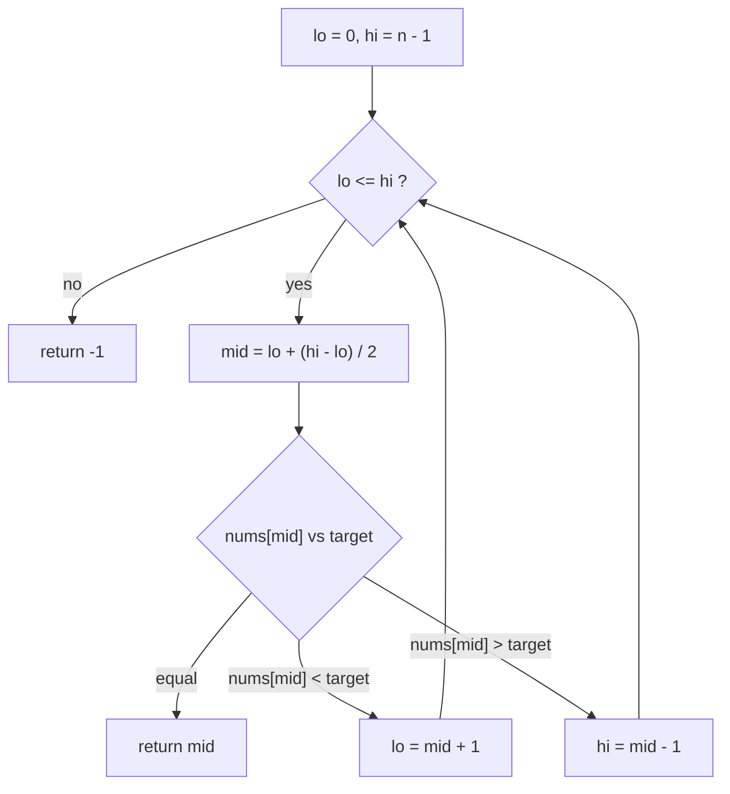

# Binary Search

> Halve the search space every step by comparing with the middle. `O(log n)`. Easy to describe, easy to get wrong: learn one template and use it every time.

#### 1. What Is It?

**Binary search** finds a target in a **sorted** array by repeatedly looking at the **middle** element:

- middle `==` target → found,
- middle `<` target → the target can only be to the **right**,
- middle `>` target → the target can only be to the **left**.

Each step throws away half of the remaining items, so 1,000,000 items need about 20 steps.

**Signals:** "sorted array", "find in `O(log n)`", "the array is huge".

#### 2. How It Works

```text
nums = [-1, 0, 3, 5, 9, 12], target 9
lo=0 hi=5  mid=2 (3)   3 < 9 → lo = mid + 1 = 3
lo=3 hi=5  mid=4 (9)   9 = 9 → found at index 4
```



**The template (closed interval `[lo, hi]`)**

```text
lo = 0, hi = n - 1
while lo <= hi:
    mid = lo + (hi - lo) / 2
    if nums[mid] == target: return mid
    if nums[mid] < target:  lo = mid + 1
    else:                   hi = mid - 1
return -1
```

**Why it is correct (loop invariant):** if the target is in the array, it is always inside `[lo, hi]`. Each step keeps that true and makes the interval smaller, so the loop ends.

**Why `lo + (hi − lo) / 2`:** `(lo + hi) / 2` can overflow `Int` when both are large. The subtraction form cannot.

**Iterations:** `⌊log₂ n⌋ + 1`. For `n = 10⁹` that is 30.

#### 3. Brute Force vs Optimized

| Approach | Time |
|---|---|
| Linear scan | `O(n)` |
| **Binary search** | **`O(log n)`** |
| Hash set | `O(1)` but needs `O(n)` memory and no order |

```kotlin
// Brute force: scan
fun searchLinear(nums: IntArray, target: Int): Int {
    for (i in nums.indices) if (nums[i] == target) return i
    return -1
}
```

#### 4. Kotlin Code

```kotlin
// Binary Search (LeetCode 704): iterative
fun search(nums: IntArray, target: Int): Int {
    var lo = 0
    var hi = nums.size - 1
    while (lo <= hi) {
        val mid = lo + (hi - lo) / 2
        when {
            nums[mid] == target -> return mid
            nums[mid] < target -> lo = mid + 1
            else -> hi = mid - 1
        }
    }
    return -1
}

// Recursive version
fun searchRec(nums: IntArray, target: Int, lo: Int = 0, hi: Int = nums.size - 1): Int {
    if (lo > hi) return -1
    val mid = lo + (hi - lo) / 2
    return when {
        nums[mid] == target -> mid
        nums[mid] < target -> searchRec(nums, target, mid + 1, hi)
        else -> searchRec(nums, target, lo, mid - 1)
    }
}
```

Checks: `search(intArrayOf(-1, 0, 3, 5, 9, 12), 9)` → `4`. `search(intArrayOf(-1, 0, 3, 5, 9, 12), 2)` → `-1`. `search(intArrayOf(5), 5)` → `0`. `search(intArrayOf(), 5)` → `-1`. `searchRec(intArrayOf(-1, 0, 3, 5, 9, 12), 9)` → `4`. `searchLinear(...)` agrees on all.

#### 5. Complexity

| | Time | Space |
|---|---|---|
| Iterative | `O(log n)` | `O(1)` |
| Recursive | `O(log n)` | `O(log n)` stack |

#### 6. Common Mistakes

1. **Unsorted input.**
2. **`(lo + hi) / 2` overflow.**
3. **`lo < hi` with `hi = mid − 1`** (misses the last element). Match the loop condition to the interval style.
4. **Not moving past `mid`** (`lo = mid` instead of `mid + 1`): infinite loop.
5. **Mixing the two styles** (closed `[lo, hi]` vs half-open `[lo, hi)`).
6. **Empty array:** `hi = −1`, the loop never runs, return `-1`.
7. **Duplicates:** this template returns **some** index, not the first (note 4).

#### 7. Say This in the Interview

1. "The array is sorted, so each comparison with the middle removes half of the candidates: `O(log n)` time, `O(1)` space."
2. "I'll use `mid = lo + (hi - lo) / 2` to avoid overflow, and keep the invariant that the target, if present, is always in `[lo, hi]`."
3. "I'll test: one element, two elements, target at each end, and a missing target."

#### 8. Quick Check

1. How many steps for 1,024 items at most?
2. What happens if you write `lo = mid` instead of `lo = mid + 1`?
3. What does the loop condition `lo <= hi` mean?

<details>
<summary>Answers</summary>

1. About 11 (`log₂ 1024 + 1`).
2. It can loop forever when `lo + 1 == hi`.
3. The interval `[lo, hi]` still contains at least one candidate.

</details>

#### 9. Related LeetCode Questions

| # | Question | Idea |
|---|---|---|
| 704 | [Binary Search](https://leetcode.com/problems/binary-search/) (Easy) | the template |
| 35 | [Search Insert Position](https://leetcode.com/problems/search-insert-position/) (Easy) | where it belongs |
| 278 | [First Bad Version](https://leetcode.com/problems/first-bad-version/) (Easy) | yes/no flips once |
| 69 | [Sqrt(x)](https://leetcode.com/problems/sqrtx/) (Easy) | search on the answer |
| 367 | [Valid Perfect Square](https://leetcode.com/problems/valid-perfect-square/) (Easy) | search a number range |
| 34 | [Find First and Last Position of Element in Sorted Array](https://leetcode.com/problems/find-first-and-last-position-of-element-in-sorted-array/) (Medium) | duplicates (note 4) |
