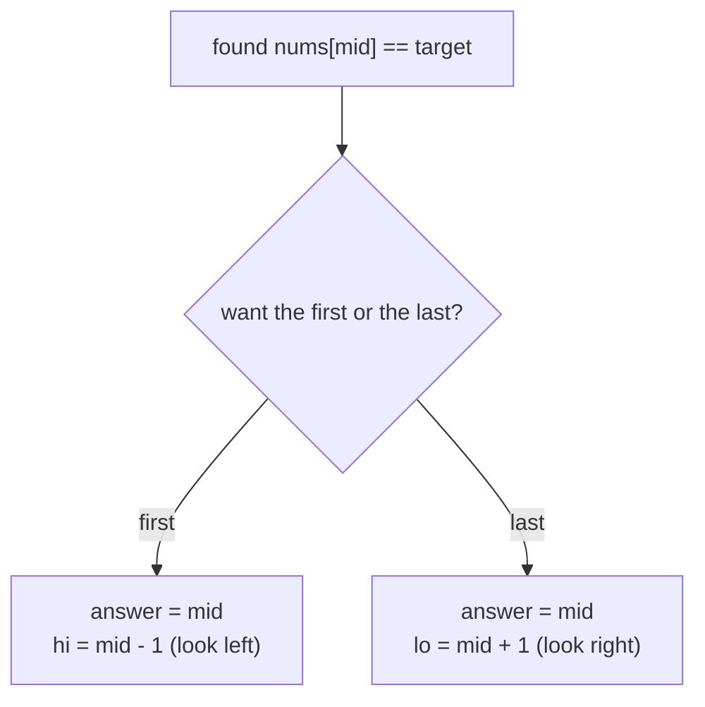

# First & Last Occurrence

> With duplicates, plain binary search returns **any** match. To get the **first** or **last** one, keep searching after you find it.

#### 1. What Is It?

In `[5, 7, 7, 8, 8, 10]`, the value `8` appears at indexes `3` and `4`. Problems ask for:

| Question | Answer for target 8 |
|---|---|
| first occurrence | `3` |
| last occurrence | `4` |
| how many times | `last − first + 1 = 2` |
| a range `[first, last]` | `[3, 4]` |

**Signals:** "first / last position", "leftmost / rightmost", "count of a value in a sorted array", "first bad version".

#### 2. How It Works

**First occurrence.** When you find the target, it might not be the leftmost. Remember it, then **keep searching to the left** (`hi = mid − 1`).

**Last occurrence.** When you find the target, remember it, then **keep searching to the right** (`lo = mid + 1`).

```text
nums = [5, 7, 7, 8, 8, 10], target 8,  looking for the FIRST
lo=0 hi=5  mid=2 (7) <8 → lo=3
lo=3 hi=5  mid=4 (8) =8 → answer=4, search left: hi=3
lo=3 hi=3  mid=3 (8) =8 → answer=3, search left: hi=2
lo=3 hi=2 → stop.   first = 3
```



**Cleaner: use lower bound (note 5).**

```text
first = lowerBound(target)                 the first index with nums[i] >= target
last  = lowerBound(target + 1) - 1         one before the first index with nums[i] >= target + 1
count = lowerBound(target + 1) - lowerBound(target)
```

If `first == n` or `nums[first] != target`, the value is not present.

**Same idea elsewhere:** *First Bad Version* is "the first index where the answer flips to bad". Any "first true" question uses this pattern.

#### 3. Brute Force vs Optimized

| Approach | Time |
|---|---|
| Linear scan for the first and last match | `O(n)` |
| Binary search, then walk left and right | `O(log n + k)`: `O(n)` if all items are equal |
| **Two binary searches** | **`O(log n)`** |

```kotlin
// Brute force: scan once
fun searchRangeBrute(nums: IntArray, target: Int): IntArray {
    var first = -1
    var last = -1
    for (i in nums.indices) if (nums[i] == target) { if (first == -1) first = i; last = i }
    return intArrayOf(first, last)
}
```

#### 4. Kotlin Code

```kotlin
// Find First and Last Position of Element in Sorted Array (LeetCode 34)
fun searchRange(nums: IntArray, target: Int): IntArray {
    fun findFirst(): Int {
        var lo = 0; var hi = nums.size - 1; var answer = -1
        while (lo <= hi) {
            val mid = lo + (hi - lo) / 2
            if (nums[mid] == target) { answer = mid; hi = mid - 1 }      // keep looking left
            else if (nums[mid] < target) lo = mid + 1
            else hi = mid - 1
        }
        return answer
    }
    fun findLast(): Int {
        var lo = 0; var hi = nums.size - 1; var answer = -1
        while (lo <= hi) {
            val mid = lo + (hi - lo) / 2
            if (nums[mid] == target) { answer = mid; lo = mid + 1 }      // keep looking right
            else if (nums[mid] < target) lo = mid + 1
            else hi = mid - 1
        }
        return answer
    }
    return intArrayOf(findFirst(), findLast())
}

// Count occurrences of a value in a sorted array
fun countOccurrences(nums: IntArray, target: Int): Int {
    val range = searchRange(nums, target)
    return if (range[0] == -1) 0 else range[1] - range[0] + 1
}

// First Bad Version (LeetCode 278): isBad is the API
fun firstBadVersion(n: Int, isBad: (Int) -> Boolean): Int {
    var lo = 1
    var hi = n
    while (lo < hi) {
        val mid = lo + (hi - lo) / 2
        if (isBad(mid)) hi = mid else lo = mid + 1        // the first bad is at mid or to its left
    }
    return lo
}
```

Checks: `searchRange(intArrayOf(5, 7, 7, 8, 8, 10), 8)` → `[3, 4]`. `searchRange(intArrayOf(5, 7, 7, 8, 8, 10), 6)` → `[-1, -1]`. `searchRange(intArrayOf(), 0)` → `[-1, -1]`. `searchRange(intArrayOf(2, 2), 2)` → `[0, 1]`. `searchRangeBrute(...)` agrees. `countOccurrences(intArrayOf(1, 2, 2, 2, 3), 2)` → `3`. `firstBadVersion(5) { it >= 4 }` → `4`. `firstBadVersion(1) { true }` → `1`.

#### 5. Complexity

| | Time | Space |
|---|---|---|
| First / last | `O(log n)` each | `O(1)` |
| Count | `O(log n)` | `O(1)` |

#### 6. Common Mistakes

1. **Returning at the first match** (gets any occurrence, not the first or last).
2. **Walking left and right** from a found index: `O(n)` when many duplicates.
3. **Forgetting to initialise `answer = -1`.**
4. **First bad version with `lo <= hi`** and `hi = mid` (infinite loop). Use `lo < hi`.
5. **Overflow** in `mid`.
6. **Not testing all-equal arrays** (`[2, 2, 2]`).

#### 7. Say This in the Interview

1. "A normal binary search returns any match. To find the first one I record the match and keep searching left. For the last one I keep searching right. Each is `O(log n)`."
2. "Equivalently, first = `lowerBound(target)` and last = `lowerBound(target + 1) − 1`."
3. "Walking out from a found index would be `O(n)` if every item is equal."

#### 8. Quick Check

1. How many times does `2` occur in `[1, 2, 2, 2, 3]`?
2. In the first-occurrence search, what do you do after finding the target?
3. What is `searchRange([1], 1)`?

<details>
<summary>Answers</summary>

1. `3`.
2. Save `mid` and set `hi = mid − 1`.
3. `[0, 0]`.

</details>

#### 9. Related LeetCode Questions

| # | Question | Idea |
|---|---|---|
| 34 | [Find First and Last Position of Element in Sorted Array](https://leetcode.com/problems/find-first-and-last-position-of-element-in-sorted-array/) (Medium) | two searches |
| 278 | [First Bad Version](https://leetcode.com/problems/first-bad-version/) (Easy) | first true |
| 744 | [Find Smallest Letter Greater Than Target](https://leetcode.com/problems/find-smallest-letter-greater-than-target/) (Easy) | upper bound |
| 1351 | [Count Negative Numbers in a Sorted Matrix](https://leetcode.com/problems/count-negative-numbers-in-a-sorted-matrix/) (Easy) | first negative per row |
| 2300 | [Successful Pairs of Spells and Potions](https://leetcode.com/problems/successful-pairs-of-spells-and-potions/) (Medium) | lower bound per spell |
| 1170 | [Compare Strings by Frequency of the Smallest Character](https://leetcode.com/problems/compare-strings-by-frequency-of-the-smallest-character/) (Medium) | upper bound |
