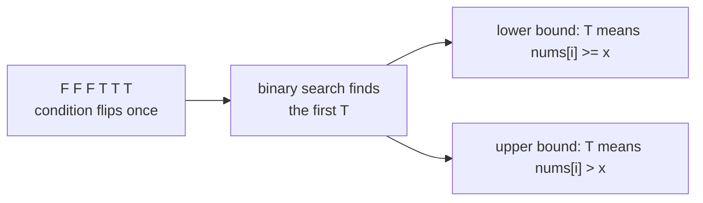

# Lower Bound / Upper Bound

> The two building blocks behind almost every binary-search variant. **Lower bound:** the first index with `nums[i] >= x`. **Upper bound:** the first index with `nums[i] > x`.

#### 1. What Is It?

For a sorted array and a value `x`:

| Name | Definition | If no such index |
|---|---|---|
| **lower bound** | the **first** index `i` with `nums[i] >= x` | `n` |
| **upper bound** | the **first** index `i` with `nums[i] > x` | `n` |

They are the C++ `std::lower_bound` and `std::upper_bound`. Kotlin has no direct version, so write them once and reuse.

**What you can do with them**

| Question | Formula |
|---|---|
| first occurrence of `x` | `lowerBound(x)` (check `nums[i] == x`) |
| last occurrence of `x` | `upperBound(x) − 1` |
| count of `x` | `upperBound(x) − lowerBound(x)` |
| count of values in `[a, b]` | `upperBound(b) − lowerBound(a)` |
| insert position | `lowerBound(x)` |
| largest value `<= x` (floor) | `nums[upperBound(x) − 1]` |
| smallest value `>= x` (ceiling) | `nums[lowerBound(x)]` |

#### 2. How It Works

Both use the **first true** template on the half-open range `[0, n]`:

```text
lo = 0, hi = n                       // hi = n means "none satisfy"
while lo < hi:
    mid = lo + (hi - lo) / 2
    if condition(mid): hi = mid      // mid might be the answer, keep it
    else:              lo = mid + 1
return lo
```

- lower bound: `condition(mid)` is `nums[mid] >= x`.
- upper bound: `condition(mid)` is `nums[mid] > x`.

```text
nums = [1, 2, 2, 2, 3, 5]
x = 2:  lowerBound = 1 (first 2)     upperBound = 4 (first value > 2, which is 3)
        count of 2 = 4 - 1 = 3
x = 4:  lowerBound = 5 (the 5)       upperBound = 5
x = 9:  lowerBound = 6 = n           upperBound = 6   (no such value)
```



Only the **condition** differs. If you remember the template, you can derive both.

#### 3. Brute Force vs Optimized

| Question | Brute force | With bounds |
|---|---|---|
| Count of `x` | scan `O(n)` | two binary searches `O(log n)` |
| Count values in `[a, b]` | scan `O(n)` | `O(log n)` |
| Many range-count queries | `O(n)` each | `O(log n)` each after sorting |

```kotlin
// Brute force: count values in [a, b] by scanning
fun countInRangeBrute(nums: IntArray, a: Int, b: Int): Int = nums.count { it in a..b }
```

#### 4. Kotlin Code

```kotlin
// First index with nums[i] >= x (n if none)
fun lowerBound(nums: IntArray, x: Int): Int {
    var lo = 0
    var hi = nums.size
    while (lo < hi) {
        val mid = lo + (hi - lo) / 2
        if (nums[mid] >= x) hi = mid else lo = mid + 1
    }
    return lo
}

// First index with nums[i] > x (n if none)
fun upperBound(nums: IntArray, x: Int): Int {
    var lo = 0
    var hi = nums.size
    while (lo < hi) {
        val mid = lo + (hi - lo) / 2
        if (nums[mid] > x) hi = mid else lo = mid + 1
    }
    return lo
}

fun countOf(nums: IntArray, x: Int): Int = upperBound(nums, x) - lowerBound(nums, x)

fun countInRange(nums: IntArray, a: Int, b: Int): Int = upperBound(nums, b) - lowerBound(nums, a)
```

Checks (`nums = [1, 2, 2, 2, 3, 5]`): `lowerBound(nums, 2)` → `1`. `upperBound(nums, 2)` → `4`. `lowerBound(nums, 4)` → `5`. `lowerBound(nums, 9)` → `6`. `lowerBound(nums, 0)` → `0`. `countOf(nums, 2)` → `3`. `countOf(nums, 4)` → `0`. `countInRange(nums, 2, 3)` → `4`. `countInRangeBrute(nums, 2, 3)` → `4`. On an empty array both bounds return `0`.

#### 5. Complexity

| | Time | Space |
|---|---|---|
| `lowerBound`, `upperBound` | `O(log n)` | `O(1)` |
| Count, range count | `O(log n)` | `O(1)` |

#### 6. Common Mistakes

1. **Confusing `>=` and `>`.** Lower bound uses `>=`, upper bound uses `>`.
2. **`hi = n − 1`** (cannot return `n` for "none"). Use `hi = n`.
3. **`hi = mid − 1`** in this template (it must be `hi = mid`).
4. **Forgetting to check `nums[i] == x`** after lower bound when you need an exact match.
5. **Using `lo <= hi`** with this template (infinite loop with `hi = mid`).
6. **Reading `nums[n]`** when the bound is `n`.

#### 7. Say This in the Interview

1. "Lower bound is the first index with `nums[i] >= x`, upper bound the first with `nums[i] > x`. Both are the same binary search with a different condition."
2. "The count of `x` is `upperBound − lowerBound`, and the insert position is `lowerBound`."
3. "I use `hi = n` so the answer can be 'past the end', and `hi = mid` so I never skip the candidate."

#### 8. Quick Check

1. `lowerBound([1, 3, 5], 4)`?
2. `upperBound([1, 3, 5], 3)`?
3. Count of values in `[2, 5]` in `[1, 3, 5, 7]`?

<details>
<summary>Answers</summary>

1. `2` (the `5`).
2. `2` (the `5`).
3. `upperBound(5) − lowerBound(2) = 3 − 1 = 2` (`3` and `5`).

</details>

#### 9. Related LeetCode Questions

| # | Question | Idea |
|---|---|---|
| 35 | [Search Insert Position](https://leetcode.com/problems/search-insert-position/) (Easy) | lower bound |
| 34 | [Find First and Last Position of Element in Sorted Array](https://leetcode.com/problems/find-first-and-last-position-of-element-in-sorted-array/) (Medium) | both bounds |
| 744 | [Find Smallest Letter Greater Than Target](https://leetcode.com/problems/find-smallest-letter-greater-than-target/) (Easy) | upper bound |
| 2300 | [Successful Pairs of Spells and Potions](https://leetcode.com/problems/successful-pairs-of-spells-and-potions/) (Medium) | lower bound |
| 1385 | [Find the Distance Value Between Two Arrays](https://leetcode.com/problems/find-the-distance-value-between-two-arrays/) (Easy) | closest value |
| 981 | [Time Based Key-Value Store](https://leetcode.com/problems/time-based-key-value-store/) (Medium) | upper bound on timestamps |
