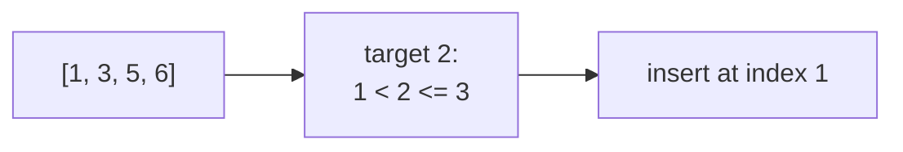

# Search Insert Position

> Where would `x` go to keep the array sorted? It is the **lower bound**. The same idea gives floor, ceiling and "smallest value greater than".

#### 1. What Is It?

**Search Insert Position** (LeetCode 35): given a sorted array of distinct integers and a target, return the index of the target if present, or the index where it would be inserted to keep the order.

| `nums = [1, 3, 5, 6]` | Answer |
|---|---|
| target `5` | `2` (found) |
| target `2` | `1` (insert between 1 and 3) |
| target `7` | `4` (insert at the end) |
| target `0` | `0` (insert at the front) |

The answer is the **first index with `nums[i] >= target`**: the lower bound from note 5.

**Related questions with the same idea**

| Question | Use |
|---|---|
| **Find Smallest Letter Greater Than Target** (744) | upper bound, wrap to the first letter |
| **Sqrt(x)** (69) | the largest `m` with `m × m <= x`: an insert-position style search |
| **Valid Perfect Square** (367) | search `1..x` |
| **Arranging Coins** (441) | largest `k` with `k(k + 1)/2 <= n` |

**Signals:** "insert position", "where would it go", "first element `>=`", "smallest value greater than", "integer square root".

#### 2. How It Works

```text
nums = [1, 3, 5, 6], target 2
lo=0 hi=4  mid=2 (5) >= 2 → hi=2
lo=0 hi=2  mid=1 (3) >= 2 → hi=1
lo=0 hi=1  mid=0 (1) <  2 → lo=1
lo=1 hi=1  → stop, answer 1
```



**Integer square root as a search.** The condition "`m × m > x`" flips from false to true as `m` grows. The answer is the last `m` where it is false, which is `firstTrue − 1`. Use `Long` for `m × m` to avoid overflow.

```text
x = 8: m*m > 8 first becomes true at m = 3 → answer 3 - 1 = 2
```

**Floor and ceiling:**

- ceiling (smallest `>= x`) = `nums[lowerBound(x)]` (if in range)
- floor (largest `<= x`) = `nums[upperBound(x) − 1]` (if `>= 0`)

#### 3. Brute Force vs Optimized

| Approach | Time |
|---|---|
| Scan for the first item `>= target` | `O(n)` |
| **Lower bound (binary search)** | **`O(log n)`** |
| Square root by trying `1, 2, 3, ...` | `O(√x)` |
| Square root by binary search | `O(log x)` |

```kotlin
// Brute force: scan
fun searchInsertBrute(nums: IntArray, target: Int): Int {
    for (i in nums.indices) if (nums[i] >= target) return i
    return nums.size
}

// Brute force integer square root
fun mySqrtBrute(x: Int): Int {
    var m = 0L
    while ((m + 1) * (m + 1) <= x) m++
    return m.toInt()
}
```

#### 4. Kotlin Code

```kotlin
// Search Insert Position (LeetCode 35)
fun searchInsert(nums: IntArray, target: Int): Int {
    var lo = 0
    var hi = nums.size
    while (lo < hi) {
        val mid = lo + (hi - lo) / 2
        if (nums[mid] >= target) hi = mid else lo = mid + 1
    }
    return lo
}

// Find Smallest Letter Greater Than Target (LeetCode 744)
fun nextGreatestLetter(letters: CharArray, target: Char): Char {
    var lo = 0
    var hi = letters.size
    while (lo < hi) {
        val mid = lo + (hi - lo) / 2
        if (letters[mid] > target) hi = mid else lo = mid + 1
    }
    return letters[lo % letters.size]                    // wrap around to the first letter
}

// Sqrt(x) (LeetCode 69)
fun mySqrt(x: Int): Int {
    var lo = 0L
    var hi = x.toLong() + 1                              // first m with m*m > x
    while (lo < hi) {
        val mid = lo + (hi - lo) / 2
        if (mid * mid > x) hi = mid else lo = mid + 1
    }
    return (lo - 1).toInt()
}
```

Checks: `searchInsert(intArrayOf(1, 3, 5, 6), 5)` → `2`; `(…, 2)` → `1`; `(…, 7)` → `4`; `(…, 0)` → `0`. `searchInsertBrute(intArrayOf(1, 3, 5, 6), 2)` → `1`. `nextGreatestLetter(charArrayOf('c', 'f', 'j'), 'a')` → `'c'`; `('c')` → `'f'`; `('j')` → `'c'` (wraps). `mySqrt(8)` → `2`; `mySqrt(4)` → `2`; `mySqrt(0)` → `0`; `mySqrt(1)` → `1`; `mySqrt(2147395599)` → `46339`. `mySqrtBrute(8)` → `2`.

#### 5. Complexity

| | Time | Space |
|---|---|---|
| Search insert | `O(log n)` | `O(1)` |
| Sqrt | `O(log x)` | `O(1)` |

#### 6. Common Mistakes

1. **Returning `-1` when not found.** Here you must return the insert position.
2. **`hi = n − 1`** (cannot return `n` for "insert at the end").
3. **Sqrt overflow:** `mid * mid` with `Int`. Use `Long`.
4. **Sqrt off by one** (returning the first `m` with `m² > x` instead of one less).
5. **744:** forgetting the wrap-around (`% size`).
6. **Duplicates:** lower bound gives the **first** equal item, which is the standard insert position.

#### 7. Say This in the Interview

1. "The insert position is the first index with `nums[i] >= target`, which is a lower bound. I use `hi = n` so 'after the last element' is a valid answer."
2. "For the integer square root I binary search the largest `m` with `m × m <= x`, using `Long` so `m × m` can't overflow."
3. "Both are `O(log n)` with `O(1)` space."

#### 8. Quick Check

1. Insert position of `10` in `[1, 3, 5]`?
2. `mySqrt(15)`?
3. Why use `hi = n` and not `n − 1`?

<details>
<summary>Answers</summary>

1. `3` (at the end).
2. `3`.
3. So the answer `n` ("past the end") can be returned when every element is smaller than the target.

</details>

#### 9. Related LeetCode Questions

| # | Question | Idea |
|---|---|---|
| 35 | [Search Insert Position](https://leetcode.com/problems/search-insert-position/) (Easy) | lower bound |
| 744 | [Find Smallest Letter Greater Than Target](https://leetcode.com/problems/find-smallest-letter-greater-than-target/) (Easy) | upper bound + wrap |
| 69 | [Sqrt(x)](https://leetcode.com/problems/sqrtx/) (Easy) | search on a number range |
| 367 | [Valid Perfect Square](https://leetcode.com/problems/valid-perfect-square/) (Easy) | same |
| 441 | [Arranging Coins](https://leetcode.com/problems/arranging-coins/) (Easy) | largest `k` that fits |
| 278 | [First Bad Version](https://leetcode.com/problems/first-bad-version/) (Easy) | first true |
