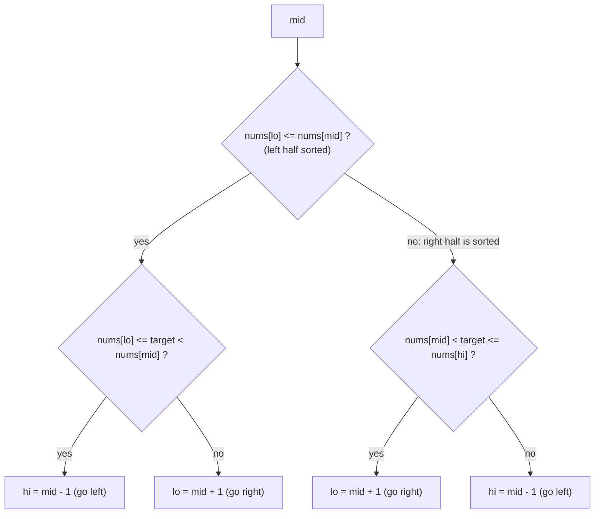

# Binary Search on Rotated Sorted Array

> A sorted array rotated at an unknown pivot. At any `mid`, **one half is always sorted**. Decide which half, then decide if the target lies in it.

#### 1. What Is It?

A sorted array `[0, 1, 2, 4, 5, 6, 7]` rotated by 4 becomes `[4, 5, 6, 7, 0, 1, 2]`. It is two sorted runs joined: `[4..7]` then `[0..2]`.

Normal binary search fails, because "`nums[mid] < target`" no longer tells you which side the target is on. But you can still halve the space.

**Signals:** "sorted array rotated", "pivot", "search in `O(log n)`" on a rotated array.

#### 2. How It Works

**The key fact:** in `[lo, hi]`, at least one of `[lo, mid]` and `[mid, hi]` is a **sorted** run.

```text
nums = [4, 5, 6, 7, 0, 1, 2], target 0
lo=0 hi=6  mid=3 (7)
   left half [4..7] is sorted (nums[lo]=4 <= nums[mid]=7)
   is the target in [4, 7)? 0 is not → go right: lo = 4
lo=4 hi=6  mid=5 (1)
   left half [0..1] is sorted (0 <= 1).  is 0 in [0, 1)? yes → go left: hi = 4
lo=4 hi=4  mid=4 (0) = target → found at index 4
```



**With duplicates (LeetCode 81).** If `nums[lo] == nums[mid] == nums[hi]`, you cannot tell which half is sorted. Shrink both ends (`lo++`, `hi--`). That can degrade to `O(n)` (for example `[1, 1, 1, 1, 1, 2, 1]`).

#### 3. Brute Force vs Optimized

| Approach | Time |
|---|---|
| Linear scan | `O(n)` |
| Find the pivot, then binary search in the right half | `O(log n)` (two passes) |
| **One modified binary search** | **`O(log n)`** |
| With duplicates | `O(log n)` average, `O(n)` worst case |

```kotlin
// Brute force: scan
fun searchRotatedBrute(nums: IntArray, target: Int): Int {
    for (i in nums.indices) if (nums[i] == target) return i
    return -1
}
```

#### 4. Kotlin Code

```kotlin
// Search in Rotated Sorted Array (LeetCode 33): distinct values
fun searchRotated(nums: IntArray, target: Int): Int {
    var lo = 0
    var hi = nums.size - 1
    while (lo <= hi) {
        val mid = lo + (hi - lo) / 2
        if (nums[mid] == target) return mid
        if (nums[lo] <= nums[mid]) {                                  // left half is sorted
            if (target >= nums[lo] && target < nums[mid]) hi = mid - 1 else lo = mid + 1
        } else {                                                      // right half is sorted
            if (target > nums[mid] && target <= nums[hi]) lo = mid + 1 else hi = mid - 1
        }
    }
    return -1
}

// Search in Rotated Sorted Array II (LeetCode 81): duplicates allowed, returns true / false
fun searchRotatedWithDuplicates(nums: IntArray, target: Int): Boolean {
    var lo = 0
    var hi = nums.size - 1
    while (lo <= hi) {
        val mid = lo + (hi - lo) / 2
        if (nums[mid] == target) return true
        if (nums[lo] == nums[mid] && nums[mid] == nums[hi]) { lo++; hi-- }       // cannot decide: shrink
        else if (nums[lo] <= nums[mid]) {
            if (target >= nums[lo] && target < nums[mid]) hi = mid - 1 else lo = mid + 1
        } else {
            if (target > nums[mid] && target <= nums[hi]) lo = mid + 1 else hi = mid - 1
        }
    }
    return false
}
```

Checks: `searchRotated(intArrayOf(4, 5, 6, 7, 0, 1, 2), 0)` → `4`; `(…, 3)` → `-1`. `searchRotated(intArrayOf(1), 0)` → `-1`. `searchRotated(intArrayOf(1), 1)` → `0`. `searchRotated(intArrayOf(3, 1), 1)` → `1`. `searchRotatedBrute(intArrayOf(4, 5, 6, 7, 0, 1, 2), 0)` → `4`. `searchRotatedWithDuplicates(intArrayOf(2, 5, 6, 0, 0, 1, 2), 0)` → `true`; `(…, 3)` → `false`. `searchRotatedWithDuplicates(intArrayOf(1, 0, 1, 1, 1), 0)` → `true`.

#### 5. Complexity

| | Time | Space |
|---|---|---|
| Distinct values | `O(log n)` | `O(1)` |
| With duplicates | `O(log n)` average, `O(n)` worst | `O(1)` |

#### 6. Common Mistakes

1. **`nums[lo] < nums[mid]`** instead of `<=` (breaks when `lo == mid`, e.g. two elements).
2. **Wrong range checks** (`target <= nums[mid]` instead of `< nums[mid]`; `mid` is already tested).
3. **Treating the array as unrotated** (a rotation of 0 is allowed).
4. **Duplicates with the distinct-values code** (loops or wrong answers).
5. **Searching for the pivot first and mixing indexes** (extra complexity, more bugs).
6. **Forgetting `hi = mid − 1` / `lo = mid + 1`** (infinite loop).

#### 7. Say This in the Interview

1. "At any `mid`, one half is sorted. I check which half, then whether the target is inside that half's range, and move to the right side accordingly. `O(log n)`."
2. "With duplicates I can't always tell which half is sorted: when `nums[lo] == nums[mid] == nums[hi]` I shrink both ends, so the worst case is `O(n)`."
3. "I'll test a two-element array and an array that isn't rotated."

#### 8. Quick Check

1. Which half is sorted if `nums[lo] <= nums[mid]`?
2. Why `<=` and not `<`?
3. Worst-case time with duplicates?

<details>
<summary>Answers</summary>

1. The left half `[lo, mid]`.
2. When `lo == mid` the left "half" is one element, which is sorted.
3. `O(n)`.

</details>

#### 9. Related LeetCode Questions

| # | Question | Idea |
|---|---|---|
| 33 | [Search in Rotated Sorted Array](https://leetcode.com/problems/search-in-rotated-sorted-array/) (Medium) | find the sorted half |
| 81 | [Search in Rotated Sorted Array II](https://leetcode.com/problems/search-in-rotated-sorted-array-ii/) (Medium) | duplicates |
| 153 | [Find Minimum in Rotated Sorted Array](https://leetcode.com/problems/find-minimum-in-rotated-sorted-array/) (Medium) | note 8 |
| 154 | [Find Minimum in Rotated Sorted Array II](https://leetcode.com/problems/find-minimum-in-rotated-sorted-array-ii/) (Hard) | note 8 |
| 1752 | [Check if Array Is Sorted and Rotated](https://leetcode.com/problems/check-if-array-is-sorted-and-rotated/) (Easy) | count the drops |
| 189 | [Rotate Array](https://leetcode.com/problems/rotate-array/) (Medium) | the rotation itself |
