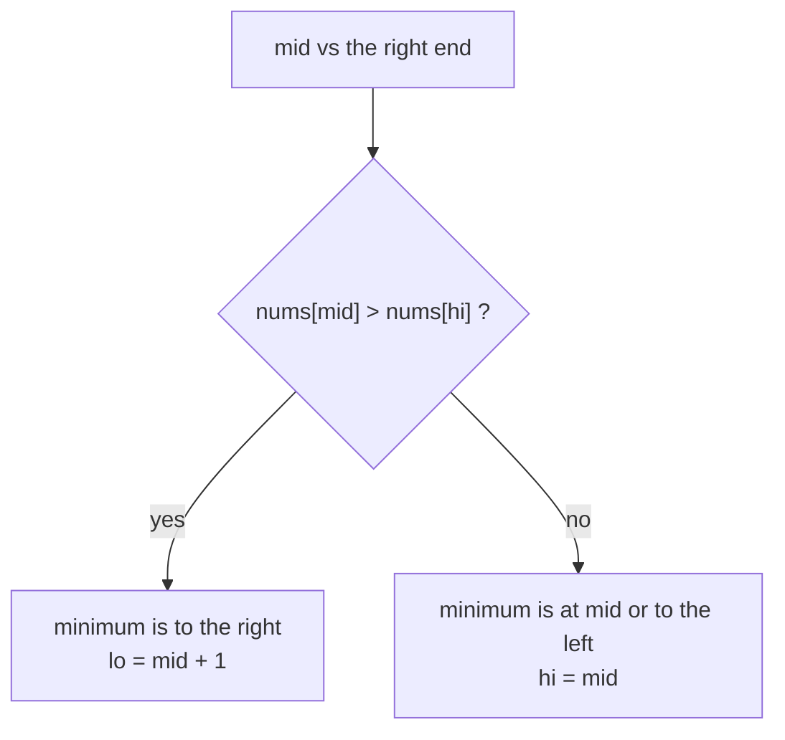

# Find Minimum in Rotated Sorted Array

> The minimum is the **pivot**, where the array drops. Compare `mid` with `hi` to decide which side the pivot is on.

#### 1. What Is It?

In a rotated sorted array `[3, 4, 5, 1, 2]` the minimum (`1`) is the point where the order breaks. Find it in `O(log n)`.

**Why it matters:** the pivot gives the rotation count, and it is a building block for searching a rotated array (note 7).

**Signals:** "minimum in a rotated sorted array", "how many times was it rotated", "find the pivot".

#### 2. How It Works

Compare `nums[mid]` with the **right end** `nums[hi]`:

| Case | Meaning | Move |
|---|---|---|
| `nums[mid] > nums[hi]` | the drop is to the **right** of `mid` | `lo = mid + 1` |
| `nums[mid] < nums[hi]` | `mid` to `hi` is sorted, so the minimum is at `mid` or to its **left** | `hi = mid` |
| `nums[mid] == nums[hi]` (duplicates) | cannot tell | `hi--` |

```text
nums = [4, 5, 6, 7, 0, 1, 2]
lo=0 hi=6  mid=3 (7)  7 > 2  → min is right of mid: lo = 4
lo=4 hi=6  mid=5 (1)  1 < 2  → min is at mid or left: hi = 5
lo=4 hi=5  mid=4 (0)  0 < 1  → hi = 4
lo=4 hi=4 → answer nums[4] = 0
```



**Why compare with `hi` and not `lo`?** Comparing with `lo` is ambiguous when the array is not rotated at all (`[1, 2, 3]`). The right end always tells you whether `mid` is in the "big" left run.

**Loop:** `while (lo < hi)`, with `hi = mid` (not `mid − 1`), because `mid` could be the minimum.

**Rotation count** = the index of the minimum.

**Duplicates (LeetCode 154):** when `nums[mid] == nums[hi]`, the minimum could be on either side, so drop `hi` by one. Worst case `O(n)` (for example `[1, 1, 1, 1]`).

#### 3. Brute Force vs Optimized

| Approach | Time |
|---|---|
| Scan for the smallest | `O(n)` |
| **Binary search with `nums[hi]`** | **`O(log n)`** |
| With duplicates | `O(log n)` average, `O(n)` worst |

```kotlin
fun findMinBrute(nums: IntArray): Int = nums.minOrNull()!!
```

#### 4. Kotlin Code

```kotlin
// Find Minimum in Rotated Sorted Array (LeetCode 153): distinct values
fun findMin(nums: IntArray): Int {
    var lo = 0
    var hi = nums.size - 1
    while (lo < hi) {
        val mid = lo + (hi - lo) / 2
        if (nums[mid] > nums[hi]) lo = mid + 1 else hi = mid
    }
    return nums[lo]
}

// Find Minimum in Rotated Sorted Array II (LeetCode 154): duplicates allowed
fun findMinWithDuplicates(nums: IntArray): Int {
    var lo = 0
    var hi = nums.size - 1
    while (lo < hi) {
        val mid = lo + (hi - lo) / 2
        when {
            nums[mid] > nums[hi] -> lo = mid + 1
            nums[mid] < nums[hi] -> hi = mid
            else -> hi--                                       // equal: cannot decide, shrink
        }
    }
    return nums[lo]
}

// How many times was the sorted array rotated? (the index of the minimum)
fun rotationCount(nums: IntArray): Int {
    var lo = 0
    var hi = nums.size - 1
    while (lo < hi) {
        val mid = lo + (hi - lo) / 2
        if (nums[mid] > nums[hi]) lo = mid + 1 else hi = mid
    }
    return lo
}
```

Checks: `findMin(intArrayOf(3, 4, 5, 1, 2))` → `1`. `findMin(intArrayOf(4, 5, 6, 7, 0, 1, 2))` → `0`. `findMin(intArrayOf(11, 13, 15, 17))` → `11`. `findMin(intArrayOf(2, 1))` → `1`. `findMin(intArrayOf(5))` → `5`. `findMinBrute(intArrayOf(3, 4, 5, 1, 2))` → `1`. `findMinWithDuplicates(intArrayOf(2, 2, 2, 0, 1))` → `0`. `findMinWithDuplicates(intArrayOf(1, 3, 5))` → `1`. `rotationCount(intArrayOf(4, 5, 6, 7, 0, 1, 2))` → `4`. `rotationCount(intArrayOf(1, 2, 3))` → `0`.

#### 5. Complexity

| | Time | Space |
|---|---|---|
| Distinct | `O(log n)` | `O(1)` |
| Duplicates | `O(log n)` average, `O(n)` worst | `O(1)` |

#### 6. Common Mistakes

1. **Comparing `mid` with `lo`** (wrong for an unrotated array).
2. **`hi = mid − 1`** (skips a possible minimum).
3. **`lo <= hi`** with `hi = mid` (infinite loop).
4. **Duplicates:** `hi = mid` when equal can skip the minimum. Use `hi--`.
5. **Returning the index when the value is wanted** (or the reverse).
6. **Empty or one-element array** (handle it).

#### 7. Say This in the Interview

1. "I compare `nums[mid]` with `nums[hi]`. If `mid` is bigger, the drop is to the right, so `lo = mid + 1`. Otherwise the minimum is at `mid` or to its left, so `hi = mid`. `O(log n)`."
2. "I compare with `hi`, not `lo`, so an array that wasn't rotated also works."
3. "With duplicates, equal values force `hi--`, so the worst case is `O(n)`."

#### 8. Quick Check

1. `findMin([2, 1])`?
2. Why `hi = mid` and not `mid − 1`?
3. What is the rotation count of an unrotated array?

<details>
<summary>Answers</summary>

1. `1`.
2. `mid` itself may be the minimum, so it must stay in the range.
3. `0`.

</details>

#### 9. Related LeetCode Questions

| # | Question | Idea |
|---|---|---|
| 153 | [Find Minimum in Rotated Sorted Array](https://leetcode.com/problems/find-minimum-in-rotated-sorted-array/) (Medium) | compare with `hi` |
| 154 | [Find Minimum in Rotated Sorted Array II](https://leetcode.com/problems/find-minimum-in-rotated-sorted-array-ii/) (Hard) | duplicates |
| 33 | [Search in Rotated Sorted Array](https://leetcode.com/problems/search-in-rotated-sorted-array/) (Medium) | note 7 |
| 1752 | [Check if Array Is Sorted and Rotated](https://leetcode.com/problems/check-if-array-is-sorted-and-rotated/) (Easy) | one drop at most |
| 896 | [Monotonic Array](https://leetcode.com/problems/monotonic-array/) (Easy) | order check |
| 162 | [Find Peak Element](https://leetcode.com/problems/find-peak-element/) (Medium) | a similar shape |
