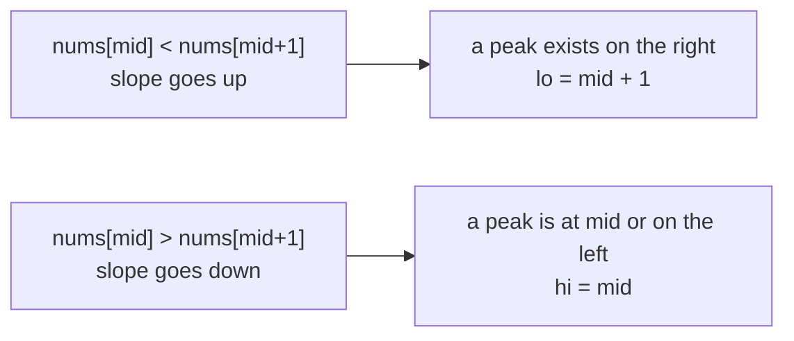

# Peak Element

> Binary search without a sorted array. Compare `mid` with its **neighbour**: the slope tells you which side must contain a peak.

#### 1. What Is It?

A **peak** is an element strictly greater than its neighbours. In `[1, 2, 3, 1]` the peak is `3` (index 2). In `[1, 2, 1, 3, 5, 6, 4]` there are two peaks (`2` and `6`). **Find any one** in `O(log n)`.

The array is **not sorted**, but binary search still works because of the **slope**.

| Question | Idea |
|---|---|
| **Find Peak Element** (162) | any peak; neighbours are never equal |
| **Peak Index in a Mountain Array** (852) | the one peak of an increasing-then-decreasing array |
| **Find in Mountain Array** (1095) | peak, then search both sides |

**Signals:** "find a peak", "mountain array", "increasing then decreasing", "neighbours differ".

#### 2. How It Works

Look at `nums[mid]` and `nums[mid + 1]`:

| Case | Slope | A peak is... | Move |
|---|---|---|---|
| `nums[mid] < nums[mid + 1]` | going **up** | to the **right** (the values must come down eventually, or hit the end) | `lo = mid + 1` |
| `nums[mid] > nums[mid + 1]` | going **down** | at `mid` or to the **left** | `hi = mid` |

```text
nums = [1, 2, 1, 3, 5, 6, 4]
lo=0 hi=6  mid=3 (3), next 5: 3 < 5 → up → lo = 4
lo=4 hi=6  mid=5 (6), next 4: 6 > 4 → down → hi = 5
lo=4 hi=5  mid=4 (5), next 6: 5 < 6 → up → lo = 5
lo=5 hi=5 → peak at index 5 (value 6)
```



**Why a peak must exist on the side you move to:** if the slope goes up, either the array keeps rising until its last element (a peak, because `nums[n] = −∞`), or it turns down somewhere, which makes a peak there.

**Boundary assumption:** `nums[−1] = nums[n] = −∞`, so the ends can be peaks.

#### 3. Brute Force vs Optimized

| Approach | Time |
|---|---|
| Scan for an element bigger than both neighbours | `O(n)` |
| Scan for the maximum | `O(n)` (the maximum is always a peak) |
| **Binary search on the slope** | **`O(log n)`** |

```kotlin
// Brute force: the global maximum is always a peak
fun findPeakBrute(nums: IntArray): Int {
    var best = 0
    for (i in nums.indices) if (nums[i] > nums[best]) best = i
    return best
}
```

#### 4. Kotlin Code

```kotlin
// Find Peak Element (LeetCode 162)
fun findPeakElement(nums: IntArray): Int {
    var lo = 0
    var hi = nums.size - 1
    while (lo < hi) {
        val mid = lo + (hi - lo) / 2
        if (nums[mid] < nums[mid + 1]) lo = mid + 1 else hi = mid       // follow the slope up
    }
    return lo
}

// Peak Index in a Mountain Array (LeetCode 852)
fun peakIndexInMountainArray(arr: IntArray): Int {
    var lo = 0
    var hi = arr.size - 1
    while (lo < hi) {
        val mid = lo + (hi - lo) / 2
        if (arr[mid] < arr[mid + 1]) lo = mid + 1 else hi = mid
    }
    return lo
}

// Search in a mountain array: find the peak, then binary search each side
fun searchMountain(arr: IntArray, target: Int): Int {
    val peak = peakIndexInMountainArray(arr)
    var lo = 0
    var hi = peak
    while (lo <= hi) {                                                   // increasing side
        val mid = lo + (hi - lo) / 2
        if (arr[mid] == target) return mid
        if (arr[mid] < target) lo = mid + 1 else hi = mid - 1
    }
    lo = peak + 1
    hi = arr.size - 1
    while (lo <= hi) {                                                   // decreasing side
        val mid = lo + (hi - lo) / 2
        if (arr[mid] == target) return mid
        if (arr[mid] > target) lo = mid + 1 else hi = mid - 1
    }
    return -1
}
```

Checks: `findPeakElement(intArrayOf(1, 2, 3, 1))` → `2`. `findPeakElement(intArrayOf(1, 2, 1, 3, 5, 6, 4))` → `5` (index 1 is also a valid peak; any is accepted). `findPeakElement(intArrayOf(1))` → `0`. `findPeakElement(intArrayOf(3, 2, 1))` → `0`. `findPeakBrute(intArrayOf(1, 2, 1, 3, 5, 6, 4))` → `5`. `peakIndexInMountainArray(intArrayOf(0, 2, 1, 0))` → `1`. `peakIndexInMountainArray(intArrayOf(0, 10, 5, 2))` → `1`. `searchMountain(intArrayOf(1, 2, 3, 4, 5, 3, 1), 3)` → `2` (the smaller index). `searchMountain(intArrayOf(0, 1, 2, 4, 2, 1), 3)` → `-1`.

#### 5. Complexity

| | Time | Space |
|---|---|---|
| Find peak | `O(log n)` | `O(1)` |
| Mountain search | `O(log n)` | `O(1)` |

#### 6. Common Mistakes

1. **Comparing `mid` with `mid − 1`** and going out of range at `mid = 0`. Compare with `mid + 1` and use `lo < hi`, so `mid + 1` is always valid.
2. **`hi = mid − 1`** (could skip the peak).
3. **Assuming one peak.** In 162 there may be many, and any is accepted.
4. **Equal neighbours** (not allowed in 162; if allowed, the slope trick fails).
5. **Searching the wrong direction** on the decreasing side of a mountain.
6. **Forgetting the one-element array.**

#### 7. Say This in the Interview

1. "The array isn't sorted, but at `mid` I compare with `mid + 1`. If it goes up, there's a peak to the right. If it goes down, there's a peak at `mid` or to the left. That halves the range: `O(log n)`."
2. "The ends count as peaks, since I treat the outside as minus infinity."
3. "For a mountain array I find the peak first, then binary search the increasing side and the decreasing side."

#### 8. Quick Check

1. Peak index of `[1, 3, 2]`?
2. If `nums[mid] > nums[mid + 1]`, which range do you keep?
3. Does 162 guarantee a unique peak?

<details>
<summary>Answers</summary>

1. `1`.
2. `[lo, mid]` (set `hi = mid`).
3. No, any peak is accepted.

</details>

#### 9. Related LeetCode Questions

| # | Question | Idea |
|---|---|---|
| 162 | [Find Peak Element](https://leetcode.com/problems/find-peak-element/) (Medium) | slope search |
| 852 | [Peak Index in a Mountain Array](https://leetcode.com/problems/peak-index-in-a-mountain-array/) (Medium) | one peak |
| 1095 | [Find in Mountain Array](https://leetcode.com/problems/find-in-mountain-array/) (Hard) | peak + two searches |
| 941 | [Valid Mountain Array](https://leetcode.com/problems/valid-mountain-array/) (Easy) | one pass |
| 1346 | [Check If N and Its Double Exist](https://leetcode.com/problems/check-if-n-and-its-double-exist/) (Easy) | search variants |
| 153 | [Find Minimum in Rotated Sorted Array](https://leetcode.com/problems/find-minimum-in-rotated-sorted-array/) (Medium) | similar shape |
