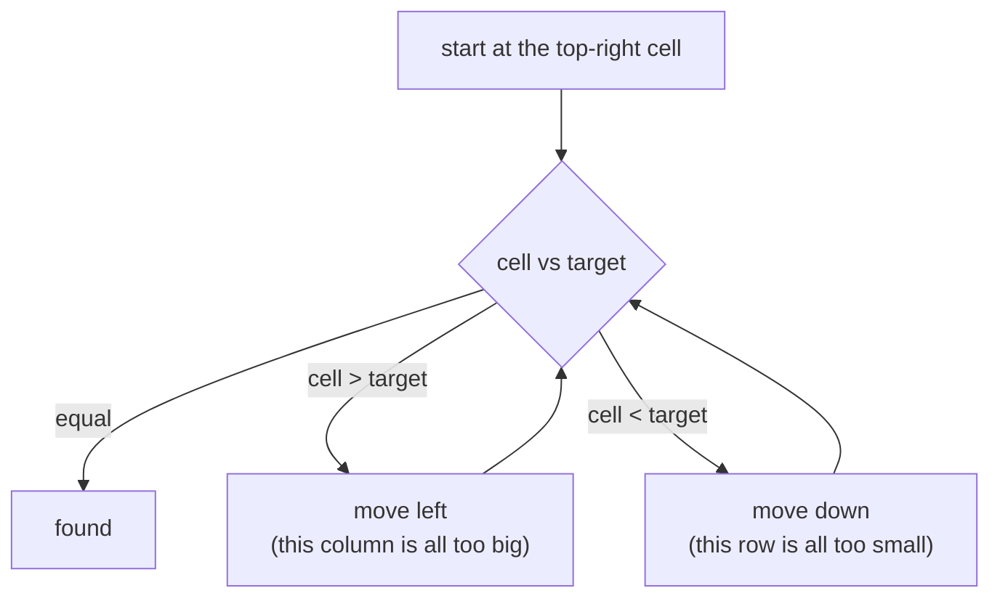

# Search in 2D Matrix

> Two matrix shapes, two methods. **Fully sorted** (each row continues the last): treat it as one sorted array. **Row and column sorted**: start in a corner and walk.

#### 1. What Is It?

| Problem | Matrix property | Method | Time |
|---|---|---|---|
| **Search a 2D Matrix** (74) | each row is sorted, and the first item of a row is **greater** than the last item of the previous row | binary search on the flattened index | `O(log(m · n))` |
| **Search a 2D Matrix II** (240) | each row sorted left to right, each column sorted top to bottom | **staircase search** from the top-right corner | `O(m + n)` |

**Signals:** "sorted matrix", "search in a matrix", "rows and columns are sorted".

#### 2. How It Works

**Method A: flatten (LeetCode 74).** The matrix is one sorted list of `m × n` values read row by row. Binary search `0..m·n − 1` and convert an index `k` to a cell with `row = k / n`, `col = k % n`.

```text
matrix = [[1, 3, 5, 7], [10, 11, 16, 20], [23, 30, 34, 60]],  n (columns) = 4, target 3
lo=0 hi=11  mid=5  → row 1, col 1 → 11 > 3 → hi = 4
lo=0 hi=4   mid=2  → row 0, col 2 → 5  > 3 → hi = 1
lo=0 hi=1   mid=0  → row 0, col 0 → 1  < 3 → lo = 1
lo=1 hi=1   mid=1  → row 0, col 1 → 3 = 3 → found
```

**Method B: staircase (LeetCode 240).** Start at the **top-right** cell.

- If it equals the target: found.
- If it is **bigger** than the target: the whole **column** below is bigger too, so move **left**.
- If it is **smaller**: the whole **row** to its left is smaller, so move **down**.

Each step removes a row or a column, so at most `m + n` steps.

```text
matrix = [[1, 4, 7, 11, 15],
          [2, 5, 8, 12, 19],
          [3, 6, 9, 16, 22],
          [10, 13, 14, 17, 24],
          [18, 21, 23, 26, 30]],   target 5
start (0,4) = 15 > 5 → left (0,3) = 11 > 5 → left (0,2) = 7 > 5 → left (0,1) = 4 < 5 → down (1,1) = 5 → found
```



**Why not the top-left?** From the top-left both directions (right and down) increase the value, so you cannot decide. The top-right (or bottom-left) corner has one direction that decreases and one that increases.

#### 3. Brute Force vs Optimized

| Approach | Time |
|---|---|
| Scan every cell | `O(m · n)` |
| Binary search each row | `O(m log n)` |
| **Flatten + binary search** (74) | **`O(log(m · n))`** |
| **Staircase** (240) | **`O(m + n)`** |

```kotlin
// Brute force
fun searchMatrixBrute(matrix: Array<IntArray>, target: Int): Boolean {
    for (row in matrix) for (v in row) if (v == target) return true
    return false
}
```

#### 4. Kotlin Code

```kotlin
// Search a 2D Matrix (LeetCode 74): flatten
fun searchMatrix(matrix: Array<IntArray>, target: Int): Boolean {
    val rows = matrix.size
    val cols = matrix[0].size
    var lo = 0
    var hi = rows * cols - 1
    while (lo <= hi) {
        val mid = lo + (hi - lo) / 2
        val value = matrix[mid / cols][mid % cols]
        when {
            value == target -> return true
            value < target -> lo = mid + 1
            else -> hi = mid - 1
        }
    }
    return false
}

// Search a 2D Matrix II (LeetCode 240): staircase from the top-right
fun searchMatrixII(matrix: Array<IntArray>, target: Int): Boolean {
    var r = 0
    var c = matrix[0].size - 1
    while (r < matrix.size && c >= 0) {
        val v = matrix[r][c]
        when {
            v == target -> return true
            v > target -> c--                    // the column below is bigger: go left
            else -> r++                          // the row to the left is smaller: go down
        }
    }
    return false
}
```

Checks: `searchMatrix(arrayOf(intArrayOf(1, 3, 5, 7), intArrayOf(10, 11, 16, 20), intArrayOf(23, 30, 34, 60)), 3)` → `true`; `(…, 13)` → `false`. `searchMatrix(arrayOf(intArrayOf(1)), 1)` → `true`. `searchMatrixBrute(…, 13)` → `false`. `searchMatrixII(m, 5)` → `true` and `searchMatrixII(m, 20)` → `false` for the 5 × 5 matrix above.

#### 5. Complexity

| | Time | Space |
|---|---|---|
| Flatten (74) | `O(log(m · n))` | `O(1)` |
| Staircase (240) | `O(m + n)` | `O(1)` |
| Row-by-row binary search | `O(m log n)` | `O(1)` |

#### 6. Common Mistakes

1. **Using the staircase from the top-left.**
2. **Wrong index conversion** (`mid / rows` instead of `mid / cols`).
3. **Using the flatten method on matrix II** (its rows do not continue each other).
4. **Using staircase moves in the wrong direction.**
5. **Not handling an empty matrix** (`matrix.isEmpty()`).
6. **Overflow** of `rows * cols` for huge matrices (use `Long` if needed).

#### 7. Say This in the Interview

1. "If each row continues the previous one, the matrix is one sorted array. I binary search the index range and convert `mid` to `(mid / cols, mid % cols)`: `O(log(m · n))`."
2. "If only rows and columns are sorted, I start at the top-right: bigger means move left, smaller means move down. That removes a row or column each step: `O(m + n)`."
3. "I start at a corner where one direction increases and the other decreases."

#### 8. Quick Check

1. Which cell does flattened index `7` map to in a 3 × 4 matrix?
2. Why start at the top-right in problem 240?
3. Time of the staircase search?

<details>
<summary>Answers</summary>

1. Row `7 / 4 = 1`, column `7 % 4 = 3`.
2. From there, moving left decreases the value and moving down increases it, so each comparison tells you where to go.
3. `O(m + n)`.

</details>

#### 9. Related LeetCode Questions

| # | Question | Idea |
|---|---|---|
| 74 | [Search a 2D Matrix](https://leetcode.com/problems/search-a-2d-matrix/) (Medium) | flatten |
| 240 | [Search a 2D Matrix II](https://leetcode.com/problems/search-a-2d-matrix-ii/) (Medium) | staircase |
| 378 | [Kth Smallest Element in a Sorted Matrix](https://leetcode.com/problems/kth-smallest-element-in-a-sorted-matrix/) (Medium) | binary search on value |
| 1351 | [Count Negative Numbers in a Sorted Matrix](https://leetcode.com/problems/count-negative-numbers-in-a-sorted-matrix/) (Easy) | staircase |
| 1337 | [The K Weakest Rows in a Matrix](https://leetcode.com/problems/the-k-weakest-rows-in-a-matrix/) (Easy) | binary search per row |
| 1428 | [Leftmost Column with at Least a One](https://leetcode.com/problems/leftmost-column-with-at-least-a-one/) (Medium, premium) | staircase |
