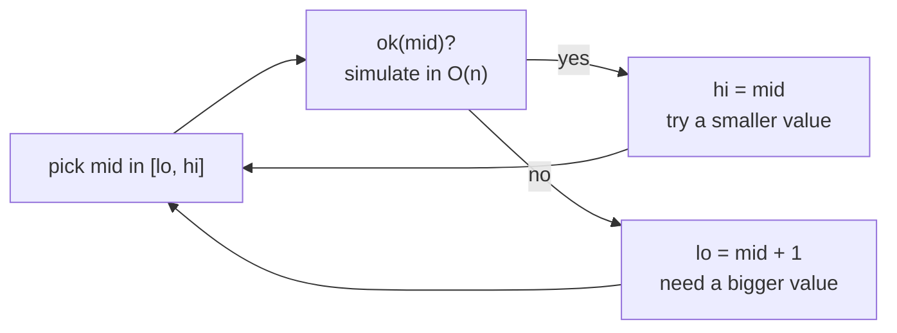

# Binary Search on Answer

> You cannot binary search the array, but you can binary search the **answer**. If "can I do it with value `x`?" flips from no to yes exactly once, find the flip.

#### 1. What Is It?

Some questions ask for the **smallest** (or **largest**) value that satisfies a condition:

- "minimum eating speed so Koko finishes in `h` hours",
- "least ship capacity to deliver in `D` days",
- "largest `m` with `m² <= x`".

The answer lies in a **range** `[low, high]`. Write a function `ok(x)` that answers "is `x` enough?". If `ok` is **monotonic** (all `false` then all `true`), binary search finds the boundary.

```text
x:      1  2  3  4  5  6  7  8 ...
ok(x):  F  F  F  T  T  T  T  T      ← find the first T
```

**Signals:** "minimum X such that ...", "maximum X such that ...", "minimise the maximum", "maximise the minimum", and a monotonic condition.

#### 2. How It Works

**Template (minimum value that works)**

```text
lo = smallest possible answer, hi = largest possible answer
while lo < hi:
    mid = lo + (hi - lo) / 2
    if ok(mid): hi = mid         // mid works: try smaller
    else:       lo = mid + 1     // mid fails: need bigger
return lo
```

For the **maximum** value that works, flip it: `if ok(mid) lo = mid + 1 else hi = mid` and return `lo − 1`, or use `mid = lo + (hi − lo + 1) / 2` with `lo = mid`.

**Koko Eating Bananas (875).** Piles `[3, 6, 7, 11]`, `h = 8` hours. At speed `k` she needs `Σ ceil(pile / k)` hours.

```text
range of k: 1 .. max(piles) = 11
ok(k) = total hours at speed k <= 8
k=4: 1 + 2 + 2 + 3 = 8 → ok.      k=3: 1 + 2 + 3 + 4 = 10 → too slow.     answer 4
```



**How to choose the range**

| Problem | `lo` | `hi` |
|---|---|---|
| Koko | 1 | `max(piles)` |
| Ship packages | `max(weights)` (must carry the heaviest) | `sum(weights)` (everything in one day) |
| Sqrt(x) | 0 | `x` |

**How to build `ok`**: simulate the process greedily with the candidate value. It usually costs `O(n)`.

**Total cost:** `O(n × log(range))`.

#### 3. Brute Force vs Optimized

| Approach | Time |
|---|---|
| Try every value from `lo` to `hi` | `O(range × n)` |
| **Binary search the range** | **`O(n × log range)`** |

```kotlin
// Brute force Koko: try speeds 1, 2, 3, ...
fun minEatingSpeedBrute(piles: IntArray, h: Int): Int {
    var k = 1
    while (true) {
        var hours = 0L
        for (p in piles) hours += (p + k - 1) / k
        if (hours <= h) return k
        k++
    }
}
```

#### 4. Kotlin Code

```kotlin
// Koko Eating Bananas (LeetCode 875)
fun minEatingSpeed(piles: IntArray, h: Int): Int {
    var lo = 1
    var hi = piles.maxOrNull()!!
    while (lo < hi) {
        val mid = lo + (hi - lo) / 2
        var hours = 0L
        for (p in piles) hours += (p + mid - 1) / mid                 // ceil(p / mid)
        if (hours <= h) hi = mid else lo = mid + 1
    }
    return lo
}

// Capacity To Ship Packages Within D Days (LeetCode 1011)
fun shipWithinDays(weights: IntArray, days: Int): Int {
    var lo = weights.maxOrNull()!!
    var hi = weights.sum()
    while (lo < hi) {
        val mid = lo + (hi - lo) / 2
        var need = 1
        var load = 0
        for (w in weights) {
            if (load + w > mid) { need++; load = 0 }
            load += w
        }
        if (need <= days) hi = mid else lo = mid + 1
    }
    return lo
}

// Minimum Number of Days to Make m Bouquets (LeetCode 1482)
fun minDays(bloomDay: IntArray, m: Int, k: Int): Int {
    if (m.toLong() * k > bloomDay.size) return -1
    var lo = bloomDay.minOrNull()!!
    var hi = bloomDay.maxOrNull()!!
    fun ok(day: Int): Boolean {
        var bouquets = 0
        var run = 0
        for (b in bloomDay) {
            if (b <= day) { run++; if (run == k) { bouquets++; run = 0 } } else run = 0
        }
        return bouquets >= m
    }
    while (lo < hi) {
        val mid = lo + (hi - lo) / 2
        if (ok(mid)) hi = mid else lo = mid + 1
    }
    return lo
}
```

Checks: `minEatingSpeed(intArrayOf(3, 6, 7, 11), 8)` → `4`. `minEatingSpeed(intArrayOf(30, 11, 23, 4, 20), 5)` → `30`. `minEatingSpeed(intArrayOf(30, 11, 23, 4, 20), 6)` → `23`. `minEatingSpeedBrute(intArrayOf(3, 6, 7, 11), 8)` → `4`. `shipWithinDays(intArrayOf(1, 2, 3, 4, 5, 6, 7, 8, 9, 10), 5)` → `15`. `shipWithinDays(intArrayOf(3, 2, 2, 4, 1, 4), 3)` → `6`. `minDays(intArrayOf(1, 10, 3, 10, 2), 3, 1)` → `3`. `minDays(intArrayOf(1, 10, 3, 10, 2), 3, 2)` → `-1`.

#### 5. Complexity

| | Time | Space |
|---|---|---|
| Koko | `O(n log max)` | `O(1)` |
| Ship packages | `O(n log sum)` | `O(1)` |
| Bouquets | `O(n log range)` | `O(1)` |

#### 6. Common Mistakes

1. **Searching an array that is not the answer space** (the array is not sorted, the answer range is).
2. **A non-monotonic `ok`.** If `ok(5)` is true but `ok(6)` is false, binary search fails.
3. **Wrong range** (a too-low `lo` is harmless but a too-high `lo` misses the answer).
4. **Using `mid = (lo + hi + 1) / 2` and `hi = mid`** (infinite loop). Pair each rounding with the right update.
5. **Ceiling division bug:** `p / k` instead of `(p + k − 1) / k`.
6. **Overflow:** total hours as `Int` can overflow. Use `Long`.
7. **Returning `lo − 1` vs `lo`** (first true vs last true).

#### 7. Say This in the Interview

1. "I can't binary search the array, but the answer has a yes/no check that flips once: if speed `k` works, so does `k + 1`. So I binary search the speed between `1` and the largest pile."
2. "The check simulates the process in `O(n)`, so the total is `O(n log max)`."
3. "I'll make sure the range includes the answer and that the check is monotonic."

#### 8. Quick Check

1. Why is `lo = max(weights)` in the ship problem?
2. What makes binary search on the answer valid?
3. Time for `n = 10⁵` piles with speeds up to `10⁹`?

<details>
<summary>Answers</summary>

1. A ship must carry the heaviest package at least once, so any smaller capacity is impossible.
2. The condition `ok(x)` is monotonic: false, false, ..., true, true.
3. About `10⁵ × 30 = 3 × 10⁶` steps.

</details>

#### 9. Related LeetCode Questions

| # | Question | Idea |
|---|---|---|
| 875 | [Koko Eating Bananas](https://leetcode.com/problems/koko-eating-bananas/) (Medium) | minimum speed |
| 1011 | [Capacity To Ship Packages Within D Days](https://leetcode.com/problems/capacity-to-ship-packages-within-d-days/) (Medium) | minimum capacity |
| 1482 | [Minimum Number of Days to Make m Bouquets](https://leetcode.com/problems/minimum-number-of-days-to-make-m-bouquets/) (Medium) | minimum day |
| 69 | [Sqrt(x)](https://leetcode.com/problems/sqrtx/) (Easy) | largest that fits |
| 410 | [Split Array Largest Sum](https://leetcode.com/problems/split-array-largest-sum/) (Hard) | note 15 |
| 1552 | [Magnetic Force Between Two Balls](https://leetcode.com/problems/magnetic-force-between-two-balls/) (Medium) | maximise the minimum |
