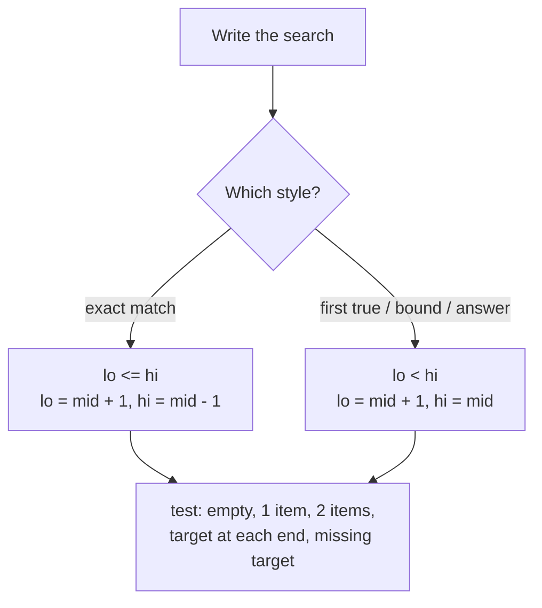

# Common Binary Search Edge Cases

> Binary search has the most bugs per line of any common algorithm. Read this list before an interview and check each item at the end of your solution.

#### 1. What Is It?

Most binary-search bugs come from five places:

1. the **loop condition** (`<` vs `<=`),
2. the **updates** (`mid`, `mid + 1`, `mid − 1`),
3. **overflow** in `mid`,
4. **duplicates**,
5. **boundaries** (empty array, one element, target outside the range).

**The two consistent styles. Pick one and do not mix them.**

| Style | Interval | Loop | Updates | Use for |
|---|---|---|---|---|
| **Closed** `[lo, hi]` | both ends possible | `while (lo <= hi)` | `lo = mid + 1`, `hi = mid − 1` | exact match |
| **Half-open** `[lo, hi)` | `hi` is one past the end | `while (lo < hi)` | `lo = mid + 1`, `hi = mid` | first true, bounds, answer search |

#### 2. How It Works

**The checklist**

| # | Edge case | What goes wrong | Fix |
|---|---|---|---|
| 1 | `mid = (lo + hi) / 2` | overflow when `lo + hi > Int.MAX` | `lo + (hi − lo) / 2` |
| 2 | `lo <= hi` with `hi = mid` | infinite loop | use `lo < hi` with `hi = mid` |
| 3 | `lo < hi` with `hi = mid − 1` | misses the last candidate | use `lo <= hi` with `hi = mid − 1` |
| 4 | `lo = mid` | infinite loop when `lo + 1 == hi` | `lo = mid + 1`, or round `mid` up |
| 5 | Empty array | `nums[0]` crashes | check size first, or `hi = −1` so the loop never runs |
| 6 | One element | off-by-one in the loop | test it explicitly |
| 7 | Target smaller than all / larger than all | wrong insert position | bounds return `0` / `n` |
| 8 | Duplicates | returns any index, not first or last | lower bound / keep searching (notes 4, 5) |
| 9 | All elements equal | `O(n)` if you walk after finding | two binary searches |
| 10 | Rotated array with duplicates | cannot tell which half is sorted | shrink `lo++`, `hi−−` (note 7) |
| 11 | `nums[mid + 1]` out of range | crash at the end | use `lo < hi` (so `mid < hi`) |
| 12 | Binary search on **unsorted** data | wrong answers | sort first, or use another method |
| 13 | Non-monotonic `ok` function | wrong answer | check `ok(x) ⇒ ok(x + 1)` |
| 14 | `Int` overflow in the check (`mid * mid`, sums) | wrong comparison | use `Long` |
| 15 | Floating-point search | never terminates on `lo < hi` | loop a fixed number of times (about 100) or use an epsilon |
| 16 | Ceiling division `p / k` | rounds down | `(p + k − 1) / k` |
| 17 | Returning the index when the value is wanted | wrong type of answer | re-read the question |
| 18 | Comparing with `<=` vs `<` at `mid` | skips or repeats `mid` | decide what `mid` means (already tested?) |



**Always test these five inputs:** empty array, one element (found and not found), two elements, target at the first and last position, and a missing target (smaller than all, between, larger than all).

#### 3. Brute Force vs Optimized

| Situation | Risky shortcut | Safe approach |
|---|---|---|
| Not sure of the boundary logic | write it from memory | derive it from the template and test 2 elements |
| Duplicates | linear walk after a hit | lower / upper bound |
| Unsure the data is monotonic | binary search anyway | add a quick `ok(x) ⇒ ok(x + 1)` check |

```kotlin
// Float search: use a fixed number of iterations instead of lo < hi
fun sqrtDouble(x: Double): Double {
    var lo = 0.0
    var hi = maxOf(1.0, x)
    repeat(100) {
        val mid = (lo + hi) / 2
        if (mid * mid > x) hi = mid else lo = mid
    }
    return lo
}
```

#### 4. Kotlin Code

```kotlin
// Exact match, closed interval
fun searchClosed(nums: IntArray, target: Int): Int {
    var lo = 0
    var hi = nums.size - 1
    while (lo <= hi) {
        val mid = lo + (hi - lo) / 2
        if (nums[mid] == target) return mid
        if (nums[mid] < target) lo = mid + 1 else hi = mid - 1
    }
    return -1
}

// First index with nums[i] >= target, half-open interval
fun firstAtLeast(nums: IntArray, target: Int): Int {
    var lo = 0
    var hi = nums.size
    while (lo < hi) {
        val mid = lo + (hi - lo) / 2
        if (nums[mid] >= target) hi = mid else lo = mid + 1
    }
    return lo
}

// An overflow demo: (lo + hi) / 2 with large indexes
fun badMid(lo: Int, hi: Int): Int = (lo + hi) / 2
fun goodMid(lo: Int, hi: Int): Int = lo + (hi - lo) / 2
```

Checks: `searchClosed(intArrayOf(), 5)` → `-1`. `searchClosed(intArrayOf(5), 5)` → `0`. `searchClosed(intArrayOf(2, 4), 4)` → `1`. `searchClosed(intArrayOf(2, 4), 3)` → `-1`. `firstAtLeast(intArrayOf(1, 3, 5), 0)` → `0`; `(…, 4)` → `2`; `(…, 9)` → `3`. `badMid(2_000_000_000, 2_100_000_000)` → a negative number (overflow). `goodMid(2_000_000_000, 2_100_000_000)` → `2050000000`. `sqrtDouble(2.0)` → about `1.41421356`.

#### 5. Complexity

| Fix | Cost |
|---|---|
| Overflow-safe `mid` | none |
| Two bound searches instead of a walk | `O(log n)` instead of `O(n)` |
| Fixed iteration count for doubles | `O(100)` |

#### 6. Common Mistakes

1. **Mixing the two interval styles.**
2. **Not testing a 1-element and 2-element array.**
3. **Forgetting `nums[mid + 1]` can be out of range** with `lo <= hi`.
4. **Assuming the array is sorted** because the question mentions "search".
5. **Using `lo < hi` for exact match and returning `-1` wrongly** (the last candidate `lo == hi` is never checked).
6. **Using `Int` for products.**

#### 7. Say This in the Interview

1. "I'll use the half-open style for first-true problems: `lo < hi`, `hi = mid`, so `mid` is never skipped."
2. "I compute `mid` as `lo + (hi - lo) / 2` to avoid overflow."
3. "I'll test an empty array, one element, two elements, and the target before, between and after the values."

#### 8. Quick Check

1. What goes wrong with `lo <= hi` and `hi = mid`?
2. How do you search doubles safely?
3. How can `badMid` be negative?

<details>
<summary>Answers</summary>

1. It loops forever when `lo == hi` (`mid == hi`, so `hi` never shrinks).
2. Loop a fixed number of times (for example 100), or until the interval is smaller than an epsilon.
3. `lo + hi` exceeds `Int.MAX_VALUE` and wraps around to a negative number.

</details>

#### 9. Related LeetCode Questions

| # | Question | Idea |
|---|---|---|
| 704 | [Binary Search](https://leetcode.com/problems/binary-search/) (Easy) | exact match |
| 35 | [Search Insert Position](https://leetcode.com/problems/search-insert-position/) (Easy) | boundaries |
| 34 | [Find First and Last Position of Element in Sorted Array](https://leetcode.com/problems/find-first-and-last-position-of-element-in-sorted-array/) (Medium) | duplicates |
| 33 | [Search in Rotated Sorted Array](https://leetcode.com/problems/search-in-rotated-sorted-array/) (Medium) | which half is sorted |
| 69 | [Sqrt(x)](https://leetcode.com/problems/sqrtx/) (Easy) | overflow |
| 50 | [Pow(x, n)](https://leetcode.com/problems/powx-n/) (Medium) | halving, negative exponent |
