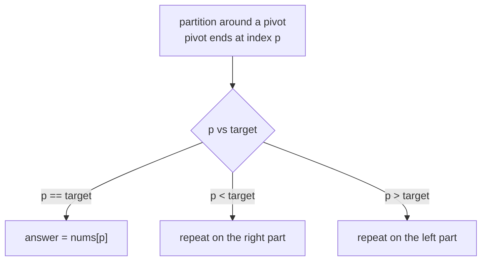

# Quickselect

> Find the Kth smallest (or largest) element **without sorting everything**. Partition like quicksort, but follow only the side that holds the answer. `O(n)` on average.

#### 1. What Is It?

**Quickselect** finds the element that would be at index `k` if the array were sorted.

| Method | Time | Space | Changes the array? |
|---|---|---|---|
| Sort, then index `k` | `O(n log n)` | `O(1)`/`O(n)` | yes (sorted) |
| Min-heap / max-heap of size `k` | `O(n log k)` | `O(k)` | no |
| **Quickselect** | **`O(n)` average**, `O(n²)` worst | `O(1)` | yes (partially reordered) |
| Median of medians | `O(n)` worst | `O(1)` | yes (complex, rarely coded) |

**Signals:** "Kth largest / smallest", "median", "top K elements (unordered)", and the interviewer asks for better than `O(n log n)`.

#### 2. How It Works

**Partition.** Pick a pivot. Rearrange the array so that everything smaller than the pivot is on its left and everything bigger is on its right. The pivot lands at its **final sorted index** `p`.

```text
[3, 2, 1, 5, 6, 4], pivot = 4 (last element)
after partition: [3, 2, 1, 4, 6, 5]        pivot 4 is at index 3
```

**Select.** Let `target` be the index you want (for the Kth largest: `n − k`).

- `p == target` → done, return `nums[p]`.
- `p < target` → the answer is in the **right** part: repeat there.
- `p > target` → the answer is in the **left** part: repeat there.

```text
Kth largest, k = 2, n = 6 → target index = 6 - 2 = 4
partition → pivot at 3 < 4 → go right: [6, 5] (indexes 4..5)
partition with pivot 5 → [5, 6]: pivot at index 4 == target → answer 5
```



**Why `O(n)` on average:** each round works on about half as much: `n + n/2 + n/4 + ... ≈ 2n`. In the worst case (a bad pivot every time, such as a sorted array with the last element as the pivot) it is `O(n²)`.

**Fix the worst case: random pivot.** Swap a random element to the pivot position first. Then the expected time is `O(n)` for any input.

**Quickselect vs heap.** Use a heap when the data **streams** or you need to keep the array unchanged. Use quickselect for a single query on an in-memory array.

#### 3. Brute Force vs Optimized

| Approach | Time |
|---|---|
| Sort and index | `O(n log n)` |
| Heap of size `k` | `O(n log k)` |
| **Quickselect with a random pivot** | **`O(n)` expected** |

```kotlin
// Brute force
fun kthLargestSort(nums: IntArray, k: Int): Int = nums.sortedDescending()[k - 1]
```

#### 4. Kotlin Code

```kotlin
import kotlin.random.Random

// Kth Largest Element in an Array (LeetCode 215): quickselect with a random pivot
fun findKthLargest(nums: IntArray, k: Int): Int {
    val a = nums.copyOf()                                   // do not change the caller's array
    val target = a.size - k                                 // index in ascending order
    var lo = 0
    var hi = a.size - 1
    while (lo <= hi) {
        val pivotIndex = Random.nextInt(lo, hi + 1)
        swap(a, pivotIndex, hi)                             // move the random pivot to the end
        val pivot = a[hi]
        var store = lo
        for (i in lo until hi) {
            if (a[i] < pivot) { swap(a, i, store); store++ }
        }
        swap(a, store, hi)                                  // the pivot goes to its final place
        when {
            store == target -> return a[store]
            store < target -> lo = store + 1
            else -> hi = store - 1
        }
    }
    return -1
}

private fun swap(a: IntArray, i: Int, j: Int) { val t = a[i]; a[i] = a[j]; a[j] = t }

// Kth smallest (1-based)
fun findKthSmallest(nums: IntArray, k: Int): Int = findKthLargest(nums, nums.size - k + 1)

// Median of an array (odd length): the middle element
fun medianOdd(nums: IntArray): Int = findKthSmallest(nums, nums.size / 2 + 1)
```

Checks: `findKthLargest(intArrayOf(3, 2, 1, 5, 6, 4), 2)` → `5`. `findKthLargest(intArrayOf(3, 2, 3, 1, 2, 4, 5, 5, 6), 4)` → `4`. `findKthLargest(intArrayOf(1), 1)` → `1`. `findKthLargest(intArrayOf(2, 2, 2), 2)` → `2` (duplicates count). `findKthSmallest(intArrayOf(7, 10, 4, 3, 20, 15), 3)` → `7`. `medianOdd(intArrayOf(5, 1, 9, 3, 7))` → `5`. `kthLargestSort(intArrayOf(3, 2, 1, 5, 6, 4), 2)` → `5`.

#### 5. Complexity

| | Time | Space |
|---|---|---|
| Quickselect (random pivot) | `O(n)` expected, `O(n²)` worst (very unlikely) | `O(1)` |
| Sort | `O(n log n)` | `O(1)` |
| Heap | `O(n log k)` | `O(k)` |

#### 6. Common Mistakes

1. **Off-by-one in the target index.** Kth largest is index `n − k` (ascending), not `k − 1`.
2. **A fixed pivot** (always last) on sorted input: `O(n²)`.
3. **Recursing into both sides** (that is quicksort, `O(n log n)`).
4. **Not handling duplicates** (many equal values with a `<` partition are fine, but `<=` can cause extra work or infinite loops).
5. **Changing the caller's array** when they did not expect it.
6. **Using quickselect on a stream** (it needs all the data).

#### 7. Say This in the Interview

1. "Sorting is `O(n log n)`. Quickselect partitions around a pivot and follows only the side that contains the target index, so on average it is `O(n)`."
2. "I pick a random pivot, so no input can force the `O(n²)` worst case."
3. "A min-heap of size `k` is `O(n log k)` and works on a stream, so I'd choose by whether the data is static."

#### 8. Quick Check

1. Target index for the 2nd largest of 6 elements?
2. Why is quickselect `O(n)` on average and not `O(n log n)`?
3. When do you prefer a heap?

<details>
<summary>Answers</summary>

1. `6 − 2 = 4`.
2. It recurses into only one side, so the work is `n + n/2 + n/4 + ... ≈ 2n`.
3. For a stream of data, or when you must not change the array.

</details>

#### 9. Related LeetCode Questions

| # | Question | Idea |
|---|---|---|
| 215 | [Kth Largest Element in an Array](https://leetcode.com/problems/kth-largest-element-in-an-array/) (Medium) | quickselect |
| 973 | [K Closest Points to Origin](https://leetcode.com/problems/k-closest-points-to-origin/) (Medium) | select by distance |
| 347 | [Top K Frequent Elements](https://leetcode.com/problems/top-k-frequent-elements/) (Medium) | select by frequency |
| 75 | [Sort Colors](https://leetcode.com/problems/sort-colors/) (Medium) | 3-way partition |
| 324 | [Wiggle Sort II](https://leetcode.com/problems/wiggle-sort-ii/) (Medium) | median with quickselect |
| 462 | [Minimum Moves to Equal Array Elements II](https://leetcode.com/problems/minimum-moves-to-equal-array-elements-ii/) (Medium) | the median is optimal |
