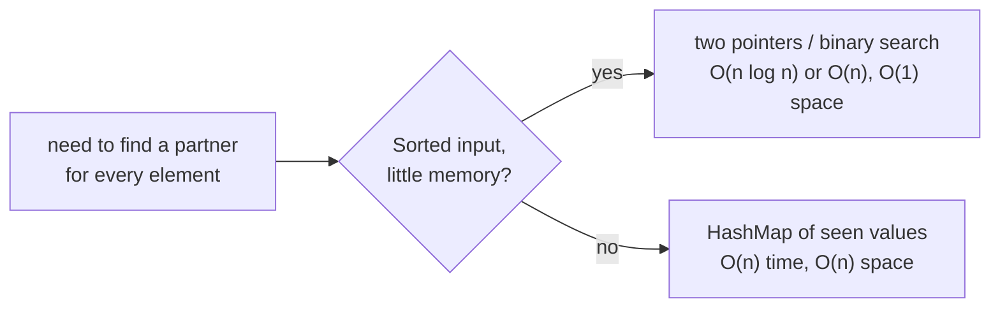

# Searching with HashMap / HashSet

> When you search **many times** or the data is **unsorted**, a hash table gives `O(1)` average lookups. Trade memory for speed.

#### 1. What Is It?

A `HashSet` answers "is it there?". A `HashMap` answers "where is it?" or "what goes with it?". Both take `O(1)` on average, with `O(n)` to build.

| Need | Structure | Time |
|---|---|---|
| Is `x` in the collection? | `HashSet` | `O(1)` |
| Index / count / value for `x` | `HashMap` | `O(1)` |
| Is `x` in a **sorted** collection, little memory | binary search | `O(log n)` |
| Nearest value, floor, ceiling | `TreeSet` / `TreeMap` | `O(log n)` |

**Signals:** "does it exist", "two numbers that add up to", "seen before", "first repeated", "count of each".

#### 2. How It Works

**Complement search (Two Sum).** For each `x`, search for `target − x` among the numbers already seen. The search is a hash lookup, not a scan.

```text
nums = [2, 7, 11, 15], target 9
x=2: need 7 → not seen → store 2
x=7: need 2 → seen at index 0 → answer [0, 1]
```



**Linear vs binary vs hash**

| | Linear | Binary (sorted) | Hash |
|---|---|---|---|
| Build | none | sort `O(n log n)` | `O(n)` |
| One lookup | `O(n)` | `O(log n)` | `O(1)` |
| `q` lookups | `O(q · n)` | `O(n log n + q log n)` | `O(n + q)` |
| Memory | `O(1)` | `O(1)` | `O(n)` |
| Keeps order / nearest | no | yes | no |

**When hashing does not help:** you need the **closest** or **range** answers (use a sorted structure), or memory is very tight.

**Pitfalls:** hash lookups are `O(1)` on average, not worst case. Arrays make bad keys (identity equality). Mutable keys break the table.

#### 3. Brute Force vs Optimized

| Question | Brute force | Hash |
|---|---|---|
| Two Sum | all pairs `O(n²)` | `O(n)` |
| Contains duplicate | all pairs `O(n²)` | `O(n)` |
| Common elements of two arrays | nested loops `O(m · n)` | `O(m + n)` |
| First repeated element | nested loops | `O(n)` |

```kotlin
// Brute force: every pair
fun twoSumBrute(nums: IntArray, target: Int): IntArray {
    for (i in nums.indices) for (j in i + 1 until nums.size) if (nums[i] + nums[j] == target) return intArrayOf(i, j)
    return intArrayOf()
}
```

#### 4. Kotlin Code

```kotlin
// Two Sum (LeetCode 1): hash map of value -> index
fun twoSum(nums: IntArray, target: Int): IntArray {
    val indexOf = HashMap<Int, Int>()
    for ((i, x) in nums.withIndex()) {
        val j = indexOf[target - x]
        if (j != null) return intArrayOf(j, i)
        indexOf[x] = i
    }
    return intArrayOf()
}

// Contains Duplicate (LeetCode 217): hash set
fun containsDuplicate(nums: IntArray): Boolean {
    val seen = HashSet<Int>()
    for (x in nums) if (!seen.add(x)) return true
    return false
}

// Intersection of Two Arrays (LeetCode 349)
fun intersection(a: IntArray, b: IntArray): IntArray {
    val set = a.toHashSet()
    return b.filter { it in set }.toSet().toIntArray()
}

// First Unique Character in a String (LeetCode 387)
fun firstUniqChar(s: String): Int {
    val count = IntArray(26)
    for (c in s) count[c - 'a']++
    for (i in s.indices) if (count[s[i] - 'a'] == 1) return i
    return -1
}
```

Checks: `twoSum(intArrayOf(2, 7, 11, 15), 9)` → `[0, 1]`. `twoSum(intArrayOf(3, 2, 4), 6)` → `[1, 2]`. `twoSum(intArrayOf(3, 3), 6)` → `[0, 1]`. `twoSumBrute(intArrayOf(2, 7, 11, 15), 9)` → `[0, 1]`. `containsDuplicate(intArrayOf(1, 2, 3, 1))` → `true`. `intersection(intArrayOf(1, 2, 2, 1), intArrayOf(2, 2))` → `[2]`. `firstUniqChar("leetcode")` → `0`; `("loveleetcode")` → `2`; `("aabb")` → `-1`.

#### 5. Complexity

| | Time | Space |
|---|---|---|
| Build + one lookup | `O(n)` | `O(n)` |
| `q` lookups after building | `O(1)` each | |
| Two Sum | `O(n)` | `O(n)` |

#### 6. Common Mistakes

1. **Rebuilding the set inside a loop.**
2. **Adding before checking** in Two Sum (an element pairs with itself).
3. **Using `IntArray` as a key.**
4. **Using a hash when the data is sorted and `O(1)` space is needed** (two pointers or binary search).
5. **Expecting order** from a `HashSet`.
6. **Assuming worst-case `O(1)`.**

#### 7. Say This in the Interview

1. "I'm searching many times in unsorted data, so I'll build a hash set once: `O(n)` build and `O(1)` per lookup, instead of `O(n)` per lookup."
2. "The trade-off is `O(n)` extra memory. If the array is sorted I could use two pointers or binary search with `O(1)` space."
3. "For the nearest value I'd need a `TreeSet`, because a hash set has no order."

#### 8. Quick Check

1. Hash vs binary search: which needs sorted data?
2. Time to answer `q` membership queries on `n` items with a hash set?
3. Why can't a `HashSet` find the nearest value?

<details>
<summary>Answers</summary>

1. Binary search.
2. `O(n + q)`.
3. It has no order, so it can only test exact equality.

</details>

#### 9. Related LeetCode Questions

| # | Question | Idea |
|---|---|---|
| 1 | [Two Sum](https://leetcode.com/problems/two-sum/) (Easy) | complement lookup |
| 217 | [Contains Duplicate](https://leetcode.com/problems/contains-duplicate/) (Easy) | seen set |
| 349 | [Intersection of Two Arrays](https://leetcode.com/problems/intersection-of-two-arrays/) (Easy) | set lookups |
| 387 | [First Unique Character in a String](https://leetcode.com/problems/first-unique-character-in-a-string/) (Easy) | counts |
| 128 | [Longest Consecutive Sequence](https://leetcode.com/problems/longest-consecutive-sequence/) (Medium) | set + starts |
| 49 | [Group Anagrams](https://leetcode.com/problems/group-anagrams/) (Medium) | key lookups |
