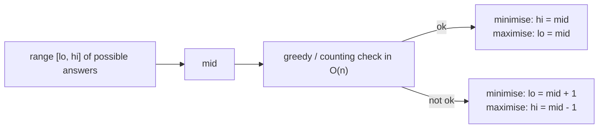

# Advanced Binary Search on Answer

> The hard versions: **minimise the maximum**, **maximise the minimum**, count pairs by distance, and split arrays. The `ok` check is harder, the template is the same.

#### 1. What Is It?

Same method as note 11 (binary search the answer with a monotonic check), but the checks are cleverer, and some problems have no obvious "array" at all.

| Problem | Search over | `ok(x)` means |
|---|---|---|
| **Split Array Largest Sum** (410) | the largest allowed subarray sum | the array can be split into `<= m` parts, each with sum `<= x` |
| **Magnetic Force Between Two Balls** (1552) | the minimum distance `x` | we can place `m` balls with every gap `>= x` |
| **Find K-th Smallest Pair Distance** (719) | a distance `x` | at least `k` pairs have distance `<= x` |
| **Median of Two Sorted Arrays** (4) | a cut position in the smaller array | the left parts are all `<=` the right parts |

**Two flavours**

| Goal | Search | Update |
|---|---|---|
| **Minimise the maximum** (smallest `x` that works) | first `true` | `ok(mid) → hi = mid`, else `lo = mid + 1` |
| **Maximise the minimum** (largest `x` that works) | last `true` | `ok(mid) → lo = mid`, else `hi = mid − 1`, with `mid` rounded **up** |

**Signals:** "minimise the largest", "maximise the smallest", "split into `k` parts", "Kth smallest distance / product / sum".

#### 2. How It Works

**Split Array Largest Sum.** Split `[7, 2, 5, 10, 8]` into `m = 2` parts to **minimise the largest part sum**.

```text
range: lo = max element = 10,  hi = total = 32
ok(x): greedily fill parts, start a new part when the sum would exceed x; ok if parts <= m
x = 18: [7,2,5] = 14, then [10,8] = 18  → 2 parts → ok
x = 17: [7,2,5] = 14, [10] , [8]       → 3 parts → not ok
answer 18
```

**Magnetic Force (maximise the minimum).** Positions `[1, 2, 3, 4, 7]`, `m = 3` balls. Sort. `ok(d)`: place the first ball at the first position, then the next ball at the first position at least `d` away, and so on. Count balls placed; `ok` if `>= m`.

```text
d = 3: place at 1, then 4 (>= 1 + 3), then 7 (>= 4 + 3) → 3 balls → ok
d = 4: place at 1, then 7 (>= 5) → 2 balls → not ok          answer 3
```

**K-th Smallest Pair Distance.** Sort. Count pairs with distance `<= x` with two pointers in `O(n)`. Find the smallest `x` with count `>= k`.



**Median of Two Sorted Arrays (`O(log min(m, n))`).** Binary search how many items `i` to take from the smaller array `a` into the left half. The rest `j = (m + n + 1) / 2 − i` come from `b`. The split is valid when `a[i − 1] <= b[j]` and `b[j − 1] <= a[i]`. The median comes from the four border values.

**Rounding rule for "maximise":** use `mid = lo + (hi − lo + 1) / 2` (round up), or the loop never ends when `lo + 1 == hi` and `lo = mid`.

#### 3. Brute Force vs Optimized

| Problem | Brute force | Binary search on answer |
|---|---|---|
| Split Array Largest Sum | try all splits `O(C(n, m))` or DP `O(n² m)` | `O(n log sum)` |
| Magnetic Force | try every distance | `O(n log range)` |
| K-th Smallest Pair Distance | all pairs, sort: `O(n² log n)` | `O(n log range)` |
| Median of two sorted arrays | merge `O(m + n)` | `O(log min(m, n))` |

```kotlin
// Brute force kth smallest pair distance: all pairs, sort
fun smallestDistancePairBrute(nums: IntArray, k: Int): Int {
    val d = mutableListOf<Int>()
    for (i in nums.indices) for (j in i + 1 until nums.size) d.add(Math.abs(nums[i] - nums[j]))
    d.sort()
    return d[k - 1]
}
```

#### 4. Kotlin Code

```kotlin
// Split Array Largest Sum (LeetCode 410): minimise the maximum
fun splitArray(nums: IntArray, m: Int): Int {
    var lo = nums.maxOrNull()!!
    var hi = nums.sum()
    fun ok(limit: Int): Boolean {
        var parts = 1
        var sum = 0
        for (x in nums) {
            if (sum + x > limit) { parts++; sum = 0 }
            sum += x
        }
        return parts <= m
    }
    while (lo < hi) {
        val mid = lo + (hi - lo) / 2
        if (ok(mid)) hi = mid else lo = mid + 1
    }
    return lo
}

// Magnetic Force Between Two Balls (LeetCode 1552): maximise the minimum
fun maxDistance(position: IntArray, m: Int): Int {
    val p = position.sortedArray()
    var lo = 1
    var hi = p.last() - p.first()
    fun ok(d: Int): Boolean {
        var count = 1
        var last = p[0]
        for (i in 1 until p.size) if (p[i] - last >= d) { count++; last = p[i] }
        return count >= m
    }
    while (lo < hi) {
        val mid = lo + (hi - lo + 1) / 2                 // round UP
        if (ok(mid)) lo = mid else hi = mid - 1
    }
    return lo
}

// Find K-th Smallest Pair Distance (LeetCode 719)
fun smallestDistancePair(nums: IntArray, k: Int): Int {
    val a = nums.sortedArray()
    var lo = 0
    var hi = a.last() - a.first()
    fun countAtMost(d: Int): Int {
        var count = 0
        var left = 0
        for (right in a.indices) {
            while (a[right] - a[left] > d) left++
            count += right - left                         // pairs (left..right-1, right)
        }
        return count
    }
    while (lo < hi) {
        val mid = lo + (hi - lo) / 2
        if (countAtMost(mid) >= k) hi = mid else lo = mid + 1
    }
    return lo
}

// Median of Two Sorted Arrays (LeetCode 4): binary search the cut in the smaller array
fun findMedianSortedArrays(a: IntArray, b: IntArray): Double {
    if (a.size > b.size) return findMedianSortedArrays(b, a)
    val m = a.size
    val n = b.size
    var lo = 0
    var hi = m
    while (lo <= hi) {
        val i = (lo + hi) / 2                             // items taken from a into the left half
        val j = (m + n + 1) / 2 - i                       // items taken from b
        val aLeft = if (i == 0) Int.MIN_VALUE else a[i - 1]
        val aRight = if (i == m) Int.MAX_VALUE else a[i]
        val bLeft = if (j == 0) Int.MIN_VALUE else b[j - 1]
        val bRight = if (j == n) Int.MAX_VALUE else b[j]
        if (aLeft <= bRight && bLeft <= aRight) {
            return if ((m + n) % 2 == 1) maxOf(aLeft, bLeft).toDouble()
            else (maxOf(aLeft, bLeft).toLong() + minOf(aRight, bRight)) / 2.0
        } else if (aLeft > bRight) hi = i - 1 else lo = i + 1
    }
    throw IllegalArgumentException("arrays are not sorted")
}
```

Checks: `splitArray(intArrayOf(7, 2, 5, 10, 8), 2)` → `18`. `splitArray(intArrayOf(1, 2, 3, 4, 5), 2)` → `9`. `maxDistance(intArrayOf(1, 2, 3, 4, 7), 3)` → `3`. `maxDistance(intArrayOf(5, 4, 3, 2, 1, 1000000000), 2)` → `999999999`. `smallestDistancePair(intArrayOf(1, 3, 1), 1)` → `0`. `smallestDistancePair(intArrayOf(1, 6, 1), 3)` → `5`. `smallestDistancePairBrute(intArrayOf(1, 3, 1), 1)` → `0`. `findMedianSortedArrays(intArrayOf(1, 3), intArrayOf(2))` → `2.0`. `findMedianSortedArrays(intArrayOf(1, 2), intArrayOf(3, 4))` → `2.5`. `findMedianSortedArrays(intArrayOf(), intArrayOf(1))` → `1.0`.

#### 5. Complexity

| | Time | Space |
|---|---|---|
| Split Array Largest Sum | `O(n log sum)` | `O(1)` |
| Magnetic Force | `O(n log range)` (+ sort) | `O(1)` |
| K-th Smallest Pair Distance | `O(n log n + n log range)` | `O(1)` |
| Median of Two Sorted Arrays | `O(log min(m, n))` | `O(1)` |

#### 6. Common Mistakes

1. **Rounding `mid` down** when maximising (`lo = mid` loops forever).
2. **A greedy `ok` that is not correct** (for example not resetting the running sum properly).
3. **Wrong range** (`lo` below the true minimum is fine, above it is wrong).
4. **Splitting with `parts < m` expected to be exactly `m`**: `<= m` is correct because fewer parts can always be split further.
5. **Median:** not binary searching the **smaller** array, or mishandling empty sides with `±∞`.
6. **Median:** `Int` overflow when adding the two middle values (use `Long`).
7. **Counting pairs** with `O(n²)` inside the check.

#### 7. Say This in the Interview

1. "I want to minimise the largest sum, and 'can I split into at most `m` parts with each sum at most `x`?' is monotonic in `x`. So I binary search `x` between the biggest element and the total, with an `O(n)` greedy check."
2. "For maximising the minimum distance I round `mid` up so the loop terminates."
3. "For the median of two sorted arrays I binary search the cut in the smaller array: `O(log min(m, n))`."

#### 8. Quick Check

1. Range for `x` in Split Array Largest Sum?
2. Which rounding for "maximise"?
3. Why is `ok` monotonic in Split Array?

<details>
<summary>Answers</summary>

1. From `max(nums)` to `sum(nums)`.
2. Round `mid` up: `lo + (hi − lo + 1) / 2`.
3. If a limit `x` works, any larger limit also works (the same split still satisfies it).

</details>

#### 9. Related LeetCode Questions

| # | Question | Idea |
|---|---|---|
| 410 | [Split Array Largest Sum](https://leetcode.com/problems/split-array-largest-sum/) (Hard) | minimise the maximum |
| 1552 | [Magnetic Force Between Two Balls](https://leetcode.com/problems/magnetic-force-between-two-balls/) (Medium) | maximise the minimum |
| 719 | [Find K-th Smallest Pair Distance](https://leetcode.com/problems/find-k-th-smallest-pair-distance/) (Hard) | count pairs by distance |
| 4 | [Median of Two Sorted Arrays](https://leetcode.com/problems/median-of-two-sorted-arrays/) (Hard) | partition search |
| 2226 | [Maximum Candies Allocated to K Children](https://leetcode.com/problems/maximum-candies-allocated-to-k-children/) (Medium) | maximise the minimum |
| 1231 | [Divide Chocolate](https://leetcode.com/problems/divide-chocolate/) (Hard, premium) | maximise the minimum |
