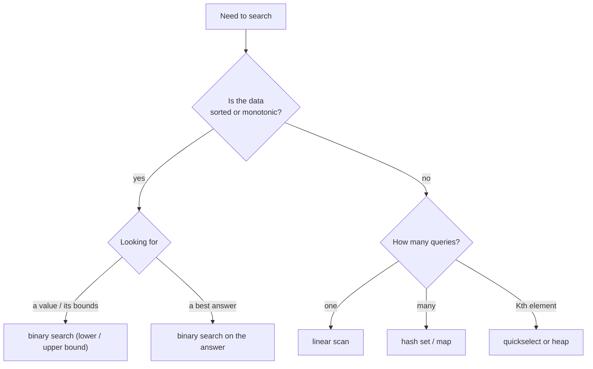

# Searching Cheat Sheet

> One-page revision for the night before an interview. The full explanations are in notes 01–15.

#### 1. Key Takeaways

1. **Unsorted, one query** → linear scan `O(n)`. **Many queries, unsorted** → hash set/map `O(1)` each. **Sorted or monotonic** → binary search `O(log n)`.
2. Binary search works whenever a yes/no question flips **once** across the range (`false false false true true`).
3. Pick **one template** and stay with it. Closed `[lo, hi]` or half-open `[lo, hi)`; do not mix them.
4. `mid = lo + (hi − lo) / 2` (never `(lo + hi) / 2`). Maximise problems round up: `lo + (hi − lo + 1) / 2`.
5. Lower bound = first index with `nums[i] >= x`. Upper bound = first index with `nums[i] > x`. Everything else (first/last occurrence, count, insert position) is built from these.
6. Rotated array: **one half is always sorted**. Find-min compares `nums[mid]` with `nums[hi]`. Peak compares `nums[mid]` with `nums[mid + 1]`.
7. "Minimise the maximum" / "maximise the minimum" → **binary search on the answer** with an `O(n)` greedy `ok(x)`.
8. Kth smallest/largest without sorting: **quickselect** `O(n)` average, or a heap of size `k`, `O(n log k)`.

#### 2. Complexity Table

| Method | Time | Space | Needs |
|---|---|---|---|
| Linear search | `O(n)` | `O(1)` | nothing |
| Binary search | `O(log n)` | `O(1)` | sorted / monotonic |
| Lower / upper bound | `O(log n)` | `O(1)` | sorted |
| Rotated array search | `O(log n)` | `O(1)` | rotated, distinct (duplicates → `O(n)` worst) |
| 2D matrix (flatten) | `O(log mn)` | `O(1)` | rows sorted, row starts > previous row end |
| 2D matrix (staircase) | `O(m + n)` | `O(1)` | rows and columns sorted |
| Binary search on answer | `O(n log range)` | `O(1)` | monotonic `ok` |
| Quickselect | `O(n)` avg, `O(n²)` worst | `O(1)` | nothing |
| Hash set / map | `O(n)` build, `O(1)` lookup | `O(n)` | nothing |
| Median of two sorted arrays | `O(log min(m, n))` | `O(1)` | both sorted |

#### 3. Patterns and How to Identify Them

| Signal in the question | Pattern | Note |
|---|---|---|
| "sorted array, find target" | classic binary search | 03 |
| "first / last position", "count of x" | lower bound, upper bound | 04, 05 |
| "where would it be inserted" | lower bound | 06 |
| "sorted then rotated" | find which half is sorted | 07 |
| "minimum in rotated array" | compare `mid` with `hi` | 08 |
| "peak", "mountain", "local maximum" | compare `mid` with `mid + 1` | 09 |
| "matrix with sorted rows" | flatten, or staircase | 10 |
| "minimum speed / capacity / days" | binary search on the answer | 11 |
| "minimise the largest sum", "split into k" | search on the answer + greedy | 15 |
| "maximise the smallest distance" | search on the answer, round up | 15 |
| "Kth largest", "median" | quickselect or heap | 13 |
| "two numbers that add up", "seen before" | hash set / map | 14 |
| "square root", "nth root" | search on a number range (or float) | 11, 12 |



#### 4. Templates to Memorise

**Closed interval: find an exact value**

```kotlin
fun binarySearch(nums: IntArray, target: Int): Int {
    var lo = 0
    var hi = nums.size - 1
    while (lo <= hi) {
        val mid = lo + (hi - lo) / 2
        when {
            nums[mid] == target -> return mid
            nums[mid] < target -> lo = mid + 1
            else -> hi = mid - 1
        }
    }
    return -1
}
```

**Half-open: lower bound (first index with `nums[i] >= x`)**

```kotlin
fun lowerBound(nums: IntArray, x: Int): Int {
    var lo = 0
    var hi = nums.size
    while (lo < hi) {
        val mid = lo + (hi - lo) / 2
        if (nums[mid] >= x) hi = mid else lo = mid + 1
    }
    return lo
}
// upperBound: change >= to >
// first = lowerBound(x), last = upperBound(x) - 1, count = upperBound(x) - lowerBound(x)
```

**Minimise the answer (first `true`)**

```kotlin
var lo = minAnswer
var hi = maxAnswer
while (lo < hi) {
    val mid = lo + (hi - lo) / 2
    if (ok(mid)) hi = mid else lo = mid + 1
}
// answer = lo
```

**Maximise the answer (last `true`)**

```kotlin
var lo = minAnswer
var hi = maxAnswer
while (lo < hi) {
    val mid = lo + (hi - lo + 1) / 2        // round UP
    if (ok(mid)) lo = mid else hi = mid - 1
}
// answer = lo
```

**Rotated array: find minimum**

```kotlin
var lo = 0
var hi = nums.size - 1
while (lo < hi) {
    val mid = lo + (hi - lo) / 2
    if (nums[mid] > nums[hi]) lo = mid + 1 else hi = mid
}
// answer = nums[lo]
```

**Peak element**

```kotlin
var lo = 0
var hi = nums.size - 1
while (lo < hi) {
    val mid = lo + (hi - lo) / 2
    if (nums[mid] < nums[mid + 1]) lo = mid + 1 else hi = mid
}
// answer index = lo
```

**Quickselect (Kth largest)**: partition with a random pivot, then go to the side that contains index `n − k`. See note 13.

#### 5. Brute Force to Optimized

| Problem | Brute force | Better |
|---|---|---|
| Find in sorted array | scan `O(n)` | binary search `O(log n)` |
| First / last position | scan both ways | two bound searches `O(log n)` |
| Search rotated array | scan `O(n)` | one-half-sorted check `O(log n)` |
| Search 2D matrix | scan `O(mn)` | flatten `O(log mn)` or staircase `O(m + n)` |
| Koko Eating Bananas | try each speed `O(n · max)` | binary search the speed `O(n log max)` |
| Split Array Largest Sum | all splits | binary search the answer `O(n log sum)` |
| Kth largest | sort `O(n log n)` | quickselect `O(n)` avg |
| Two Sum | all pairs `O(n²)` | hash map `O(n)` |
| Median of two sorted arrays | merge `O(m + n)` | partition search `O(log min(m, n))` |

#### 6. Common Mistakes and Edge Cases

1. **Infinite loop** from `lo = mid` with a rounded-down `mid`, or `hi = mid − 1` with the half-open template.
2. **Overflow** with `(lo + hi) / 2` on large indexes or values.
3. **Mixing** `<=` closed loops with half-open updates.
4. **Wrong comparison in rotated search** (compare with `nums[lo]` to decide the sorted half, and use `<=` for the boundaries).
5. **Duplicates** in rotated arrays: when `nums[mid] == nums[hi]`, do `hi--` (worst case `O(n)`).
6. **Non-monotonic `ok`**: check it by testing a small range by hand.
7. **Wrong search range** (the lower limit of Split Array is `max(nums)`, not 0).
8. **Not returning `lo`** correctly: the answer is `lo` after the loop for the half-open templates.
9. Edge cases: empty array, one element, target below the minimum or above the maximum, all equal values, target absent.

#### 7. What to Say Out Loud

1. "The array is sorted, so binary search gives `O(log n)` instead of a scan."
2. "I'll use the half-open template and return `lo`, the first index where the condition holds."
3. "For the first and last position I run lower bound twice, once for `x` and once for `x + 1`."
4. "In a rotated array one half is always sorted, so I check whether the target is in the sorted half."
5. "The check 'can we do it with limit `x`?' is monotonic, so I binary search the answer."
6. "For Kth largest, quickselect is `O(n)` on average. A heap of size `k` is `O(n log k)` and works on streams."

#### 8. Practice Order (Easy → Medium)

| Level | Question | Pattern |
|---|---|---|
| Easy | [Binary Search](https://leetcode.com/problems/binary-search/) | classic |
| Easy | [Search Insert Position](https://leetcode.com/problems/search-insert-position/) | lower bound |
| Easy | [Sqrt(x)](https://leetcode.com/problems/sqrtx/) | search on a number |
| Easy | [First Bad Version](https://leetcode.com/problems/first-bad-version/) | first `true` |
| Easy | [Two Sum](https://leetcode.com/problems/two-sum/) | hash map |
| Medium | [Find First and Last Position of Element in Sorted Array](https://leetcode.com/problems/find-first-and-last-position-of-element-in-sorted-array/) | two bounds |
| Medium | [Search in Rotated Sorted Array](https://leetcode.com/problems/search-in-rotated-sorted-array/) | sorted half |
| Medium | [Find Minimum in Rotated Sorted Array](https://leetcode.com/problems/find-minimum-in-rotated-sorted-array/) | compare with `hi` |
| Medium | [Find Peak Element](https://leetcode.com/problems/find-peak-element/) | compare with `mid + 1` |
| Medium | [Search a 2D Matrix](https://leetcode.com/problems/search-a-2d-matrix/) | flatten |
| Medium | [Search a 2D Matrix II](https://leetcode.com/problems/search-a-2d-matrix-ii/) | staircase |
| Medium | [Koko Eating Bananas](https://leetcode.com/problems/koko-eating-bananas/) | minimise the answer |
| Medium | [Capacity To Ship Packages Within D Days](https://leetcode.com/problems/capacity-to-ship-packages-within-d-days/) | minimise the answer |
| Medium | [Kth Largest Element in an Array](https://leetcode.com/problems/kth-largest-element-in-an-array/) | quickselect |
| Medium | [Magnetic Force Between Two Balls](https://leetcode.com/problems/magnetic-force-between-two-balls/) | maximise the minimum |
| Hard | [Split Array Largest Sum](https://leetcode.com/problems/split-array-largest-sum/) | minimise the maximum |
| Hard | [Median of Two Sorted Arrays](https://leetcode.com/problems/median-of-two-sorted-arrays/) | partition search |
