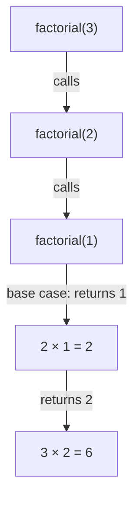

# Base Case & Recursive Case

> Recursion = a function that solves a problem by calling itself on a **smaller** version of the same problem. Every recursive function needs exactly two parts: a **base case** that stops, and a **recursive case** that moves toward it.

#### 1. What Is It?

| Part | Meaning | Example (`factorial`) |
|---|---|---|
| **Base case** | the smallest input, answered directly | `factorial(0) = 1` |
| **Recursive case** | solve the problem using a smaller call | `factorial(n) = n × factorial(n − 1)` |

Without a base case you get **infinite recursion** (a `StackOverflowError`). Without progress toward the base case you get the same result.

**The "trust" rule.** Assume the recursive call already works for the smaller input. Your only job: (1) handle the base case, (2) combine the smaller answer with the current item.

**Signals:** "defined in terms of a smaller version of itself", trees and linked lists, "all combinations", "divide the input", mathematical definitions (factorial, Fibonacci, power, GCD).

#### 2. How It Works

`factorial(3)`:

```text
factorial(3) = 3 × factorial(2)
                    factorial(2) = 2 × factorial(1)
                                        factorial(1) = 1      ← base case
             = 3 × (2 × 1) = 6
```



**A 3-question checklist before writing any recursion**

1. **What is the smallest input?** (base case: `n == 0`, empty list, `null` node)
2. **How do I make the input smaller?** (`n − 1`, `next` node, half the array, left/right child)
3. **How do I combine the smaller answer into mine?** (`n × result`, `1 + result`, `max(left, right)`)

**Shapes of recursion**

| Shape | Calls per step | Example |
|---|---|---|
| Linear | 1 | factorial, sum of a list, reverse a linked list |
| Binary | 2 | Fibonacci, tree traversal, merge sort |
| Multiple | many | permutations, subsets (backtracking) |

#### 3. Brute Force vs Optimized

| Problem | Plain recursion | Better |
|---|---|---|
| Fibonacci | `O(2ⁿ)` two overlapping calls | memoize `O(n)` (note 08), or loop `O(n)` with `O(1)` space |
| Power `xⁿ` | `O(n)` multiply `n` times | halve the exponent `O(log n)` (note 09) |
| Reverse a string | `O(n²)` with `substring` copies | two pointers `O(n)` |
| Sum of `1..n` | `O(n)` stack | formula `n(n + 1)/2` `O(1)` |

```kotlin
// Naive Fibonacci: each call makes two more calls
fun fibNaive(n: Int): Int = if (n < 2) n else fibNaive(n - 1) + fibNaive(n - 2)

// Naive reverse: substring copies the rest each time, O(n²)
fun reverseNaive(s: String): String = if (s.length <= 1) s else reverseNaive(s.substring(1)) + s[0]
```

#### 4. Kotlin Code

```kotlin
// Factorial
fun factorial(n: Int): Long = if (n <= 1) 1L else n * factorial(n - 1)

// Sum of an array, recursing on the index
fun sum(a: IntArray, i: Int = 0): Int = if (i == a.size) 0 else a[i] + sum(a, i + 1)

// Reverse a character array in place with two ends moving inward
fun reverse(c: CharArray, l: Int = 0, r: Int = c.size - 1) {
    if (l >= r) return                              // base case: 0 or 1 characters left
    val t = c[l]; c[l] = c[r]; c[r] = t
    reverse(c, l + 1, r - 1)
}

// Palindrome check
fun isPalindrome(s: String, l: Int = 0, r: Int = s.length - 1): Boolean {
    if (l >= r) return true
    return s[l] == s[r] && isPalindrome(s, l + 1, r - 1)
}

// Power by repeated multiplication (simple version, O(n))
fun powSimple(x: Int, n: Int): Long = if (n == 0) 1L else x * powSimple(x, n - 1)

// Reverse a linked list recursively (LeetCode 206)
class ListNode(var `val`: Int) { var next: ListNode? = null }

fun reverseList(head: ListNode?): ListNode? {
    if (head?.next == null) return head             // empty or single node
    val newHead = reverseList(head.next)            // reverse the rest
    head.next!!.next = head                         // the next node now points back to us
    head.next = null
    return newHead
}
```

Checks: `factorial(5)` → `120`; `factorial(0)` → `1`; `factorial(20)` → `2432902008176640000`. `sum(intArrayOf(1, 2, 3, 4))` → `10`; `sum(intArrayOf())` → `0`. `reverse` on `"abc".toCharArray()` → `"cba"`; on `"ab"` → `"ba"`; on `""` → unchanged. `isPalindrome("racecar")` → `true`; `("ab")` → `false`; `("")` → `true`. `powSimple(2, 10)` → `1024`. `fibNaive(10)` → `55`. `reverseNaive("abc")` → `"cba"`. `reverseList(1→2→3)` → `3→2→1`.

#### 5. Complexity

| Function | Time | Space (call stack) |
|---|---|---|
| `factorial(n)`, `sum`, `reverse` | `O(n)` | `O(n)` (`O(n/2)` for two-ended) |
| `fibNaive(n)` | `O(2ⁿ)` | `O(n)` depth |
| `powSimple` | `O(n)` | `O(n)` |
| `reverseNaive` | `O(n²)` | `O(n)` |

Recursion always costs **stack space** equal to the maximum depth (note 02).

#### 6. Common Mistakes

1. **Missing or wrong base case** (off by one: `n == 1` vs `n == 0`).
2. **Not shrinking the input** (calling with the same `n`).
3. **Forgetting to return the recursive result**, so you get `Unit` or a wrong value.
4. **Handling only one base case** when two are needed (Fibonacci needs `0` and `1`).
5. **Recursing on a `null` node** without a null base case.
6. **Using recursion where a loop is simpler** (and cheaper).
7. **Overflow:** `factorial(21)` overflows `Long`.

#### 7. Say This in the Interview

1. "The base case is the empty/smallest input. The recursive case solves a smaller problem and combines the result."
2. "I'll assume the recursive call is correct for the smaller input and just handle my current element."
3. "Depth is `n`, so the stack space is `O(n)`. If `n` can be very large I'd switch to a loop."

#### 8. Quick Check

1. Base case for Fibonacci?
2. What happens without a base case?
3. Stack space of `factorial(n)`?

<details>
<summary>Answers</summary>

1. `fib(0) = 0` and `fib(1) = 1`.
2. The calls never stop and the program crashes with `StackOverflowError`.
3. `O(n)`: one frame per pending call.

</details>

#### 9. Related LeetCode Questions

| # | Question | Idea |
|---|---|---|
| 509 | [Fibonacci Number](https://leetcode.com/problems/fibonacci-number/) (Easy) | two base cases |
| 231 | [Power of Two](https://leetcode.com/problems/power-of-two/) (Easy) | divide by 2 |
| 344 | [Reverse String](https://leetcode.com/problems/reverse-string/) (Easy) | two ends inward |
| 206 | [Reverse Linked List](https://leetcode.com/problems/reverse-linked-list/) (Easy) | trust the rest |
| 70 | [Climbing Stairs](https://leetcode.com/problems/climbing-stairs/) (Easy) | Fibonacci shape |
| 21 | [Merge Two Sorted Lists](https://leetcode.com/problems/merge-two-sorted-lists/) (Easy) | smaller head + recurse |
| 50 | [Pow(x, n)](https://leetcode.com/problems/powx-n/) (Medium) | halve the exponent |
