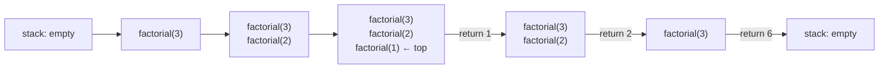

# The Call Stack & Space Complexity

> Every function call gets a **stack frame** with its own variables. Recursion keeps one frame per pending call, so recursion depth = extra space. Too deep = `StackOverflowError`.

#### 1. What Is It?

The **call stack** is the memory area that tracks the functions currently running. A new frame is **pushed** when a call starts and **popped** when it returns (last in, first out).

Each frame holds: the parameters, local variables, and the place to continue after the call returns.

**Why you care in interviews**

| Question | Answer |
|---|---|
| What is the space complexity of a recursive function? | the **maximum depth** × frame size, even if you allocate nothing else |
| Why can recursion crash? | depth too large → `StackOverflowError` (JVM default allows roughly 10,000–20,000 simple frames) |
| Can I avoid the stack cost? | tail recursion (note 06), or an explicit stack/loop (note 07) |

**Signals:** "what is the space complexity", "will this overflow for `n = 10⁶`", DFS on a big grid or a skewed tree, "do it iteratively".

#### 2. How It Works

`factorial(3)` pushes three frames and pops them in reverse:

```text
push factorial(3)
  push factorial(2)
    push factorial(1)       ← base case, returns 1
    pop  → factorial(2) gets 1, returns 2
  pop    → factorial(3) gets 2, returns 6
pop
```



**Depth, not total calls, sets the space.**

| Recursion | Total calls | Max depth (space) |
|---|---|---|
| `factorial(n)` | `n` | `n` |
| `fib(n)` (naive) | about `2ⁿ` | `n` |
| Merge sort on `n` items | about `2n` | `log n` |
| Binary search (recursive) | `log n` | `log n` |
| DFS on a binary tree | `n` | height `h` (from `log n` to `n`) |
| DFS on an `m × n` grid | `m · n` | up to `m · n` |

So naive Fibonacci takes exponential **time** but only `O(n)` **space**: the left branch goes down `n` frames, returns, and the next branch reuses that stack space.

**Stack size.** The JVM's default thread stack is about 512 KB–1 MB. Each frame uses tens of bytes, so depth of tens of thousands is the limit. On LeetCode, a skewed tree or a 1,000 × 1,000 grid DFS can overflow.

#### 3. Brute Force vs Optimized

| Approach | Time | Space |
|---|---|---|
| Recursion `sumTo(n)` | `O(n)` | `O(n)` stack |
| Loop | `O(n)` | `O(1)` |
| Formula `n(n + 1)/2` | `O(1)` | `O(1)` |
| Recursive DFS on a grid | `O(mn)` | `O(mn)` worst |
| DFS with an explicit stack / BFS | `O(mn)` | `O(mn)` heap (no overflow) |

```kotlin
// Recursive sum: O(n) stack
fun sumTo(n: Int): Long = if (n == 0) 0L else n + sumTo(n - 1)

// Loop: O(1) space
fun sumLoop(n: Int): Long {
    var total = 0L
    for (i in 1..n) total += i
    return total
}
```

#### 4. Kotlin Code

```kotlin
// Detect a stack overflow safely (for learning, not production)
fun safeSumTo(n: Int): Long? =
    try { sumTo(n) } catch (e: StackOverflowError) { null }

// Measure the depth you can reach
fun maxDepthReached(): Int {
    var depth = 0
    fun dive() { depth++; dive() }
    try { dive() } catch (e: StackOverflowError) { }
    return depth
}

// Run with a bigger stack when you must stay recursive (512 MB here)
fun runWithBigStack(block: () -> Unit) {
    val t = Thread(null, { block() }, "big-stack", 512L * 1024 * 1024)
    t.start()
    t.join()
}

// Space example: recursive tree height uses O(h) stack
class TreeNode(var `val`: Int) { var left: TreeNode? = null; var right: TreeNode? = null }

fun height(root: TreeNode?): Int =
    if (root == null) 0 else 1 + maxOf(height(root.left), height(root.right))
```

Checks: `sumTo(1000)` → `500500`. `sumLoop(1000)` → `500500`. `safeSumTo(1000)` → `500500`; `safeSumTo(10_000_000)` → `null` on a default stack. `maxDepthReached()` → a number in the thousands to tens of thousands (varies by machine). `height` of a tree with root `1`, left child `2`, and `2`'s left child `3` → `3`. `height(null)` → `0`.

#### 5. Complexity

| | Time | Space |
|---|---|---|
| Linear recursion | `O(n)` | `O(n)` |
| Binary recursion (balanced) | depends | `O(log n)` |
| Tree recursion (skewed) | `O(n)` | `O(n)` |
| Same logic as a loop | same | `O(1)` or heap-allocated stack |

#### 6. Common Mistakes

1. **Saying recursion space is `O(1)`** because "no extra arrays". The stack counts.
2. **Using total calls as space** (use max depth).
3. **Ignoring a skewed tree** where height is `n`.
4. **Deep DFS on a large grid** without thinking about overflow.
5. **Assuming the compiler removes the stack** (Kotlin does that only for `tailrec` self-calls).
6. **Forgetting the output** is not counted but recursion frames are.

#### 7. Say This in the Interview

1. "Each recursive call adds a stack frame, so the space is the maximum recursion depth: `O(n)` here."
2. "On a balanced tree the depth is `O(log n)`, but on a skewed tree it is `O(n)`."
3. "For very deep inputs I'd convert this to an iterative version with an explicit stack to avoid a stack overflow."

#### 8. Quick Check

1. Space of recursive binary search?
2. Why is naive `fib(n)` `O(n)` space but `O(2ⁿ)` time?
3. What throws when recursion is too deep?

<details>
<summary>Answers</summary>

1. `O(log n)`.
2. Only one path of up to `n` frames is on the stack at a time, but the number of calls overall is exponential.
3. `StackOverflowError`.

</details>

#### 9. Related LeetCode Questions

| # | Question | Idea |
|---|---|---|
| 104 | [Maximum Depth of Binary Tree](https://leetcode.com/problems/maximum-depth-of-binary-tree/) (Easy) | depth = stack depth |
| 206 | [Reverse Linked List](https://leetcode.com/problems/reverse-linked-list/) (Easy) | `O(n)` stack vs `O(1)` loop |
| 509 | [Fibonacci Number](https://leetcode.com/problems/fibonacci-number/) (Easy) | time vs space |
| 70 | [Climbing Stairs](https://leetcode.com/problems/climbing-stairs/) (Easy) | recursion vs loop |
| 94 | [Binary Tree Inorder Traversal](https://leetcode.com/problems/binary-tree-inorder-traversal/) (Easy) | recursive vs iterative |
| 200 | [Number of Islands](https://leetcode.com/problems/number-of-islands/) (Medium) | DFS depth on a grid |
