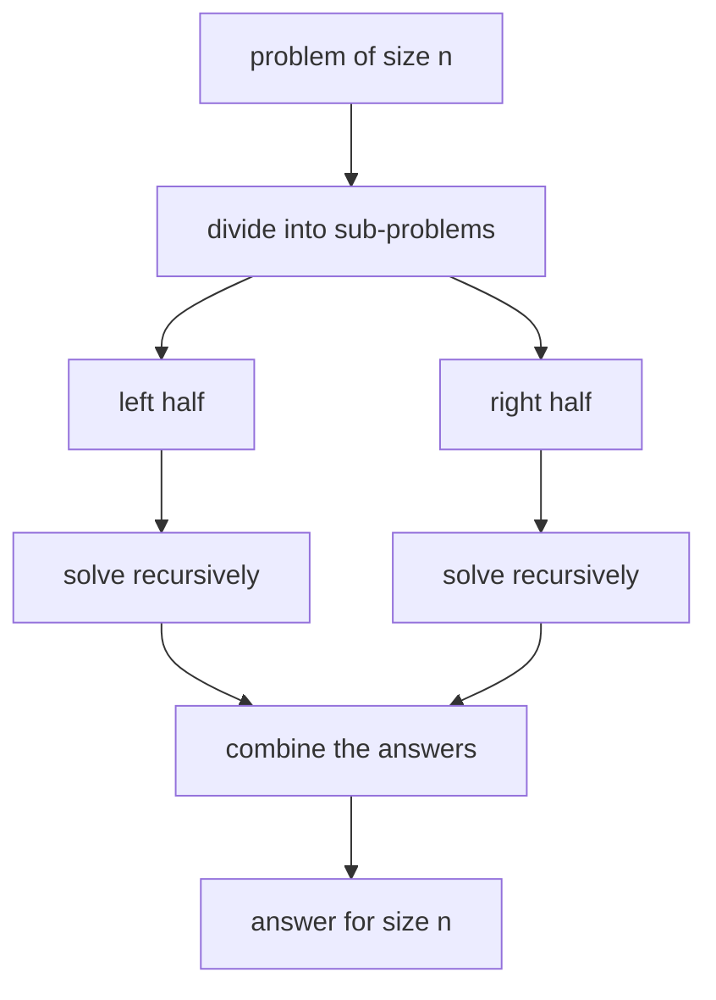

# Divide and Conquer: Split, Solve, Combine

> Break the problem into **independent** smaller pieces of the same kind, solve each recursively, and combine the answers. Merge sort, quick sort, binary search and many tree problems all work this way.

#### 1. What Is It?

| Step | What happens | Merge sort example |
|---|---|---|
| **Divide** | split the input | cut the array in half |
| **Conquer** | solve each part recursively (base case at size 1) | sort each half |
| **Combine** | merge the sub-answers | merge two sorted halves |

**Divide and conquer vs dynamic programming**

| | Divide and conquer | Dynamic programming |
|---|---|---|
| Subproblems | **independent** (no overlap) | **overlapping** (same subproblem repeats) |
| Remember answers? | no need | yes (memo / table) |
| Examples | merge sort, binary search, tree depth | Fibonacci, knapsack, edit distance |

**Signals:** "split the array in half", sorted input, a binary tree, "combine results from left and right", target time `O(n log n)` or `O(log n)`.

#### 2. How It Works



**Common algorithms and their recurrences** (explained in note 05)

| Algorithm | Divide | Combine | Recurrence | Time |
|---|---|---|---|---|
| Binary search | pick half | none | `T(n) = T(n/2) + 1` | `O(log n)` |
| Merge sort | halves | merge `O(n)` | `T(n) = 2T(n/2) + n` | `O(n log n)` |
| Quick sort (good pivot) | partition `O(n)` | none | `T(n) = 2T(n/2) + n` | `O(n log n)` |
| Quickselect | partition, one side | none | `T(n) = T(n/2) + n` | `O(n)` |
| Tree height | left, right | `1 + max` | `T(n) = 2T(n/2) + 1` | `O(n)` |
| Fast power | halve the exponent | square | `T(n) = T(n/2) + 1` | `O(log n)` |
| Max subarray (D&C) | halves | cross-sum `O(n)` | `T(n) = 2T(n/2) + n` | `O(n log n)` |

**Split evenly.** If you split `n` into `1` and `n − 1`, you get `O(n²)` (quick sort with a bad pivot). Balanced splits give `log n` levels.

**Tip:** if the two halves are unrelated and only one matters (binary search), you do not even need a combine step.

#### 3. Brute Force vs Optimized

| Problem | Brute force | Divide and conquer |
|---|---|---|
| Find a value in sorted data | scan `O(n)` | binary search `O(log n)` |
| Sort | `O(n²)` | merge sort `O(n log n)` |
| Build a balanced BST from a sorted array | insert one by one (can be skewed) | pick the middle as root `O(n)` |
| Count inversions | all pairs `O(n²)` | merge sort `O(n log n)` |
| Largest value | scan `O(n)` | halves (same `O(n)`, but parallelisable) |

```kotlin
// Brute force: maximum by scanning
fun maxScan(a: IntArray): Int { var m = a[0]; for (x in a) if (x > m) m = x; return m }
```

#### 4. Kotlin Code

```kotlin
// Maximum of an array by divide and conquer (same O(n), shows the pattern)
fun maxDC(a: IntArray, lo: Int = 0, hi: Int = a.size - 1): Int {
    if (lo == hi) return a[lo]                          // base case: one element
    val mid = lo + (hi - lo) / 2
    return maxOf(maxDC(a, lo, mid), maxDC(a, mid + 1, hi))   // combine
}

// Recursive binary search: divide only, no combine
fun binarySearch(a: IntArray, target: Int, lo: Int = 0, hi: Int = a.size - 1): Int {
    if (lo > hi) return -1
    val mid = lo + (hi - lo) / 2
    return when {
        a[mid] == target -> mid
        a[mid] < target -> binarySearch(a, target, mid + 1, hi)
        else -> binarySearch(a, target, lo, mid - 1)
    }
}

// Convert Sorted Array to a height-balanced BST (LeetCode 108)
class TreeNode(var `val`: Int) { var left: TreeNode? = null; var right: TreeNode? = null }

fun sortedArrayToBST(nums: IntArray): TreeNode? {
    fun build(lo: Int, hi: Int): TreeNode? {
        if (lo > hi) return null
        val mid = lo + (hi - lo) / 2
        val node = TreeNode(nums[mid])                  // the middle becomes the root
        node.left = build(lo, mid - 1)
        node.right = build(mid + 1, hi)
        return node
    }
    return build(0, nums.size - 1)
}

fun preorder(root: TreeNode?): List<Int> =
    if (root == null) emptyList() else listOf(root.`val`) + preorder(root.left) + preorder(root.right)
```

Checks: `maxDC(intArrayOf(3, 9, 2, 7))` → `9`; `maxDC(intArrayOf(5))` → `5`. `binarySearch(intArrayOf(1, 3, 5, 7, 9), 7)` → `3`; `(…, 4)` → `-1`. `preorder(sortedArrayToBST(intArrayOf(-10, -3, 0, 5, 9)))` → `[0, -10, -3, 5, 9]`. `maxScan(intArrayOf(3, 9, 2, 7))` → `9`.

#### 5. Complexity

| | Time | Space |
|---|---|---|
| Balanced split, linear combine | `O(n log n)` | `O(log n)` stack (+ helper memory) |
| Halve, constant combine | `O(n)` | `O(log n)` |
| Halve, no combine, one side | `O(log n)` | `O(log n)` (or `O(1)` iterative) |

#### 6. Common Mistakes

1. **Overlapping subproblems** treated as independent (Fibonacci by halves). Use DP instead.
2. **Uneven split** causing `O(n²)`.
3. **Missing base case** for size 0 or 1.
4. **Slow combine step** (`O(n²)` merge) that spoils the recurrence.
5. **Wrong midpoint** or `mid` that does not shrink the range (infinite recursion).
6. **Copying subarrays** (`copyOfRange`) at every level instead of passing indexes.

#### 7. Say This in the Interview

1. "I'll divide the array in half, solve each half recursively, then combine. The combine step is `O(n)`, and there are `log n` levels, so `O(n log n)`."
2. "The subproblems do not overlap, so plain divide and conquer works. If they overlapped I'd add memoization."
3. "I pass index bounds instead of copying subarrays, to keep the extra space at the stack depth."

#### 8. Quick Check

1. Three steps?
2. D&C vs DP difference?
3. Recurrence for binary search?

<details>
<summary>Answers</summary>

1. Divide, conquer (solve recursively), combine.
2. D&C subproblems are independent; DP subproblems overlap and are cached.
3. `T(n) = T(n/2) + O(1)` → `O(log n)`.

</details>

#### 9. Related LeetCode Questions

| # | Question | Idea |
|---|---|---|
| 704 | [Binary Search](https://leetcode.com/problems/binary-search/) (Easy) | divide only |
| 108 | [Convert Sorted Array to Binary Search Tree](https://leetcode.com/problems/convert-sorted-array-to-binary-search-tree/) (Easy) | middle as root |
| 912 | [Sort an Array](https://leetcode.com/problems/sort-an-array/) (Medium) | merge sort |
| 53 | [Maximum Subarray](https://leetcode.com/problems/maximum-subarray/) (Medium) | D&C or Kadane |
| 105 | [Construct Binary Tree from Preorder and Inorder Traversal](https://leetcode.com/problems/construct-binary-tree-from-preorder-and-inorder-traversal/) (Medium) | split by root |
| 23 | [Merge k Sorted Lists](https://leetcode.com/problems/merge-k-sorted-lists/) (Hard) | merge pairs |
