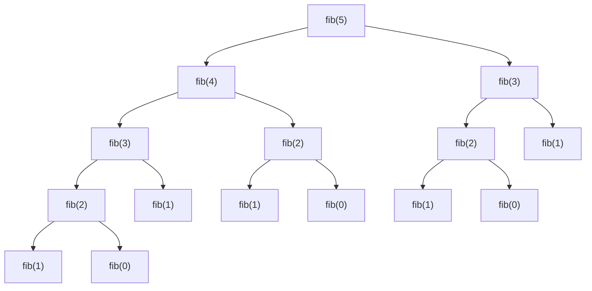
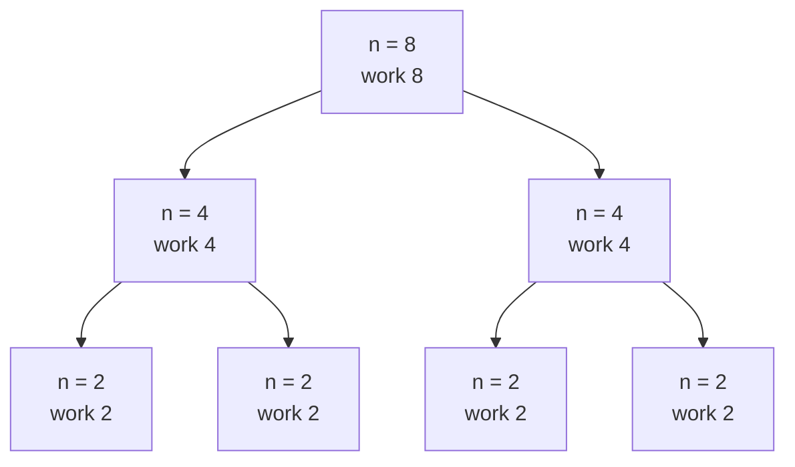

# Recursion Tree and Tracing Complexity by Hand

> Draw every call as a node. **Total work = sum over all nodes.** This is the quickest way to see why Fibonacci is exponential and merge sort is `n log n`.

#### 1. What Is It?

A **recursion tree** shows each call as a node and each recursive call as a child. For each node, write the work done *outside* the recursive calls.

Then ask two questions:

| Question | Gives you |
|---|---|
| How many **levels** does the tree have? | the depth (stack space) |
| How much work happens **at each level**? | multiply by the levels for total time |

**Signals:** "what is the time complexity of this recursive function", "why is this slow", "trace the calls".

#### 2. How It Works

**Naive Fibonacci, `fib(5)`.** The same values are computed again and again:



Number of calls: `calls(n) = 1 + calls(n − 1) + calls(n − 2)` → `calls(5) = 15` (count the nodes above). Each level has about double the previous one, so the total is about **`2ⁿ`** (more exactly `≈ 1.618ⁿ`).

**Merge sort, `n = 8`.** Work outside the calls = the merge, `n` items at each level:

```text
level 0:  1 node  × merge 8       = 8
level 1:  2 nodes × merge 4       = 8
level 2:  4 nodes × merge 2       = 8
level 3:  8 nodes × (base) 1      = 8
levels = log₂ 8 + 1 = 4      total ≈ n × log n = 8 × 3 (+ n for the leaves)
```



Each level sums to 8 → `n` work × `log n` levels.

**Tower of Hanoi, a recursion tree you can count.** Move `n` disks from A to C using B: move `n − 1` to B, move one disk, move `n − 1` to C. Moves: `M(n) = 2M(n − 1) + 1` → **`2ⁿ − 1`**. For `n = 3`: 7 moves.

**Rules of thumb**

| Shape | Cost |
|---|---|
| One call, size `n − 1`, `O(1)` work | `O(n)` |
| One call, size `n/2`, `O(1)` work | `O(log n)` |
| Two calls, size `n − 1` | `O(2ⁿ)` |
| Two calls, size `n/2`, `O(n)` work | `O(n log n)` |
| Two calls, size `n/2`, `O(1)` work | `O(n)` |
| One call `n − 1`, `O(n)` work | `O(n²)` |

#### 3. Brute Force vs Optimized

| Function | Recursion tree | Fix |
|---|---|---|
| `fib(n)` | exponential, repeated nodes | memo: each node once → `O(n)` |
| `power(x, n)` linear | one chain, `n` deep | halve → `log n` deep |
| `subsets(n)` | `2ⁿ` leaves | inherent (output size) |
| `merge sort` | `log n` levels × `n` | already optimal for comparison sorts |

```kotlin
// Count calls to see the shape of the tree
var calls = 0
fun fibCount(n: Int): Int { calls++; return if (n < 2) n else fibCount(n - 1) + fibCount(n - 2) }
```

#### 4. Kotlin Code

```kotlin
// Count the calls of naive fib
fun countFibCalls(n: Int): Int {
    var calls = 0
    fun fib(k: Int): Int { calls++; return if (k < 2) k else fib(k - 1) + fib(k - 2) }
    fib(n)
    return calls
}

// Work of T(n) = 2T(n/2) + n (merge sort shape), with T(1) = 1
fun mergeWork(n: Int): Int = if (n <= 1) 1 else n + 2 * mergeWork(n / 2)

// Tower of Hanoi: returns the list of moves "from->to"
fun hanoi(n: Int, from: Char, to: Char, via: Char, moves: MutableList<String> = mutableListOf()): List<String> {
    if (n == 0) return moves
    hanoi(n - 1, from, via, to, moves)               // move n-1 disks out of the way
    moves.add("$from->$to")                          // move the biggest disk
    hanoi(n - 1, via, to, from, moves)               // move n-1 disks on top of it
    return moves
}
```

Checks: `countFibCalls(5)` → `15`; `countFibCalls(10)` → `177`; `countFibCalls(30)` → `2692537`. `mergeWork(8)` → `32`; `mergeWork(16)` → `80`. `hanoi(3, 'A', 'C', 'B')` → 7 moves: `A->C, A->B, C->B, A->C, B->A, B->C, A->C`. `hanoi(0, 'A', 'C', 'B')` → `[]`.

Check of `countFibCalls(10)`: `calls = 2·fib(11) − 1 = 2·89 − 1 = 177`. Check of `mergeWork(16)`: `16 + 2·32 = 80`.

#### 5. Complexity

| Function | Time | Space (depth) |
|---|---|---|
| naive `fib(n)` | `O(2ⁿ)` | `O(n)` |
| `mergeWork(n)` | `O(n log n)` | `O(log n)` |
| `hanoi(n)` | `O(2ⁿ)` | `O(n)` |
| Linear recursion | `O(n)` | `O(n)` |

#### 6. Common Mistakes

1. **Counting only the first branch** of the tree.
2. **Forgetting the work done outside the recursive calls** (merge, copy).
3. **Mixing up total calls and depth** (time vs space).
4. **Not noticing repeated nodes** (the sign that memoization helps).
5. **Treating `2T(n/2) + 1` as `n log n`.** With `O(1)` combine it is `O(n)`.
6. **Copying subarrays** in each call, which adds hidden `O(n)` work per node.

#### 7. Say This in the Interview

1. "I'll draw the recursion tree. Each call makes two more, so the tree doubles each level: exponential."
2. "The same `fib(k)` shows up many times in the tree, so memoizing each value once makes it `O(n)`."
3. "Each level of the merge sort tree does `O(n)` work and there are `log n` levels."

#### 8. Quick Check

1. Moves needed for Hanoi with 4 disks?
2. How many calls does naive `fib(5)` make?
3. Levels in the merge sort tree for `n = 1024`?

<details>
<summary>Answers</summary>

1. `2⁴ − 1 = 15`.
2. 15.
3. 11 (10 splits + the leaves).

</details>

#### 9. Related LeetCode Questions

| # | Question | Idea |
|---|---|---|
| 509 | [Fibonacci Number](https://leetcode.com/problems/fibonacci-number/) (Easy) | exponential tree → memo |
| 70 | [Climbing Stairs](https://leetcode.com/problems/climbing-stairs/) (Easy) | same tree shape |
| 50 | [Pow(x, n)](https://leetcode.com/problems/powx-n/) (Medium) | halving tree |
| 78 | [Subsets](https://leetcode.com/problems/subsets/) (Medium) | `2ⁿ` leaves |
| 22 | [Generate Parentheses](https://leetcode.com/problems/generate-parentheses/) (Medium) | decision tree |
| 241 | [Different Ways to Add Parentheses](https://leetcode.com/problems/different-ways-to-add-parentheses/) (Medium) | split on operators |
