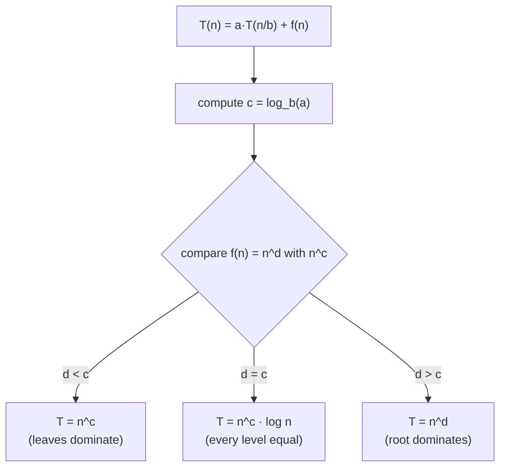

# Recurrence Relations and the Master Theorem

> A **recurrence** writes the running time of a recursive function in terms of smaller inputs. The **Master Theorem** reads the answer for divide-and-conquer recurrences in seconds.

#### 1. What Is It?

A recurrence has the form:

```text
T(n) = a · T(n / b) + f(n)
        │     │        └ work outside the recursive calls (split + combine)
        │     └ each subproblem is n/b in size
        └ number of recursive calls
```

| Algorithm | Recurrence | Why |
|---|---|---|
| Binary search | `T(n) = T(n/2) + 1` | one half, constant work |
| Merge sort | `T(n) = 2T(n/2) + n` | two halves, linear merge |
| Tree traversal (balanced) | `T(n) = 2T(n/2) + 1` | two halves, constant work |
| Quickselect (average) | `T(n) = T(n/2) + n` | one half, linear partition |
| Linear recursion | `T(n) = T(n−1) + 1` | one call, size shrinks by 1 |
| Naive Fibonacci | `T(n) = T(n−1) + T(n−2) + 1` | two calls |

**Signals:** "what is the time complexity of this recursive algorithm?", "solve the recurrence".

#### 2. How It Works

**Master Theorem.** Compare `f(n)` with `n^(log_b a)` (the total work at the leaves):

| Case | Condition | Result |
|---|---|---|
| 1. Leaves dominate | `f(n)` is smaller than `n^(log_b a)` | `T(n) = Θ(n^(log_b a))` |
| 2. Balanced | `f(n)` is about `n^(log_b a)` | `T(n) = Θ(n^(log_b a) · log n)` |
| 3. Root dominates | `f(n)` is bigger than `n^(log_b a)` | `T(n) = Θ(f(n))` |



**Worked examples**

| Recurrence | `a, b, f(n)` | `n^(log_b a)` | Case | Answer |
|---|---|---|---|---|
| Binary search `T(n/2) + 1` | 1, 2, `1` | `n⁰ = 1` | 2 | `O(log n)` |
| Merge sort `2T(n/2) + n` | 2, 2, `n` | `n¹` | 2 | `O(n log n)` |
| Tree traversal `2T(n/2) + 1` | 2, 2, `1` | `n¹` | 1 | `O(n)` |
| Quickselect `T(n/2) + n` | 1, 2, `n` | `n⁰ = 1` | 3 | `O(n)` |
| Karatsuba `3T(n/2) + n` | 3, 2, `n` | `n^1.585` | 1 | `O(n^1.585)` |
| Strassen `7T(n/2) + n²` | 7, 2, `n²` | `n^2.807` | 1 | `O(n^2.807)` |
| `4T(n/2) + n` | 4, 2, `n` | `n²` | 1 | `O(n²)` |

**Quick intuition.** Picture the recursion tree (note 04). Case 1: the bottom level has the most work. Case 2: every level has the same work, times `log n` levels. Case 3: the top level has the most work.

**When the theorem does not apply: `n − 1` style recurrences.** Unroll instead:

| Recurrence | Unrolled | Result |
|---|---|---|
| `T(n) = T(n−1) + 1` | `1 + 1 + ... + 1` | `O(n)` |
| `T(n) = T(n−1) + n` | `n + (n−1) + ... + 1` | `O(n²)` |
| `T(n) = 2T(n−1) + 1` | `1 + 2 + 4 + ... + 2ⁿ` | `O(2ⁿ)` |
| `T(n) = T(n−1) + T(n−2) + 1` | grows like Fibonacci | `O(1.618ⁿ)` |

#### 3. Brute Force vs Optimized

| Question | Slow way | Fast way |
|---|---|---|
| Find the complexity | expand the recursion by hand | Master Theorem in 10 seconds |
| Check your answer | guess | run the recursion and count work (below) |
| Reduce `2T(n−1)` | exponential | memoize (overlap) or halve (D&C) |

```kotlin
// Brute force check: count the work of T(n) = T(n - 1) + n by actually running it
fun workQuadratic(n: Int): Int = if (n == 0) 0 else n + workQuadratic(n - 1)
```

#### 4. Kotlin Code

```kotlin
import kotlin.math.abs
import kotlin.math.ln

// Master theorem for T(n) = a·T(n/b) + n^d
fun master(a: Int, b: Int, d: Double): String {
    val c = ln(a.toDouble()) / ln(b.toDouble())          // log_b(a)
    fun fmt(x: Double) = if (abs(x - Math.round(x)) < 1e-9) Math.round(x).toString() else "%.3f".format(x)
    return when {
        abs(c - d) < 1e-9 -> if (d == 0.0) "O(log n)" else "O(n^${fmt(d)} log n)"
        c > d -> "O(n^${fmt(c)})"
        else -> "O(n^${fmt(d)})"
    }
}

// Recurrences by running them
fun mergeShape(n: Int): Int = if (n <= 1) 1 else n + 2 * mergeShape(n / 2)        // 2T(n/2) + n
fun quadratic(n: Int): Int = if (n == 0) 0 else n + quadratic(n - 1)               // T(n-1) + n
fun doubling(n: Int): Int = if (n == 0) 0 else 2 * doubling(n - 1) + 1             // 2T(n-1) + 1
fun binaryShape(n: Int): Int = if (n <= 1) 1 else 1 + binaryShape(n / 2)           // T(n/2) + 1
```

Checks: `master(1, 2, 0.0)` → `"O(log n)"`. `master(2, 2, 1.0)` → `"O(n^1 log n)"` (that is `n log n`). `master(2, 2, 0.0)` → `"O(n^1)"`. `master(1, 2, 1.0)` → `"O(n^1)"`. `master(4, 2, 1.0)` → `"O(n^2)"`. `master(3, 2, 1.0)` → `"O(n^1.585)"`. `master(7, 2, 2.0)` → `"O(n^2.807)"`. `mergeShape(8)` → `32`; `mergeShape(16)` → `80`. `quadratic(4)` → `10`; `workQuadratic(4)` → `10`. `doubling(4)` → `15` (`2⁴ − 1`). `binaryShape(16)` → `5`; `binaryShape(1024)` → `11`.

#### 5. Complexity

| Pattern | Time |
|---|---|
| `T(n/2) + O(1)` | `O(log n)` |
| `T(n/2) + O(n)` | `O(n)` |
| `2T(n/2) + O(1)` | `O(n)` |
| `2T(n/2) + O(n)` | `O(n log n)` |
| `T(n−1) + O(1)` | `O(n)` |
| `T(n−1) + O(n)` | `O(n²)` |
| `2T(n−1) + O(1)` | `O(2ⁿ)` |

Memorise this table: it covers almost every interview recursion.

#### 6. Common Mistakes

1. **Using the Master Theorem on `T(n−1)` recurrences.** It needs division `n/b`.
2. **Forgetting the combine cost `f(n)`.**
3. **Mixing up `a` (calls) and `b` (shrink factor).**
4. **Saying `2T(n/2) + 1` is `n log n`.** It is `O(n)`.
5. **Ignoring hidden copy cost:** `copyOfRange` makes `f(n) = n` even if you meant `1`.
6. **Quoting average cases as worst cases** (quicksort, quickselect).

#### 7. Say This in the Interview

1. "This is `T(n) = 2T(n/2) + O(n)`: two half-size calls with a linear merge, so `O(n log n)` by the Master Theorem."
2. "Here the combine is `O(1)`, so the leaves dominate: `O(n)`."
3. "`T(n) = 2T(n−1) + 1` doubles per level, so it's `O(2ⁿ)`. Memoization would cut it down."

#### 8. Quick Check

1. Solve `T(n) = 2T(n/2) + 1`.
2. Solve `T(n) = T(n−1) + n`.
3. Solve `T(n) = T(n/2) + n`.

<details>
<summary>Answers</summary>

1. `O(n)`.
2. `O(n²)`.
3. `O(n)`.

</details>

#### 9. Related LeetCode Questions

| # | Question | Recurrence |
|---|---|---|
| 704 | [Binary Search](https://leetcode.com/problems/binary-search/) (Easy) | `T(n/2) + 1` |
| 912 | [Sort an Array](https://leetcode.com/problems/sort-an-array/) (Medium) | `2T(n/2) + n` |
| 104 | [Maximum Depth of Binary Tree](https://leetcode.com/problems/maximum-depth-of-binary-tree/) (Easy) | `2T(n/2) + 1` |
| 215 | [Kth Largest Element in an Array](https://leetcode.com/problems/kth-largest-element-in-an-array/) (Medium) | `T(n/2) + n` (average) |
| 50 | [Pow(x, n)](https://leetcode.com/problems/powx-n/) (Medium) | `T(n/2) + 1` |
| 509 | [Fibonacci Number](https://leetcode.com/problems/fibonacci-number/) (Easy) | `T(n−1) + T(n−2)` |
