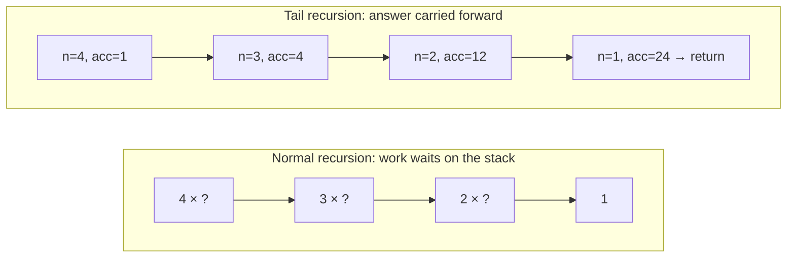

# Tail Recursion

> A recursive call that is the **very last thing** a function does. The compiler can turn it into a loop and reuse one stack frame. Kotlin supports this with the `tailrec` keyword.

#### 1. What Is It?

A call is in **tail position** if nothing is left to do after it returns: no multiplying, adding or combining.

```text
not tail:   return n * factorial(n - 1)          // multiply AFTER the call returns
tail:       return factorial(n - 1, n * acc)     // the call is the last action
```

| | Normal recursion | Tail recursion |
|---|---|---|
| Work after the call | yes | none |
| Frames kept | `n` | 1 (when optimised) |
| Space | `O(n)` | `O(1)` with `tailrec` |
| How | return value is combined on the way back | an **accumulator** carries the answer forward |

**Important:** the JVM itself does not optimise tail calls. Kotlin's `tailrec` does it at compile time, **only for a function calling itself directly**.

**Signals:** "can you avoid stack overflow", "make it `O(1)` space", linear recursion that just accumulates a value.

#### 2. How It Works

Turn `factorial` into a tail-recursive version by adding an accumulator.

```text
factorialTail(4, acc=1)
→ factorialTail(3, acc=4)
→ factorialTail(2, acc=12)
→ factorialTail(1, acc=24)    base case: return acc = 24
```



**Recipe**

1. Add an accumulator parameter (with a default value).
2. Base case: return the accumulator.
3. Recursive case: update the accumulator **in the arguments** and call yourself last.
4. Add `tailrec`. If the call is not truly last, Kotlin warns you.

**What `tailrec` compiles to:** a `while` loop that reassigns the parameters. So it is the same as writing the loop yourself.

**Does not work for:** Fibonacci's `fib(n−1) + fib(n−2)` (two calls, and an addition after), tree recursion, backtracking. For those, use memoization or an explicit stack.

#### 3. Brute Force vs Optimized

| Version | Time | Space | Overflows at depth ~10⁵? |
|---|---|---|---|
| Normal recursion | `O(n)` | `O(n)` | yes |
| **Tail recursion (`tailrec`)** | `O(n)` | `O(1)` | no |
| Loop | `O(n)` | `O(1)` | no |

```kotlin
// Not tail recursive: the + happens after the call
fun sumNormal(n: Int): Long = if (n == 0) 0L else n + sumNormal(n - 1)
// sumNormal(1_000_000) → StackOverflowError on a default stack
```

#### 4. Kotlin Code

```kotlin
// Sum 1..n with an accumulator
tailrec fun sumTail(n: Int, acc: Long = 0L): Long =
    if (n == 0) acc else sumTail(n - 1, acc + n)

// Factorial
tailrec fun factorialTail(n: Int, acc: Long = 1L): Long =
    if (n <= 1) acc else factorialTail(n - 1, acc * n)

// Fibonacci in O(n) time and O(1) space: two accumulators
tailrec fun fibTail(n: Int, a: Long = 0L, b: Long = 1L): Long =
    if (n == 0) a else fibTail(n - 1, b, a + b)

// GCD (Euclid): naturally tail recursive
tailrec fun gcd(a: Int, b: Int): Int = if (b == 0) a else gcd(b, a % b)

// Reverse a linked list with an accumulator (LeetCode 206)
class ListNode(var `val`: Int) { var next: ListNode? = null }

tailrec fun reverseTail(cur: ListNode?, prev: ListNode? = null): ListNode? {
    if (cur == null) return prev
    val next = cur.next
    cur.next = prev
    return reverseTail(next, cur)
}
```

Checks: `sumTail(100_000)` → `5000050000` with no stack overflow. `sumTail(0)` → `0`. `factorialTail(5)` → `120`; `factorialTail(0)` → `1`. `fibTail(10)` → `55`; `fibTail(0)` → `0`; `fibTail(1)` → `1`; `fibTail(90)` → `2880067194370816120`. `gcd(48, 18)` → `6`; `gcd(7, 0)` → `7`; `gcd(17, 5)` → `1`. `reverseTail(1→2→3)` → `3→2→1`. `sumNormal(1000)` → `500500`.

#### 5. Complexity

| | Time | Space |
|---|---|---|
| `sumTail`, `factorialTail`, `gcd` | `O(n)` (`gcd`: `O(log min(a, b))`) | `O(1)` with `tailrec` |
| `fibTail` | `O(n)` | `O(1)` |
| Normal recursion version | same time | `O(n)` |

#### 6. Common Mistakes

1. **Believing Java/Kotlin tail calls are optimised automatically.** Only `tailrec` on direct self-calls.
2. **A call that looks last but is not** (`n + f(n − 1)` or `f(n − 1) + f(n − 2)`).
3. **Forgetting the accumulator default** (callers must pass an extra argument).
4. **Updating the accumulator after the call** instead of in the arguments.
5. **Mutual recursion** (`a` calls `b`, `b` calls `a`) is not optimised by `tailrec`.
6. **Overflow:** `Int` accumulators for large sums; use `Long`.
7. **Calling it "recursion with no stack" in an interview without saying `tailrec` does the conversion.**

#### 7. Say This in the Interview

1. "This recursion does work after the call returns, so it isn't tail recursive. I can add an accumulator and make the call the last action."
2. "Kotlin's `tailrec` compiles a self tail call into a loop, so the space drops from `O(n)` to `O(1)`. The JVM itself doesn't do tail-call optimisation."
3. "For tree recursion I can't use `tailrec`; I'd use an explicit stack if depth is a risk."

#### 8. Quick Check

1. Is `return 1 + f(n − 1)` a tail call?
2. What does `tailrec` produce?
3. Can naive `fib(n−1) + fib(n−2)` be `tailrec`?

<details>
<summary>Answers</summary>

1. No: the `1 +` happens after the call returns.
2. A loop that reuses the same frame.
3. No. Rewrite with two accumulators (`fibTail`).

</details>

#### 9. Related LeetCode Questions

| # | Question | Idea |
|---|---|---|
| 509 | [Fibonacci Number](https://leetcode.com/problems/fibonacci-number/) (Easy) | two accumulators |
| 70 | [Climbing Stairs](https://leetcode.com/problems/climbing-stairs/) (Easy) | Fibonacci with accumulators |
| 206 | [Reverse Linked List](https://leetcode.com/problems/reverse-linked-list/) (Easy) | accumulator = reversed part |
| 1071 | [Greatest Common Divisor of Strings](https://leetcode.com/problems/greatest-common-divisor-of-strings/) (Easy) | Euclid's idea |
| 258 | [Add Digits](https://leetcode.com/problems/add-digits/) (Easy) | repeated reduction |
| 50 | [Pow(x, n)](https://leetcode.com/problems/powx-n/) (Medium) | accumulator power |
