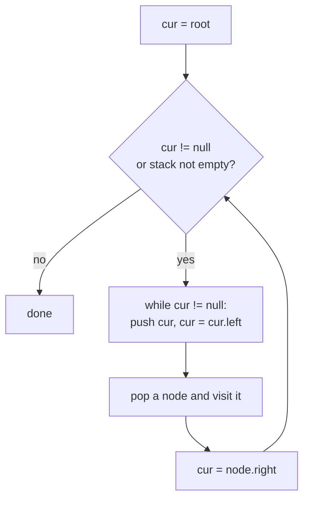

# Recursion to Iteration: Using an Explicit Stack

> Any recursion can be rewritten with a loop and your own stack. You do by hand what the call stack does automatically. This avoids stack overflow and is a common interview follow-up.

#### 1. What Is It?

The call stack holds "what to do next". An **explicit stack** is the same thing, stored on the heap in an `ArrayDeque`, so depth is limited by memory, not by the thread's stack size.

| | Recursive | Iterative with a stack |
|---|---|---|
| Code | short, close to the definition | longer, needs care |
| Depth limit | thread stack (about 10⁴ frames) | heap memory |
| Speed | similar (function call overhead) | similar, slightly faster |
| When to choose | default; clearer | very deep input; interviewer asks for it |

**Signals:** "do it iteratively", "without recursion", "tree is very deep / skewed", "grid up to 1000 × 1000", "implement an iterator over a tree" (stack of pending nodes).

#### 2. How It Works

**Recipe**

1. Put the starting state on the stack.
2. While the stack is not empty: pop a state, process it, push the states the recursive calls would have made.
3. If order matters, push in **reverse** of the order you want to visit (stack is last-in, first-out).

| Traversal | Push order |
|---|---|
| Preorder (root, left, right) | push right, then left |
| Inorder (left, root, right) | go left pushing, pop, visit, move right |
| Postorder (left, right, root) | preorder as (root, right, left), then reverse |
| DFS on a grid | push unvisited neighbours (mark visited when pushed) |

**Inorder, step by step** on a tree with root `2`, left `1`, right `3`:

```text
cur = 2: push 2, go left → cur = 1: push 1, go left → cur = null
pop 1 → visit 1; cur = 1.right = null
pop 2 → visit 2; cur = 2.right = 3
cur = 3: push 3, go left → null; pop 3 → visit 3
visit order: 1, 2, 3
```



**Recursion vs iteration state.** When the recursion has *work after the call* (postorder, backtracking), the stack must store more than the node: for example `(node, stage)` or the partial result.

#### 3. Brute Force vs Optimized

| Approach | Space | Overflow risk |
|---|---|---|
| Recursive DFS | `O(h)` call stack | yes on skewed input |
| **Explicit stack** | `O(h)` heap | no |
| Morris traversal (inorder) | `O(1)` | no, but changes pointers temporarily |
| BFS with a queue | `O(width)` | no |

```kotlin
// Recursive inorder: short but depth = tree height
fun inorderRec(root: TreeNode?, out: MutableList<Int> = mutableListOf()): List<Int> {
    if (root == null) return out
    inorderRec(root.left, out)
    out.add(root.`val`)
    inorderRec(root.right, out)
    return out
}
```

#### 4. Kotlin Code

```kotlin
class TreeNode(var `val`: Int) { var left: TreeNode? = null; var right: TreeNode? = null }

// Inorder (LeetCode 94)
fun inorder(root: TreeNode?): List<Int> {
    val result = ArrayList<Int>()
    val stack = ArrayDeque<TreeNode>()
    var cur = root
    while (cur != null || stack.isNotEmpty()) {
        while (cur != null) { stack.addLast(cur); cur = cur.left }   // go as far left as possible
        val node = stack.removeLast()
        result.add(node.`val`)
        cur = node.right
    }
    return result
}

// Preorder (LeetCode 144)
fun preorder(root: TreeNode?): List<Int> {
    val result = ArrayList<Int>()
    if (root == null) return result
    val stack = ArrayDeque<TreeNode>()
    stack.addLast(root)
    while (stack.isNotEmpty()) {
        val node = stack.removeLast()
        result.add(node.`val`)
        node.right?.let { stack.addLast(it) }       // right first, so left is popped first
        node.left?.let { stack.addLast(it) }
    }
    return result
}

// Postorder (LeetCode 145): (root, right, left) reversed
fun postorder(root: TreeNode?): List<Int> {
    val result = ArrayList<Int>()
    if (root == null) return result
    val stack = ArrayDeque<TreeNode>()
    stack.addLast(root)
    while (stack.isNotEmpty()) {
        val node = stack.removeLast()
        result.add(node.`val`)
        node.left?.let { stack.addLast(it) }
        node.right?.let { stack.addLast(it) }
    }
    result.reverse()
    return result
}

// Number of Islands (LeetCode 200) with an explicit stack instead of recursive DFS
fun numIslands(grid: Array<CharArray>): Int {
    if (grid.isEmpty()) return 0
    val m = grid.size
    val n = grid[0].size
    val dirs = arrayOf(intArrayOf(1, 0), intArrayOf(-1, 0), intArrayOf(0, 1), intArrayOf(0, -1))
    var count = 0
    for (r in 0 until m) for (c in 0 until n) {
        if (grid[r][c] != '1') continue
        count++
        val stack = ArrayDeque<IntArray>()
        stack.addLast(intArrayOf(r, c))
        grid[r][c] = '0'                              // mark visited when pushed
        while (stack.isNotEmpty()) {
            val (cr, cc) = stack.removeLast()
            for (d in dirs) {
                val nr = cr + d[0]
                val nc = cc + d[1]
                if (nr in 0 until m && nc in 0 until n && grid[nr][nc] == '1') {
                    grid[nr][nc] = '0'
                    stack.addLast(intArrayOf(nr, nc))
                }
            }
        }
    }
    return count
}
```

Checks (tree: root `2`, left `1`, right `3`; second tree: root `1`, right `2`, whose left is `3`): `inorder` → `[1, 2, 3]` and `[1, 3, 2]`. `preorder` → `[2, 1, 3]` and `[1, 2, 3]`. `postorder` → `[1, 3, 2]` and `[3, 2, 1]`. `inorder(null)` → `[]`. `inorderRec` matches `inorder` on both trees. `numIslands` on rows `"110"`, `"010"`, `"001"` → `2`; on all `'0'` → `0`; on an empty grid → `0`. (Both the recursive and iterative island counts change the input grid; copy it first if you need it again.)

#### 5. Complexity

| | Time | Space |
|---|---|---|
| Iterative tree traversals | `O(n)` | `O(h)` heap |
| Grid DFS with a stack | `O(mn)` | `O(mn)` worst |
| Morris inorder | `O(n)` | `O(1)` |

#### 6. Common Mistakes

1. **Pushing left before right in preorder** (visits right first).
2. **Marking visited when popping** instead of when pushing (duplicates in the stack on grids).
3. **Using `Stack` or `LinkedList` in Kotlin** when `ArrayDeque` is simpler and faster (`addLast` / `removeLast`).
4. **Forgetting `cur = node.right`** in inorder, causing an infinite loop.
5. **Postorder done as a single reversed list** without thinking: it works only through the root-right-left trick.
6. **Mutating the input grid** without saying so.

#### 7. Say This in the Interview

1. "The recursive version is `O(h)` stack. To avoid overflow on a skewed tree I'll keep my own stack on the heap."
2. "I push the right child first so that the left child is popped first, matching preorder."
3. "If I needed `O(1)` space I could use Morris traversal, which temporarily re-links nodes."

#### 8. Quick Check

1. Which push order gives preorder?
2. Why mark a grid cell visited when pushing it?
3. Data structure for the explicit stack in Kotlin?

<details>
<summary>Answers</summary>

1. Right first, then left.
2. Otherwise the same cell can be pushed many times by different neighbours.
3. `ArrayDeque` with `addLast` and `removeLast`.

</details>

#### 9. Related LeetCode Questions

| # | Question | Idea |
|---|---|---|
| 94 | [Binary Tree Inorder Traversal](https://leetcode.com/problems/binary-tree-inorder-traversal/) (Easy) | go left, pop, go right |
| 144 | [Binary Tree Preorder Traversal](https://leetcode.com/problems/binary-tree-preorder-traversal/) (Easy) | push right then left |
| 145 | [Binary Tree Postorder Traversal](https://leetcode.com/problems/binary-tree-postorder-traversal/) (Easy) | reverse of root-right-left |
| 200 | [Number of Islands](https://leetcode.com/problems/number-of-islands/) (Medium) | stack DFS on a grid |
| 173 | [Binary Search Tree Iterator](https://leetcode.com/problems/binary-search-tree-iterator/) (Medium) | controlled inorder stack |
| 341 | [Flatten Nested List Iterator](https://leetcode.com/problems/flatten-nested-list-iterator/) (Medium) | stack of iterators |
