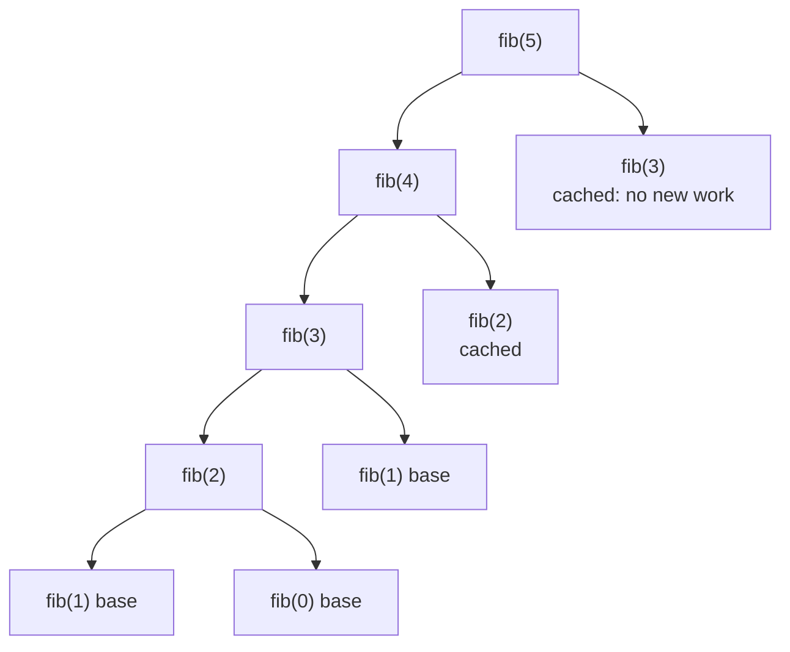

# Memoization: the Bridge to Dynamic Programming

> If a recursive function is called again with the **same arguments**, remember the first answer. This turns exponential recursion into polynomial time. It is the first half of dynamic programming.

#### 1. What Is It?

**Memoization** = recursion + a cache (`HashMap` or array) keyed by the function's arguments.

```text
solve(state):
    if state in cache: return cache[state]       ← skip repeated work
    answer = ... recursive calls ...
    cache[state] = answer
    return answer
```

| | Plain recursion | Memoized recursion |
|---|---|---|
| Each subproblem solved | many times | **once** |
| Fibonacci | `O(2ⁿ)` | `O(n)` |
| Extra space | stack | stack + cache |

**Requirements**

1. **Overlapping subproblems:** the same arguments appear more than once (note 04's tree shows repeated nodes).
2. **Pure function:** the answer depends only on the arguments, not on outside state.
3. **A key** that captures every argument that changes.

**Signals:** "count the number of ways", "minimum cost / maximum value", "can we reach", brute force that is exponential with repeated states, recursion with parameters like `(index, remaining)` or `(row, col)`.

#### 2. How It Works

`fib(5)` with a cache. Repeated calls are answered instantly:



The tree shrinks from 15 calls to 9. For `fib(30)`: **2,692,537 calls** become **59**.

**Memoization (top-down) vs tabulation (bottom-up)**

| | Memoization | Tabulation |
|---|---|---|
| Direction | from the big problem down | from base cases up |
| Computes | only the needed states | all states |
| Stack | uses recursion depth | none |
| Code | nearly the plain recursion | explicit loops and a table |

**How to memoize any recursion in 4 steps**

1. Write the plain recursion (base case + recursive case).
2. Identify the arguments that change: they are the **state**.
3. Add a cache keyed by the state (an array if the state is small integers).
4. Check the cache first, and store before returning.

This is exactly the start of dynamic programming (see `5` Dynamic Programming notes 02 and 03).

#### 3. Brute Force vs Optimized

| Problem | Plain recursion | Memoized |
|---|---|---|
| Fibonacci | `O(2ⁿ)` | `O(n)` |
| Climbing Stairs | `O(2ⁿ)` | `O(n)` |
| Unique Paths `m × n` | `O(2^(m+n))` | `O(mn)` |
| House Robber | `O(2ⁿ)` | `O(n)` |
| Coin Change (amount `A`, `c` coins) | `O(cᴬ)` | `O(A · c)` |

```kotlin
// Plain recursion for Unique Paths: exponential
fun pathsPlain(r: Int, c: Int): Int =
    if (r == 0 || c == 0) 1 else pathsPlain(r - 1, c) + pathsPlain(r, c - 1)
```

#### 4. Kotlin Code

```kotlin
// Fibonacci with a HashMap
fun fibMemo(n: Int, memo: HashMap<Int, Long> = HashMap()): Long {
    if (n < 2) return n.toLong()
    memo[n]?.let { return it }                         // cache hit
    val result = fibMemo(n - 1, memo) + fibMemo(n - 2, memo)
    memo[n] = result
    return result
}

// Count invocations with and without the cache
fun countCalls(n: Int, useMemo: Boolean): Int {
    var calls = 0
    val memo = HashMap<Int, Long>()
    fun fib(k: Int): Long {
        calls++
        if (k < 2) return k.toLong()
        if (useMemo) memo[k]?.let { return it }
        val r = fib(k - 1) + fib(k - 2)
        if (useMemo) memo[k] = r
        return r
    }
    fib(n)
    return calls
}

// Unique Paths (LeetCode 62): state = (row, col), array cache
fun uniquePaths(m: Int, n: Int): Int {
    val memo = Array(m) { IntArray(n) { -1 } }
    fun go(r: Int, c: Int): Int {
        if (r == 0 || c == 0) return 1
        if (memo[r][c] != -1) return memo[r][c]
        memo[r][c] = go(r - 1, c) + go(r, c - 1)
        return memo[r][c]
    }
    return go(m - 1, n - 1)
}

// House Robber (LeetCode 198): state = index
fun rob(nums: IntArray): Int {
    val memo = IntArray(nums.size) { -1 }
    fun best(i: Int): Int {
        if (i >= nums.size) return 0
        if (memo[i] != -1) return memo[i]
        memo[i] = maxOf(best(i + 1), nums[i] + best(i + 2))    // skip, or rob this house
        return memo[i]
    }
    return best(0)
}

// Coin Change (LeetCode 322): state = remaining amount
fun coinChange(coins: IntArray, amount: Int): Int {
    val memo = IntArray(amount + 1) { -2 }              // -2 = not computed, -1 = impossible
    fun fewest(rem: Int): Int {
        if (rem == 0) return 0
        if (rem < 0) return -1
        if (memo[rem] != -2) return memo[rem]
        var best = Int.MAX_VALUE
        for (c in coins) {
            val sub = fewest(rem - c)
            if (sub >= 0) best = minOf(best, sub + 1)
        }
        memo[rem] = if (best == Int.MAX_VALUE) -1 else best
        return memo[rem]
    }
    return fewest(amount)
}
```

Checks: `fibMemo(10)` → `55`; `fibMemo(50)` → `12586269025`. `countCalls(5, false)` → `15`; `countCalls(30, false)` → `2692537`; `countCalls(30, true)` → `59`. `uniquePaths(3, 7)` → `28`; `uniquePaths(3, 2)` → `3`; `uniquePaths(1, 1)` → `1`. `pathsPlain(2, 6)` → `28`. `rob(intArrayOf(1, 2, 3, 1))` → `4`; `rob(intArrayOf(2, 7, 9, 3, 1))` → `12`; `rob(intArrayOf())` → `0`. `coinChange(intArrayOf(1, 2, 5), 11)` → `3`; `coinChange(intArrayOf(2), 3)` → `-1`; `coinChange(intArrayOf(1), 0)` → `0`.

#### 5. Complexity

| | Time | Space |
|---|---|---|
| Memoized recursion | (number of states) × (work per state) | cache + stack depth |
| `fibMemo` | `O(n)` | `O(n)` |
| `uniquePaths` | `O(mn)` | `O(mn)` |
| `coinChange` | `O(A · c)` | `O(A)` |

#### 6. Common Mistakes

1. **A cache key that misses an argument** (wrong answers that look right on small tests).
2. **Using `0` as the "not computed" marker** when `0` is a valid answer. Use `-1` or `-2`, or a nullable.
3. **Memoizing a function with side effects** or outside state.
4. **A default `HashMap()` parameter** that is not passed down (a fresh cache every call, so no speed-up).
5. **Storing results after returning** (store first, then return).
6. **Deep recursion** on large `n` (memoized `fib(100000)` overflows the stack). Switch to tabulation.
7. **Memoizing a non-overlapping recursion** (merge sort), which only adds overhead.

#### 7. Say This in the Interview

1. "The same `(index, remaining)` is being solved repeatedly, so I'll cache by that state. Each state is computed once: `O(states × work per state)`."
2. "This is top-down dynamic programming. I could convert it to a bottom-up table to avoid the recursion depth."
3. "The cache key must contain every parameter that changes the answer."

#### 8. Quick Check

1. What makes memoization useful?
2. Calls for memoized `fib(30)`?
3. Why not use `0` as the empty marker for `coinChange`?

<details>
<summary>Answers</summary>

1. Overlapping subproblems: the same arguments repeat.
2. 59.
3. `0` is a valid answer (amount `0` needs `0` coins), so you couldn't tell it from "not computed".

</details>

#### 9. Related LeetCode Questions

| # | Question | Idea |
|---|---|---|
| 509 | [Fibonacci Number](https://leetcode.com/problems/fibonacci-number/) (Easy) | memoize `n` |
| 70 | [Climbing Stairs](https://leetcode.com/problems/climbing-stairs/) (Easy) | memoize `n` |
| 198 | [House Robber](https://leetcode.com/problems/house-robber/) (Medium) | memoize index |
| 62 | [Unique Paths](https://leetcode.com/problems/unique-paths/) (Medium) | memoize `(r, c)` |
| 322 | [Coin Change](https://leetcode.com/problems/coin-change/) (Medium) | memoize remaining |
| 329 | [Longest Increasing Path in a Matrix](https://leetcode.com/problems/longest-increasing-path-in-a-matrix/) (Hard) | memoize cell |
