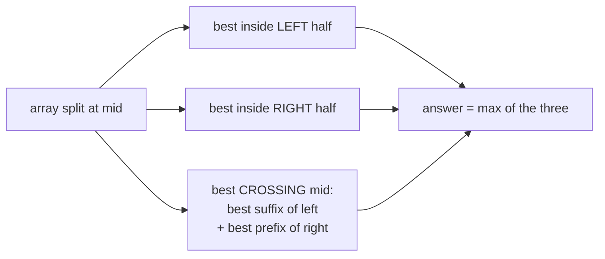

# Classic Divide and Conquer: Max Subarray, Closest Pair, Fast Exponentiation

> Three famous divide-and-conquer examples. **Fast exponentiation** is the one you will use most. **Max subarray** teaches the "crossing the middle" idea. **Closest pair** is idea-only.

#### 1. What Is It?

| Problem | Divide | Combine | Time | Better known solution |
|---|---|---|---|---|
| **Fast exponentiation** `xⁿ` | halve `n` | square (and multiply by `x` if `n` is odd) | `O(log n)` | same (binary exponentiation) |
| **Maximum subarray** | halves | best of: left, right, **crossing the middle** | `O(n log n)` | Kadane `O(n)` |
| **Closest pair of points** (⚪ idea only) | split by x | best of left, right, and a narrow **strip** | `O(n log n)` | none simpler |

**Signals:** "compute `xⁿ` or `xⁿ mod m` for huge `n`", "largest sum contiguous subarray", "closest two points", "the answer may lie across the split".

#### 2. How It Works

**Fast exponentiation.** `x¹⁰ = (x⁵)²` and `x⁵ = (x²)² · x`. Each step halves `n`.

```text
power(2, 10) = power(2, 5)²
power(2, 5)  = power(2, 2)² · 2
power(2, 2)  = power(2, 1)²
power(2, 1)  = power(2, 0)² · 2 = 1 · 2 = 2
→ 4 → 32 → 1024        about log₂ 10 ≈ 4 levels instead of 10 multiplications
```

Compute `power(x, n/2)` **once** and square it. Calling it twice makes it `O(n)` again.

**Maximum subarray.** The best subarray is entirely in the left half, entirely in the right half, or **crosses the middle**.



Example `[-2, 1, -3, 4, -1, 2, 1, -5, 4]`: the best subarray is `[4, -1, 2, 1]` with sum **6**. It crosses the middle of the array, so the cross case finds it.

**Closest pair (idea only).**

1. Sort the points by x. Split at the middle line.
2. Solve the left and right halves: `d = min(dLeft, dRight)`.
3. Only points within distance `d` of the middle line can beat `d`. Take that **strip**, sort it by y.
4. For each point in the strip, only the next few (at most 7) points in y-order can be closer than `d`.

Total `O(n log n)`. The brute force is all pairs, `O(n²)`.

#### 3. Brute Force vs Optimized

| Problem | Brute force | Divide and conquer | Best |
|---|---|---|---|
| `xⁿ` | multiply `n` times `O(n)` | halve `O(log n)` | `O(log n)` |
| Max subarray | all subarrays `O(n²)` (`O(n³)` naive) | `O(n log n)` | Kadane `O(n)` |
| Closest pair | all pairs `O(n²)` | `O(n log n)` | `O(n log n)` |

```kotlin
// Brute force max subarray: every start, extend the end
fun maxSubArrayBrute(nums: IntArray): Int {
    var best = Int.MIN_VALUE
    for (i in nums.indices) {
        var sum = 0
        for (j in i until nums.size) { sum += nums[j]; best = maxOf(best, sum) }
    }
    return best
}

// Brute force closest pair: squared distance of the closest two points
fun closestPairBrute(p: List<Pair<Int, Int>>): Long {
    var best = Long.MAX_VALUE
    for (i in p.indices) for (j in i + 1 until p.size) {
        val dx = (p[i].first - p[j].first).toLong()
        val dy = (p[i].second - p[j].second).toLong()
        best = minOf(best, dx * dx + dy * dy)
    }
    return best
}
```

#### 4. Kotlin Code

```kotlin
// Fast exponentiation, Pow(x, n) (LeetCode 50), handles negative n
fun myPow(x: Double, n: Int): Double {
    val exp = n.toLong()                               // Long: -Int.MIN_VALUE would overflow an Int
    return if (exp < 0) 1.0 / power(x, -exp) else power(x, exp)
}

private fun power(x: Double, n: Long): Double {
    if (n == 0L) return 1.0
    val half = power(x, n / 2)                         // compute ONCE
    return if (n % 2 == 0L) half * half else half * half * x
}

// Iterative binary exponentiation with a modulus (common in number theory)
fun powMod(base: Long, exp: Long, mod: Long): Long {
    var result = 1L
    var b = base % mod
    var e = exp
    while (e > 0) {
        if ((e and 1L) == 1L) result = result * b % mod
        b = b * b % mod
        e = e shr 1
    }
    return result
}

// Maximum subarray by divide and conquer
fun maxSubArrayDC(nums: IntArray): Int = solve(nums, 0, nums.size - 1)

private fun solve(a: IntArray, lo: Int, hi: Int): Int {
    if (lo == hi) return a[lo]
    val mid = lo + (hi - lo) / 2
    val left = solve(a, lo, mid)
    val right = solve(a, mid + 1, hi)
    var sum = 0
    var leftBest = Int.MIN_VALUE
    for (i in mid downTo lo) { sum += a[i]; leftBest = maxOf(leftBest, sum) }     // best suffix of the left
    sum = 0
    var rightBest = Int.MIN_VALUE
    for (i in mid + 1..hi) { sum += a[i]; rightBest = maxOf(rightBest, sum) }     // best prefix of the right
    return maxOf(left, right, leftBest + rightBest)
}

// Kadane: the O(n) answer to remember
fun maxSubArrayKadane(nums: IntArray): Int {
    var current = nums[0]
    var best = nums[0]
    for (i in 1 until nums.size) {
        current = maxOf(nums[i], current + nums[i])     // extend, or start fresh
        best = maxOf(best, current)
    }
    return best
}
```

Checks: `myPow(2.0, 10)` → `1024.0`; `myPow(2.0, -2)` → `0.25`; `myPow(2.1, 3)` → about `9.261`; `myPow(2.0, 0)` → `1.0`; `myPow(2.0, Int.MIN_VALUE)` → `0.0`. `powMod(2, 10, 1000)` → `24`; `powMod(3, 200, 13)` → `9`. `maxSubArrayDC(intArrayOf(-2, 1, -3, 4, -1, 2, 1, -5, 4))` → `6`; `(intArrayOf(1))` → `1`; `(intArrayOf(5, 4, -1, 7, 8))` → `23`; `(intArrayOf(-3, -1, -2))` → `-1`. Kadane and `maxSubArrayBrute` give the same four answers. `closestPairBrute(listOf(0 to 0, 3 to 4, 1 to 1))` → `2`.

#### 5. Complexity

| | Time | Space |
|---|---|---|
| `myPow` / `powMod` | `O(log n)` | `O(log n)` recursive, `O(1)` iterative |
| `maxSubArrayDC` | `O(n log n)` | `O(log n)` |
| Kadane | `O(n)` | `O(1)` |
| Closest pair (D&C) | `O(n log n)` | `O(n)` |
| Closest pair (brute) | `O(n²)` | `O(1)` |

#### 6. Common Mistakes

1. **Calling `power(x, n/2)` twice** (loses the speed-up).
2. **Negative exponent bug:** `-n` overflows for `Int.MIN_VALUE`. Convert to `Long` first.
3. **`Int` overflow in `powMod`:** multiply as `Long` and reduce after every multiplication.
4. **Max subarray: forgetting the crossing case.**
5. **Cross sums starting from 0** instead of `Int.MIN_VALUE` (wrong for all-negative arrays).
6. **Closest pair: checking every strip pair** instead of the next few by y.
7. **Using D&C max subarray when Kadane is expected.**

#### 7. Say This in the Interview

1. "I compute `x^(n/2)` once and square it, so the exponent halves each call: `O(log n)`."
2. "The maximum subarray is in the left half, the right half, or crosses the middle. The crossing part is the best suffix of the left plus the best prefix of the right. That is `O(n log n)`; Kadane's is `O(n)`, and I'd write that one."
3. "For closest pair I'd sort by x, recurse on halves and check a strip of width `d` around the middle."

#### 8. Quick Check

1. Multiplications for `x¹⁰²⁴` with fast power?
2. Why use `Long` for the exponent in `myPow`?
3. Kadane's time vs the D&C max subarray?

<details>
<summary>Answers</summary>

1. About 10 squarings (`log₂ 1024`).
2. `-Int.MIN_VALUE` does not fit in an `Int`.
3. Kadane `O(n)`, D&C `O(n log n)`.

</details>

#### 9. Related LeetCode Questions

| # | Question | Idea |
|---|---|---|
| 50 | [Pow(x, n)](https://leetcode.com/problems/powx-n/) (Medium) | fast exponentiation |
| 69 | [Sqrt(x)](https://leetcode.com/problems/sqrtx/) (Easy) | halving search |
| 169 | [Majority Element](https://leetcode.com/problems/majority-element/) (Easy) | D&C: majority of each half |
| 53 | [Maximum Subarray](https://leetcode.com/problems/maximum-subarray/) (Medium) | D&C or Kadane |
| 372 | [Super Pow](https://leetcode.com/problems/super-pow/) (Medium) | modular fast power |
| 218 | [The Skyline Problem](https://leetcode.com/problems/the-skyline-problem/) (Hard) | merge skylines |
