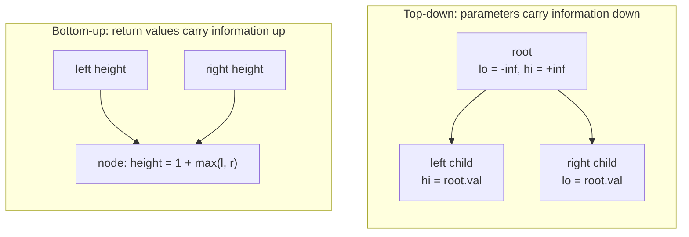

# Recursion on Trees, Lists and Strings: Top-Down vs Bottom-Up

> Most recursion in interviews is on **trees and linked lists**. There are only two styles: pass information **down** as parameters, or return information **up** as the result.

#### 1. What Is It?

| Style | Information flows | Typical use |
|---|---|---|
| **Top-down** (pass down) | from parent to children, via parameters | valid BST bounds, path sum, depth so far |
| **Bottom-up** (return up) | from children to parent, via return values | height, diameter, balanced check, LCA |

A tree is a recursive structure: a node, a left tree, a right tree. A linked list is a node plus a shorter list. So the template is always:

```kotlin
fun solve(node: TreeNode?): Result {
    if (node == null) return /* base case */
    val left = solve(node.left)
    val right = solve(node.right)
    return /* combine node, left, right */
}
```

**Signals:** any binary tree question, "for each node", "path", "depth/height", "same/symmetric", "swap/reverse a list recursively".

#### 2. How It Works



**Which style?**

| If the answer for a node depends on... | Use |
|---|---|
| what is **above** it (ancestors, running sum) | top-down |
| what is **below** it (subtrees) | bottom-up |
| both | bottom-up, plus a global variable or a pair `(a, b)` |

**Bottom-up with a global.** Diameter = longest path between any two nodes. At each node the best path through it is `leftHeight + rightHeight`, but the function must *return* only the height (`1 + max(l, r)`). Keep the best in an outer variable.

**Linked lists.** `head` plus `rest`. Trust the recursive call on `head.next`, then fix up the links.

```text
swapPairs(1→2→3→4):
  second = 2;  head(1).next = swapPairs(3→4) = 4→3
  second(2).next = head(1)        → 2→1→4→3
```

**Depth.** Recursion depth = tree height `h` (`log n` balanced, `n` skewed). For huge skewed trees use an explicit stack (note 07).

#### 3. Brute Force vs Optimized

| Problem | Naive | Better |
|---|---|---|
| Is the tree balanced? | compute height at every node repeatedly `O(n²)` | one bottom-up pass returning `-1` when unbalanced `O(n)` |
| Diameter | height of both sides at each node `O(n²)` | one pass with a global `O(n)` |
| Valid BST | check only the node vs its children (wrong) | pass `(lo, hi)` bounds down `O(n)` |
| Path sum | enumerate all paths | subtract as you go down `O(n)` |

```kotlin
// Naive balanced check: height() is recomputed at every node → O(n²) on a skewed tree
fun isBalancedNaive(root: TreeNode?): Boolean {
    if (root == null) return true
    return Math.abs(height(root.left) - height(root.right)) <= 1 &&
        isBalancedNaive(root.left) && isBalancedNaive(root.right)
}
fun height(n: TreeNode?): Int = if (n == null) 0 else 1 + maxOf(height(n.left), height(n.right))
```

#### 4. Kotlin Code

```kotlin
class TreeNode(var `val`: Int) { var left: TreeNode? = null; var right: TreeNode? = null }
class ListNode(var `val`: Int) { var next: ListNode? = null }

// Build a tree from a level-order list (null = missing), used in the checks below
fun buildTree(vals: List<Int?>): TreeNode? {
    if (vals.isEmpty() || vals[0] == null) return null
    val root = TreeNode(vals[0]!!)
    val queue = ArrayDeque<TreeNode>()
    queue.addLast(root)
    var i = 1
    while (i < vals.size && queue.isNotEmpty()) {
        val node = queue.removeFirst()
        vals.getOrNull(i++)?.let { node.left = TreeNode(it); queue.addLast(node.left!!) }
        vals.getOrNull(i++)?.let { node.right = TreeNode(it); queue.addLast(node.right!!) }
    }
    return root
}

// ---- Bottom-up ----
fun maxDepth(root: TreeNode?): Int =                                  // LeetCode 104
    if (root == null) 0 else 1 + maxOf(maxDepth(root.left), maxDepth(root.right))

fun diameterOfBinaryTree(root: TreeNode?): Int {                      // LeetCode 543
    var best = 0
    fun depth(n: TreeNode?): Int {
        if (n == null) return 0
        val l = depth(n.left)
        val r = depth(n.right)
        best = maxOf(best, l + r)                                     // path through this node
        return 1 + maxOf(l, r)                                        // but return only the height
    }
    depth(root)
    return best
}

fun isBalanced(root: TreeNode?): Boolean {                            // LeetCode 110, O(n)
    fun h(n: TreeNode?): Int {                                        // -1 means "unbalanced"
        if (n == null) return 0
        val l = h(n.left); if (l == -1) return -1
        val r = h(n.right); if (r == -1) return -1
        return if (Math.abs(l - r) > 1) -1 else 1 + maxOf(l, r)
    }
    return h(root) != -1
}

fun lowestCommonAncestor(root: TreeNode?, p: Int, q: Int): TreeNode? {   // LeetCode 236
    if (root == null || root.`val` == p || root.`val` == q) return root
    val l = lowestCommonAncestor(root.left, p, q)
    val r = lowestCommonAncestor(root.right, p, q)
    return if (l != null && r != null) root else l ?: r
}

fun invertTree(root: TreeNode?): TreeNode? {                          // LeetCode 226
    if (root == null) return null
    val left = invertTree(root.left)
    root.left = invertTree(root.right)
    root.right = left
    return root
}

fun isSameTree(a: TreeNode?, b: TreeNode?): Boolean {                 // LeetCode 100
    if (a == null && b == null) return true
    if (a == null || b == null || a.`val` != b.`val`) return false
    return isSameTree(a.left, b.left) && isSameTree(a.right, b.right)
}

fun isSymmetric(root: TreeNode?): Boolean {                           // LeetCode 101
    fun mirror(a: TreeNode?, b: TreeNode?): Boolean {
        if (a == null && b == null) return true
        if (a == null || b == null || a.`val` != b.`val`) return false
        return mirror(a.left, b.right) && mirror(a.right, b.left)
    }
    return root == null || mirror(root.left, root.right)
}

// ---- Top-down ----
fun hasPathSum(root: TreeNode?, target: Int): Boolean {               // LeetCode 112
    if (root == null) return false
    val remaining = target - root.`val`                               // pass the remaining sum down
    if (root.left == null && root.right == null) return remaining == 0
    return hasPathSum(root.left, remaining) || hasPathSum(root.right, remaining)
}

fun isValidBST(root: TreeNode?, lo: Long = Long.MIN_VALUE, hi: Long = Long.MAX_VALUE): Boolean {   // LeetCode 98
    if (root == null) return true
    if (root.`val` <= lo || root.`val` >= hi) return false
    return isValidBST(root.left, lo, root.`val`.toLong()) && isValidBST(root.right, root.`val`.toLong(), hi)
}

// ---- Linked lists ----
fun swapPairs(head: ListNode?): ListNode? {                           // LeetCode 24
    if (head?.next == null) return head
    val second = head.next!!
    head.next = swapPairs(second.next)
    second.next = head
    return second
}

fun mergeTwoLists(a: ListNode?, b: ListNode?): ListNode? {            // LeetCode 21
    if (a == null) return b
    if (b == null) return a
    return if (a.`val` <= b.`val`) { a.next = mergeTwoLists(a.next, b); a }
    else { b.next = mergeTwoLists(a, b.next); b }
}
```

Checks, with `t = buildTree(listOf(3, 9, 20, null, null, 15, 7))`: `maxDepth(t)` → `3`; `diameterOfBinaryTree(t)` → `3`; `isBalanced(t)` → `true`; `isBalancedNaive(t)` → `true`. `diameterOfBinaryTree(buildTree(listOf(1, 2, 3, 4, 5)))` → `3`. `isBalanced(buildTree(listOf(1, 2, 2, 3, 3, null, null, 4, 4)))` → `false`. `maxDepth(null)` → `0`. With `s = buildTree(listOf(3, 5, 1, 6, 2, 0, 8, null, null, 7, 4))`: `lowestCommonAncestor(s, 5, 1)?.val` → `3`; `(s, 5, 4)?.val` → `5`. `invertTree(buildTree(listOf(4, 2, 7, 1, 3, 6, 9)))` has level order `[4, 7, 2, 9, 6, 3, 1]`. `isSameTree(buildTree(listOf(1, 2, 3)), buildTree(listOf(1, 2, 3)))` → `true`; `isSameTree(buildTree(listOf(1, 2)), buildTree(listOf(1, null, 2)))` → `false`. `isSymmetric(buildTree(listOf(1, 2, 2, 3, 4, 4, 3)))` → `true`; `(listOf(1, 2, 2, null, 3, null, 3))` → `false`. `hasPathSum(buildTree(listOf(5, 4, 8, 11, null, 13, 4, 7, 2, null, null, null, 1)), 22)` → `true`; `(…, 100)` → `false`. `isValidBST(buildTree(listOf(2, 1, 3)))` → `true`; `isValidBST(buildTree(listOf(5, 1, 4, null, null, 3, 6)))` → `false`. `swapPairs(1→2→3→4)` → `2→1→4→3`. `mergeTwoLists(1→2→4, 1→3→4)` → `1→1→2→3→4→4`.

#### 5. Complexity

| | Time | Space |
|---|---|---|
| Single pass over the tree | `O(n)` | `O(h)` stack |
| Balanced tree | | `O(log n)` |
| Skewed tree | | `O(n)` |
| `isBalancedNaive` | `O(n²)` worst | `O(h)` |
| List recursion | `O(n)` | `O(n)` stack |

#### 6. Common Mistakes

1. **Missing `null` base case** (a `NullPointerException` on leaves).
2. **Checking BST validity only against direct children.** The whole subtree must stay within bounds.
3. **`Int` bounds in `isValidBST`** (a node value can equal `Int.MIN_VALUE`); use `Long`.
4. **Returning the path length instead of the height** in diameter.
5. **Leaf check on `null` children:** a leaf has *both* children `null`; "root-to-leaf" paths must end at leaves.
6. **Forgetting to return the new head** in list recursion.
7. **Not using the result of the recursive call** (`root.left = invertTree(root.right)` assigns it).
8. **Assuming balanced depth** and ignoring a skewed tree.

#### 7. Say This in the Interview

1. "For each node, the answer depends on its two subtrees, so I'll return information up from the children and combine it here."
2. "The bound depends on ancestors, so I pass a `(lo, hi)` range down."
3. "Diameter needs the height to be returned and the best path tracked in a variable: one pass, `O(n)`."
4. "Recursion depth is the tree height: `O(log n)` if balanced, `O(n)` worst case."

#### 8. Quick Check

1. Top-down or bottom-up for tree height?
2. Top-down or bottom-up for Valid BST?
3. Space of tree recursion?

<details>
<summary>Answers</summary>

1. Bottom-up (return `1 + max(l, r)`).
2. Top-down (pass `lo` and `hi` bounds down).
3. `O(h)`, the height of the tree.

</details>

#### 9. Related LeetCode Questions

| # | Question | Idea |
|---|---|---|
| 104 | [Maximum Depth of Binary Tree](https://leetcode.com/problems/maximum-depth-of-binary-tree/) (Easy) | bottom-up |
| 226 | [Invert Binary Tree](https://leetcode.com/problems/invert-binary-tree/) (Easy) | swap after recursion |
| 100 | [Same Tree](https://leetcode.com/problems/same-tree/) (Easy) | compare in parallel |
| 101 | [Symmetric Tree](https://leetcode.com/problems/symmetric-tree/) (Easy) | mirror compare |
| 112 | [Path Sum](https://leetcode.com/problems/path-sum/) (Easy) | top-down remaining |
| 543 | [Diameter of Binary Tree](https://leetcode.com/problems/diameter-of-binary-tree/) (Easy) | bottom-up + global |
| 110 | [Balanced Binary Tree](https://leetcode.com/problems/balanced-binary-tree/) (Easy) | return -1 early |
| 98 | [Validate Binary Search Tree](https://leetcode.com/problems/validate-binary-search-tree/) (Medium) | top-down bounds |
| 236 | [Lowest Common Ancestor of a Binary Tree](https://leetcode.com/problems/lowest-common-ancestor-of-a-binary-tree/) (Medium) | bottom-up |
| 24 | [Swap Nodes in Pairs](https://leetcode.com/problems/swap-nodes-in-pairs/) (Medium) | list recursion |
