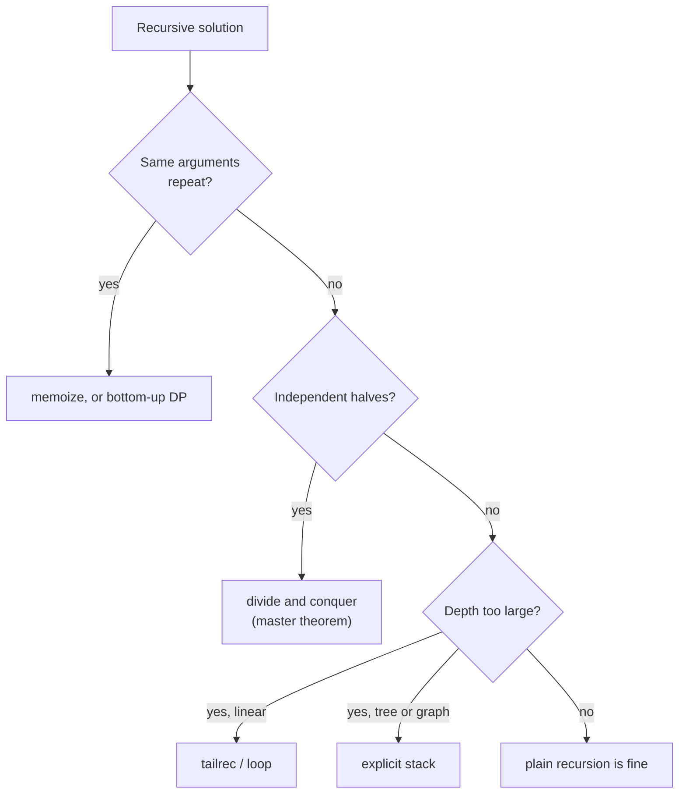

# Recursion and Divide and Conquer Cheat Sheet

> One-page revision for the night before an interview. The full explanations are in notes 01–10.

#### 1. Key Takeaways

1. Every recursion needs a **base case** (smallest input, answered directly) and a **recursive case** (a smaller input that moves toward the base case).
2. **Trust the recursion**: assume the call works for the smaller input, then handle only the current element.
3. **Space = maximum depth**, not total calls. Linear recursion `O(n)`, balanced tree `O(log n)`, skewed tree `O(n)`.
4. **Draw the recursion tree** to get time: `calls × work per call`, or levels × work per level.
5. Repeated nodes in the tree → **memoize** (key = every changing argument). That is top-down dynamic programming.
6. **Divide and conquer** = split into *independent* parts, solve, combine. Overlapping parts → DP instead.
7. **Master theorem** for `T(n) = aT(n/b) + f(n)`: compare `f(n)` with `n^(log_b a)`. Memorise the common results below.
8. **Tail recursion** (`tailrec` in Kotlin) turns a self call in last position into a loop: `O(1)` space. The JVM does not do this on its own.
9. **Deep recursion?** Use an explicit `ArrayDeque` stack (iterative DFS / inorder).
10. **Trees:** bottom-up = return info up (height, diameter); top-down = pass info down (BST bounds, remaining sum).

#### 2. Complexity Table

| Recurrence | Example | Time |
|---|---|---|
| `T(n) = T(n−1) + O(1)` | factorial, linked list | `O(n)` |
| `T(n) = T(n−1) + O(n)` | selection-sort shape | `O(n²)` |
| `T(n) = 2T(n−1) + O(1)` | subsets, Hanoi, naive Fibonacci (`≈ 1.618ⁿ`) | `O(2ⁿ)` |
| `T(n) = T(n/2) + O(1)` | binary search, fast power | `O(log n)` |
| `T(n) = T(n/2) + O(n)` | quickselect (average) | `O(n)` |
| `T(n) = 2T(n/2) + O(1)` | tree traversal, max of array | `O(n)` |
| `T(n) = 2T(n/2) + O(n)` | merge sort, quick sort (good pivot) | `O(n log n)` |
| `T(n) = 3T(n/2) + O(n)` | Karatsuba | `O(n^1.585)` |
| memoized recursion | Fibonacci, grid paths | states × work per state |

| Structure | Recursion depth (space) |
|---|---|
| Array halving | `O(log n)` |
| Balanced tree | `O(log n)` |
| Skewed tree / linked list | `O(n)` |
| Grid DFS | up to `O(m · n)` |

#### 3. Patterns and How to Identify Them

| Signal in the question | Pattern | Note |
|---|---|---|
| "defined by a smaller version of itself" | plain recursion | 01 |
| "what is the space complexity?" | count max depth | 02 |
| "split in half", sorted input | divide and conquer | 03 |
| "time complexity of this recursion" | recursion tree / master theorem | 04, 05 |
| exponential recursion with repeated arguments | memoization | 08 |
| "O(1) space recursion", accumulate a value | `tailrec` | 06 |
| "do it iteratively", very deep tree | explicit stack | 07 |
| "`xⁿ`", "`xⁿ mod m`" | fast exponentiation | 09 |
| "best subarray", answer may cross the split | D&C cross case (or Kadane) | 09 |
| binary tree, "for each node" | bottom-up or top-down | 10 |
| linked list "recursively" | trust `head.next`, fix links | 01, 10 |



#### 4. Templates to Memorise

**Recursion skeleton**

```kotlin
fun solve(state): Result {
    if (/* smallest input */) return /* direct answer */
    val smaller = solve(/* smaller state */)
    return /* combine current item with smaller */
}
```

**Memoization**

```kotlin
val memo = HashMap<Key, Result>()          // or an array filled with -1
fun solve(state): Result {
    if (/* base */) return base
    memo[state]?.let { return it }
    val result = /* combine solve(smaller states) */
    memo[state] = result
    return result
}
```

**Divide and conquer on an array (half-open or closed, pass indexes, do not copy)**

```kotlin
fun solve(a: IntArray, lo: Int, hi: Int): Int {
    if (lo == hi) return a[lo]
    val mid = lo + (hi - lo) / 2
    val left = solve(a, lo, mid)
    val right = solve(a, mid + 1, hi)
    return /* combine left, right (and the crossing part if needed) */
}
```

**Tail recursion**

```kotlin
tailrec fun sum(n: Int, acc: Long = 0L): Long = if (n == 0) acc else sum(n - 1, acc + n)
```

**Fast power**

```kotlin
fun power(x: Double, n: Long): Double {
    if (n == 0L) return 1.0
    val half = power(x, n / 2)                         // once!
    return if (n % 2 == 0L) half * half else half * half * x
}
```

**Tree, bottom-up and top-down**

```kotlin
fun height(n: TreeNode?): Int = if (n == null) 0 else 1 + maxOf(height(n.left), height(n.right))

fun valid(n: TreeNode?, lo: Long, hi: Long): Boolean {
    if (n == null) return true
    if (n.`val` <= lo || n.`val` >= hi) return false
    return valid(n.left, lo, n.`val`.toLong()) && valid(n.right, n.`val`.toLong(), hi)
}
```

**Iterative inorder**

```kotlin
val stack = ArrayDeque<TreeNode>()
var cur = root
while (cur != null || stack.isNotEmpty()) {
    while (cur != null) { stack.addLast(cur); cur = cur.left }
    val node = stack.removeLast()
    result.add(node.`val`)
    cur = node.right
}
```

#### 5. Brute Force to Optimized

| Problem | Brute force | Better |
|---|---|---|
| Fibonacci | recursion `O(2ⁿ)` | memo `O(n)`, or two variables `O(1)` space |
| `xⁿ` | `O(n)` | halve `O(log n)` |
| Max subarray | `O(n²)` | D&C `O(n log n)`, Kadane `O(n)` |
| Balanced tree check | height at every node `O(n²)` | one pass returning `-1` `O(n)` |
| Diameter | `O(n²)` | one pass with a global `O(n)` |
| Valid BST | compare only children (wrong) | pass bounds `O(n)` |
| Sum with deep recursion | stack overflow | `tailrec` or loop |
| Reverse string with `substring` | `O(n²)` | two pointers `O(n)` |

#### 6. Common Mistakes and Edge Cases

1. **Missing / wrong base case** (`n == 0` vs `n == 1`; `null` node; empty list).
2. **Not shrinking** the input, so infinite recursion.
3. **Space = `O(1)` claimed** for recursion. The stack counts.
4. **Calling the recursive function twice for the same value** (fast power, height).
5. **Memo key misses a parameter**, or `0` used as "not computed".
6. **`Int` overflow:** factorial, Fibonacci, `-Int.MIN_VALUE`; use `Long`.
7. **Copying subarrays** in each call (`O(n)` hidden work).
8. **BST check against children only**, or `Int` bounds.
9. **Skewed tree** gives `O(n)` depth.
10. **Edge cases:** empty input, single element, `n = 0`, negative exponent, `null` tree, duplicate values.

#### 7. What to Say Out Loud

1. "The base case is the empty input. For the rest, I solve the smaller problem and combine."
2. "The recursion tree has `n` levels with `O(1)` work each, so `O(n)` time and `O(n)` stack space."
3. "The same state repeats, so I'll memoize on `(index, remaining)`. That brings it from exponential to `states × work per state`."
4. "It's `2T(n/2) + O(n)`, so `O(n log n)` by the Master Theorem."
5. "For a very deep input I'd switch to an explicit stack to avoid a stack overflow."
6. "I'll compute the half power once and square it: `O(log n)`."

#### 8. Practice Order (Easy → Medium)

| Level | Question | Pattern |
|---|---|---|
| Easy | [Fibonacci Number](https://leetcode.com/problems/fibonacci-number/) | two base cases, memo |
| Easy | [Climbing Stairs](https://leetcode.com/problems/climbing-stairs/) | memo |
| Easy | [Reverse String](https://leetcode.com/problems/reverse-string/) | recursion on two ends |
| Easy | [Reverse Linked List](https://leetcode.com/problems/reverse-linked-list/) | trust the rest |
| Easy | [Merge Two Sorted Lists](https://leetcode.com/problems/merge-two-sorted-lists/) | list recursion |
| Easy | [Maximum Depth of Binary Tree](https://leetcode.com/problems/maximum-depth-of-binary-tree/) | bottom-up |
| Easy | [Same Tree](https://leetcode.com/problems/same-tree/) | parallel recursion |
| Easy | [Path Sum](https://leetcode.com/problems/path-sum/) | top-down |
| Easy | [Diameter of Binary Tree](https://leetcode.com/problems/diameter-of-binary-tree/) | bottom-up + global |
| Easy | [Binary Tree Inorder Traversal](https://leetcode.com/problems/binary-tree-inorder-traversal/) | iterative stack |
| Medium | [Pow(x, n)](https://leetcode.com/problems/powx-n/) | fast exponentiation |
| Medium | [Swap Nodes in Pairs](https://leetcode.com/problems/swap-nodes-in-pairs/) | list recursion |
| Medium | [Validate Binary Search Tree](https://leetcode.com/problems/validate-binary-search-tree/) | top-down bounds |
| Medium | [Lowest Common Ancestor of a Binary Tree](https://leetcode.com/problems/lowest-common-ancestor-of-a-binary-tree/) | bottom-up |
| Medium | [Maximum Subarray](https://leetcode.com/problems/maximum-subarray/) | D&C or Kadane |
| Medium | [Unique Paths](https://leetcode.com/problems/unique-paths/) | memo `(r, c)` |
| Medium | [House Robber](https://leetcode.com/problems/house-robber/) | memo index |
| Medium | [Coin Change](https://leetcode.com/problems/coin-change/) | memo remaining |
| Medium | [Number of Islands](https://leetcode.com/problems/number-of-islands/) | DFS (recursive or stack) |
| Medium | [Construct Binary Tree from Preorder and Inorder Traversal](https://leetcode.com/problems/construct-binary-tree-from-preorder-and-inorder-traversal/) | split by root |
