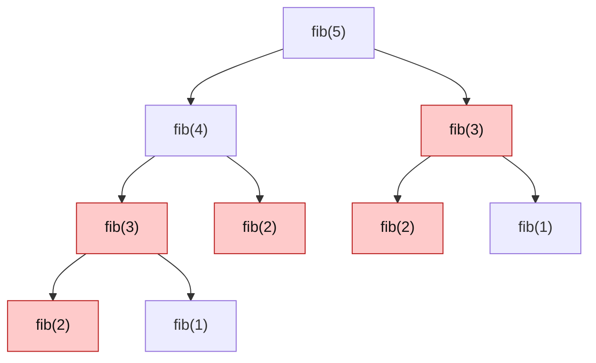

# Optimal Substructure & Overlapping Subproblems

> Two conditions tell you a problem is a DP problem. Check both before you write any code.

#### 1. What Is It?

**Dynamic programming (DP)** solves a problem by solving smaller versions of it **once** and **remembering** the answers. It works only when the problem has two properties:

| Property | Meaning | Test question |
|---|---|---|
| **Optimal substructure** | the best answer to the whole problem is built from the best answers to smaller parts | "if I know the best answer for the smaller problems, can I combine them into the answer for this one?" |
| **Overlapping subproblems** | the **same** smaller problems appear again and again | "does my recursion call the same arguments more than once?" |

- Only **substructure**, no overlap → **divide and conquer** (merge sort, binary search). No need to remember anything.
- Both → **DP**.
- Neither a clear substructure → try greedy or backtracking.

**Signals in a question:** "count the number of ways", "minimum / maximum cost / length / profit", "is it possible", "longest / shortest ...", and a recursive idea where choices repeat.

#### 2. How It Works

*Fibonacci, the standard example. `fib(3)` and `fib(2)` are computed several times.*



The red nodes are repeats. Without memory, the number of calls roughly doubles every time `n` grows by 1 (note 8). With memory, each `fib(k)` is computed once.

**Optimal substructure examples**

| Problem | Why it has it |
|---|---|
| Shortest path | a shortest path from `A` to `C` through `B` uses a shortest path `A → B` and a shortest path `B → C` |
| Coin change (fewest coins) | the best way for amount `a` is 1 coin plus the best way for `a − coin` |
| Longest common subsequence | the answer for two strings uses the answer for shorter prefixes |

**A problem without it:** the longest **simple** path in a graph. The longest path `A → C` through `B` does not have to use the longest path `A → B`, because the two parts may share vertices.

**Quick decision**

```text
1. Can I define the answer for a smaller input of the same kind?         (substructure)
2. Would a plain recursion solve the same small input many times?        (overlap)
   yes and yes → DP.     yes and no → divide and conquer.     no → greedy / backtracking / something else.
```

#### 3. Brute Force vs Optimized

| Approach | Time for `fib(n)` | Space |
|---|---|---|
| Plain recursion | `O(2ⁿ)` (about `1.6ⁿ`) | `O(n)` stack |
| **Memoization** (remember each result) | `O(n)` | `O(n)` |
| Bottom-up table | `O(n)` | `O(n)` |
| Two variables | `O(n)` | `O(1)` |

```kotlin
var naiveCalls = 0
fun fibNaive(n: Int): Int {
    naiveCalls++
    return if (n <= 1) n else fibNaive(n - 1) + fibNaive(n - 2)
}

var memoCalls = 0
fun fibMemo(n: Int, memo: LongArray = LongArray(n + 1) { -1 }): Long {
    memoCalls++
    if (n <= 1) return n.toLong()
    if (memo[n] != -1L) return memo[n]                    // reuse a stored answer
    memo[n] = fibMemo(n - 1, memo) + fibMemo(n - 2, memo)
    return memo[n]
}
```

#### 4. Kotlin Code

Checks: `fibNaive(10)` → `55`. After `naiveCalls = 0; fibNaive(5)`, `naiveCalls` → `15`. After `memoCalls = 0; fibMemo(5)`, `memoCalls` → `9`. `fibMemo(50)` → `12586269025` instantly. The naive `fibNaive(50)` would need about 40 billion calls.

```kotlin
// Distinct subproblems vs total calls: the overlap is the gap between the two numbers
fun overlap(n: Int): Pair<Int, Int> {
    val seen = HashSet<Int>()
    var calls = 0
    fun f(k: Int): Int {
        calls++
        seen.add(k)
        return if (k <= 1) k else f(k - 1) + f(k - 2)
    }
    f(n)
    return seen.size to calls
}
```

`overlap(5)` → `(6, 15)`: only 6 different arguments (`0..5`), but 15 calls. `overlap(20)` → `(21, 21891)`. DP removes that gap.

#### 5. Complexity

| | Time | Space |
|---|---|---|
| Naive Fibonacci | `O(2ⁿ)` | `O(n)` |
| Memoized Fibonacci | `O(n)` | `O(n)` |

General rule: **time = (number of distinct states) × (work per state)**.

#### 6. Common Mistakes

1. **Using DP where there is no overlap** (binary search, merge sort). It adds memory and no speed.
2. **Assuming greedy works** because the first example does. Test a counter-example (coins `{1,3,4}`, amount 6).
3. **Skipping the substructure check.** "Longest simple path" looks like DP but is not.
4. **Confusing the two properties.** Overlap is about repeated work. Substructure is about combining answers.
5. **Memoizing a function that has side effects** or depends on global state.

#### 7. Say This in the Interview

1. "A recursion here would solve the same subproblems again and again, and the best answer to the whole is built from the best answers to the parts. So this is DP."
2. "I'll define the state first, then the recurrence, then the base case."
3. "Plain recursion is exponential. With memoization each state is solved once, so it is states times work per state."

#### 8. Quick Check

1. Merge sort has substructure. Why is it not DP?
2. How many distinct subproblems does `fib(n)` have?
3. A problem has overlapping subproblems but no optimal substructure. DP or not?

<details>
<summary>Answers</summary>

1. Its subproblems never overlap (each half is sorted once), so there is nothing to remember.
2. `n + 1` (`fib(0)` to `fib(n)`).
3. Not DP. You need both properties to combine stored answers safely.

</details>

#### 9. Related LeetCode Questions

| # | Question | Idea |
|---|---|---|
| 509 | [Fibonacci Number](https://leetcode.com/problems/fibonacci-number/) (Easy) | the standard example |
| 70 | [Climbing Stairs](https://leetcode.com/problems/climbing-stairs/) (Easy) | same recurrence |
| 1137 | [N-th Tribonacci Number](https://leetcode.com/problems/n-th-tribonacci-number/) (Easy) | three previous states |
| 746 | [Min Cost Climbing Stairs](https://leetcode.com/problems/min-cost-climbing-stairs/) (Easy) | minimum version |
| 198 | [House Robber](https://leetcode.com/problems/house-robber/) (Medium) | take or skip |
| 322 | [Coin Change](https://leetcode.com/problems/coin-change/) (Medium) | optimal substructure |
