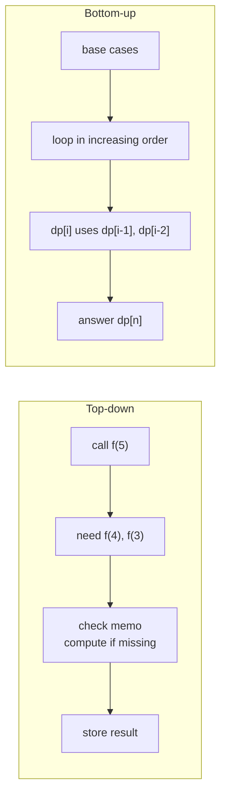

# Top-Down (Memoization) vs Bottom-Up (Tabulation)

> Two ways to implement the same DP. Top-down is easier to write. Bottom-up is faster in practice and easier to optimise for space.

#### 1. What Is It?

| | **Top-down (memoization)** | **Bottom-up (tabulation)** |
|---|---|---|
| Idea | write the recursion, **cache** each result | fill a table from the **smallest** state upward |
| Direction | from the big problem down to the base cases | from the base cases up to the big problem |
| Computes | only the states that are **reached** | **all** states |
| Uses | recursion + a `memo` array or map | loops + a `dp` array |
| Risk | deep recursion can overflow the stack | you must get the **fill order** right |

Both have the **same recurrence** and usually the **same time complexity**.

#### 2. How It Works

Climbing Stairs: `ways(n) = ways(n − 1) + ways(n − 2)`, `ways(0) = ways(1) = 1`.

**Top-down**

```text
ways(5): not in memo → ways(4) + ways(3)
         ways(4) → ways(3) + ways(2) ...    each ways(k) is computed once and stored
```

**Bottom-up**

```text
dp[0] = 1, dp[1] = 1
dp[2] = dp[1] + dp[0] = 2
dp[3] = dp[2] + dp[1] = 3
dp[4] = 5,  dp[5] = 8
```



**Which to choose**

| Situation | Prefer |
|---|---|
| Unsure of the fill order, or many states are unreachable | top-down |
| Large `n` (recursion depth 10⁵ and more) | bottom-up |
| Need to save space (keep only the last row) | bottom-up |
| First draft in an interview | top-down (closest to the recursive idea) |

**Converting top-down to bottom-up:** the memo index becomes the loop variable, the recursive calls become table reads, and the base cases fill the first cells.

#### 3. Brute Force vs Optimized

| Version | Time | Space |
|---|---|---|
| Plain recursion | `O(2ⁿ)` | `O(n)` |
| Top-down with memo | `O(n)` | `O(n)` memo + `O(n)` stack |
| Bottom-up table | `O(n)` | `O(n)` |
| Bottom-up, two variables | `O(n)` | `O(1)` |

```kotlin
fun climbPlain(n: Int): Int = if (n <= 1) 1 else climbPlain(n - 1) + climbPlain(n - 2)
```

#### 4. Kotlin Code

```kotlin
// Top-down (memoization)
fun climbMemo(n: Int, memo: IntArray = IntArray(n + 1)): Int {
    if (n <= 1) return 1
    if (memo[n] != 0) return memo[n]
    memo[n] = climbMemo(n - 1, memo) + climbMemo(n - 2, memo)
    return memo[n]
}

// Bottom-up (tabulation)
fun climbTable(n: Int): Int {
    val dp = IntArray(n + 1)
    dp[0] = 1
    dp[1] = 1
    for (i in 2..n) dp[i] = dp[i - 1] + dp[i - 2]
    return dp[n]
}

// Bottom-up, O(1) space
fun climbOpt(n: Int): Int {
    var prev = 1
    var cur = 1
    for (i in 2..n) { val next = prev + cur; prev = cur; cur = next }
    return cur
}
```

Checks: `climbMemo(5)`, `climbTable(5)` and `climbOpt(5)` → `8`. `climbTable(10)` → `89`. `climbOpt(45)` → `1836311903`. `climbPlain(5)` → `8`. `climbTable(1)` → `1`.

#### 5. Complexity

| | Time | Space |
|---|---|---|
| Top-down | `O(states × work)` | `O(states)` + recursion `O(depth)` |
| Bottom-up | `O(states × work)` | `O(states)`, often reducible |

#### 6. Common Mistakes

1. **Top-down without storing** the result (it is just recursion).
2. **Using `0` as "not computed"** when `0` is a valid answer. Use `-1` or a separate boolean.
3. **Bottom-up in the wrong order** (reading a cell that is not filled yet).
4. **Recursion depth** too large (use bottom-up).
5. **A memo key that misses a parameter** (two different states share one cell).
6. **Forgetting base cases** (`n = 0`, `n = 1`).

#### 7. Say This in the Interview

1. "I'll write the recursive solution first and add a memo. Each state is solved once."
2. "If the depth is large, I'll switch to a bottom-up table, filling in increasing order so each cell's dependencies are ready."
3. "Both are `O(states × work per state)`. Bottom-up lets me reduce the space."

#### 8. Quick Check

1. Which approach can overflow the stack?
2. Which approach computes only reachable states?
3. Why is `0` a bad "not computed" marker for some problems?

<details>
<summary>Answers</summary>

1. Top-down (recursion).
2. Top-down.
3. If `0` is a legitimate answer, you cannot tell "stored 0" from "empty".

</details>

#### 9. Related LeetCode Questions

| # | Question | Idea |
|---|---|---|
| 70 | [Climbing Stairs](https://leetcode.com/problems/climbing-stairs/) (Easy) | both versions |
| 509 | [Fibonacci Number](https://leetcode.com/problems/fibonacci-number/) (Easy) | both versions |
| 198 | [House Robber](https://leetcode.com/problems/house-robber/) (Medium) | both versions |
| 322 | [Coin Change](https://leetcode.com/problems/coin-change/) (Medium) | memo, then table |
| 62 | [Unique Paths](https://leetcode.com/problems/unique-paths/) (Medium) | 2D memo, then table |
| 139 | [Word Break](https://leetcode.com/problems/word-break/) (Medium) | memo on the start index |
