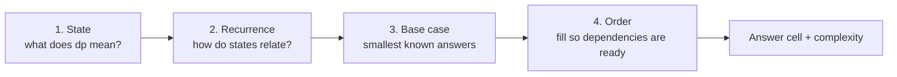

# The Four Steps: State, Recurrence, Base Case, Fill Order

> The method for **every** DP problem. Say each step out loud. Interviewers watch for this structure.

#### 1. What Is It?

Solve a DP problem by answering four questions **in this order**:

| Step | Question | Output |
|---|---|---|
| **1. State** | what describes a subproblem? | "`dp[i]` = the best answer for the first `i` items" |
| **2. Recurrence** | how does one state come from smaller states? | `dp[i] = f(dp[i − 1], dp[i − 2], ...)` |
| **3. Base case** | which states have an answer you know directly? | `dp[0] = ...` |
| **4. Fill order + answer** | in what order do I compute states, and which cell holds the answer? | loop direction, `dp[n]` |

Candidates who skip step 1 and jump to code usually get stuck or write a wrong recurrence.

#### 2. How It Works

**Example 1: Climbing Stairs.**

```text
1. State:      dp[i] = number of ways to reach step i
2. Recurrence: dp[i] = dp[i - 1] + dp[i - 2]      (last move was 1 step or 2 steps)
3. Base case:  dp[0] = 1, dp[1] = 1
4. Order:      i = 2..n, answer dp[n]
```

**Example 2: House Robber.** Rob houses in a row, not two adjacent ones, to maximise money.

```text
1. State:      dp[i] = best money using the first i houses
2. Recurrence: dp[i] = max(dp[i - 1],  dp[i - 2] + nums[i - 1])     (skip house i, or rob it)
3. Base case:  dp[0] = 0, dp[1] = nums[0]
4. Order:      i = 2..n, answer dp[n]
```

**Example 3: Coin Change (fewest coins).**

```text
1. State:      dp[a] = fewest coins to make amount a
2. Recurrence: dp[a] = 1 + min(dp[a - coin])   over coins <= a
3. Base case:  dp[0] = 0, others = "impossible" (a big number)
4. Order:      a = 1..amount, answer dp[amount] (or -1 if impossible)
```



**Questions to ask when choosing the state**

| Ask | Typical state |
|---|---|
| Does the order of items matter, one sequence? | index `i` |
| Two sequences? | `(i, j)` |
| A budget / capacity? | `(i, remaining)` |
| A choice that changes what is allowed next? | add a flag (holding / not holding) |
| A subset of items? | a bitmask |

**Final checks**

1. **Complexity** = number of states × work per state.
2. **Space:** can I keep only the last row (note 7)?
3. **Edge cases:** empty input, size 1, impossible target.

#### 3. Brute Force vs Optimized

| Step | Brute force | DP |
|---|---|---|
| House Robber | try every subset with no two adjacent: `O(2ⁿ)` | table `O(n)` |
| Coin Change | try every combination of coins: `O(coinsᵃᵐᵒᵘⁿᵗ)` | table `O(amount × coins)` |

```kotlin
// Brute force House Robber: recursion, take or skip each house
fun robBrute(nums: IntArray, i: Int = 0): Int {
    if (i >= nums.size) return 0
    return maxOf(robBrute(nums, i + 1), nums[i] + robBrute(nums, i + 2))
}
```

#### 4. Kotlin Code

```kotlin
// House Robber by the four steps (LeetCode 198)
fun rob(nums: IntArray): Int {
    val n = nums.size
    if (n == 0) return 0
    val dp = IntArray(n + 1)                    // 1. dp[i] = best using the first i houses
    dp[0] = 0                                   // 3. base cases
    dp[1] = nums[0]
    for (i in 2..n) {                           // 4. increasing order
        dp[i] = maxOf(dp[i - 1], dp[i - 2] + nums[i - 1])     // 2. recurrence
    }
    return dp[n]
}

// Coin Change by the four steps (LeetCode 322)
fun coinChange(coins: IntArray, amount: Int): Int {
    val dp = IntArray(amount + 1) { amount + 1 }      // amount + 1 means "impossible"
    dp[0] = 0
    for (a in 1..amount) {
        for (c in coins) if (c <= a) dp[a] = minOf(dp[a], dp[a - c] + 1)
    }
    return if (dp[amount] > amount) -1 else dp[amount]
}
```

Checks: `rob(intArrayOf(1, 2, 3, 1))` → `4`. `rob(intArrayOf(2, 7, 9, 3, 1))` → `12`. `rob(intArrayOf(5))` → `5`. `rob(intArrayOf())` → `0`. `robBrute(intArrayOf(2, 7, 9, 3, 1))` → `12`. `coinChange(intArrayOf(1, 2, 5), 11)` → `3`. `coinChange(intArrayOf(2), 3)` → `-1`. `coinChange(intArrayOf(1), 0)` → `0`.

#### 5. Complexity

| | Time | Space |
|---|---|---|
| House Robber | `O(n)` | `O(n)`, or `O(1)` with two variables |
| Coin Change | `O(amount × coins)` | `O(amount)` |

#### 6. Common Mistakes

1. **Starting to code before writing what `dp[i]` means.**
2. **A state that is too small** (misses a parameter) so the recurrence is wrong.
3. **A state that is too big** (needless dimension), making it slow.
4. **Wrong base case** (`dp[0]`, empty prefix, amount 0).
5. **Wrong fill order** (reading a cell not yet computed).
6. **Using `Int.MAX_VALUE` as "impossible"** and then adding 1 (overflow). Use `amount + 1`.
7. **Returning the wrong cell** (`dp[n − 1]` instead of `dp[n]`).

#### 7. Say This in the Interview

1. "State: `dp[i]` means ... Recurrence: ... Base case: ... I fill in increasing `i`, and the answer is `dp[n]`."
2. "That's `n` states with `O(1)` work each, so `O(n)` time. Each state only needs the previous two, so I can drop the space to `O(1)`."
3. "Let me test it on a small example, then on the empty and one-element cases."

#### 8. Quick Check

1. What is the state for the 2D problem "longest common subsequence of strings `a` and `b`"?
2. Why does Coin Change start `dp[1..amount]` at `amount + 1`?
3. Which step decides the loop direction?

<details>
<summary>Answers</summary>

1. `dp[i][j]` = LCS of the first `i` characters of `a` and the first `j` characters of `b`.
2. It means "impossible", and no real answer can be larger than `amount` (all 1-coins). It is also safe to add `1` to.
3. Step 4, the fill order (dependencies must be computed first).

</details>

#### 9. Related LeetCode Questions

| # | Question | Idea |
|---|---|---|
| 70 | [Climbing Stairs](https://leetcode.com/problems/climbing-stairs/) (Easy) | first state and recurrence |
| 198 | [House Robber](https://leetcode.com/problems/house-robber/) (Medium) | take or skip |
| 322 | [Coin Change](https://leetcode.com/problems/coin-change/) (Medium) | amount as the state |
| 300 | [Longest Increasing Subsequence](https://leetcode.com/problems/longest-increasing-subsequence/) (Medium) | state ends at `i` |
| 139 | [Word Break](https://leetcode.com/problems/word-break/) (Medium) | state = prefix length |
| 1143 | [Longest Common Subsequence](https://leetcode.com/problems/longest-common-subsequence/) (Medium) | two-index state |
