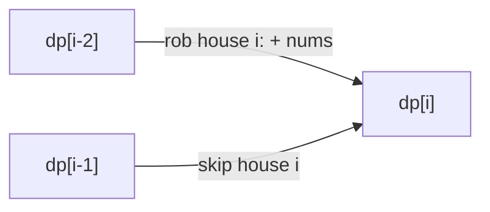

# 1D DP: Fibonacci, Climbing Stairs, House Robber

> The simplest DP family: one index, and each answer depends on a few earlier answers. Master these and the rest follow.

#### 1. What Is It?

In **1D DP** the state is one number (an index or an amount), so `dp` is a single array.

| Problem | State | Recurrence |
|---|---|---|
| **Fibonacci** (509) | `dp[i]` = `fib(i)` | `dp[i − 1] + dp[i − 2]` |
| **Climbing Stairs** (70) | `dp[i]` = ways to reach step `i` | `dp[i − 1] + dp[i − 2]` |
| **Min Cost Climbing Stairs** (746) | `dp[i]` = least cost to reach step `i` | `min(dp[i − 1] + cost[i − 1], dp[i − 2] + cost[i − 2])` |
| **House Robber** (198) | `dp[i]` = best money from the first `i` houses | `max(dp[i − 1], dp[i − 2] + nums[i − 1])` |
| **House Robber II** (213) | houses in a **circle** | run House Robber twice (note below) |
| **Maximum Subarray** (53) | `dp[i]` = best sum of a subarray **ending** at `i` | `max(nums[i], dp[i − 1] + nums[i])` |

**Signals:** one sequence or one number, "ways to reach", "best you can get without taking two neighbours", "best subarray".

#### 2. How It Works

**House Robber.** At each house you either **skip** it (keep the best so far) or **rob** it (add its money to the best from two houses back).

```text
nums = [2, 7, 9, 3, 1]
dp[0] = 0
dp[1] = 2
dp[2] = max(dp[1], dp[0] + 7) = 7
dp[3] = max(dp[2], dp[1] + 9) = 11
dp[4] = max(dp[3], dp[2] + 3) = 11
dp[5] = max(dp[4], dp[3] + 1) = 12       answer 12 (2 + 9 + 1)
```



**House Robber II (circle).** The first and last houses are neighbours, so you cannot rob both. Split into two normal problems and take the better: houses `0..n − 2` (skip the last), or houses `1..n − 1` (skip the first).

**Maximum Subarray (Kadane).** At each element, either start a new subarray here, or extend the previous best one that ended just before.

```text
[-2, 1, -3, 4, -1, 2, 1, -5, 4]
ending at each index:  -2, 1, -2, 4, 3, 5, 6, 1, 5      best = 6  ([4, -1, 2, 1])
```

**Min Cost Climbing Stairs.** You may start at step 0 or 1 for free. Reaching the top costs the cheaper of coming from one step below or two steps below.

**Space:** each state needs only the previous two, so two variables are enough.

#### 3. Brute Force vs Optimized

| Problem | Brute force | DP |
|---|---|---|
| Climbing Stairs | recursion `O(2ⁿ)` | `O(n)`, `O(1)` space |
| House Robber | all valid subsets `O(2ⁿ)` | `O(n)`, `O(1)` space |
| Maximum Subarray | all subarrays `O(n²)` | Kadane `O(n)`, `O(1)` space |

```kotlin
// Brute force maximum subarray: every start, running sum
fun maxSubArrayBrute(nums: IntArray): Int {
    var best = nums[0]
    for (i in nums.indices) {
        var sum = 0
        for (j in i until nums.size) { sum += nums[j]; best = maxOf(best, sum) }
    }
    return best
}
```

#### 4. Kotlin Code

```kotlin
// Climbing Stairs (LeetCode 70)
fun climbStairs(n: Int): Int {
    var prev = 1; var cur = 1
    for (i in 2..n) { val next = prev + cur; prev = cur; cur = next }
    return cur
}

// Min Cost Climbing Stairs (LeetCode 746)
fun minCostClimbingStairs(cost: IntArray): Int {
    var a = 0                                   // cost to reach step i - 2
    var b = 0                                   // cost to reach step i - 1
    for (i in 2..cost.size) {
        val next = minOf(b + cost[i - 1], a + cost[i - 2])
        a = b
        b = next
    }
    return b
}

// House Robber (LeetCode 198)
fun rob(nums: IntArray): Int {
    var skip = 0                                // best up to the previous house
    var take = 0                                // best up to the house before that
    for (x in nums) {
        val cur = maxOf(skip, take + x)
        take = skip
        skip = cur
    }
    return skip
}

// House Robber II (LeetCode 213): circle
fun robCircle(nums: IntArray): Int {
    if (nums.size == 1) return nums[0]
    fun robRange(lo: Int, hi: Int): Int {
        var skip = 0; var take = 0
        for (i in lo..hi) { val cur = maxOf(skip, take + nums[i]); take = skip; skip = cur }
        return skip
    }
    return maxOf(robRange(0, nums.size - 2), robRange(1, nums.size - 1))
}

// Maximum Subarray, Kadane (LeetCode 53)
fun maxSubArray(nums: IntArray): Int {
    var cur = nums[0]
    var best = nums[0]
    for (i in 1 until nums.size) {
        cur = maxOf(nums[i], cur + nums[i])
        best = maxOf(best, cur)
    }
    return best
}
```

Checks: `climbStairs(5)` → `8`. `minCostClimbingStairs(intArrayOf(10, 15, 20))` → `15`. `minCostClimbingStairs(intArrayOf(1, 100, 1, 1, 1, 100, 1, 1, 100, 1))` → `6`. `rob(intArrayOf(1, 2, 3, 1))` → `4`. `rob(intArrayOf(2, 7, 9, 3, 1))` → `12`. `robCircle(intArrayOf(2, 3, 2))` → `3`. `robCircle(intArrayOf(1, 2, 3, 1))` → `4`. `robCircle(intArrayOf(1))` → `1`. `maxSubArray(intArrayOf(-2, 1, -3, 4, -1, 2, 1, -5, 4))` → `6`. `maxSubArray(intArrayOf(-3))` → `-3`. `maxSubArrayBrute(intArrayOf(-2, 1, -3, 4, -1, 2, 1, -5, 4))` → `6`.

#### 5. Complexity

| | Time | Space |
|---|---|---|
| All five problems | `O(n)` | `O(1)` with rolling variables, `O(n)` with a table |

#### 6. Common Mistakes

1. **House Robber:** using `dp[i − 1] + nums[i]` (adjacent houses). Use `dp[i − 2]`.
2. **House Robber II:** forgetting the single-house case (`n = 1`).
3. **Kadane:** starting `best` at `0` (wrong when all numbers are negative).
4. **Kadane:** forgetting to compare with `nums[i]` alone (restart).
5. **Min Cost Climbing:** adding the cost of the top step (there is none).
6. **Off-by-one** in `dp` indexes (`dp[i]` for the first `i` houses vs house `i`).

#### 7. Say This in the Interview

1. "For each house I either skip it, keeping the best so far, or rob it and add its value to the best from two houses back. That's `dp[i] = max(dp[i − 1], dp[i − 2] + nums[i])`."
2. "It only needs the last two values, so space is `O(1)`."
3. "For the circular version I can't rob both ends, so I solve the line twice, without the first house and without the last, and take the maximum."

#### 8. Quick Check

1. `rob([5, 1, 1, 5])`?
2. Kadane on `[-1, -2]`?
3. Why two runs for the circular version?

<details>
<summary>Answers</summary>

1. `10` (`5 + 5`).
2. `-1`.
3. The two end houses are adjacent in a circle. Each run excludes one of them.

</details>

#### 9. Related LeetCode Questions

| # | Question | Idea |
|---|---|---|
| 509 | [Fibonacci Number](https://leetcode.com/problems/fibonacci-number/) (Easy) | two previous values |
| 70 | [Climbing Stairs](https://leetcode.com/problems/climbing-stairs/) (Easy) | ways to reach |
| 746 | [Min Cost Climbing Stairs](https://leetcode.com/problems/min-cost-climbing-stairs/) (Easy) | minimum version |
| 198 | [House Robber](https://leetcode.com/problems/house-robber/) (Medium) | skip or take |
| 213 | [House Robber II](https://leetcode.com/problems/house-robber-ii/) (Medium) | circle: two runs |
| 53 | [Maximum Subarray](https://leetcode.com/problems/maximum-subarray/) (Medium) | Kadane |
| 740 | [Delete and Earn](https://leetcode.com/problems/delete-and-earn/) (Medium) | House Robber on counts |
