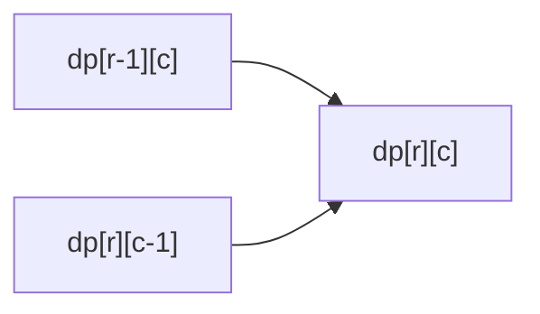

# 2D DP: Grid Paths, Edit Distance, Longest Common Subsequence

> Two indexes, so `dp` is a table. Grids use `(row, col)`. Two strings use `(i, j)` = prefix lengths.

#### 1. What Is It?

**2D DP** has a state with two numbers.

| Problem | State | Recurrence |
|---|---|---|
| **Unique Paths** (62) | `dp[r][c]` = ways to reach cell `(r, c)` | `dp[r−1][c] + dp[r][c−1]` |
| **Unique Paths II** (63) | same, with obstacles | `0` on an obstacle |
| **Minimum Path Sum** (64) | `dp[r][c]` = cheapest path to `(r, c)` | `grid[r][c] + min(dp[r−1][c], dp[r][c−1])` |
| **Longest Common Subsequence** (1143) | `dp[i][j]` = LCS of the first `i` chars of `a` and first `j` of `b` | match: `dp[i−1][j−1] + 1`, else `max(dp[i−1][j], dp[i][j−1])` |
| **Edit Distance** (72) | `dp[i][j]` = fewest edits to turn `a[0..i)` into `b[0..j)` | match: `dp[i−1][j−1]`, else `1 + min(replace, delete, insert)` |

**Signals:** a grid with moves right and down, two strings or two arrays compared, "minimum number of operations to convert".

#### 2. How It Works

**Grid.** A cell is reached from the cell **above** or **to the left**. Fill row by row.



**LCS table** for `a = "abcde"`, `b = "ace"`. Row `i` is the first `i` letters of `a`, column `j` the first `j` of `b`.

```text
        ""  a  c  e
   ""    0  0  0  0
   a     0  1  1  1
   b     0  1  1  1
   c     0  1  2  2
   d     0  1  2  2
   e     0  1  2  3      → LCS length 3 ("ace")
```

- Letters match → take the diagonal and add 1.
- Letters differ → take the better of "drop a letter from `a`" (up) and "drop a letter from `b`" (left).

**Edit Distance.** Three operations: insert, delete, replace. For `"horse" → "ros"`:

| Cell move | Operation |
|---|---|
| `dp[i−1][j−1]` (+1 if letters differ) | replace (or keep if equal) |
| `dp[i−1][j] + 1` | delete a letter from `a` |
| `dp[i][j−1] + 1` | insert a letter into `a` |

Base cases: `dp[i][0] = i` (delete everything), `dp[0][j] = j` (insert everything).

#### 3. Brute Force vs Optimized

| Problem | Brute force | DP |
|---|---|---|
| Unique Paths | recursion `O(2^(m+n))` | `O(m · n)` |
| LCS | all subsequences of one string `O(2ⁿ · m)` | `O(m · n)` |
| Edit Distance | recursion over three choices `O(3^(m+n))` | `O(m · n)` |

```kotlin
// Brute force LCS: recursion on the ends of both strings. Exponential.
fun lcsBrute(a: String, b: String, i: Int = a.length, j: Int = b.length): Int {
    if (i == 0 || j == 0) return 0
    return if (a[i - 1] == b[j - 1]) 1 + lcsBrute(a, b, i - 1, j - 1)
    else maxOf(lcsBrute(a, b, i - 1, j), lcsBrute(a, b, i, j - 1))
}
```

#### 4. Kotlin Code

```kotlin
// Unique Paths (LeetCode 62)
fun uniquePaths(m: Int, n: Int): Int {
    val dp = Array(m) { IntArray(n) { 1 } }          // first row and column: one way
    for (r in 1 until m) for (c in 1 until n) dp[r][c] = dp[r - 1][c] + dp[r][c - 1]
    return dp[m - 1][n - 1]
}

// Unique Paths II (LeetCode 63): 1 = obstacle
fun uniquePathsWithObstacles(grid: Array<IntArray>): Int {
    val m = grid.size
    val n = grid[0].size
    val dp = Array(m) { IntArray(n) }
    for (r in 0 until m) for (c in 0 until n) {
        when {
            grid[r][c] == 1 -> dp[r][c] = 0
            r == 0 && c == 0 -> dp[r][c] = 1
            else -> dp[r][c] = (if (r > 0) dp[r - 1][c] else 0) + (if (c > 0) dp[r][c - 1] else 0)
        }
    }
    return dp[m - 1][n - 1]
}

// Minimum Path Sum (LeetCode 64)
fun minPathSum(grid: Array<IntArray>): Int {
    val m = grid.size
    val n = grid[0].size
    val dp = Array(m) { IntArray(n) }
    for (r in 0 until m) for (c in 0 until n) {
        dp[r][c] = grid[r][c] + when {
            r == 0 && c == 0 -> 0
            r == 0 -> dp[r][c - 1]
            c == 0 -> dp[r - 1][c]
            else -> minOf(dp[r - 1][c], dp[r][c - 1])
        }
    }
    return dp[m - 1][n - 1]
}

// Longest Common Subsequence (LeetCode 1143)
fun longestCommonSubsequence(a: String, b: String): Int {
    val dp = Array(a.length + 1) { IntArray(b.length + 1) }
    for (i in 1..a.length) {
        for (j in 1..b.length) {
            dp[i][j] = if (a[i - 1] == b[j - 1]) dp[i - 1][j - 1] + 1
            else maxOf(dp[i - 1][j], dp[i][j - 1])
        }
    }
    return dp[a.length][b.length]
}

// Edit Distance (LeetCode 72)
fun minDistance(a: String, b: String): Int {
    val dp = Array(a.length + 1) { IntArray(b.length + 1) }
    for (i in 0..a.length) dp[i][0] = i
    for (j in 0..b.length) dp[0][j] = j
    for (i in 1..a.length) {
        for (j in 1..b.length) {
            dp[i][j] = if (a[i - 1] == b[j - 1]) dp[i - 1][j - 1]
            else 1 + minOf(dp[i - 1][j - 1], dp[i - 1][j], dp[i][j - 1])
        }
    }
    return dp[a.length][b.length]
}
```

Checks: `uniquePaths(3, 7)` → `28`. `uniquePaths(3, 2)` → `3`. `uniquePathsWithObstacles(arrayOf(intArrayOf(0, 0, 0), intArrayOf(0, 1, 0), intArrayOf(0, 0, 0)))` → `2`. `uniquePathsWithObstacles(arrayOf(intArrayOf(0, 1), intArrayOf(0, 0)))` → `1`. `minPathSum(arrayOf(intArrayOf(1, 3, 1), intArrayOf(1, 5, 1), intArrayOf(4, 2, 1)))` → `7`. `longestCommonSubsequence("abcde", "ace")` → `3`. `longestCommonSubsequence("abc", "def")` → `0`. `lcsBrute("abcde", "ace")` → `3`. `minDistance("horse", "ros")` → `3`. `minDistance("intention", "execution")` → `5`. `minDistance("", "abc")` → `3`.

#### 5. Complexity

| | Time | Space |
|---|---|---|
| Grid DP | `O(m · n)` | `O(m · n)`, `O(n)` with one row |
| LCS | `O(m · n)` | `O(m · n)`, `O(min(m, n))` with two rows |
| Edit Distance | `O(m · n)` | `O(m · n)`, `O(n)` with two rows |

#### 6. Common Mistakes

1. **Using string indexes `i` instead of `i − 1`** in `a[i − 1]` (the table is one larger than the strings).
2. **Missing base cases** (`dp[i][0] = i`, `dp[0][j] = j` for Edit Distance).
3. **Mixing up** which neighbour a cell depends on (up, left, diagonal).
4. **Obstacle on the start or end cell** (Unique Paths II) giving `0`.
5. **Confusing subsequence and substring.** LCS letters need not be adjacent.
6. **Forgetting the empty string** cases.

#### 7. Say This in the Interview

1. "State: `dp[i][j]` is the LCS of the first `i` characters of `a` and the first `j` of `b`. If the characters match I extend the diagonal. Otherwise I take the better of dropping one character from either string."
2. "That's `m × n` states with `O(1)` work: `O(m · n)` time. Each row only needs the previous row, so space can be `O(n)`."
3. "For Edit Distance the three moves are replace, delete and insert, and the base cases are the cost of building or removing a whole string."

#### 8. Quick Check

1. Ways to go from top-left to bottom-right of a `2 × 2` grid?
2. Edit distance of `"a"` and `"b"`?
3. Which cells does `dp[i][j]` of LCS read when the letters differ?

<details>
<summary>Answers</summary>

1. `2`.
2. `1` (one replace).
3. `dp[i − 1][j]` (up) and `dp[i][j − 1]` (left).

</details>

#### 9. Related LeetCode Questions

| # | Question | Idea |
|---|---|---|
| 62 | [Unique Paths](https://leetcode.com/problems/unique-paths/) (Medium) | up + left |
| 63 | [Unique Paths II](https://leetcode.com/problems/unique-paths-ii/) (Medium) | obstacles |
| 64 | [Minimum Path Sum](https://leetcode.com/problems/minimum-path-sum/) (Medium) | min of up and left |
| 120 | [Triangle](https://leetcode.com/problems/triangle/) (Medium) | grid-like DP |
| 1143 | [Longest Common Subsequence](https://leetcode.com/problems/longest-common-subsequence/) (Medium) | two strings |
| 72 | [Edit Distance](https://leetcode.com/problems/edit-distance/) (Medium) | insert, delete, replace |
| 221 | [Maximal Square](https://leetcode.com/problems/maximal-square/) (Medium) | min of three neighbours |
