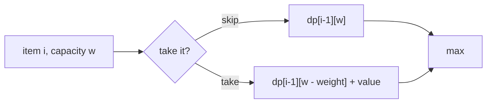

# Knapsack-Style DP: Subset Sum, Partition, Coin Change

> "Choose items under a limit." The state is (items considered, capacity used). The loop direction decides whether each item can be used **once** or **many times**.

#### 1. What Is It?

**Knapsack-style DP** picks items to reach a goal under a budget.

| Problem | Items | Goal |
|---|---|---|
| **0/1 Knapsack** | each item at most **once**, weight and value | max value within capacity `W` |
| **Subset Sum** | numbers, each once | can some subset make `target`? |
| **Partition Equal Subset Sum** (416) | numbers, each once | can you split into two equal-sum parts? (subset sum to `total / 2`) |
| **Target Sum** (494) | numbers, each gets `+` or `−` | number of ways to reach `target` |
| **Coin Change** (322) | coins, **unlimited** | fewest coins for `amount` |

**Signals:** "choose a subset", "can we make exactly K", "limited capacity", "number of ways to reach a sum", "each element used once / any number of times".

#### 2. How It Works

**0/1 knapsack.** `dp[w]` = best value with capacity `w`. For each item, update `w` **from high to low**, so the item is not used twice.

```text
weights [1, 3, 4, 5], values [1, 4, 5, 7], capacity 7
after item (w=1, v=1):  dp[1..7] = 1 1 1 1 1 1 1
after item (w=3, v=4):  dp = 0 1 1 4 5 5 5 5   (index 0..7)
after item (w=4, v=5):  ... dp[7] = max(dp[7], dp[3] + 5 = 9) = 9
answer 9  (items w=3 and w=4)
```

**The loop direction rule**

| Items can be used | Inner loop over capacity |
|---|---|
| **once** (0/1) | **downwards** (`w` from `W` to `weight`) |
| **many times** (unbounded) | **upwards** (`w` from `weight` to `W`) |



**Subset sum / Partition.** `dp[s]` = "can we make sum `s`?" (boolean). Start with `dp[0] = true`. For each number `x`, for `s` from `target` down to `x`: `dp[s] = dp[s] || dp[s − x]`. Partition: if the total is odd it is impossible, otherwise the target is `total / 2`.

**Target Sum.** Let `P` be the numbers with `+` and `N` those with `−`. Then `sum(P) − sum(N) = target` and `sum(P) + sum(N) = total`, so `sum(P) = (total + target) / 2`. It becomes "count subsets with this sum".

```text
[1,1,1,1,1], target 3:  total 5, (5 + 3) / 2 = 4  → subsets of sum 4 from five 1s: C(5,4) = 5 ways
```

**Coin change (min coins).** `dp[a] = 1 + min(dp[a − coin])`. Coins are unlimited, so the amount loop runs upward.

#### 3. Brute Force vs Optimized

| Problem | Brute force | DP |
|---|---|---|
| 0/1 Knapsack | try every subset `O(2ⁿ)` | `O(n · W)` |
| Subset Sum / Partition | all subsets `O(2ⁿ)` | `O(n · target)` |
| Target Sum | all `2ⁿ` sign choices | `O(n · sum)` |
| Coin Change | all coin sequences | `O(amount · coins)` |

```kotlin
// Brute force 0/1 knapsack: take or skip each item. O(2^n).
fun knapsackBrute(w: IntArray, v: IntArray, cap: Int, i: Int = 0): Int {
    if (i == w.size) return 0
    val skip = knapsackBrute(w, v, cap, i + 1)
    val take = if (w[i] <= cap) v[i] + knapsackBrute(w, v, cap - w[i], i + 1) else 0
    return maxOf(skip, take)
}
```

#### 4. Kotlin Code

```kotlin
// 0/1 Knapsack: capacity loop goes DOWN
fun knapsack01(weights: IntArray, values: IntArray, capacity: Int): Int {
    val dp = IntArray(capacity + 1)
    for (i in weights.indices) {
        for (w in capacity downTo weights[i]) {
            dp[w] = maxOf(dp[w], dp[w - weights[i]] + values[i])
        }
    }
    return dp[capacity]
}

// Subset Sum
fun subsetSum(nums: IntArray, target: Int): Boolean {
    val dp = BooleanArray(target + 1)
    dp[0] = true
    for (x in nums) for (s in target downTo x) if (dp[s - x]) dp[s] = true
    return dp[target]
}

// Partition Equal Subset Sum (LeetCode 416)
fun canPartition(nums: IntArray): Boolean {
    val total = nums.sum()
    return total % 2 == 0 && subsetSum(nums, total / 2)
}

// Target Sum (LeetCode 494): count subsets with sum (total + target) / 2
fun findTargetSumWays(nums: IntArray, target: Int): Int {
    val total = nums.sum()
    if ((total + target) % 2 != 0 || total + target < 0) return 0
    val s = (total + target) / 2
    val dp = IntArray(s + 1)
    dp[0] = 1
    for (x in nums) for (j in s downTo x) dp[j] += dp[j - x]
    return dp[s]
}

// Coin Change (LeetCode 322): coins unlimited, amount loop goes UP
fun coinChange(coins: IntArray, amount: Int): Int {
    val dp = IntArray(amount + 1) { amount + 1 }
    dp[0] = 0
    for (a in 1..amount) for (c in coins) if (c <= a) dp[a] = minOf(dp[a], dp[a - c] + 1)
    return if (dp[amount] > amount) -1 else dp[amount]
}
```

Checks: `knapsack01(intArrayOf(1, 3, 4, 5), intArrayOf(1, 4, 5, 7), 7)` → `9`. `knapsackBrute(intArrayOf(1, 3, 4, 5), intArrayOf(1, 4, 5, 7), 7)` → `9`. `subsetSum(intArrayOf(3, 34, 4, 12, 5, 2), 9)` → `true` (`4 + 5`). `subsetSum(intArrayOf(3, 34, 4, 12, 5, 2), 30)` → `false`. `canPartition(intArrayOf(1, 5, 11, 5))` → `true`. `canPartition(intArrayOf(1, 2, 3, 5))` → `false`. `findTargetSumWays(intArrayOf(1, 1, 1, 1, 1), 3)` → `5`. `findTargetSumWays(intArrayOf(1), 1)` → `1`. `findTargetSumWays(intArrayOf(1), 2)` → `0`. `coinChange(intArrayOf(1, 2, 5), 11)` → `3`. `coinChange(intArrayOf(2), 3)` → `-1`.

#### 5. Complexity

| | Time | Space |
|---|---|---|
| 0/1 Knapsack | `O(n · W)` | `O(W)` |
| Subset Sum / Partition | `O(n · target)` | `O(target)` |
| Target Sum | `O(n · sum)` | `O(sum)` |
| Coin Change | `O(amount · coins)` | `O(amount)` |

`O(n · W)` is **pseudo-polynomial**: it depends on the **value** of `W`, not only on the number of bits of `W`.

#### 6. Common Mistakes

1. **Wrong loop direction.** Upward in 0/1 knapsack uses an item many times. Downward in unbounded knapsack uses it at most once.
2. **Forgetting the odd total** check in Partition.
3. **`dp[0]`:** for counting it is `1` (one way to make 0), for "can we" it is `true`, for min coins it is `0`.
4. **Target Sum:** not handling `(total + target)` odd or negative.
5. **Using `Int.MAX_VALUE`** for "impossible" and overflowing on `+ 1`.
6. **Treating Coin Change as greedy.** It fails on coins like `{1, 3, 4}`.

#### 7. Say This in the Interview

1. "This is a knapsack: for each item I either take it or skip it. `dp[w]` is the best value with capacity `w`. For 0/1 I loop capacity downwards so each item is used once."
2. "Partition Equal Subset Sum reduces to subset sum with target `total / 2`."
3. "Time is `O(n · W)` with `O(W)` space. That's pseudo-polynomial, because it depends on the size of `W`."

#### 8. Quick Check

1. Which direction for the capacity loop in unbounded knapsack?
2. Can `[1, 2, 5]` be partitioned into two equal-sum subsets?
3. What does `dp[0]` equal in Target Sum counting?

<details>
<summary>Answers</summary>

1. Upwards.
2. No. The total is `8`, so the target is `4`, and no subset sums to 4.
3. `1`.

</details>

#### 9. Related LeetCode Questions

| # | Question | Idea |
|---|---|---|
| 416 | [Partition Equal Subset Sum](https://leetcode.com/problems/partition-equal-subset-sum/) (Medium) | subset sum to half |
| 494 | [Target Sum](https://leetcode.com/problems/target-sum/) (Medium) | count subsets |
| 322 | [Coin Change](https://leetcode.com/problems/coin-change/) (Medium) | unlimited items, min |
| 518 | [Coin Change II](https://leetcode.com/problems/coin-change-ii/) (Medium) | unlimited, count (note 14) |
| 1049 | [Last Stone Weight II](https://leetcode.com/problems/last-stone-weight-ii/) (Medium) | minimise the difference of two subsets |
| 474 | [Ones and Zeroes](https://leetcode.com/problems/ones-and-zeroes/) (Medium) | knapsack with two capacities |
| 2915 | [Length of the Longest Subsequence That Sums to Target](https://leetcode.com/problems/length-of-the-longest-subsequence-that-sums-to-target/) (Medium) | subset sum with a length |
