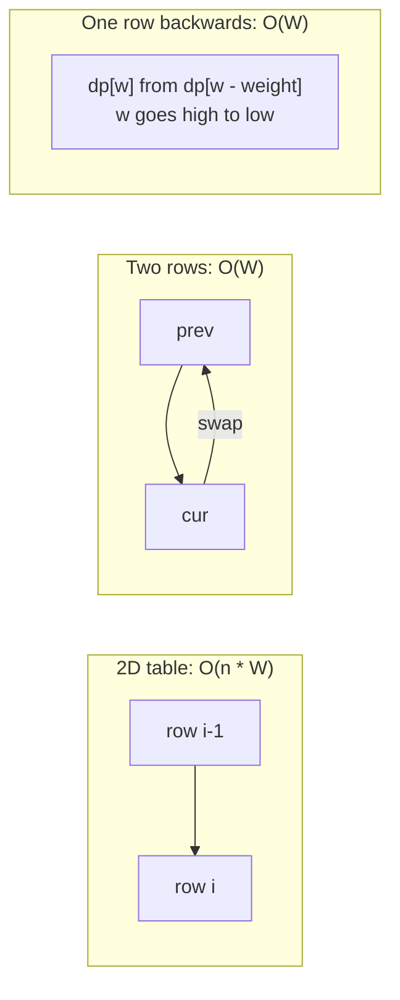

# Space Optimisation: Keeping Only the Last Row or Two

> If a state depends only on the previous row (or the last few values), keep just those. `O(n · m)` memory becomes `O(m)`, or even `O(1)`.

#### 1. What Is It?

A DP table is often much bigger than what the recurrence reads. If `dp[i]` uses only `dp[i − 1]` and `dp[i − 2]`, you do not need the older cells.

| Dependency | Memory needed |
|---|---|
| `dp[i]` uses the last `k` values | `k` variables: `O(1)` |
| `dp[i][j]` uses only row `i − 1` (and row `i`) | two rows: `O(m)` |
| `dp[i][j]` uses `dp[i − 1][j]`, `dp[i][j − 1]`, `dp[i − 1][j − 1]` | one row + one saved diagonal value |
| 0/1 knapsack `dp[i][w]` uses row `i − 1` only | **one** row, updated **backwards** |

**Signals:** "can you reduce the space?", a DP table that is filled row by row. **The trade-off:** you can no longer **reconstruct** the solution from the table (note 9).

#### 2. How It Works

**Case 1: rolling variables** (Fibonacci, Climbing Stairs, House Robber): replace `dp[i]` by `cur`, `dp[i − 1]` by `prev`, and shift each step.

**Case 2: two rows** (LCS, Edit Distance). Row `i` depends only on row `i − 1`. Keep `prev` and `cur`, and swap after each row.

```text
LCS "abcde" / "ace":   prev = [0,0,0,0]
row a: cur = [0,1,1,1]      swap → prev = [0,1,1,1]
row b: cur = [0,1,1,1]
row c: cur = [0,1,2,2]
row d: cur = [0,1,2,2]
row e: cur = [0,1,2,3]      answer = last cell = 3
```

**Case 3: one row, backwards** (0/1 knapsack). `dp[w]` still holds the value from the **previous item** until you overwrite it. Going from high `w` to low `w` means `dp[w − weight]` has **not** been overwritten yet. Going upwards would overwrite it first and use the item twice.



**Choose the smaller dimension** for the row length: LCS can use `O(min(m, n))`.

#### 3. Brute Force vs Optimized

| Problem | Full table | Optimised |
|---|---|---|
| LCS / Edit Distance | `O(m · n)` | two rows, `O(n)` |
| 0/1 Knapsack | `O(n · W)` | one row, `O(W)` |
| Unique Paths | `O(m · n)` | one row, `O(n)` |
| Fibonacci / House Robber | `O(n)` | two variables, `O(1)` |

```kotlin
// Full table version of knapsack: O(n * W) memory
fun knapsackTable(w: IntArray, v: IntArray, cap: Int): Int {
    val dp = Array(w.size + 1) { IntArray(cap + 1) }
    for (i in 1..w.size) for (c in 0..cap) {
        dp[i][c] = dp[i - 1][c]
        if (w[i - 1] <= c) dp[i][c] = maxOf(dp[i][c], dp[i - 1][c - w[i - 1]] + v[i - 1])
    }
    return dp[w.size][cap]
}
```

#### 4. Kotlin Code

```kotlin
// LCS with two rows
fun lcsTwoRows(a: String, b: String): Int {
    var prev = IntArray(b.length + 1)
    var cur = IntArray(b.length + 1)
    for (i in 1..a.length) {
        for (j in 1..b.length) {
            cur[j] = if (a[i - 1] == b[j - 1]) prev[j - 1] + 1 else maxOf(prev[j], cur[j - 1])
        }
        val t = prev; prev = cur; cur = t              // swap the rows
    }
    return prev[b.length]
}

// Edit Distance with two rows
fun editDistanceTwoRows(a: String, b: String): Int {
    var prev = IntArray(b.length + 1) { it }           // dp[0][j] = j
    for (i in 1..a.length) {
        val cur = IntArray(b.length + 1)
        cur[0] = i                                      // dp[i][0] = i
        for (j in 1..b.length) {
            cur[j] = if (a[i - 1] == b[j - 1]) prev[j - 1]
            else 1 + minOf(prev[j - 1], prev[j], cur[j - 1])
        }
        prev = cur
    }
    return prev[b.length]
}

// Unique Paths with one row
fun uniquePathsOneRow(m: Int, n: Int): Int {
    val dp = IntArray(n) { 1 }
    for (r in 1 until m) for (c in 1 until n) dp[c] += dp[c - 1]      // dp[c] is "up", dp[c-1] is "left"
    return dp[n - 1]
}

// 0/1 Knapsack with one row, capacity going DOWN
fun knapsackOneRow(weights: IntArray, values: IntArray, capacity: Int): Int {
    val dp = IntArray(capacity + 1)
    for (i in weights.indices) {
        for (w in capacity downTo weights[i]) dp[w] = maxOf(dp[w], dp[w - weights[i]] + values[i])
    }
    return dp[capacity]
}
```

Checks: `lcsTwoRows("abcde", "ace")` → `3`. `lcsTwoRows("abc", "def")` → `0`. `editDistanceTwoRows("horse", "ros")` → `3`. `editDistanceTwoRows("intention", "execution")` → `5`. `uniquePathsOneRow(3, 7)` → `28`. `knapsackOneRow(intArrayOf(1, 3, 4, 5), intArrayOf(1, 4, 5, 7), 7)` → `9`. `knapsackTable(intArrayOf(1, 3, 4, 5), intArrayOf(1, 4, 5, 7), 7)` → `9`.

#### 5. Complexity

| | Time | Space |
|---|---|---|
| LCS / Edit Distance | `O(m · n)` | `O(n)` (was `O(m · n)`) |
| 0/1 Knapsack | `O(n · W)` | `O(W)` (was `O(n · W)`) |
| Unique Paths | `O(m · n)` | `O(n)` |

Time stays the same. Only memory shrinks.

#### 6. Common Mistakes

1. **Updating knapsack upwards** with a single row (an item is used many times).
2. **Overwriting a value you still need** (the diagonal in a one-row LCS needs a saved temporary).
3. **Forgetting to reset** `cur[0]` (Edit Distance base case) for each new row.
4. **Optimising too early** and then needing the table to rebuild the answer.
5. **Swapping rows but not clearing** values that the next row reads as zero.
6. **Using the longer string** as the row length when the shorter one would use less memory.

#### 7. Say This in the Interview

1. "Each row only depends on the previous row, so I keep two rows and swap them. Space drops from `O(m · n)` to `O(n)`. Time is the same."
2. "For 0/1 knapsack I can use a single array if I iterate capacity from high to low, so each item is used once."
3. "The cost is that I can't rebuild the actual solution from the table anymore, only its value."

#### 8. Quick Check

1. Space of Edit Distance with two rows?
2. Why must the 0/1 knapsack row be updated downwards?
3. What do you lose by optimising space?

<details>
<summary>Answers</summary>

1. `O(n)` for the shorter string's length.
2. So `dp[w − weight]` still holds the previous item's value. Going upwards would use the same item twice.
3. The ability to reconstruct the chosen items or characters.

</details>

#### 9. Related LeetCode Questions

| # | Question | Idea |
|---|---|---|
| 70 | [Climbing Stairs](https://leetcode.com/problems/climbing-stairs/) (Easy) | two variables |
| 198 | [House Robber](https://leetcode.com/problems/house-robber/) (Medium) | two variables |
| 62 | [Unique Paths](https://leetcode.com/problems/unique-paths/) (Medium) | one row |
| 1143 | [Longest Common Subsequence](https://leetcode.com/problems/longest-common-subsequence/) (Medium) | two rows |
| 72 | [Edit Distance](https://leetcode.com/problems/edit-distance/) (Medium) | two rows |
| 416 | [Partition Equal Subset Sum](https://leetcode.com/problems/partition-equal-subset-sum/) (Medium) | one boolean row |
