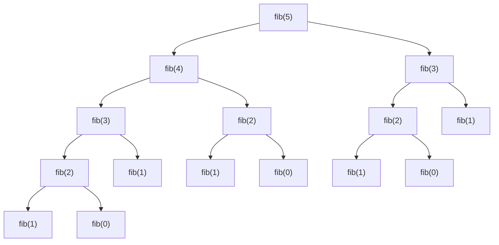

# Why Plain Recursion Is Exponential Without Memoization

> A recursion that branches twice and repeats subproblems does exponential work. Counting the calls shows exactly how bad it is.

#### 1. What Is It?

A recursive function like `fib(n) = fib(n − 1) + fib(n − 2)` calls itself **twice**. The second call recomputes what the first call already knew. The number of calls grows like the **Fibonacci numbers themselves**, which is about `1.618ⁿ`.

**Why it matters in interviews:** "Why is this slow?" and "What is the time complexity of the brute force?" are common questions. You should be able to draw the recursion tree and say "`O(2ⁿ)`".

#### 2. How It Works

**Recursion tree for `fib(5)`: 15 calls, only 6 different arguments.**



**Counting the calls.** Let `T(n)` be the number of calls: `T(n) = T(n − 1) + T(n − 2) + 1`, with `T(0) = T(1) = 1`.

| `n` | 5 | 10 | 20 | 30 | 40 | 50 |
|---|---|---|---|---|---|---|
| calls | 15 | 177 | 21,891 | 2,692,537 | 331,160,281 | about 40 billion |

Each time `n` grows by about 1.4, the calls double. For a rough bound: the tree has depth `n` and each level at most doubles, so `O(2ⁿ)`. (A tighter bound is `O(φⁿ)`, `φ ≈ 1.618`.)

**With memoization** each `fib(k)` is computed **once**, so the tree collapses into a single chain and the total is `2n − 1` calls (`n` computations plus lookups).

**Other exponential recursions**

| Problem | Brute force | Why exponential | DP time |
|---|---|---|---|
| Subsets / House Robber | `O(2ⁿ)` | take or skip each item | `O(n)` |
| Coin Change (recursion) | `O(coinsᵃᵐᵒᵘⁿᵗ)` | try every coin at every amount | `O(amount · coins)` |
| LCS (recursion) | `O(2^(m+n))` | two branches per mismatch | `O(m · n)` |
| Edit Distance (recursion) | `O(3^(m+n))` | three branches | `O(m · n)` |

**The rule to remember:** if the number of **distinct** arguments is polynomial (like `n` or `m × n`) but the number of **calls** is exponential, memoization turns it into polynomial time.

#### 3. Brute Force vs Optimized

| | Calls for `n = 40` | Time |
|---|---|---|
| Plain recursion | 331,160,281 | seconds |
| Memoized recursion | 79 | microseconds |
| Bottom-up | 40 loop steps | microseconds |

```kotlin
var calls = 0L

fun fibPlain(n: Int): Long {
    calls++
    return if (n <= 1) n.toLong() else fibPlain(n - 1) + fibPlain(n - 2)
}

fun fibMemoized(n: Int, memo: HashMap<Int, Long> = HashMap()): Long {
    calls++
    if (n <= 1) return n.toLong()
    memo[n]?.let { return it }
    val result = fibMemoized(n - 1, memo) + fibMemoized(n - 2, memo)
    memo[n] = result
    return result
}
```

#### 4. Kotlin Code

```kotlin
// Count calls for any n and either version
fun countCalls(n: Int): Pair<Long, Long> {
    calls = 0; fibPlain(n); val plain = calls
    calls = 0; fibMemoized(n); val memo = calls
    return plain to memo
}

// Coin change by plain recursion (exponential): fewest coins, -1 if impossible
fun coinChangeRec(coins: IntArray, amount: Int): Int {
    if (amount == 0) return 0
    if (amount < 0) return -1
    var best = -1
    for (c in coins) {
        val sub = coinChangeRec(coins, amount - c)
        if (sub >= 0 && (best == -1 || sub + 1 < best)) best = sub + 1
    }
    return best
}

// The same with a memo: each amount solved once
fun coinChangeMemo(coins: IntArray, amount: Int, memo: IntArray = IntArray(amount + 1) { -2 }): Int {
    if (amount == 0) return 0
    if (amount < 0) return -1
    if (memo[amount] != -2) return memo[amount]
    var best = -1
    for (c in coins) {
        val sub = coinChangeMemo(coins, amount - c, memo)
        if (sub >= 0 && (best == -1 || sub + 1 < best)) best = sub + 1
    }
    memo[amount] = best
    return best
}
```

Checks: `countCalls(5)` → `(15, 9)`. `countCalls(20)` → `(21891, 39)`. `countCalls(10)` → `(177, 19)`. `coinChangeRec(intArrayOf(1, 2, 5), 11)` → `3` (slow only for large amounts). `coinChangeMemo(intArrayOf(1, 2, 5), 11)` → `3`. `coinChangeMemo(intArrayOf(2), 3)` → `-1`. `coinChangeMemo(intArrayOf(186, 419, 83, 408), 6249)` finishes instantly with the memo (the plain recursion would never finish).

#### 5. Complexity

| | Time | Space |
|---|---|---|
| Plain Fibonacci | `O(2ⁿ)` (tight `O(φⁿ)`) | `O(n)` stack |
| Memoized | `O(n)` | `O(n)` |
| Plain coin change | `O(coinsᵃᵐᵒᵘⁿᵗ)` | `O(amount)` stack |
| Memoized coin change | `O(amount · coins)` | `O(amount)` |

#### 6. Common Mistakes

1. **Saying plain recursion is `O(n)`** because the depth is `n`. The depth is `n`, the number of calls is exponential.
2. **Forgetting to count the memo lookups** (they are `O(1)` but still calls).
3. **Memoizing with a key that misses a parameter**, so different states share a result.
4. **Mutating shared state** inside a memoized function.
5. **Not noticing the repeated arguments.** Print the arguments for a small input to see them.

#### 7. Say This in the Interview

1. "Each call branches into two, so the call tree doubles in size as `n` grows: about `O(2ⁿ)`. The same arguments are computed many times."
2. "There are only `n + 1` distinct arguments, so if I store each result the first time, the work drops to `O(n)`."
3. "General rule: distinct states times work per state."

#### 8. Quick Check

1. How many calls does plain `fib(6)` make?
2. How many distinct arguments does `fib(n)` use?
3. What does memoization change about the recursion depth?

<details>
<summary>Answers</summary>

1. `25` (`T(6) = T(5) + T(4) + 1 = 15 + 9 + 1`).
2. `n + 1`.
3. Nothing. The depth is still `n`. Only the number of calls shrinks.

</details>

#### 9. Related LeetCode Questions

| # | Question | Idea |
|---|---|---|
| 509 | [Fibonacci Number](https://leetcode.com/problems/fibonacci-number/) (Easy) | the standard blow-up |
| 70 | [Climbing Stairs](https://leetcode.com/problems/climbing-stairs/) (Easy) | same tree |
| 322 | [Coin Change](https://leetcode.com/problems/coin-change/) (Medium) | recursion TLE, then memo |
| 139 | [Word Break](https://leetcode.com/problems/word-break/) (Medium) | repeated suffixes |
| 96 | [Unique Binary Search Trees](https://leetcode.com/problems/unique-binary-search-trees/) (Medium) | Catalan recursion with memo |
| 279 | [Perfect Squares](https://leetcode.com/problems/perfect-squares/) (Medium) | recursion over remaining |
