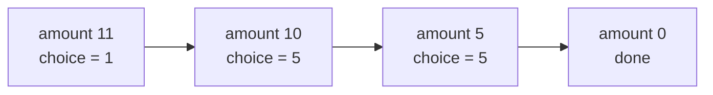

# Reconstructing the Actual Solution, Not Only Its Value

> A DP table tells you the **best value**. To get the **actual choices** (the subsequence, the coins, the items), walk back through the table, or store a parent pointer.

#### 1. What Is It?

Most DP solutions return only a number. Many interview follow-ups ask: "Now print the actual subsequence / the coins / the items."

Two standard ways:

| Way | Idea | Cost |
|---|---|---|
| **Backtrack the table** | start at the answer cell and ask "which choice gave this value?" | needs the **full table** |
| **Store a choice / parent** | record the decision (`choice[a] = coin`) while filling | one extra array |

**Signals:** "return the subsequence itself", "which items", "print the path", "list the coins".

#### 2. How It Works

**LCS string.** Fill the normal LCS table, then walk from `dp[m][n]` to the top-left:

- letters equal → take the letter, go **diagonally**;
- otherwise go to the neighbour with the larger value (up or left).

```text
"abcde" / "ace"   (table in note 5)
(5,3): e == e → take 'e', go to (4,2)
(4,2): d != c, up = 2 >= left = 1 → go up to (3,2)
(3,2): c == c → take 'c', go to (2,1)
(2,1): b != a, up = 1 >= left = 0 → up to (1,1)
(1,1): a == a → take 'a', go to (0,0)
letters collected in reverse: e, c, a  → reverse → "ace"
```

**Coin change coins.** Store `choice[a]` = the coin used for the best answer at amount `a`. Then follow `a, a − choice[a], ...` down to 0.



**0/1 Knapsack items.** Keep the **2D** table `dp[i][w]`. From `(n, W)` go up: if `dp[i][w] != dp[i − 1][w]`, item `i` **was taken**, so subtract its weight.

**LIS sequence.** Store `parent[i]` = the previous index in the best subsequence ending at `i`.

**Rule:** to rebuild you must keep the table (or the choice array). The space-optimised versions (note 7) throw that information away.

#### 3. Brute Force vs Optimized

| Approach | Time | Space |
|---|---|---|
| Brute force: generate all subsequences and keep the longest common one | `O(2ⁿ · m)` | `O(n)` |
| DP value only | `O(m · n)` | `O(n)` |
| **DP + backtrack** | `O(m · n)` + `O(m + n)` | `O(m · n)` |

```kotlin
// Brute force LCS string: try every subsequence of a, check it is a subsequence of b. Exponential.
fun lcsStringBrute(a: String, b: String): String {
    var best = ""
    fun isSub(s: String, t: String): Boolean { var i = 0; for (c in t) if (i < s.length && s[i] == c) i++; return i == s.length }
    for (mask in 0 until (1 shl a.length)) {
        val sb = StringBuilder()
        for (i in a.indices) if (((mask shr i) and 1) == 1) sb.append(a[i])
        val s = sb.toString()
        if (s.length > best.length && isSub(s, b)) best = s
    }
    return best
}
```

#### 4. Kotlin Code

```kotlin
// LCS: the string itself
fun lcsString(a: String, b: String): String {
    val dp = Array(a.length + 1) { IntArray(b.length + 1) }
    for (i in 1..a.length) for (j in 1..b.length) {
        dp[i][j] = if (a[i - 1] == b[j - 1]) dp[i - 1][j - 1] + 1 else maxOf(dp[i - 1][j], dp[i][j - 1])
    }
    val sb = StringBuilder()
    var i = a.length
    var j = b.length
    while (i > 0 && j > 0) {
        when {
            a[i - 1] == b[j - 1] -> { sb.append(a[i - 1]); i--; j-- }
            dp[i - 1][j] >= dp[i][j - 1] -> i--
            else -> j--
        }
    }
    return sb.reverse().toString()
}

// Coin change: the coins used
fun coinChangeCoins(coins: IntArray, amount: Int): List<Int> {
    val dp = IntArray(amount + 1) { amount + 1 }
    val choice = IntArray(amount + 1)
    dp[0] = 0
    for (a in 1..amount) for (c in coins) {
        if (c <= a && dp[a - c] + 1 < dp[a]) { dp[a] = dp[a - c] + 1; choice[a] = c }
    }
    if (dp[amount] > amount) return emptyList()
    val used = mutableListOf<Int>()
    var a = amount
    while (a > 0) { used.add(choice[a]); a -= choice[a] }
    return used
}

// 0/1 Knapsack: which items (indexes) are taken
fun knapsackItems(weights: IntArray, values: IntArray, capacity: Int): List<Int> {
    val n = weights.size
    val dp = Array(n + 1) { IntArray(capacity + 1) }
    for (i in 1..n) for (w in 0..capacity) {
        dp[i][w] = dp[i - 1][w]
        if (weights[i - 1] <= w) dp[i][w] = maxOf(dp[i][w], dp[i - 1][w - weights[i - 1]] + values[i - 1])
    }
    val taken = mutableListOf<Int>()
    var w = capacity
    for (i in n downTo 1) {
        if (dp[i][w] != dp[i - 1][w]) { taken.add(i - 1); w -= weights[i - 1] }      // item i - 1 was taken
    }
    return taken.reversed()
}

// Longest Increasing Subsequence: the sequence itself
fun lisSequence(nums: IntArray): List<Int> {
    val n = nums.size
    val len = IntArray(n) { 1 }
    val parent = IntArray(n) { -1 }
    var best = 0
    for (i in 0 until n) {
        for (j in 0 until i) if (nums[j] < nums[i] && len[j] + 1 > len[i]) { len[i] = len[j] + 1; parent[i] = j }
        if (len[i] > len[best]) best = i
    }
    val seq = mutableListOf<Int>()
    var k = best
    while (k != -1) { seq.add(nums[k]); k = parent[k] }
    return seq.reversed()
}
```

Checks: `lcsString("abcde", "ace")` → `"ace"`. `lcsString("abc", "def")` → `""`. `lcsStringBrute("abcde", "ace")` → `"ace"`. `coinChangeCoins(intArrayOf(1, 2, 5), 11)` → `[1, 5, 5]` (3 coins that sum to 11). `coinChangeCoins(intArrayOf(2), 3)` → `[]`. `knapsackItems(intArrayOf(1, 3, 4, 5), intArrayOf(1, 4, 5, 7), 7)` → `[1, 2]` (the items with weights 3 and 4, value 9). `lisSequence(intArrayOf(10, 9, 2, 5, 3, 7, 101, 18))` → `[2, 5, 7, 101]`. `lisSequence(intArrayOf(5))` → `[5]`.

#### 5. Complexity

| | Time | Space |
|---|---|---|
| Fill the table | `O(m · n)` | `O(m · n)` |
| Backtrack | `O(m + n)` | `O(answer)` |
| Choice array (coin change) | `O(amount · coins)` | `O(amount)` |

#### 6. Common Mistakes

1. **Space-optimising first** and then being unable to rebuild.
2. **Backtracking in the wrong direction** (you walk from the end cell back to the start).
3. **Forgetting to reverse** the collected result.
4. **Ties:** many answers can be correct (`[1, 5, 5]` or `[5, 5, 1]`). Say which one you return.
5. **Using `>` vs `>=`** when choosing up vs left (changes which equal-length answer you get, not the length).
6. **Off-by-one** between table indexes (`i`) and item indexes (`i − 1`).

#### 7. Say This in the Interview

1. "First I compute the optimal value. To get the actual solution I walk back from the answer cell: at each cell I check which choice produced its value, and follow it."
2. "That needs the full table, or a parent or choice array. So I only do the space optimisation if the interviewer doesn't need the path."
3. "Rebuilding costs only `O(m + n)` extra time."

#### 8. Quick Check

1. Where does the LCS backtrack start and end?
2. How do you know item `i` was taken in knapsack?
3. Why can't a two-row LCS rebuild the string?

<details>
<summary>Answers</summary>

1. It starts at `dp[m][n]` and ends when `i` or `j` reaches 0.
2. `dp[i][w] != dp[i − 1][w]`.
3. The earlier rows are gone, so the choices can't be traced back.

</details>

#### 9. Related LeetCode Questions

| # | Question | Idea |
|---|---|---|
| 1143 | [Longest Common Subsequence](https://leetcode.com/problems/longest-common-subsequence/) (Medium) | length, then the string |
| 1092 | [Shortest Common Supersequence](https://leetcode.com/problems/shortest-common-supersequence/) (Hard) | LCS + rebuild |
| 322 | [Coin Change](https://leetcode.com/problems/coin-change/) (Medium) | count, then the coins |
| 300 | [Longest Increasing Subsequence](https://leetcode.com/problems/longest-increasing-subsequence/) (Medium) | length, then the sequence |
| 368 | [Largest Divisible Subset](https://leetcode.com/problems/largest-divisible-subset/) (Medium) | LIS style, return the subset |
| 5 | [Longest Palindromic Substring](https://leetcode.com/problems/longest-palindromic-substring/) (Medium) | track start and length |
