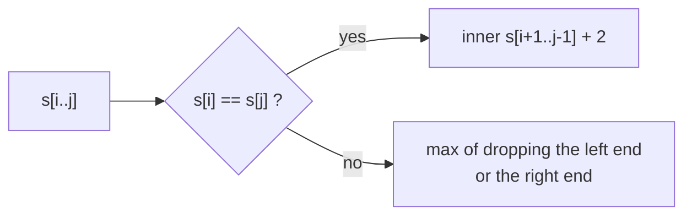

# String DP: Palindromes, Word Break, Decode Ways

> DP on a single string. The state is a **prefix length** or a **range `[i, j]`**. Palindromes use ranges. Word Break and Decode Ways use prefixes.

#### 1. What Is It?

| Problem | State | Idea |
|---|---|---|
| **Longest Palindromic Substring** (5) | centre, or `dp[i][j]` = `s[i..j]` is a palindrome | expand around a centre |
| **Palindromic Substrings** (647) | same | count every expansion that works |
| **Longest Palindromic Subsequence** (516) | `dp[i][j]` = longest palindromic subsequence in `s[i..j]` | ends equal: `+2` |
| **Word Break** (139) | `dp[i]` = can the first `i` characters be split into dictionary words? | some `j < i` with `dp[j]` and `s[j..i)` in the dictionary |
| **Decode Ways** (91) | `dp[i]` = ways to decode the first `i` characters | one-digit and two-digit codes |

**Signals:** "palindrome", "split a string into words", "number of ways to decode", "longest ... in a string".

#### 2. How It Works

**Palindromes by expanding.** Every palindrome has a centre: one character (odd length) or the gap between two (even length). Expand outwards while the ends match. There are `2n − 1` centres.

```text
"babad":  centre 'a' (index 1): b = b → "bab" (length 3).    centre 'b' (index 2): a = a → "aba" (length 3).
answer "bab" (or "aba")
```

**Longest Palindromic Subsequence (range DP).**

```text
dp[i][j] = dp[i+1][j-1] + 2                    if s[i] == s[j]
         = max(dp[i+1][j], dp[i][j-1])         otherwise
base: dp[i][i] = 1, filled with i from the end and j from i + 1
```



**Word Break.** `dp[0] = true`. For each `i`, check every split point `j`:

```text
s = "leetcode", dict = {leet, code}
dp[0] = true
dp[4]: s[0..4) = "leet" in dict and dp[0] → true
dp[8]: s[4..8) = "code" in dict and dp[4] → true      answer true
```

**Decode Ways.** `A = 1 ... Z = 26`. At position `i`:

- the last **one** digit (`1..9`) is a valid code → add `dp[i − 1]`;
- the last **two** digits (`10..26`) are a valid code → add `dp[i − 2]`.
- A `0` alone is invalid; it must be part of `10` or `20`.

```text
"226": dp[0]=1, dp[1]=1 ('2'), dp[2]=2 ('22' as 2,2 or 22), dp[3]=3 ('226' as 2,2,6 / 22,6 / 2,26)
```

#### 3. Brute Force vs Optimized

| Problem | Brute force | DP / expansion |
|---|---|---|
| Longest palindromic substring | check every substring `O(n³)` | expand around centres `O(n²)` |
| Longest palindromic subsequence | all subsequences `O(2ⁿ)` | `O(n²)` |
| Word Break | try every split recursively `O(2ⁿ)` | `O(n²)` (or `O(n · L)`) |
| Decode Ways | recursion `O(2ⁿ)` | `O(n)` |

```kotlin
// Brute force: longest palindromic substring by checking every substring. O(n^3).
fun longestPalindromeBrute(s: String): String {
    fun isPal(i: Int, j: Int): Boolean { var a = i; var b = j; while (a < b) { if (s[a++] != s[b--]) return false }; return true }
    var best = ""
    for (i in s.indices) for (j in i until s.length) {
        if (j - i + 1 > best.length && isPal(i, j)) best = s.substring(i, j + 1)
    }
    return best
}
```

#### 4. Kotlin Code

```kotlin
// Longest Palindromic Substring (LeetCode 5): expand around each centre
fun longestPalindrome(s: String): String {
    var start = 0
    var bestLen = 0
    fun expand(l: Int, r: Int) {
        var i = l; var j = r
        while (i >= 0 && j < s.length && s[i] == s[j]) { i--; j++ }
        val len = j - i - 1
        if (len > bestLen) { bestLen = len; start = i + 1 }
    }
    for (c in s.indices) { expand(c, c); expand(c, c + 1) }
    return s.substring(start, start + bestLen)
}

// Palindromic Substrings (LeetCode 647): count them
fun countSubstrings(s: String): Int {
    var count = 0
    fun expand(l: Int, r: Int) {
        var i = l; var j = r
        while (i >= 0 && j < s.length && s[i] == s[j]) { count++; i--; j++ }
    }
    for (c in s.indices) { expand(c, c); expand(c, c + 1) }
    return count
}

// Longest Palindromic Subsequence (LeetCode 516)
fun longestPalindromeSubseq(s: String): Int {
    val n = s.length
    val dp = Array(n) { IntArray(n) }
    for (i in n - 1 downTo 0) {
        dp[i][i] = 1
        for (j in i + 1 until n) {
            dp[i][j] = if (s[i] == s[j]) dp[i + 1][j - 1] + 2 else maxOf(dp[i + 1][j], dp[i][j - 1])
        }
    }
    return dp[0][n - 1]
}

// Word Break (LeetCode 139)
fun wordBreak(s: String, wordDict: List<String>): Boolean {
    val words = wordDict.toHashSet()
    val dp = BooleanArray(s.length + 1)
    dp[0] = true
    for (i in 1..s.length) {
        for (j in 0 until i) {
            if (dp[j] && s.substring(j, i) in words) { dp[i] = true; break }
        }
    }
    return dp[s.length]
}

// Decode Ways (LeetCode 91)
fun numDecodings(s: String): Int {
    if (s[0] == '0') return 0
    var prev2 = 1                                   // dp[i - 2]
    var prev1 = 1                                   // dp[i - 1]
    for (i in 1 until s.length) {
        var cur = 0
        if (s[i] != '0') cur += prev1                                 // one digit: 1..9
        val two = (s[i - 1] - '0') * 10 + (s[i] - '0')
        if (two in 10..26) cur += prev2                               // two digits: 10..26
        prev2 = prev1
        prev1 = cur
    }
    return prev1
}
```

Checks: `longestPalindrome("babad")` → `"bab"`. `longestPalindrome("cbbd")` → `"bb"`. `longestPalindromeBrute("babad")` → `"bab"`. `countSubstrings("abc")` → `3`. `countSubstrings("aaa")` → `6`. `longestPalindromeSubseq("bbbab")` → `4`. `longestPalindromeSubseq("cbbd")` → `2`. `wordBreak("leetcode", listOf("leet", "code"))` → `true`. `wordBreak("applepenapple", listOf("apple", "pen"))` → `true`. `wordBreak("catsandog", listOf("cats", "dog", "sand", "and", "cat"))` → `false`. `numDecodings("12")` → `2`. `numDecodings("226")` → `3`. `numDecodings("06")` → `0`. `numDecodings("10")` → `1`.

#### 5. Complexity

| | Time | Space |
|---|---|---|
| Palindromic substring (expand) | `O(n²)` | `O(1)` |
| Palindromic subsequence | `O(n²)` | `O(n²)`, `O(n)` with a rolling row |
| Word Break | `O(n² · L)` for substring hashing | `O(n)` |
| Decode Ways | `O(n)` | `O(1)` |

#### 6. Common Mistakes

1. **Only odd centres** for palindromes (forgetting the even ones: `"bb"`).
2. **Confusing substring and subsequence** (adjacent vs not).
3. **Decode Ways:** treating `'0'` as a valid single digit, or `"06"` as `6`.
4. **Decode Ways:** accepting two-digit numbers outside `10..26` (like `27` or `05`).
5. **Word Break:** `dp[0] = false` (it must be `true`: the empty prefix is fine).
6. **Using a `List` for the dictionary** (`O(n)` lookups). Use a `HashSet`.
7. **Range DP filled in the wrong order** (`i` must go from the end, since `dp[i][j]` needs `dp[i + 1][...]`).

#### 7. Say This in the Interview

1. "A palindrome mirrors around a centre, so I expand from each of the `2n − 1` centres: `O(n²)` time and `O(1)` space."
2. "For Word Break, `dp[i]` is whether the first `i` characters can be segmented. It is true if some earlier `dp[j]` is true and the word from `j` to `i` is in the dictionary."
3. "Decode Ways looks like Climbing Stairs, but each step must be a valid one- or two-digit code."

#### 8. Quick Check

1. Number of centres for a string of length 5?
2. Decode ways for `"27"`?
3. Longest palindromic subsequence of `"abca"`?

<details>
<summary>Answers</summary>

1. `2 · 5 − 1 = 9`.
2. `1` (only `2, 7`, since `27 > 26`).
3. `3` (`"aba"` or `"aca"`).

</details>

#### 9. Related LeetCode Questions

| # | Question | Idea |
|---|---|---|
| 5 | [Longest Palindromic Substring](https://leetcode.com/problems/longest-palindromic-substring/) (Medium) | expand around centres |
| 647 | [Palindromic Substrings](https://leetcode.com/problems/palindromic-substrings/) (Medium) | count expansions |
| 516 | [Longest Palindromic Subsequence](https://leetcode.com/problems/longest-palindromic-subsequence/) (Medium) | range DP |
| 139 | [Word Break](https://leetcode.com/problems/word-break/) (Medium) | prefix DP |
| 91 | [Decode Ways](https://leetcode.com/problems/decode-ways/) (Medium) | one and two digits |
| 131 | [Palindrome Partitioning](https://leetcode.com/problems/palindrome-partitioning/) (Medium) | backtracking + DP table |
| 1312 | [Minimum Insertion Steps to Make a String Palindrome](https://leetcode.com/problems/minimum-insertion-steps-to-make-a-string-palindrome/) (Hard) | `n − LPS` |
