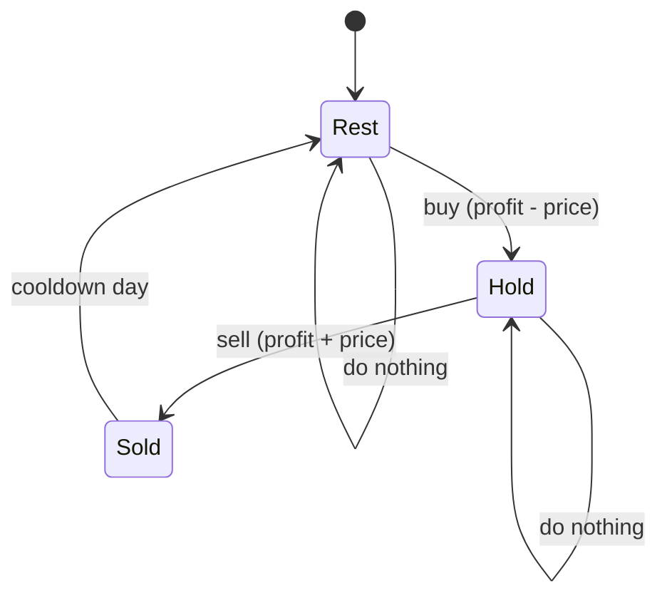

# State Machine DP: Buy/Sell Stock with Cooldown

> Add a **state** (are you holding a stock?) to the DP. Each day you move between states by an action. The family of stock problems all use this idea.

#### 1. What Is It?

In **state machine DP**, what you are allowed to do depends on a **mode**: holding a stock, free to buy, in cooldown. You track the **best profit in each mode** for each day, and update them with the day's price.

| Problem | Rule | Number of states |
|---|---|---|
| **Stock I** (121) | one transaction | 2 (or a running minimum) |
| **Stock II** (122) | unlimited transactions | 2: `hold`, `free` |
| **With Cooldown** (309) | after selling you must rest one day | 3: `hold`, `sold`, `rest` |
| **With Fee** (714) | pay a fee per transaction | 2: `hold`, `free` |
| **Stock IV** (188) | at most `k` transactions | `2k` states |

**Signals:** "buy and sell", "cannot do X right after Y", "at most `k` times", "holding".

#### 2. How It Works

**Stock with cooldown (3 states).**



On each new price `p`:

```text
sold = hold + p                    (sell the stock I was holding)
hold = max(hold, rest - p)         (keep holding, or buy from the free state)
rest = max(rest, previous sold)    (stay free, or come out of the cooldown)
answer = max(sold, rest)
```

```text
prices = [1, 2, 3, 0, 2]
start:  hold = -1, sold = 0, rest = 0
p=2:  sold = -1 + 2 = 1;  hold = max(-1, 0 - 2) = -1;  rest = max(0, 0) = 0
p=3:  sold = -1 + 3 = 2;  hold = max(-1, 0 - 3) = -1;  rest = max(0, 1) = 1
p=0:  sold = -1 + 0 = -1; hold = max(-1, 1 - 0) = 1;   rest = max(1, 2) = 2
p=2:  sold = 1 + 2 = 3;   hold = max(1, 2 - 2) = 1;    rest = max(2, -1) = 2
answer max(3, 2) = 3
```

**With a fee.** Two states. Selling pays the fee:

```text
free = max(free, hold + p - fee)
hold = max(hold, free - p)         (use the old value of free)
```

**At most `k` transactions.** For each transaction number `j` keep `buy[j]` (best profit while holding during the `j`-th transaction) and `sell[j]`. Update with each price.

**The method:** list the states, draw the arrows (actions), write one update per state using **last day's** values, and take the best final state.

#### 3. Brute Force vs Optimized

| Approach | Time | Space |
|---|---|---|
| Recursion over buy / sell / skip each day | `O(3ⁿ)` | `O(n)` |
| Recursion + memo on `(day, holding)` | `O(n)` | `O(n)` |
| **Rolling state variables** | **`O(n)`** | **`O(1)`** |

```kotlin
// Brute force with a cooldown: try buy / sell / skip every day. Exponential.
fun maxProfitBrute(prices: IntArray, day: Int = 0, holding: Boolean = false): Int {
    if (day >= prices.size) return 0
    val skip = maxProfitBrute(prices, day + 1, holding)
    return if (holding) maxOf(skip, prices[day] + maxProfitBrute(prices, day + 2, false))     // sell, then cooldown
    else maxOf(skip, -prices[day] + maxProfitBrute(prices, day + 1, true))                    // buy
}
```

#### 4. Kotlin Code

```kotlin
// Best Time to Buy and Sell Stock with Cooldown (LeetCode 309)
fun maxProfitCooldown(prices: IntArray): Int {
    var hold = -prices[0]
    var sold = 0
    var rest = 0
    for (i in 1 until prices.size) {
        val prevSold = sold
        sold = hold + prices[i]
        hold = maxOf(hold, rest - prices[i])
        rest = maxOf(rest, prevSold)
    }
    return maxOf(sold, rest)
}

// Best Time to Buy and Sell Stock with Transaction Fee (LeetCode 714)
fun maxProfitFee(prices: IntArray, fee: Int): Int {
    var hold = -prices[0]
    var free = 0
    for (i in 1 until prices.size) {
        val newFree = maxOf(free, hold + prices[i] - fee)
        val newHold = maxOf(hold, free - prices[i])
        free = newFree
        hold = newHold
    }
    return free
}

// Best Time to Buy and Sell Stock II (LeetCode 122): unlimited transactions
fun maxProfitUnlimited(prices: IntArray): Int {
    var hold = -prices[0]
    var free = 0
    for (i in 1 until prices.size) {
        val newFree = maxOf(free, hold + prices[i])
        hold = maxOf(hold, free - prices[i])
        free = newFree
    }
    return free
}

// Best Time to Buy and Sell Stock IV (LeetCode 188): at most k transactions
fun maxProfitK(k: Int, prices: IntArray): Int {
    if (k == 0 || prices.isEmpty()) return 0
    val buy = IntArray(k + 1) { Int.MIN_VALUE / 2 }
    val sell = IntArray(k + 1)
    for (p in prices) {
        for (j in 1..k) {
            buy[j] = maxOf(buy[j], sell[j - 1] - p)
            sell[j] = maxOf(sell[j], buy[j] + p)
        }
    }
    return sell[k]
}
```

Checks: `maxProfitCooldown(intArrayOf(1, 2, 3, 0, 2))` → `3`. `maxProfitCooldown(intArrayOf(1))` → `0`. `maxProfitBrute(intArrayOf(1, 2, 3, 0, 2))` → `3`. `maxProfitFee(intArrayOf(1, 3, 2, 8, 4, 9), 2)` → `8`. `maxProfitUnlimited(intArrayOf(7, 1, 5, 3, 6, 4))` → `7`. `maxProfitK(2, intArrayOf(2, 4, 1))` → `2`. `maxProfitK(2, intArrayOf(3, 2, 6, 5, 0, 3))` → `7`. `maxProfitK(100, intArrayOf(1, 2, 3, 4, 5))` → `4`.

#### 5. Complexity

| | Time | Space |
|---|---|---|
| Cooldown / Fee / Unlimited | `O(n)` | `O(1)` |
| Stock IV | `O(n · k)` | `O(k)` |

#### 6. Common Mistakes

1. **Updating a state with a value already changed today** (use the **previous day's** value: save `prevSold`, `newFree`).
2. **Wrong initial `hold`.** It is `−prices[0]`, not `0`.
3. **Cooldown:** letting `hold` use today's `sold`.
4. **Returning `hold`** (you must not end holding a stock). Return `free` / `max(sold, rest)`.
5. **Stock IV:** initial `buy` as `0` (it must be very negative) and overflow from `Int.MIN_VALUE − p`.
6. **Confusing "transaction" count** (a buy and a sell together are one transaction).

#### 7. Say This in the Interview

1. "I'll track the best profit in each state: holding a stock, just sold, and resting. Each day I update the states from yesterday's values."
2. "Buying costs the price, selling earns it. The cooldown means I can only buy from the rest state, not right after selling."
3. "It's `O(n)` time and `O(1)` space. I return the best non-holding state."

#### 8. Quick Check

1. Answer for `[1, 2]` with a cooldown?
2. Why can't the final answer be `hold`?
3. How many states in the cooldown problem?

<details>
<summary>Answers</summary>

1. `1` (buy at 1, sell at 2).
2. Holding a stock means you did not realise the profit.
3. Three: `hold`, `sold`, `rest`.

</details>

#### 9. Related LeetCode Questions

| # | Question | Idea |
|---|---|---|
| 121 | [Best Time to Buy and Sell Stock](https://leetcode.com/problems/best-time-to-buy-and-sell-stock/) (Easy) | one transaction |
| 122 | [Best Time to Buy and Sell Stock II](https://leetcode.com/problems/best-time-to-buy-and-sell-stock-ii/) (Medium) | unlimited |
| 309 | [Best Time to Buy and Sell Stock with Cooldown](https://leetcode.com/problems/best-time-to-buy-and-sell-stock-with-cooldown/) (Medium) | three states |
| 714 | [Best Time to Buy and Sell Stock with Transaction Fee](https://leetcode.com/problems/best-time-to-buy-and-sell-stock-with-transaction-fee/) (Medium) | fee on sell |
| 123 | [Best Time to Buy and Sell Stock III](https://leetcode.com/problems/best-time-to-buy-and-sell-stock-iii/) (Hard) | `k = 2` |
| 188 | [Best Time to Buy and Sell Stock IV](https://leetcode.com/problems/best-time-to-buy-and-sell-stock-iv/) (Hard) | `k` transactions |
