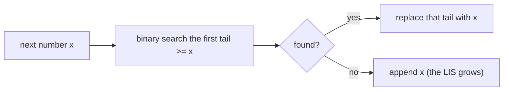

# Subsequence DP: Longest Increasing Subsequence

> A subsequence keeps the order but may skip items. For "longest ... subsequence" questions, let `dp[i]` be the best subsequence **ending at `i`**.

#### 1. What Is It?

A **subsequence** is a sequence you get by deleting some items without changing the order. The standard problem: **Longest Increasing Subsequence (LIS)**, LeetCode 300.

| Problem | State | Recurrence |
|---|---|---|
| **LIS** (300) | `dp[i]` = length of the LIS **ending at** `i` | `1 + max(dp[j])` for `j < i` with `nums[j] < nums[i]` |
| **Number of LIS** (673) | also `count[i]` = how many LIS end at `i` | add the counts of the best `j` |
| **Russian Doll Envelopes** (354) | sort, then LIS on the heights | |
| **Largest Divisible Subset** (368) | sort, then LIS with a divisibility test | |

**Signals:** "longest increasing / divisible / chain", "nested", "subsequence (not substring)".

#### 2. How It Works

**`O(n²)` DP.** For each `i`, look at every earlier `j`. If `nums[j] < nums[i]`, then the subsequence ending at `j` can be extended by `nums[i]`.

```text
nums = [10, 9, 2, 5, 3, 7, 101, 18]
dp   = [ 1, 1, 1, 2, 2, 3,   4,  4]
        10 9  2  5  3  7  101  18       answer = max(dp) = 4  (2, 5, 7, 101)
```

**`O(n log n)` with `tails`.** `tails[k]` = the **smallest possible last value** of an increasing subsequence of length `k + 1`. For each number `x`, binary search the first `tails[k] >= x` and replace it. If `x` is bigger than all, append.

```text
x=10:  tails [10]
x=9:   tails [9]            (replace 10: a smaller tail is better)
x=2:   tails [2]
x=5:   tails [2, 5]
x=3:   tails [2, 3]
x=7:   tails [2, 3, 7]
x=101: tails [2, 3, 7, 101]
x=18:  tails [2, 3, 7, 18]
length of tails = 4
```

`tails` is **not** the LIS itself, only its length is right.



**Counting LIS.** Keep `len[i]` and `count[i]`. When a longer chain is found through `j`, copy `count[j]`. When an equal-length chain is found, add `count[j]`.

**Russian Doll Envelopes.** An envelope fits into another if **both** width and height are smaller. Sort by width ascending, and for equal widths by height **descending** (so two envelopes of the same width cannot both be used). Then the answer is the LIS of the heights.

#### 3. Brute Force vs Optimized

| Approach | Time | Space |
|---|---|---|
| Try every subsequence | `O(2ⁿ · n)` | `O(n)` |
| **DP, check all earlier `j`** | `O(n²)` | `O(n)` |
| **`tails` + binary search** | **`O(n log n)`** | `O(n)` |

```kotlin
// Brute force: recursion, include or skip each number
fun lisBrute(nums: IntArray, i: Int = 0, prev: Int = Int.MIN_VALUE): Int {
    if (i == nums.size) return 0
    val skip = lisBrute(nums, i + 1, prev)
    val take = if (nums[i] > prev) 1 + lisBrute(nums, i + 1, nums[i]) else 0
    return maxOf(skip, take)
}
```

#### 4. Kotlin Code

```kotlin
// LIS, O(n^2) (LeetCode 300)
fun lengthOfLIS(nums: IntArray): Int {
    val dp = IntArray(nums.size) { 1 }
    for (i in nums.indices) {
        for (j in 0 until i) if (nums[j] < nums[i]) dp[i] = maxOf(dp[i], dp[j] + 1)
    }
    return dp.maxOrNull() ?: 0
}

// LIS, O(n log n)
fun lengthOfLISFast(nums: IntArray): Int {
    val tails = IntArray(nums.size)
    var size = 0
    for (x in nums) {
        var lo = 0
        var hi = size
        while (lo < hi) {
            val mid = (lo + hi) / 2
            if (tails[mid] < x) lo = mid + 1 else hi = mid       // first tail >= x
        }
        tails[lo] = x
        if (lo == size) size++
    }
    return size
}

// Number of Longest Increasing Subsequence (LeetCode 673)
fun findNumberOfLIS(nums: IntArray): Int {
    val n = nums.size
    val len = IntArray(n) { 1 }
    val count = IntArray(n) { 1 }
    for (i in 0 until n) {
        for (j in 0 until i) {
            if (nums[j] < nums[i]) {
                if (len[j] + 1 > len[i]) { len[i] = len[j] + 1; count[i] = count[j] }
                else if (len[j] + 1 == len[i]) count[i] += count[j]
            }
        }
    }
    val best = len.maxOrNull() ?: 0
    var total = 0
    for (i in 0 until n) if (len[i] == best) total += count[i]
    return total
}

// Russian Doll Envelopes (LeetCode 354)
fun maxEnvelopes(envelopes: Array<IntArray>): Int {
    val sorted = envelopes.sortedWith(compareBy<IntArray>({ it[0] }, { -it[1] }))   // width asc, height desc
    val tails = IntArray(sorted.size)
    var size = 0
    for (e in sorted) {
        val h = e[1]
        var lo = 0
        var hi = size
        while (lo < hi) { val mid = (lo + hi) / 2; if (tails[mid] < h) lo = mid + 1 else hi = mid }
        tails[lo] = h
        if (lo == size) size++
    }
    return size
}
```

Checks: `lengthOfLIS(intArrayOf(10, 9, 2, 5, 3, 7, 101, 18))` → `4`. `lengthOfLIS(intArrayOf(0, 1, 0, 3, 2, 3))` → `4`. `lengthOfLIS(intArrayOf(7, 7, 7, 7))` → `1`. `lengthOfLISFast(...)` gives the same on all three. `lisBrute(intArrayOf(10, 9, 2, 5, 3, 7, 101, 18))` → `4`. `findNumberOfLIS(intArrayOf(1, 3, 5, 4, 7))` → `2`. `findNumberOfLIS(intArrayOf(2, 2, 2, 2, 2))` → `5`. `maxEnvelopes(arrayOf(intArrayOf(5, 4), intArrayOf(6, 4), intArrayOf(6, 7), intArrayOf(2, 3)))` → `3`. `maxEnvelopes(arrayOf(intArrayOf(1, 1), intArrayOf(1, 1), intArrayOf(1, 1)))` → `1`.

#### 5. Complexity

| | Time | Space |
|---|---|---|
| LIS DP | `O(n²)` | `O(n)` |
| LIS with `tails` | `O(n log n)` | `O(n)` |
| Number of LIS | `O(n²)` | `O(n)` |
| Russian Doll | `O(n log n)` | `O(n)` |

#### 6. Common Mistakes

1. **Returning `dp[n − 1]`** instead of `max(dp)` (the LIS may end anywhere).
2. **Confusing subsequence with subarray.** Elements need not be adjacent.
3. **`tails` binary search with `<=`** (that gives a non-decreasing subsequence, not strictly increasing).
4. **Reading `tails` as the actual LIS.** Only its length is meaningful.
5. **Russian Doll:** sorting heights ascending for equal widths (lets two same-width envelopes nest).
6. **Counting LIS:** not resetting `count[i]` when a longer chain is found.

#### 7. Say This in the Interview

1. "Let `dp[i]` be the length of the longest increasing subsequence that ends at `i`. For each `j < i` with a smaller value I can extend it. The answer is the maximum over all `i`. That's `O(n²)`."
2. "To get `O(n log n)` I keep the smallest possible tail for each length and binary search where each new number goes."
3. "For envelopes I sort by width, and by height descending for ties, then run LIS on the heights."

#### 8. Quick Check

1. LIS length of `[3, 2, 1]`?
2. What does `tails[k]` store?
3. Why sort heights descending for equal widths?

<details>
<summary>Answers</summary>

1. `1`.
2. The smallest possible last value of an increasing subsequence of length `k + 1`.
3. So two envelopes of the same width can never appear together in an increasing height sequence.

</details>

#### 9. Related LeetCode Questions

| # | Question | Idea |
|---|---|---|
| 300 | [Longest Increasing Subsequence](https://leetcode.com/problems/longest-increasing-subsequence/) (Medium) | `O(n²)` and `O(n log n)` |
| 673 | [Number of Longest Increasing Subsequence](https://leetcode.com/problems/number-of-longest-increasing-subsequence/) (Medium) | length and count |
| 354 | [Russian Doll Envelopes](https://leetcode.com/problems/russian-doll-envelopes/) (Hard) | sort + LIS |
| 368 | [Largest Divisible Subset](https://leetcode.com/problems/largest-divisible-subset/) (Medium) | sort + LIS with divisibility |
| 646 | [Maximum Length of Pair Chain](https://leetcode.com/problems/maximum-length-of-pair-chain/) (Medium) | sort + greedy or DP |
| 1143 | [Longest Common Subsequence](https://leetcode.com/problems/longest-common-subsequence/) (Medium) | two sequences (note 5) |
