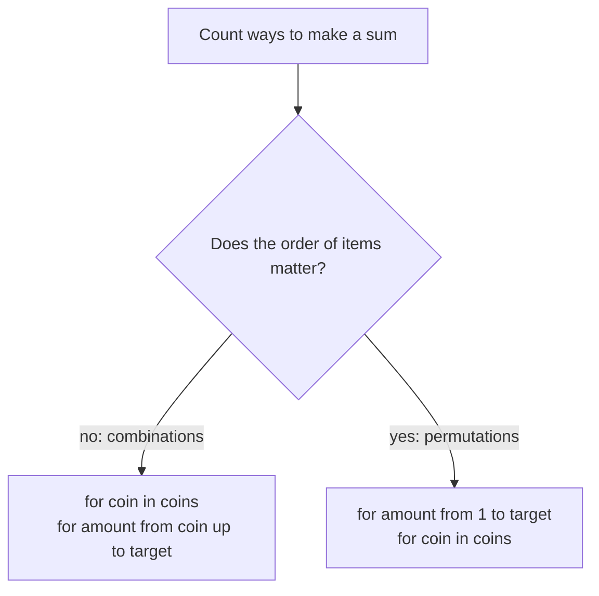

# Unbounded Knapsack & Coin Change II: Combinations vs Permutations

> When each item can be used **any number of times**, the capacity loop goes **upwards**. And the **order of the two loops** decides whether you count combinations or permutations.

#### 1. What Is It?

In **unbounded knapsack** every item is available **unlimited** times.

| Problem | Goal | Counting rule |
|---|---|---|
| **Unbounded Knapsack** | maximum value within capacity `W` | |
| **Coin Change** (322) | fewest coins for `amount` | |
| **Coin Change II** (518) | number of **combinations** (order does not matter) | `1 + 2` and `2 + 1` are the **same** |
| **Combination Sum IV** (377) | number of **permutations** (order matters) | `1 + 2` and `2 + 1` are **different** |
| **Perfect Squares** (279) | fewest perfect squares that sum to `n` | |

**Signals:** "unlimited supply", "any number of times", "number of ways to make a sum", and the words "combinations" or "different sequences".

#### 2. How It Works

**Unbounded knapsack.** `dp[w] = max(dp[w], dp[w − weight] + value)` with `w` going **up** from `weight` to `W`. Because `dp[w − weight]` may already include the same item, the item can be reused.

**Combinations vs permutations: the loop order.**

| To count | Outer loop | Inner loop | Why |
|---|---|---|---|
| **Combinations** (Coin Change II) | **coins** | amounts | each coin is "decided" once, so a set of coins is counted once |
| **Permutations** (Combination Sum IV) | **amounts** | coins | at each amount any coin can come last, so each order is counted |

```text
amount = 3, coins = [1, 2]
combinations: {1,1,1}, {1,2}                → 2 ways
permutations: 1+1+1, 1+2, 2+1               → 3 ways
```



**Perfect Squares.** `dp[i] = 1 + min(dp[i − s²])` over all squares `s² ≤ i`. It is Coin Change with the coins `1, 4, 9, 16, ...`.

#### 3. Brute Force vs Optimized

| Problem | Brute force | DP |
|---|---|---|
| Unbounded knapsack | try every count of each item | `O(n · W)` |
| Coin Change II | recursion over every coin sequence | `O(amount · coins)` |
| Perfect Squares | recursion, try each square | `O(n √n)` |

```kotlin
// Brute force Coin Change II: recursion over (coin index, remaining amount). Exponential without memo.
fun changeBrute(amount: Int, coins: IntArray, i: Int = 0): Int {
    if (amount == 0) return 1
    if (amount < 0 || i == coins.size) return 0
    return changeBrute(amount - coins[i], coins, i) + changeBrute(amount, coins, i + 1)    // use coin i again, or move on
}
```

#### 4. Kotlin Code

```kotlin
// Unbounded Knapsack: capacity loop goes UP
fun unboundedKnapsack(weights: IntArray, values: IntArray, capacity: Int): Int {
    val dp = IntArray(capacity + 1)
    for (i in weights.indices) {
        for (w in weights[i]..capacity) dp[w] = maxOf(dp[w], dp[w - weights[i]] + values[i])
    }
    return dp[capacity]
}

// Coin Change II (LeetCode 518): combinations (coins outside)
fun change(amount: Int, coins: IntArray): Int {
    val dp = IntArray(amount + 1)
    dp[0] = 1
    for (c in coins) for (a in c..amount) dp[a] += dp[a - c]
    return dp[amount]
}

// Combination Sum IV (LeetCode 377): permutations (amounts outside)
fun combinationSum4(nums: IntArray, target: Int): Int {
    val dp = IntArray(target + 1)
    dp[0] = 1
    for (a in 1..target) for (x in nums) if (x <= a) dp[a] += dp[a - x]
    return dp[target]
}

// Perfect Squares (LeetCode 279)
fun numSquares(n: Int): Int {
    val dp = IntArray(n + 1) { Int.MAX_VALUE }
    dp[0] = 0
    for (i in 1..n) {
        var s = 1
        while (s * s <= i) { dp[i] = minOf(dp[i], dp[i - s * s] + 1); s++ }
    }
    return dp[n]
}
```

Checks: `unboundedKnapsack(intArrayOf(1, 3, 4, 5), intArrayOf(10, 40, 50, 70), 8)` → `110` (`3 + 5`). `unboundedKnapsack(intArrayOf(2, 3, 4, 5), intArrayOf(3, 4, 5, 6), 8)` → `12` (four items of weight 2). `change(5, intArrayOf(1, 2, 5))` → `4`. `change(3, intArrayOf(2))` → `0`. `change(10, intArrayOf(10))` → `1`. `changeBrute(5, intArrayOf(1, 2, 5))` → `4`. `combinationSum4(intArrayOf(1, 2, 3), 4)` → `7`. `combinationSum4(intArrayOf(9), 3)` → `0`. `numSquares(12)` → `3`. `numSquares(13)` → `2`. `numSquares(1)` → `1`.

#### 5. Complexity

| | Time | Space |
|---|---|---|
| Unbounded knapsack | `O(n · W)` | `O(W)` |
| Coin Change II | `O(amount · coins)` | `O(amount)` |
| Combination Sum IV | `O(target · n)` | `O(target)` |
| Perfect Squares | `O(n √n)` | `O(n)` |

#### 6. Common Mistakes

1. **Swapping the two loops** and counting permutations when combinations are asked (or the reverse).
2. **Capacity loop downwards** for unbounded items (each item then used once).
3. **`dp[0]`:** `1` for counting, `0` for min coins, `0` for max value.
4. **Overflow:** counts can be large. Use `Long`, or the modulo the problem gives.
5. **Using `Int.MAX_VALUE` + 1** in Perfect Squares (guard, or all values are reachable, so it is safe here: `1` is always a square).
6. **Applying greedy** to coin problems with non-standard coins.

#### 7. Say This in the Interview

1. "Items are unlimited, so I iterate the capacity upwards: the same item can appear again."
2. "To count combinations I put the coins in the outer loop, so each coin is handled once and a set of coins is counted once. For permutations I put the amount outside."
3. "It's `O(amount · coins)` time and `O(amount)` space."

#### 8. Quick Check

1. Combinations of `[1, 2]` for amount 3?
2. Permutations of `[1, 2]` for amount 3?
3. Which loop is outside for combinations?

<details>
<summary>Answers</summary>

1. `2` (`1+1+1`, `1+2`).
2. `3` (`1+1+1`, `1+2`, `2+1`).
3. The loop over coins.

</details>

#### 9. Related LeetCode Questions

| # | Question | Idea |
|---|---|---|
| 322 | [Coin Change](https://leetcode.com/problems/coin-change/) (Medium) | min coins |
| 518 | [Coin Change II](https://leetcode.com/problems/coin-change-ii/) (Medium) | combinations |
| 377 | [Combination Sum IV](https://leetcode.com/problems/combination-sum-iv/) (Medium) | permutations |
| 279 | [Perfect Squares](https://leetcode.com/problems/perfect-squares/) (Medium) | coins are squares |
| 343 | [Integer Break](https://leetcode.com/problems/integer-break/) (Medium) | unbounded split |
| 983 | [Minimum Cost For Tickets](https://leetcode.com/problems/minimum-cost-for-tickets/) (Medium) | day DP with choices |
