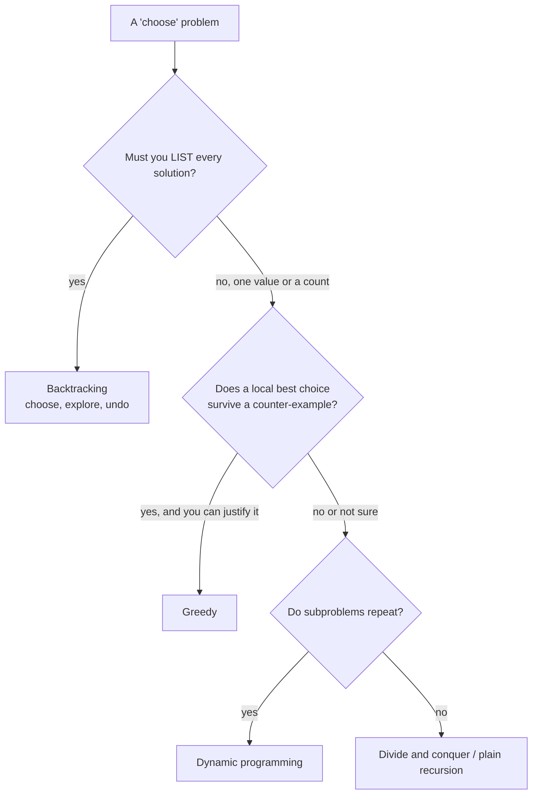

# DP vs Greedy vs Backtracking: How to Tell

> The question behind most interview mistakes: "which technique is this?" Use a short test, then say the reason out loud.

#### 1. What Is It?

Three techniques solve many "choose something" problems. They differ in **how much they explore** and **whether they remember**.

| Technique | Idea | Remembers? | Typical cost |
|---|---|---|---|
| **Greedy** | take the best-looking choice now and never go back | no | `O(n log n)` or `O(n)` |
| **Dynamic programming** | try all choices, but **store** the answer of each repeated subproblem | **yes** | `O(states × work)` |
| **Backtracking** | try all choices, **undo** and try the next, list every solution | no | exponential (`2ⁿ`, `n!`) |

**Signals in the wording**

| The question asks for | Likely |
|---|---|
| "**count** the number of ways", "minimum / maximum" with overlapping choices | **DP** |
| "**list all** subsets / permutations / combinations / placements" | **backtracking** |
| "the **best** you can do" and a local rule that never hurts (sorting, intervals, scheduling) | **greedy** |
| "**is it possible**" | DP (boolean) or backtracking |

#### 2. How It Works



**The counter-example test for greedy.** Coins `{1, 3, 4}`, amount `6`:

```text
greedy:  4 + 1 + 1 = 3 coins
DP:      3 + 3     = 2 coins   ← greedy is wrong, so use DP
```

**From backtracking to DP.** If your backtracking recursion is called again with the **same arguments** (for example `(index, remaining)`), add a memo. You have turned it into DP.

```text
Subset sum by backtracking: solve(i, remaining) is reached by many different paths → memoize (i, remaining).
```

**How to approach any DP problem in an interview (a 6-step script)**

1. **Clarify:** input size, ranges, what to return (value, count, or the actual solution).
2. **Brute force:** write the recursion in words, say its complexity (`O(2ⁿ)`).
3. **Spot the repeat:** the same arguments appear again, so the recursion can be memoized.
4. **Define the state** in one sentence: "`dp[i]` means ...".
5. **Recurrence, base case, order** (note 3), then code top-down or bottom-up.
6. **Optimise space** (note 7), state `O(states × work)`, test edge cases.

**Where each problem family lives**

| Family | Note |
|---|---|
| 1D: stairs, robber, Kadane | 04 |
| Grid, two strings: LCS, edit distance | 05 |
| Knapsack: subset sum, partition, target sum | 06 |
| Unbounded: coins, perfect squares | 14 |
| Subsequence: LIS | 13 |
| String: palindromes, word break, decode | 10 |
| State machine: stocks | 11 |
| Interval, bitmask | 12 |

#### 3. Brute Force vs Optimized

| Problem | Greedy | Backtracking | DP |
|---|---|---|---|
| Coin change `{1,3,4}`, 6 | wrong (3 coins) | exponential | correct, `O(amount · coins)` |
| Jump Game (can I reach the end?) | correct `O(n)` | exponential | `O(n²)` |
| All subsets that sum to `K` (list them) | no | needed | cannot list, only count |
| Count subsets that sum to `K` | no | exponential | `O(n · K)` |
| Activity selection | correct (sort by end) | exponential | `O(n²)` |

```kotlin
// Greedy coin change: pick the biggest coin each time
fun greedyCoins(coins: IntArray, amount: Int): Int {
    var left = amount
    var count = 0
    for (c in coins.sortedDescending()) { count += left / c; left %= c }
    return if (left == 0) count else -1
}

// DP coin change
fun dpCoins(coins: IntArray, amount: Int): Int {
    val dp = IntArray(amount + 1) { amount + 1 }
    dp[0] = 0
    for (a in 1..amount) for (c in coins) if (c <= a) dp[a] = minOf(dp[a], dp[a - c] + 1)
    return if (dp[amount] > amount) -1 else dp[amount]
}
```

#### 4. Kotlin Code

```kotlin
// Backtracking: list every subset that sums to a target
fun subsetsWithSum(nums: IntArray, target: Int): List<List<Int>> {
    val result = mutableListOf<List<Int>>()
    val path = mutableListOf<Int>()
    fun go(i: Int, remaining: Int) {
        if (remaining == 0) { result.add(path.toList()) }              // keep going: later zeros are allowed
        if (i == nums.size || remaining < 0) return
        for (k in i until nums.size) {
            path.add(nums[k]); go(k + 1, remaining - nums[k]); path.removeAt(path.size - 1)
        }
    }
    go(0, target)
    return result
}

// DP: only COUNT the subsets with that sum
fun countSubsetsWithSum(nums: IntArray, target: Int): Int {
    val dp = IntArray(target + 1)
    dp[0] = 1
    for (x in nums) for (s in target downTo x) dp[s] += dp[s - x]
    return dp[target]
}

// Greedy that IS correct: Jump Game
fun canJump(nums: IntArray): Boolean {
    var farthest = 0
    for (i in nums.indices) {
        if (i > farthest) return false
        farthest = maxOf(farthest, i + nums[i])
    }
    return true
}
```

Checks: `greedyCoins(intArrayOf(1, 3, 4), 6)` → `3`, but `dpCoins(intArrayOf(1, 3, 4), 6)` → `2`. `greedyCoins(intArrayOf(1, 5, 10, 25), 41)` → `4` and `dpCoins(...)` → `4` (for standard coin systems greedy works). `subsetsWithSum(intArrayOf(2, 3, 5, 7), 10)` → `[[2, 3, 5], [3, 7]]`. `countSubsetsWithSum(intArrayOf(2, 3, 5, 7), 10)` → `2`. `canJump(intArrayOf(2, 3, 1, 1, 4))` → `true`. `canJump(intArrayOf(3, 2, 1, 0, 4))` → `false`.

#### 5. Complexity

| Technique | Typical time | Typical space |
|---|---|---|
| Greedy | `O(n log n)` | `O(1)` |
| DP | `O(states × work)` | `O(states)` |
| Backtracking | `O(2ⁿ)` or `O(n!)` | `O(n)` |

#### 6. Common Mistakes

1. **Trusting greedy** because it works on the sample (always test `{1, 3, 4}`-style counter-examples).
2. **Using DP when asked to list all solutions.** DP gives a count or a best value. Listing needs backtracking (or DP plus reconstruction for one solution).
3. **Using backtracking for a counting problem** and timing out. Look for repeated `(index, remaining)` states.
4. **Writing a memo without a clear state**, so wrong results are shared.
5. **Not stating the complexity** of the brute force before improving it.
6. **Mixing up "subsequence" with "substring"** when choosing the state.

#### 7. Say This in the Interview

1. "A greedy choice looks right, but I tried `{1, 3, 4}` with 6 and it picks `4 + 1 + 1`. That's 3 coins and the best is 2, so greedy fails and I need DP."
2. "The question asks for a count, and the recursion repeats the same `(index, remaining)` states, so I'll memoize it: that's DP."
3. "If it asked me to **list** every solution, I'd use backtracking, since the output itself is exponential."

#### 8. Quick Check

1. "Return every permutation of the array": which technique?
2. "Number of ways to climb `n` stairs": which?
3. "Minimum number of meeting rooms": which?

<details>
<summary>Answers</summary>

1. Backtracking.
2. DP (or the Fibonacci recurrence).
3. Greedy / sorting with a heap (see the Greedy and Heap folders).

</details>

#### 9. Related LeetCode Questions

| # | Question | Idea |
|---|---|---|
| 322 | [Coin Change](https://leetcode.com/problems/coin-change/) (Medium) | greedy fails, DP works |
| 55 | [Jump Game](https://leetcode.com/problems/jump-game/) (Medium) | greedy beats DP |
| 78 | [Subsets](https://leetcode.com/problems/subsets/) (Medium) | backtracking (list all) |
| 416 | [Partition Equal Subset Sum](https://leetcode.com/problems/partition-equal-subset-sum/) (Medium) | backtracking becomes DP |
| 39 | [Combination Sum](https://leetcode.com/problems/combination-sum/) (Medium) | list all (backtracking) |
| 377 | [Combination Sum IV](https://leetcode.com/problems/combination-sum-iv/) (Medium) | count (DP) |
| 435 | [Non-overlapping Intervals](https://leetcode.com/problems/non-overlapping-intervals/) (Medium) | greedy beats DP |
