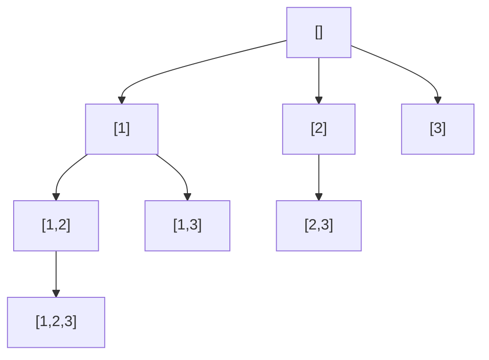

# The Template: Choose, Explore, Un-choose

> Backtracking builds an answer one decision at a time. Make a choice, go deeper, then **undo** the choice and try the next. This one template solves a whole family of interview questions.

#### 1. What Is It?

**Backtracking** is a search that builds a solution step by step. At each step you:

1. **Choose** one option and add it to the current path.
2. **Explore** by recursing to the next step.
3. **Un-choose** (undo) the option, so you can try the next one.

When the path is a complete answer, you **save a copy** of it.

**Signals:** "all combinations / permutations / subsets", "generate all valid ...", "place things under rules" (N-Queens, Sudoku), "find a path in a grid", small input (`n ≤ 20`) and the answer is a **list of solutions**.

**The template**

```text
fun backtrack(path, choices):
    if path is a complete answer:
        save a COPY of path
        return
    for each choice in choices:
        if choice is invalid: continue          // pruning (note 3)
        path.add(choice)                        // choose
        backtrack(path, remaining choices)      // explore
        path.removeLast()                       // un-choose
```

#### 2. How It Works

*Subsets of `[1, 2, 3]`. Each node is the current `path`. Every node is an answer.*



```text
backtrack(start=0): save []
   choose 1 → backtrack(start=1): save [1]
        choose 2 → backtrack(start=2): save [1,2]
             choose 3 → backtrack(start=3): save [1,2,3]    (no more choices)
             un-choose 3
        un-choose 2
        choose 3 → save [1,3] ... un-choose 3
   un-choose 1
   choose 2 → save [2] ... and so on
```

**The three things that go wrong**

| Bug | Result | Fix |
|---|---|---|
| Saving `path` itself | every saved answer is the same (and ends up empty) | save a **copy** (`path.toList()`) |
| Forgetting the undo | the path keeps growing, wrong answers | `path.removeAt(path.size − 1)` after the recursive call |
| Not stopping | infinite recursion | a clear base case |

**The shape of the recursion tree** is the shape of the problem. Subsets: a node for every prefix. Permutations: `n` choices, then `n − 1`, and so on (note 9).

#### 3. Brute Force vs Optimized

| Approach | Time | Note |
|---|---|---|
| Generate all `2ⁿ` bitmasks (subsets) | `O(n · 2ⁿ)` | works only when "every subset is valid" |
| **Backtracking** | `O(n · 2ⁿ)` for subsets, but **can prune** | stops early when a path cannot work |
| Brute force then filter | `O(n · 2ⁿ)` always | generates invalid ones too |

The advantage of backtracking over "generate everything, then check" is **pruning**: a bad prefix is abandoned before it grows (note 3).

```kotlin
// Brute force subsets: one bitmask per subset
fun subsetsBitmask(nums: IntArray): List<List<Int>> {
    val result = mutableListOf<List<Int>>()
    for (mask in 0 until (1 shl nums.size)) {
        result.add(nums.indices.filter { ((mask shr it) and 1) == 1 }.map { nums[it] })
    }
    return result
}
```

#### 4. Kotlin Code

```kotlin
// Subsets (LeetCode 78)
fun subsets(nums: IntArray): List<List<Int>> {
    val result = mutableListOf<List<Int>>()
    val path = mutableListOf<Int>()
    fun backtrack(start: Int) {
        result.add(path.toList())                       // every path is an answer: save a COPY
        for (i in start until nums.size) {
            path.add(nums[i])                           // choose
            backtrack(i + 1)                            // explore
            path.removeAt(path.size - 1)                // un-choose
        }
    }
    backtrack(0)
    return result
}

// Permutations (LeetCode 46)
fun permute(nums: IntArray): List<List<Int>> {
    val result = mutableListOf<List<Int>>()
    val path = mutableListOf<Int>()
    val used = BooleanArray(nums.size)
    fun backtrack() {
        if (path.size == nums.size) { result.add(path.toList()); return }
        for (i in nums.indices) {
            if (used[i]) continue
            used[i] = true; path.add(nums[i])           // choose
            backtrack()                                 // explore
            path.removeAt(path.size - 1); used[i] = false   // un-choose
        }
    }
    backtrack()
    return result
}
```

Checks: `subsets(intArrayOf(1, 2, 3))` → `[[], [1], [1, 2], [1, 2, 3], [1, 3], [2], [2, 3], [3]]`. `subsetsBitmask(intArrayOf(1, 2, 3)).size` → `8`. `subsets(intArrayOf())` → `[[]]`. `permute(intArrayOf(1, 2, 3))` → `[[1, 2, 3], [1, 3, 2], [2, 1, 3], [2, 3, 1], [3, 1, 2], [3, 2, 1]]`. `permute(intArrayOf(1))` → `[[1]]`.

Common wrong version: saving `path` instead of `path.toList()` gives `[[], [], [], ...]` because all saved entries are the same list, which ends up empty.

#### 5. Complexity

| | Time | Space |
|---|---|---|
| Subsets | `O(n · 2ⁿ)` (copy each answer) | `O(n)` recursion + output |
| Permutations | `O(n · n!)` | `O(n)` recursion + output |

The `n` factor is the cost of copying each answer into the result.

#### 6. Common Mistakes

1. **Saving the path, not a copy.**
2. **Forgetting to undo** (`removeAt`, `used[i] = false`, restore a grid cell).
3. **No base case**, or one that is never reached.
4. **Wrong start index:** looping from `0` for combinations creates duplicates; from `i` instead of `i + 1` reuses elements.
5. **Modifying the input** while exploring without restoring it.
6. **Ignoring the output size.** `2ⁿ` or `n!` results mean exponential time is expected.

#### 7. Say This in the Interview

1. "I'll use backtracking: choose an element, recurse, then undo it and try the next one. I save a copy of the path when it is a complete answer."
2. "I'll draw the decision tree first, so I know the base case and what each level chooses."
3. "The output itself has `2ⁿ` (or `n!`) entries, so exponential time is expected. I can prune branches that cannot lead to a valid answer."

#### 8. Quick Check

1. How many subsets does `[1, 2, 3, 4]` have?
2. What breaks if you forget the un-choose step?
3. Why save `path.toList()`?

<details>
<summary>Answers</summary>

1. `2⁴ = 16`.
2. The path keeps growing and later branches start from a wrong state.
3. `path` is one mutable list reused by every branch. Saving it directly saves many references to the same list.

</details>

#### 9. Related LeetCode Questions

| # | Question | Idea |
|---|---|---|
| 78 | [Subsets](https://leetcode.com/problems/subsets/) (Medium) | save at every node |
| 46 | [Permutations](https://leetcode.com/problems/permutations/) (Medium) | `used` array |
| 77 | [Combinations](https://leetcode.com/problems/combinations/) (Medium) | start index, size `k` |
| 17 | [Letter Combinations of a Phone Number](https://leetcode.com/problems/letter-combinations-of-a-phone-number/) (Medium) | one choice per digit |
| 22 | [Generate Parentheses](https://leetcode.com/problems/generate-parentheses/) (Medium) | constraints prune |
| 79 | [Word Search](https://leetcode.com/problems/word-search/) (Medium) | grid, mark and unmark |
