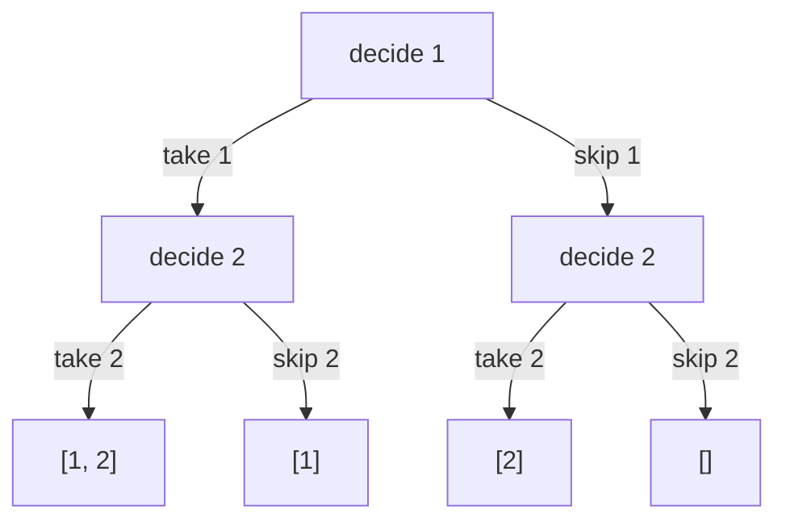

# Modelling Choices as a Decision Tree

> Before you code a backtracking solution, draw the decision tree: **what is decided at each level, and what are the options?** The tree gives you the loop, the base case and the complexity.

#### 1. What Is It?

A **decision tree** shows every choice the search can make.

- Each **level** is one decision (which element, which cell, which position).
- Each **branch** is one option for that decision.
- Each **leaf** (or node) is a complete (or partial) answer.

Backtracking is a **depth-first walk** of this tree. The code is the walk. The drawing is the plan.

**Signals:** you can describe the problem as "at each step, pick one of several options".

#### 2. How It Works

**Three common tree shapes**

| Model | Level decides | Options | Total leaves |
|---|---|---|---|
| **Include / exclude** | "is element `i` in the subset?" | 2: take it, skip it | `2ⁿ` |
| **Start index** (combinations, subsets) | "which element is picked next?" | elements **after** the last pick | `C(n, k)` or `2ⁿ` |
| **Used array** (permutations) | "which element goes in position `i`?" | any **unused** element | `n!` |

*Include / exclude for `[1, 2]`: every level has exactly two branches.*



**From the tree to the code**

| Part of the tree | Part of the code |
|---|---|
| a level | one recursive call (its depth is the parameter, such as `index`) |
| the branches at a node | the `for` loop (or two calls: take, skip) |
| a leaf | the base case: save the answer |
| going back up | the un-choose step |
| a branch that cannot succeed | a `continue` / early `return` (pruning, note 3) |

**Questions to ask while drawing**

1. What is **one decision**? (Pick an element? Place a queen in a row?)
2. What are the **options**, and which are already **invalid**?
3. When is a path **complete**?
4. How many **levels** (depth) and how many **branches** (breadth)?

```text
Generate Parentheses, n = 2: decision = "add '(' or ')'"
valid options: add '(' if open < n;  add ')' if close < open
              ""
             /
            (
           /  \
         ((    ()
         |      |
        (()    ()(
         |      |
       (())   ()()          answers: "(())" and "()()"
```

#### 3. Brute Force vs Optimized

| Approach | Nodes visited | Note |
|---|---|---|
| Decide every position freely, filter valid ones at the end | all `2^(2n)` strings | brute force |
| Decide with **rules built into the options** | only valid prefixes | the decision tree with constraints |

```kotlin
// Brute force: generate all 2^(2n) strings of '(' and ')', keep the valid ones
fun generateBrute(n: Int): List<String> {
    val result = mutableListOf<String>()
    fun valid(s: String): Boolean {
        var balance = 0
        for (c in s) { balance += if (c == '(') 1 else -1; if (balance < 0) return false }
        return balance == 0
    }
    fun gen(sb: StringBuilder) {
        if (sb.length == 2 * n) { if (valid(sb.toString())) result.add(sb.toString()); return }
        sb.append('('); gen(sb); sb.deleteCharAt(sb.length - 1)
        sb.append(')'); gen(sb); sb.deleteCharAt(sb.length - 1)
    }
    gen(StringBuilder())
    return result
}
```

#### 4. Kotlin Code

```kotlin
// Include / exclude model: subsets with a binary decision at each element
fun subsetsIncludeExclude(nums: IntArray): List<List<Int>> {
    val result = mutableListOf<List<Int>>()
    val path = mutableListOf<Int>()
    fun decide(i: Int) {
        if (i == nums.size) { result.add(path.toList()); return }   // a leaf = one complete subset
        path.add(nums[i]); decide(i + 1); path.removeAt(path.size - 1)   // take it
        decide(i + 1)                                                    // skip it
    }
    decide(0)
    return result
}

// Constraints inside the options: Generate Parentheses (LeetCode 22)
fun generateParenthesis(n: Int): List<String> {
    val result = mutableListOf<String>()
    val sb = StringBuilder()
    fun gen(open: Int, close: Int) {
        if (sb.length == 2 * n) { result.add(sb.toString()); return }
        if (open < n) { sb.append('('); gen(open + 1, close); sb.deleteCharAt(sb.length - 1) }
        if (close < open) { sb.append(')'); gen(open, close + 1); sb.deleteCharAt(sb.length - 1) }
    }
    gen(0, 0)
    return result
}
```

Checks: `subsetsIncludeExclude(intArrayOf(1, 2))` → `[[1, 2], [1], [2], []]`. `generateParenthesis(3)` → `["((()))", "(()())", "(())()", "()(())", "()()()"]`. `generateParenthesis(1)` → `["()"]`. `generateBrute(3)` gives the same 5 strings.

#### 5. Complexity

| Tree | Depth | Leaves | Time |
|---|---|---|---|
| Include / exclude | `n` | `2ⁿ` | `O(n · 2ⁿ)` |
| Permutations | `n` | `n!` | `O(n · n!)` |
| Parentheses | `2n` | Catalan `Cₙ` (5 for `n = 3`) | `O(4ⁿ / √n)` |

#### 6. Common Mistakes

1. **Coding before drawing the tree.** You may miss a constraint or a base case.
2. **Mixing models:** using a start index (combinations) for a problem where order matters (permutations).
3. **Counting leaves wrongly** and quoting the wrong complexity.
4. **Making every decision "free"** and filtering at the end instead of building rules into the options.
5. **Depth confusion:** the recursion parameter should be the **level** (index, row, length).

#### 7. Say This in the Interview

1. "Let me draw the decision tree: each level chooses one thing, and each branch is an option. A complete path is an answer."
2. "I'll build the constraints into the options, so I never generate an invalid prefix: I only add `)` if there is an unmatched `(`."
3. "The tree has `2ⁿ` leaves, so exponential time is expected."

#### 8. Quick Check

1. In the include/exclude model, how many branches does each node have?
2. What does a level represent in the permutations tree?
3. Why add `)` only when `close < open`?

<details>
<summary>Answers</summary>

1. Two (take or skip).
2. The choice of which element goes into the next position.
3. Otherwise the string would have a `)` with no `(` to match, which can never become valid.

</details>

#### 9. Related LeetCode Questions

| # | Question | Idea |
|---|---|---|
| 78 | [Subsets](https://leetcode.com/problems/subsets/) (Medium) | include / exclude |
| 22 | [Generate Parentheses](https://leetcode.com/problems/generate-parentheses/) (Medium) | constraints in the options |
| 46 | [Permutations](https://leetcode.com/problems/permutations/) (Medium) | used array |
| 39 | [Combination Sum](https://leetcode.com/problems/combination-sum/) (Medium) | reuse allowed |
| 17 | [Letter Combinations of a Phone Number](https://leetcode.com/problems/letter-combinations-of-a-phone-number/) (Medium) | one digit per level |
| 784 | [Letter Case Permutation](https://leetcode.com/problems/letter-case-permutation/) (Medium) | two options per letter |
