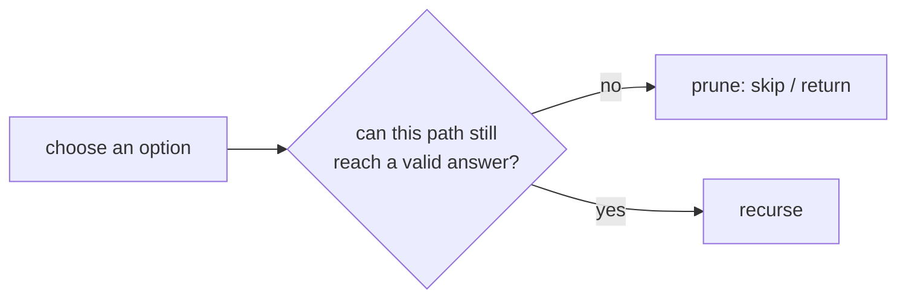

# Pruning: Stopping a Branch Early

> If a partial path **cannot** lead to a valid answer, stop right there. Pruning does not change the worst case, but it often cuts the search by orders of magnitude.

#### 1. What Is It?

**Pruning** means abandoning a branch of the decision tree as soon as you know it is useless. You check a condition **before** (or right after) the choose step, and `continue` or `return` if the branch is dead.

**Why it matters:** the worst case stays exponential, but the practical speed difference is huge, and interviewers expect you to prune.

**Common pruning conditions**

| Problem | Prune when |
|---|---|
| Combination Sum | the running sum **exceeds** the target |
| Generate Parentheses | `close > open`, or `open > n` |
| N-Queens | the column or a diagonal is **already attacked** |
| Sudoku | the digit is already in the row, column or box |
| Word Search | the cell is out of bounds, used, or the letter **does not match** |
| Subset sum with positives | the remaining numbers cannot reach the target |

#### 2. How It Works

**Prune early: check before you recurse.**

```text
Combination Sum, candidates [2, 3, 6, 7], target 7  (sorted)
choose 2 → remaining 5 → choose 2 → remaining 3 → choose 2 → remaining 1
      choose 2 would give -1 → the candidates are sorted, so every later one is also too big → STOP the loop (break)
```

**Sort first, then `break` (not `continue`).** With sorted candidates, if `candidates[i] > remaining`, all later ones are too big too, so `break` ends the whole loop.

**Pruning in Generate Parentheses (counting the tree).**

| | Calls for `n = 3` |
|---|---|
| Try both characters at all 6 positions, validate at the end | `2⁷ − 1 = 127` calls |
| **Prune:** `)` only if `close < open`, `(` only if `open < n` | **22** calls |



**Other pruning ideas**

- **Bound:** the best possible result from here cannot beat the best so far (branch and bound, note 6).
- **Symmetry:** place the first queen only in the left half and mirror the answers.
- **Duplicates:** skip equal siblings (note 10).
- **Memoization:** if the same state was already solved, reuse it (turns it into DP, note 5).

**Order matters.** Try the most constrained choice first (Sudoku: the cell with the fewest candidates). Failing early saves more.

#### 3. Brute Force vs Optimized

| Approach | Work |
|---|---|
| Generate everything, then test | always the full tree |
| **Test as you build, prune dead prefixes** | only the live part of the tree |

```kotlin
var unprunedCalls = 0
var prunedCalls = 0

// Brute force: try both characters at every position, validate at the end
fun parenthesesUnpruned(n: Int) {
    fun gen(len: Int) {
        unprunedCalls++
        if (len == 2 * n) return
        gen(len + 1)        // '('
        gen(len + 1)        // ')'
    }
    gen(0)
}

// Pruned: only legal moves
fun parenthesesPruned(n: Int) {
    fun gen(open: Int, close: Int) {
        prunedCalls++
        if (open + close == 2 * n) return
        if (open < n) gen(open + 1, close)
        if (close < open) gen(open, close + 1)
    }
    gen(0, 0)
}
```

#### 4. Kotlin Code

```kotlin
// Combination Sum (LeetCode 39) with pruning: sort, then break when a candidate is too big
fun combinationSum(candidates: IntArray, target: Int): List<List<Int>> {
    val sorted = candidates.sortedArray()
    val result = mutableListOf<List<Int>>()
    val path = mutableListOf<Int>()
    fun backtrack(start: Int, remaining: Int) {
        if (remaining == 0) { result.add(path.toList()); return }
        for (i in start until sorted.size) {
            if (sorted[i] > remaining) break                  // prune: everything after is bigger
            path.add(sorted[i])
            backtrack(i, remaining - sorted[i])               // i, not i + 1: the same number may repeat
            path.removeAt(path.size - 1)
        }
    }
    backtrack(0, target)
    return result
}

// Subset sum exists? Prune when the remaining numbers cannot reach the target.
fun subsetSumExists(nums: IntArray, target: Int): Boolean {
    val suffix = IntArray(nums.size + 1)                      // suffix[i] = sum of nums[i..]
    for (i in nums.size - 1 downTo 0) suffix[i] = suffix[i + 1] + nums[i]
    fun go(i: Int, remaining: Int): Boolean {
        if (remaining == 0) return true
        if (i == nums.size || remaining < 0) return false
        if (suffix[i] < remaining) return false               // prune: even taking all the rest is not enough
        return go(i + 1, remaining - nums[i]) || go(i + 1, remaining)
    }
    return go(0, target)
}
```

Checks: `unprunedCalls = 0; parenthesesUnpruned(3)` → `unprunedCalls` is `127`. `prunedCalls = 0; parenthesesPruned(3)` → `prunedCalls` is `22`. `combinationSum(intArrayOf(2, 3, 6, 7), 7)` → `[[2, 2, 3], [7]]`. `combinationSum(intArrayOf(2, 3, 5), 8)` → `[[2, 2, 2, 2], [2, 3, 3], [3, 5]]`. `combinationSum(intArrayOf(2), 1)` → `[]`. `subsetSumExists(intArrayOf(3, 34, 4, 12, 5, 2), 9)` → `true`. `subsetSumExists(intArrayOf(3, 34, 4, 12, 5, 2), 30)` → `false`.

(The subset-sum pruning assumes the numbers are non-negative.)

#### 5. Complexity

| | Worst case | In practice |
|---|---|---|
| Subsets / Combination Sum | `O(2ⁿ)` | far fewer nodes with pruning |
| N-Queens | `O(n!)` | roughly the number of safe partial placements |
| Sudoku | `O(9^(empty cells))` | solves in milliseconds with good pruning |

Pruning does **not** change the big-O of the worst case. It changes how often you reach it.

#### 6. Common Mistakes

1. **Pruning too late** (after recursing, instead of before).
2. **`continue` instead of `break`** on a sorted list (works, but wastes time).
3. **Pruning with a wrong condition** that also removes valid answers (negative numbers break "remaining < 0").
4. **Forgetting to sort** before relying on the `break`.
5. **Pruning but not undoing**: a `return` inside the choose step that skips the un-choose.
6. **Weak pruning:** not using obvious constraints (a queen in an attacked column).

#### 7. Say This in the Interview

1. "I'll check the constraint before recursing, so I never explore a branch that can't work. For Combination Sum I sort the candidates and `break` when one exceeds the remaining target."
2. "Pruning doesn't change the worst case, but it removes most of the tree in practice."
3. "For this problem the worst case is still `O(2ⁿ)`, but the number of nodes visited is far smaller."

#### 8. Quick Check

1. Why sort before pruning in Combination Sum?
2. Which condition prunes in Generate Parentheses?
3. Does pruning change the worst-case big-O?

<details>
<summary>Answers</summary>

1. With sorted candidates, once one is too big, all later ones are too, so you can `break`.
2. Adding `)` when `close >= open`, or `(` when `open == n`.
3. No, only the number of nodes actually visited.

</details>

#### 9. Related LeetCode Questions

| # | Question | Idea |
|---|---|---|
| 39 | [Combination Sum](https://leetcode.com/problems/combination-sum/) (Medium) | sort + `break` |
| 22 | [Generate Parentheses](https://leetcode.com/problems/generate-parentheses/) (Medium) | legal moves only |
| 216 | [Combination Sum III](https://leetcode.com/problems/combination-sum-iii/) (Medium) | prune on size and sum |
| 51 | [N-Queens](https://leetcode.com/problems/n-queens/) (Hard) | attacked sets |
| 37 | [Sudoku Solver](https://leetcode.com/problems/sudoku-solver/) (Hard) | digit constraints |
| 79 | [Word Search](https://leetcode.com/problems/word-search/) (Medium) | stop on a mismatch |
