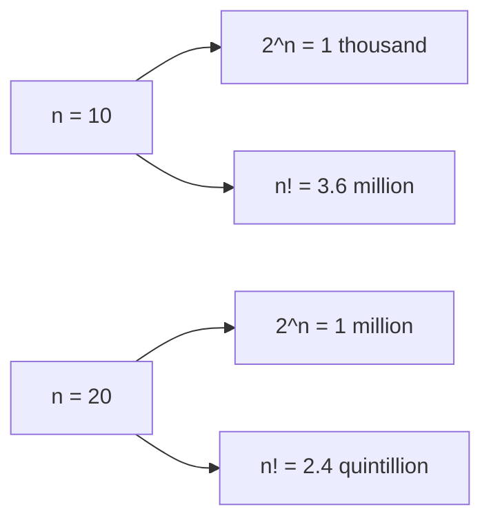

# Why It's Exponential: O(2ⁿ) and O(n!)

> Backtracking walks a tree whose number of leaves is `2ⁿ` or `n!`. Count the leaves and you know the complexity, and you know how large `n` can be.

#### 1. What Is It?

The time of a backtracking solution is **the number of nodes in its decision tree** (times the work per node). The tree is usually huge because **every level multiplies the number of paths**.

| Problem | Choices per level | Leaves | Growth |
|---|---|---|---|
| Subsets of `n` items | 2 (take or skip), `n` levels | `2ⁿ` | exponential |
| Permutations of `n` items | `n`, then `n − 1`, ... then 1 | `n!` | factorial |
| Combinations: choose `k` of `n` | | `C(n, k) = n! / (k! (n − k)!)` | up to `2ⁿ / √n` |
| N-Queens on `n × n` | up to `n` columns per row, shrinking | about `n!` (before pruning) | factorial |
| Sudoku | up to 9 digits per empty cell | `9^(empty cells)` | exponential |

**Why it matters:** if you can state *why* the complexity is `2ⁿ` or `n!`, you can state the complexity of a **new** backtracking problem. It also tells you the **practical limit** on `n`, which is a good thing to say out loud.

#### 2. How It Works

**Counting leaves**

```text
Subsets:      2 choices × 2 × 2 × ... (n times)         = 2ⁿ
Permutations: n choices × (n-1) × (n-2) × ... × 1        = n!
```

**How fast they grow** (operations if each leaf costs 1):

| `n` | `2ⁿ` | `n!` | Feasible? |
|---|---|---|---|
| 5 | 32 | 120 | instant |
| 10 | 1,024 | 3,628,800 | `n!` is slow-ish |
| 15 | 32,768 | 1,307,674,368,000 | `2ⁿ` fine, `n!` too slow |
| 20 | 1,048,576 | 2,432,902,008,176,640,000 | `2ⁿ` ok in seconds, `n!` impossible |
| 25 | 33,554,432 | about 1.5 × 10²⁵ | `2ⁿ` borderline, `n!` impossible |

**Rule of thumb (about 10⁸ simple operations per second):**

| Complexity | Largest practical `n` |
|---|---|
| `O(n!)` | about 10 to 11 |
| `O(2ⁿ)` | about 20 to 25 |
| `O(2ⁿ · n)` | about 20 |
| `O(n²)` | about 10,000 |



**The output size sets a floor.** If the problem asks you to **list** all subsets, the answer already has `2ⁿ` items. No algorithm can be faster than writing them out. So the interviewer expects `O(n · 2ⁿ)`.

**Ways to escape the exponent**

| Idea | Effect |
|---|---|
| **Pruning** | same worst case, far fewer nodes in practice |
| **Memoization / DP** | if subproblems repeat, `2ⁿ` becomes polynomial (note 5) |
| **Meet in the middle** | split into two halves of size `n / 2`: `2^(n/2)` each |
| **Greedy** | when a local rule is provably enough |

#### 3. Brute Force vs Optimized

| Question | Exhaustive search | Better |
|---|---|---|
| Does any subset sum to `K`? | `O(2ⁿ)` | DP `O(n · K)` |
| Fibonacci by recursion | `O(2ⁿ)` | DP `O(n)` |
| Shortest tour through all cities | `O(n!)` | Held-Karp DP `O(2ⁿ · n²)` |
| List all permutations | `O(n!)` | none (the output is `n!`) |

```kotlin
// Count the leaves of the two trees to see the growth
fun countSubsets(n: Int): Long {
    var leaves = 0L
    fun go(i: Int) { if (i == n) { leaves++; return }; go(i + 1); go(i + 1) }
    go(0)
    return leaves
}

fun countPermutations(n: Int): Long {
    var leaves = 0L
    val used = BooleanArray(n)
    fun go(placed: Int) {
        if (placed == n) { leaves++; return }
        for (i in 0 until n) if (!used[i]) { used[i] = true; go(placed + 1); used[i] = false }
    }
    go(0)
    return leaves
}
```

#### 4. Kotlin Code

Checks: `countSubsets(10)` → `1024`. `countSubsets(0)` → `1`. `countPermutations(5)` → `120`. `countPermutations(8)` → `40320`. `countPermutations(1)` → `1`.

```kotlin
// Combinations count C(n, k) without listing them
fun comb(n: Int, k: Int): Long {
    var result = 1L
    for (i in 1..k) result = result * (n - k + i) / i
    return result
}
```

`comb(4, 2)` → `6`. `comb(20, 10)` → `184756`. `comb(5, 0)` → `1`.

A solution that lists all `C(n, k)` combinations takes `O(k · C(n, k))` time. For `n = 20`, `k = 10` that is about 1.8 million combinations.

#### 5. Complexity

| Problem | Time | Space |
|---|---|---|
| Subsets | `O(n · 2ⁿ)` | `O(n)` stack |
| Permutations | `O(n · n!)` | `O(n)` stack |
| Combinations | `O(k · C(n, k))` | `O(k)` |
| N-Queens | about `O(n!)`, much less with pruning | `O(n)` |

#### 6. Common Mistakes

1. **Saying "backtracking is `O(n)`"** because the recursion depth is `n`. The depth is `n`, the time is the number of nodes.
2. **Forgetting the copy cost** (the extra factor `n`).
3. **Not stating the practical limit** of `n` for the interviewer.
4. **Using backtracking for a counting problem** where DP is polynomial.
5. **Confusing `2ⁿ` with `n²`** in your head: they are very different.
6. **Using `Int` for `n!`**: `13!` already overflows `Int`. Use `Long` (up to `20!`).

#### 7. Say This in the Interview

1. "At each of the `n` elements I make 2 choices, so the tree has `2ⁿ` leaves. Permutations are `n × (n − 1) × ... × 1 = n!`."
2. "So backtracking is exponential. It's practical for `n` up to about 20 for `2ⁿ`, and about 10 for `n!`."
3. "If the subproblems repeat, I can memoize and the problem becomes polynomial."

#### 8. Quick Check

1. How many permutations of 6 distinct items?
2. How many subsets of a set with 12 items?
3. Why can't listing all subsets be faster than `2ⁿ`?

<details>
<summary>Answers</summary>

1. `720`.
2. `4096`.
3. The output itself contains `2ⁿ` subsets, so writing it takes `2ⁿ` steps.

</details>

#### 9. Related LeetCode Questions

| # | Question | Idea |
|---|---|---|
| 78 | [Subsets](https://leetcode.com/problems/subsets/) (Medium) | `2ⁿ` leaves |
| 46 | [Permutations](https://leetcode.com/problems/permutations/) (Medium) | `n!` leaves |
| 77 | [Combinations](https://leetcode.com/problems/combinations/) (Medium) | `C(n, k)` leaves |
| 52 | [N-Queens II](https://leetcode.com/problems/n-queens-ii/) (Hard) | count with pruning |
| 60 | [Permutation Sequence](https://leetcode.com/problems/permutation-sequence/) (Hard) | skip the exponent with math |
| 241 | [Different Ways to Add Parentheses](https://leetcode.com/problems/different-ways-to-add-parentheses/) (Medium) | Catalan-sized output |
