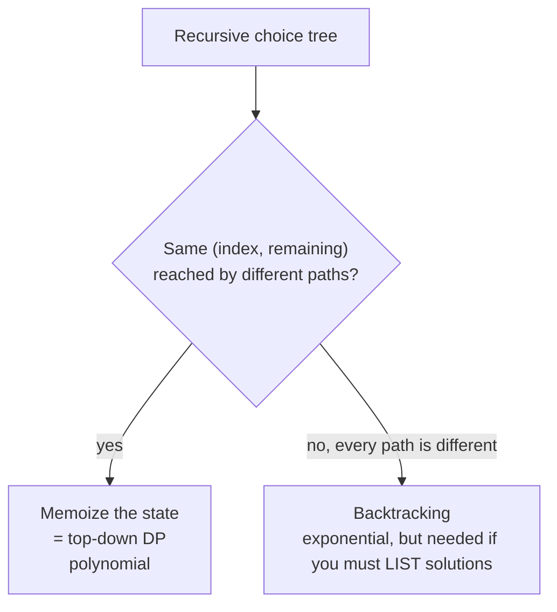

# Backtracking vs Dynamic Programming

> Both search a tree of choices. Backtracking **lists** every solution and **forgets** subproblems. DP **counts or optimises** and **remembers** subproblems.

#### 1. What Is It?

| | **Backtracking** | **Dynamic programming** |
|---|---|---|
| Output | **all** solutions (or one valid) | one **number** (count / best value), or one solution |
| Subproblems | not stored, may be recomputed | **stored** and reused |
| Time | exponential | polynomial (when states are polynomial) |
| Needs | a way to undo a choice | overlapping subproblems and optimal substructure |
| Typical question | "return all ...", "place the queens" | "how many ways ...", "minimum cost ..." |

**The key test:** *does my recursion reach the same state `(index, remaining)` again by different paths?* If yes, add a memo and you have DP.

#### 2. How It Works

**The same problem both ways: count subsets of `[1, 2, 3, 4, 5]` with sum 5.** Answer: 3 (`{5}`, `{1, 4}`, `{2, 3}`).

*Backtracking* walks every path, even when two paths end in the same state:

```text
go(i, remaining):  take or skip nums[i]
state (3, 2) can be reached by:  skip 1, take 2... / take 1, skip 2, skip ...   → same work done again
```

*Add a memo on `(i, remaining)`:*

```text
memo[(3, 2)] = answer once, reused by every path that arrives there       → DP (top-down)
```



**When you need backtracking even if DP exists**

| Situation | Why |
|---|---|
| "Return **all** valid solutions" | DP can count them, but listing needs the paths |
| The state includes the **whole path** (N-Queens board, a partial string) | no small state to memoize |
| Constraints between **all** chosen items (permutations with rules) | state is too big |

**When DP wins**

| Situation | Why |
|---|---|
| "Count", "minimum", "maximum", "is it possible" | a small state captures everything that matters |
| Big `n` (hundreds or thousands) | `2ⁿ` is impossible |

**Hybrid:** use DP to **count** (or find the best), then backtrack through the DP table to **list** one or all solutions (see note 9 of the DP folder).

#### 3. Brute Force vs Optimized

| Problem | Backtracking | DP |
|---|---|---|
| Count subsets with sum `K` | `O(2ⁿ)` | `O(n · K)` |
| Coin change, number of ways | `O(coinsᵃᵐᵒᵘⁿᵗ)` | `O(amount · coins)` |
| List all subsets with sum `K` | `O(n · 2ⁿ)` | cannot list (only count) |
| N-Queens (list boards) | `O(n!)` pruned | none |

```kotlin
// Backtracking: count subsets with a given sum, exponential
fun countSubsetsBacktrack(nums: IntArray, target: Int, i: Int = 0): Int {
    if (i == nums.size) return if (target == 0) 1 else 0
    return countSubsetsBacktrack(nums, target - nums[i], i + 1) +      // take nums[i]
           countSubsetsBacktrack(nums, target, i + 1)                  // skip nums[i]
}
```

#### 4. Kotlin Code

```kotlin
// Backtracking + memo = top-down DP: the same recursion, with the state (i, remaining) remembered
fun countSubsetsMemo(nums: IntArray, target: Int): Int {
    val memo = HashMap<Long, Int>()
    fun go(i: Int, remaining: Int): Int {
        if (remaining == 0 && i == nums.size) return 1
        if (i == nums.size || remaining < 0) return 0
        val key = i.toLong() * 100_000 + remaining
        memo[key]?.let { return it }
        val result = go(i + 1, remaining - nums[i]) + go(i + 1, remaining)      // take or skip
        memo[key] = result
        return result
    }
    return go(0, target)
}

// Bottom-up DP: the same count with a table
fun countSubsetsDp(nums: IntArray, target: Int): Int {
    val dp = IntArray(target + 1)
    dp[0] = 1
    for (x in nums) for (s in target downTo x) dp[s] += dp[s - x]
    return dp[target]
}

// Backtracking that LISTS the subsets (DP cannot do this directly)
fun listSubsetsWithSum(nums: IntArray, target: Int): List<List<Int>> {
    val result = mutableListOf<List<Int>>()
    val path = mutableListOf<Int>()
    fun go(start: Int, remaining: Int) {
        if (remaining == 0) { result.add(path.toList()); return }
        for (i in start until nums.size) {
            if (nums[i] > remaining) continue
            path.add(nums[i]); go(i + 1, remaining - nums[i]); path.removeAt(path.size - 1)
        }
    }
    go(0, target)
    return result
}
```

Checks (`nums = [1, 2, 3, 4, 5]`, `target = 5`): `countSubsetsMemo(...)` → `3`. `countSubsetsDp(...)` → `3`. `countSubsetsBacktrack(...)` → `3`. `listSubsetsWithSum(...)` → `[[1, 4], [2, 3], [5]]`. For `nums = [2, 3, 5, 7]`, `target = 10`: count `2`, list `[[2, 3, 5], [3, 7]]`.

(The memo and DP versions assume positive numbers, so a negative `remaining` can be pruned.)

#### 5. Complexity

| | Time | Space |
|---|---|---|
| Backtracking (count) | `O(2ⁿ)` | `O(n)` |
| Memoized | `O(n · target)` | `O(n · target)` |
| Table DP | `O(n · target)` | `O(target)` |
| Backtracking (list) | `O(n · 2ⁿ)` | `O(n)` + output |

#### 6. Common Mistakes

1. **Using backtracking for a count with large `n`** and getting a time limit.
2. **Using DP when the question says "return all"** (you cannot list from a count).
3. **Memoizing with a state that misses a variable.**
4. **Memoizing a backtracking function that mutates a shared `path`.** The memo must depend only on the state.
5. **Forgetting that DP's states must be small and independent of the path.**

#### 7. Say This in the Interview

1. "A recursion that reaches the same `(index, remaining)` by different paths is doing repeated work, so I'll memoize it. That's DP, and it turns `2ⁿ` into `n × target`."
2. "If I had to return all the solutions, I'd keep backtracking, because the output itself can be exponential."
3. "Often I'll count with DP, and use backtracking only to list."

#### 8. Quick Check

1. "Return all permutations": backtracking or DP?
2. "Number of ways to make change": backtracking or DP?
3. What turns a backtracking recursion into DP?

<details>
<summary>Answers</summary>

1. Backtracking.
2. DP.
3. Storing the result for each repeated state (a memo).

</details>

#### 9. Related LeetCode Questions

| # | Question | Idea |
|---|---|---|
| 39 | [Combination Sum](https://leetcode.com/problems/combination-sum/) (Medium) | list all (backtracking) |
| 377 | [Combination Sum IV](https://leetcode.com/problems/combination-sum-iv/) (Medium) | count (DP) |
| 416 | [Partition Equal Subset Sum](https://leetcode.com/problems/partition-equal-subset-sum/) (Medium) | backtracking becomes DP |
| 494 | [Target Sum](https://leetcode.com/problems/target-sum/) (Medium) | memo on `(i, sum)` |
| 140 | [Word Break II](https://leetcode.com/problems/word-break-ii/) (Hard) | list all, with a memo |
| 322 | [Coin Change](https://leetcode.com/problems/coin-change/) (Medium) | DP wins |
