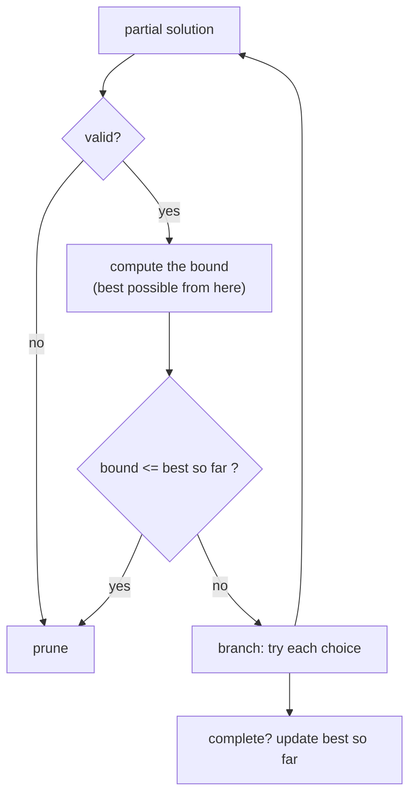

# Branch and Bound: Tracking a Best-So-Far Bound

> Backtracking for **optimisation**. Keep the best answer found so far. At every node compute a **bound** (the best this branch could possibly give). If the bound cannot beat the best so far, **prune the branch**.

#### 1. What Is It?

**Branch and bound** is backtracking with two extra ideas:

1. **Best so far:** a variable holding the best complete answer found yet.
2. **Bound:** at each partial solution, an **optimistic estimate** of the best final answer reachable from it.

If the optimistic estimate is **no better** than the best so far, this branch cannot improve the answer, so skip it.

| | Plain backtracking | Branch and bound |
|---|---|---|
| Goal | list / find any valid solution | find the **best** (min or max) solution |
| Pruning | invalid partial solutions | invalid **or not good enough** |
| Needs | a validity test | a validity test **and a bound function** |

**Signals:** "maximise / minimise", the problem is NP-hard-like (0/1 knapsack, TSP, job assignment), and a simple DP is not available or too big.

#### 2. How It Works



**Example: 0/1 knapsack.** Items `(weight, value)`: `(1,1), (3,4), (4,5), (5,7)`, capacity `7`.

- **Bound** = the value you would get if you could take **fractions** of the remaining items, best value per weight first. This is always **at least as large** as the true best, so it is a safe optimistic estimate.
- Sort items by **value per weight** (descending) so the bound is computed in a simple pass.

```text
ratios: (5,7) = 1.40,  (3,4) = 1.33,  (4,5) = 1.25,  (1,1) = 1.00
take (5,7): weight 5, value 7. Bound = 7 + fraction of next: 2/3 × 4 = 2.67 → 9.67  (> best 0, continue)
   take (3,4): weight 8 > 7 → invalid
   skip (3,4), take (4,5): weight 9 → invalid
   skip, skip, take (1,1): weight 6, value 8 → best = 8
skip (5,7): bound = fractions of (3,4), (4,5) ... = 4 + 5 = 9 + ... ≥ 8, continue
   take (3,4), take (4,5): weight 7, value 9 → best = 9
   later branches have a bound ≤ 9 → pruned
answer 9
```

**A good bound is:** (1) never smaller than the true best below the node (otherwise you prune good branches), and (2) cheap to compute (otherwise it costs more than it saves). The tighter the bound, the more pruning.

**Branch and bound vs DP:** DP wins when the state is small (knapsack with small capacity). Branch and bound wins when numbers are huge or the structure has no small state (assignment problems, TSP).

#### 3. Brute Force vs Optimized

| Approach | Time (worst case) | Typical |
|---|---|---|
| Try all `2ⁿ` subsets | `O(2ⁿ)` | always the full tree |
| Backtracking with a capacity check | `O(2ⁿ)` | prunes invalid branches only |
| **Branch and bound** | `O(2ⁿ)` | prunes branches that cannot beat the best |
| DP | `O(n · W)` | polynomial for small `W` |

```kotlin
// Brute force: try every subset, keep the best value that fits
fun knapsackBrute(w: IntArray, v: IntArray, cap: Int, i: Int = 0): Int {
    if (i == w.size) return 0
    val skip = knapsackBrute(w, v, cap, i + 1)
    val take = if (w[i] <= cap) v[i] + knapsackBrute(w, v, cap - w[i], i + 1) else 0
    return maxOf(skip, take)
}
```

#### 4. Kotlin Code

```kotlin
// 0/1 Knapsack by branch and bound
fun knapsackBranchAndBound(weights: IntArray, values: IntArray, capacity: Int): Int {
    val n = weights.size
    val order = (0 until n).sortedByDescending { values[it].toDouble() / weights[it] }   // best ratio first
    var best = 0

    // optimistic bound: fill with whole items, then a fraction of the next one
    fun bound(i: Int, weight: Int, value: Int): Double {
        var w = weight
        var v = value.toDouble()
        var k = i
        while (k < n && w + weights[order[k]] <= capacity) {
            w += weights[order[k]]; v += values[order[k]]; k++
        }
        if (k < n) v += (capacity - w).toDouble() * values[order[k]] / weights[order[k]]
        return v
    }

    fun dfs(i: Int, weight: Int, value: Int) {
        if (weight > capacity) return                         // invalid
        if (value > best) best = value                        // update the best so far
        if (i == n) return
        if (bound(i, weight, value) <= best) return           // prune: cannot beat the best
        val item = order[i]
        dfs(i + 1, weight + weights[item], value + values[item])   // take it
        dfs(i + 1, weight, value)                                  // skip it
    }

    dfs(0, 0, 0)
    return best
}
```

Checks: `knapsackBranchAndBound(intArrayOf(1, 3, 4, 5), intArrayOf(1, 4, 5, 7), 7)` → `9`. `knapsackBranchAndBound(intArrayOf(2, 3, 4, 5), intArrayOf(3, 4, 5, 6), 5)` → `7` (`2 + 3`, value `3 + 4`). `knapsackBranchAndBound(intArrayOf(10), intArrayOf(5), 3)` → `0` (nothing fits). `knapsackBrute(intArrayOf(1, 3, 4, 5), intArrayOf(1, 4, 5, 7), 7)` → `9`.

#### 5. Complexity

| | Time | Space |
|---|---|---|
| Worst case | `O(2ⁿ)` | `O(n)` |
| Typical | far fewer nodes (depends on the bound) | `O(n)` |
| Bound computation | `O(n)` per node | |

#### 6. Common Mistakes

1. **A bound that is too small** (not optimistic). It prunes branches that contain the true best.
2. **A bound that is too expensive**, so it costs more than the pruning saves.
3. **Using `<` instead of `<=`** in the prune test is fine, but be consistent. (`<=` prunes branches that can only tie.)
4. **Not sorting by ratio**, so the bound is loose or wrong.
5. **Comparing `Int` and `Double`** carelessly in the bound.
6. **Updating the best only at leaves.** Update it at every valid node when partial answers are valid.

#### 7. Say This in the Interview

1. "Plain backtracking explores everything that is valid. Branch and bound also keeps the best answer so far, and at each node it computes an optimistic bound. If the bound can't beat the best, I cut the branch."
2. "For knapsack the bound is the fractional-knapsack value of the remaining items. It is always at least the true best, so it never prunes a better answer."
3. "The worst case is still `O(2ⁿ)`, but in practice it prunes a lot. For small capacities I'd use DP instead."

#### 8. Quick Check

1. Must a bound be an over-estimate or an under-estimate (for maximisation)?
2. What do you do when `bound <= best`?
3. Which problems often use branch and bound?

<details>
<summary>Answers</summary>

1. An over-estimate (optimistic), so no better answer is pruned.
2. Prune that branch.
3. 0/1 knapsack, travelling salesman, job assignment, integer programming.

</details>

#### 9. Related LeetCode Questions

| # | Question | Idea |
|---|---|---|
| 416 | [Partition Equal Subset Sum](https://leetcode.com/problems/partition-equal-subset-sum/) (Medium) | prune with the remaining sum |
| 698 | [Partition to K Equal Sum Subsets](https://leetcode.com/problems/partition-to-k-equal-sum-subsets/) (Medium) | prune on a full bucket |
| 1723 | [Find Minimum Time to Finish All Jobs](https://leetcode.com/problems/find-minimum-time-to-finish-all-jobs/) (Hard) | best-so-far pruning |
| 1066 | [Campus Bikes II](https://leetcode.com/problems/campus-bikes-ii/) (Medium, premium) | assignment, bound by cost |
| 968 | [Binary Tree Cameras](https://leetcode.com/problems/binary-tree-cameras/) (Hard) | DP alternative |
| 1049 | [Last Stone Weight II](https://leetcode.com/problems/last-stone-weight-ii/) (Medium) | minimise a difference |
