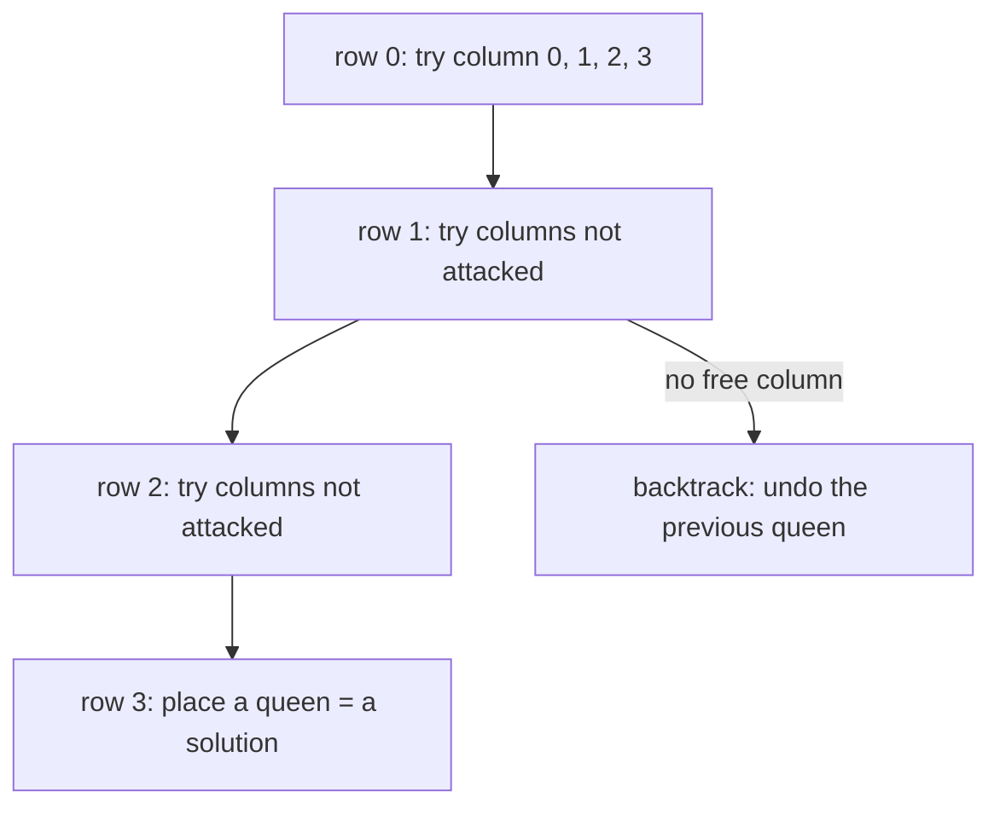

# Classic Problems: N-Queens, Sudoku, Subset Sum

> The three standard "place things under rules" problems. All three are the same template with a **validity check** before each choice.

#### 1. What Is It?

| Problem | Decision per level | Constraint |
|---|---|---|
| **N-Queens** (51, 52) | which **column** for the queen in this **row** | no two queens share a column or a diagonal |
| **Sudoku Solver** (37) | which **digit** for the next **empty cell** | no repeat in a row, column or 3×3 box |
| **Subset Sum** | take or skip each number | the sum must equal the target |

**Signals:** a grid or board with rules, "place `n` items so that none conflict", "fill in the blanks".

#### 2. How It Works

**N-Queens.** Place one queen per row (so rows never conflict). Track what is attacked:

| Attacked set | Index for the queen at `(row, col)` |
|---|---|
| column | `col` |
| "down-left to up-right" diagonal | `row + col` (constant along it) |
| "up-left to down-right" diagonal | `row − col` (constant along it, add `n` to avoid negatives) |

```text
n = 4, one solution:        . Q . .      queens at (0,1) (1,3) (2,0) (3,2)
                            . . . Q
                            Q . . .
                            . . Q .
```



**Sudoku.** Find the next empty cell. Try digits `1..9`. A digit is allowed if it is not already in the row, the column, or the 3×3 box. Recurse. If no digit fits, backtrack. Keep three boolean tables (`row[r][d]`, `col[c][d]`, `box[b][d]`) so the check is `O(1)`. The box index is `(r / 3) * 3 + c / 3`.

**Subset Sum.** The include / exclude tree (note 2) with a pruning rule: skip a branch when the remaining sum is negative (positive numbers).

**Why backtracking:** there is no formula, and the constraints between choices are checked as you go. Pruning by constraints makes these solvable.

#### 3. Brute Force vs Optimized

| Problem | Brute force | Backtracking with pruning |
|---|---|---|
| N-Queens | try all `nⁿ` placements, then check: `4⁴ = 256`, `8⁸ = 16,777,216` | about `n!` at worst, far fewer in practice (`n = 8`: about 2,000 nodes) |
| Sudoku | `9^(empty cells)` combinations | solves in milliseconds |
| Subset Sum | `2ⁿ` subsets | prune on the sum, or DP `O(n · target)` |

```kotlin
// Brute force N-Queens count: place a queen in each row anywhere (n^n), then check every pair
fun totalNQueensBrute(n: Int): Int {
    val cols = IntArray(n)
    var count = 0
    fun valid(): Boolean {
        for (i in 0 until n) for (j in i + 1 until n) {
            if (cols[i] == cols[j] || Math.abs(cols[i] - cols[j]) == j - i) return false
        }
        return true
    }
    fun place(row: Int) {
        if (row == n) { if (valid()) count++; return }
        for (c in 0 until n) { cols[row] = c; place(row + 1) }
    }
    place(0)
    return count
}
```

#### 4. Kotlin Code

```kotlin
// N-Queens (LeetCode 51): return the boards
fun solveNQueens(n: Int): List<List<String>> {
    val result = mutableListOf<List<String>>()
    val queens = IntArray(n)                           // queens[row] = column
    val cols = BooleanArray(n)
    val diag1 = BooleanArray(2 * n)                    // row + col
    val diag2 = BooleanArray(2 * n)                    // row - col + n
    fun place(row: Int) {
        if (row == n) {
            result.add((0 until n).map { r -> ".".repeat(queens[r]) + "Q" + ".".repeat(n - queens[r] - 1) })
            return
        }
        for (c in 0 until n) {
            if (cols[c] || diag1[row + c] || diag2[row - c + n]) continue      // attacked: prune
            queens[row] = c
            cols[c] = true; diag1[row + c] = true; diag2[row - c + n] = true   // choose
            place(row + 1)                                                      // explore
            cols[c] = false; diag1[row + c] = false; diag2[row - c + n] = false // un-choose
        }
    }
    place(0)
    return result
}

// N-Queens II (LeetCode 52): only the count
fun totalNQueens(n: Int): Int {
    val cols = BooleanArray(n)
    val diag1 = BooleanArray(2 * n)
    val diag2 = BooleanArray(2 * n)
    var count = 0
    fun place(row: Int) {
        if (row == n) { count++; return }
        for (c in 0 until n) {
            if (cols[c] || diag1[row + c] || diag2[row - c + n]) continue
            cols[c] = true; diag1[row + c] = true; diag2[row - c + n] = true
            place(row + 1)
            cols[c] = false; diag1[row + c] = false; diag2[row - c + n] = false
        }
    }
    place(0)
    return count
}

// Sudoku Solver (LeetCode 37): '.' marks an empty cell. Fills the board in place.
fun solveSudoku(board: Array<CharArray>) {
    val row = Array(9) { BooleanArray(10) }
    val col = Array(9) { BooleanArray(10) }
    val box = Array(9) { BooleanArray(10) }
    for (r in 0 until 9) for (c in 0 until 9) {
        if (board[r][c] != '.') {
            val d = board[r][c] - '0'
            row[r][d] = true; col[c][d] = true; box[(r / 3) * 3 + c / 3][d] = true
        }
    }
    fun solve(pos: Int): Boolean {
        if (pos == 81) return true
        val r = pos / 9
        val c = pos % 9
        if (board[r][c] != '.') return solve(pos + 1)
        val b = (r / 3) * 3 + c / 3
        for (d in 1..9) {
            if (row[r][d] || col[c][d] || box[b][d]) continue                  // prune
            board[r][c] = '0' + d
            row[r][d] = true; col[c][d] = true; box[b][d] = true               // choose
            if (solve(pos + 1)) return true                                    // explore
            row[r][d] = false; col[c][d] = false; box[b][d] = false            // un-choose
            board[r][c] = '.'
        }
        return false                                                           // no digit fits: backtrack
    }
    solve(0)
}

// Subset Sum: positive numbers, is there a subset with this sum?
fun subsetSum(nums: IntArray, target: Int): Boolean {
    fun go(i: Int, remaining: Int): Boolean {
        if (remaining == 0) return true
        if (i == nums.size || remaining < 0) return false
        return go(i + 1, remaining - nums[i]) || go(i + 1, remaining)
    }
    return go(0, target)
}
```

Checks: `solveNQueens(4)` → `[[".Q..", "...Q", "Q...", "..Q."], ["..Q.", "Q...", "...Q", ".Q.."]]`. `solveNQueens(1)` → `[["Q"]]`. `solveNQueens(3)` → `[]`. `totalNQueens(4)` → `2`. `totalNQueens(6)` → `4`. `totalNQueens(8)` → `92`. `totalNQueensBrute(6)` → `4` (slower). For Sudoku: after `solveSudoku(board)` on the LeetCode example puzzle, every row, column and 3×3 box holds the digits `1..9` once, and every given digit is unchanged. `subsetSum(intArrayOf(3, 34, 4, 12, 5, 2), 9)` → `true`. `subsetSum(intArrayOf(3, 34, 4, 12, 5, 2), 30)` → `false`.

#### 5. Complexity

| | Time | Space |
|---|---|---|
| N-Queens | `O(n!)` worst, much less with pruning | `O(n)` |
| Sudoku | `O(9^m)` for `m` empty cells, tiny in practice | `O(1)` extra (fixed 9×9) |
| Subset Sum (backtracking) | `O(2ⁿ)` | `O(n)` |

#### 6. Common Mistakes

1. **N-Queens:** checking the whole board for each placement (`O(n)` per check). Use the three boolean arrays.
2. **Wrong diagonal index** (`row − col` can be negative: add `n`).
3. **Not undoing** the three arrays on backtrack.
4. **Sudoku:** wrong box index. It is `(r / 3) * 3 + c / 3`.
5. **Sudoku:** not restoring the cell to `.` after a failed digit.
6. **Returning after the first solution** when the problem wants all (N-Queens) or continuing when it wants one (Sudoku).
7. **Strings built by concatenation inside the loop** (use `repeat`, or build rows once at the leaf).

#### 7. Say This in the Interview

1. "For N-Queens I place one queen per row, so I only need to track attacked columns and the two diagonals. `row + col` is constant along one diagonal and `row − col` along the other. Each check is `O(1)`."
2. "Sudoku is the same idea: pick the next empty cell, try each digit that fits the row, column and box, and backtrack if none fits."
3. "The worst case is exponential, but the constraints prune most branches."

#### 8. Quick Check

1. How many solutions does the 4-Queens problem have?
2. Which cells share the diagonal index `row + col = 3`?
3. What do you do if no digit fits a Sudoku cell?

<details>
<summary>Answers</summary>

1. `2`.
2. `(0,3)`, `(1,2)`, `(2,1)`, `(3,0)`.
3. Return `false`, so the caller undoes its digit and tries the next one.

</details>

#### 9. Related LeetCode Questions

| # | Question | Idea |
|---|---|---|
| 51 | [N-Queens](https://leetcode.com/problems/n-queens/) (Hard) | boards |
| 52 | [N-Queens II](https://leetcode.com/problems/n-queens-ii/) (Hard) | count |
| 37 | [Sudoku Solver](https://leetcode.com/problems/sudoku-solver/) (Hard) | digit constraints |
| 36 | [Valid Sudoku](https://leetcode.com/problems/valid-sudoku/) (Medium) | the validity check only |
| 416 | [Partition Equal Subset Sum](https://leetcode.com/problems/partition-equal-subset-sum/) (Medium) | subset sum |
| 39 | [Combination Sum](https://leetcode.com/problems/combination-sum/) (Medium) | subset sum with reuse |
