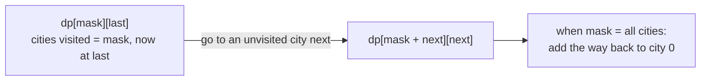

# Travelling Salesman Problem: Name & Idea Only

> Visit every city exactly once and return to the start, with the **shortest total distance**. The classic example of a problem with no fast exact solution. Know the name, the brute force, and the DP idea.

#### 1. What Is It?

The **Travelling Salesman Problem (TSP)**: given `n` cities and the distance between every pair, find the **shortest round trip** that visits each city **exactly once** and returns to the start.

- It is **NP-hard**: no known algorithm is polynomial in `n` (note 11 of this folder set: Complexity Classes).
- It shows up as a **name** in interviews ("this is TSP, so brute force is `O(n!)`, and the best exact method is `O(2ⁿ · n²)`").
- Real problems that reduce to it: delivery routes, drilling a circuit board, scheduling with set-up times.

| Method | Time | Gives |
|---|---|---|
| **Brute force** (every permutation of cities) | `O(n!)` | exact answer, `n ≤ 10` |
| **Held-Karp DP** (bitmask) | `O(2ⁿ · n²)` | exact answer, `n ≤ 20` |
| **Branch and bound** | `O(n!)` worst, often far less | exact answer |
| **Heuristics** (nearest neighbour, 2-opt) | `O(n²)` | a good, not optimal, tour |
| **Approximation** (Christofides) | polynomial | within 1.5× of optimal (metric TSP) |

#### 2. How It Works

**Brute force.** Fix city `0` as the start. Try every ordering of the other `n − 1` cities (`(n − 1)!` of them), add up the distances, keep the shortest.

```text
distances:      0   1   2   3
          0  [  0, 10, 15, 20]
          1  [ 10,  0, 35, 25]
          2  [ 15, 35,  0, 30]
          3  [ 20, 25, 30,  0]
tour 0 → 1 → 3 → 2 → 0:  10 + 25 + 30 + 15 = 80      ← the shortest
tour 0 → 1 → 2 → 3 → 0:  10 + 35 + 30 + 20 = 95
```

**Held-Karp idea (DP over subsets).** `dp[mask][last]` = the shortest path that starts at city `0`, visits exactly the cities in `mask`, and ends at `last`. Extend it by one more city:

```text
dp[mask or (1 shl next)][next] = min( dp[mask][last] + dist[last][next] )
answer = min over last of  dp[all cities][last] + dist[last][0]
```



The state count is `2ⁿ · n`, and each state tries `n` next cities: `O(2ⁿ · n²)`. For `n = 20` that is about 400 million steps, much better than `20!`.

**Why the interview only asks for the name:** an exact fast solution does not exist. If you spot a TSP-like problem, say so and propose DP with bitmask (for small `n`) or a heuristic (for large `n`).

#### 3. Brute Force vs Optimized

| `n` | `(n − 1)!` brute force | `2ⁿ · n²` Held-Karp |
|---|---|---|
| 5 | 24 | 800 |
| 10 | 362,880 | about 102,400 |
| 15 | 87 billion | about 7.4 million |
| 20 | 1.2 × 10¹⁷ | about 420 million |

```kotlin
// Brute force: try every order of the cities after city 0
fun tspBrute(dist: Array<IntArray>): Int {
    val n = dist.size
    val visited = BooleanArray(n)
    visited[0] = true
    var best = Int.MAX_VALUE
    fun go(city: Int, count: Int, length: Int) {
        if (length >= best) return                       // simple pruning
        if (count == n) { best = minOf(best, length + dist[city][0]); return }
        for (next in 0 until n) {
            if (visited[next]) continue
            visited[next] = true
            go(next, count + 1, length + dist[city][next])
            visited[next] = false
        }
    }
    go(0, 1, 0)
    return best
}
```

#### 4. Kotlin Code

```kotlin
// Held-Karp: bitmask DP, O(2^n * n^2)
fun tspDp(dist: Array<IntArray>): Int {
    val n = dist.size
    val full = 1 shl n
    val INF = Int.MAX_VALUE / 2
    val dp = Array(full) { IntArray(n) { INF } }
    dp[1][0] = 0                                          // start at city 0, only city 0 visited
    for (mask in 1 until full) {
        if ((mask and 1) == 0) continue                   // every tour contains city 0
        for (last in 0 until n) {
            if (((mask shr last) and 1) == 0 || dp[mask][last] >= INF) continue
            for (next in 0 until n) {
                if (((mask shr next) and 1) == 1) continue          // already visited
                val newMask = mask or (1 shl next)
                dp[newMask][next] = minOf(dp[newMask][next], dp[mask][last] + dist[last][next])
            }
        }
    }
    var best = INF
    for (last in 1 until n) best = minOf(best, dp[full - 1][last] + dist[last][0])
    return best
}
```

Checks (the 4-city matrix above): `tspBrute(arrayOf(intArrayOf(0, 10, 15, 20), intArrayOf(10, 0, 35, 25), intArrayOf(15, 35, 0, 30), intArrayOf(20, 25, 30, 0)))` → `80`. `tspDp(...)` on the same matrix → `80`. A 2-city problem with distance `7` between them: both return `14` (there and back).


#### 5. Complexity

| | Time | Space |
|---|---|---|
| Brute force | `O(n!)` | `O(n)` |
| Held-Karp | `O(2ⁿ · n²)` | `O(2ⁿ · n)` |
| Nearest-neighbour heuristic | `O(n²)` | `O(n)` |

#### 6. Common Mistakes

1. **Trying the exact `O(n!)` solution for `n = 20`.**
2. **Forgetting the way back** to the start city.
3. **Not fixing the start city** (counting the same tour `n` times).
4. **Bitmask precedence bugs** (`mask and 1 == 0` needs parentheses).
5. **Using `Int.MAX_VALUE`** as infinity and then adding (overflow). Use `MAX / 2`.
6. **Confusing TSP with the shortest path problem.** TSP must visit **all** cities.

#### 7. Say This in the Interview

1. "This is the Travelling Salesman Problem. It is NP-hard, so there is no known polynomial exact algorithm."
2. "The brute force tries every permutation, `O(n!)`. For small `n` I can use bitmask DP, Held-Karp, in `O(2ⁿ · n²)`."
3. "For large `n` I'd accept an approximate answer, for example nearest neighbour or 2-opt."

#### 8. Quick Check

1. How many tours does the brute force try for `n = 5` (start fixed)?
2. What does `dp[mask][last]` mean?
3. Why is TSP not solved by Dijkstra?

<details>
<summary>Answers</summary>

1. `(5 − 1)! = 24`.
2. The shortest path from city 0 visiting exactly the cities in `mask` and ending at `last`.
3. Dijkstra finds shortest paths between two nodes. TSP needs a cycle through **all** nodes, a different and harder problem.

</details>

#### 9. Related LeetCode Questions

| # | Question | Idea |
|---|---|---|
| 847 | [Shortest Path Visiting All Nodes](https://leetcode.com/problems/shortest-path-visiting-all-nodes/) (Hard) | TSP-like, bitmask BFS |
| 943 | [Find the Shortest Superstring](https://leetcode.com/problems/find-the-shortest-superstring/) (Hard) | TSP over words |
| 1125 | [Smallest Sufficient Team](https://leetcode.com/problems/smallest-sufficient-team/) (Hard) | bitmask DP |
| 1879 | [Minimum XOR Sum of Two Arrays](https://leetcode.com/problems/minimum-xor-sum-of-two-arrays/) (Hard) | bitmask assignment |
| 698 | [Partition to K Equal Sum Subsets](https://leetcode.com/problems/partition-to-k-equal-sum-subsets/) (Medium) | bitmask DP |
| 1494 | [Parallel Courses II](https://leetcode.com/problems/parallel-courses-ii/) (Hard) | bitmask DP |
