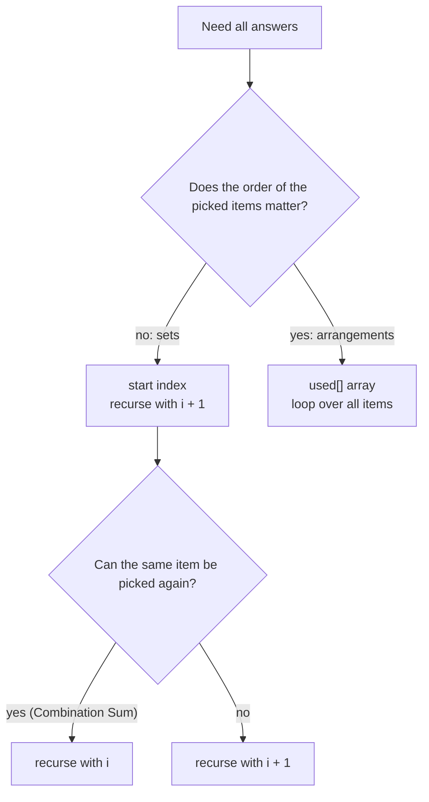

# Subsets, Combinations, Permutations: The Three Core Families

> Most backtracking questions are one of three shapes. They differ in only two details: **where the loop starts** and **whether you reuse elements**.

#### 1. What Is It?

| Family | Order matters? | Reuse an element? | Loop | Save when |
|---|---|---|---|---|
| **Subsets** | no | no | `for (i in start until n)`, recurse `i + 1` | at **every** node |
| **Combinations** (size `k`, or sum = target) | no | no (or yes in Combination Sum) | `for (i in start until n)`, recurse `i + 1` (or `i`) | when the size or sum is reached |
| **Permutations** | **yes** | no | `for (i in 0 until n)` with a `used[]` array | when `path.size == n` |

**Signals:** "all subsets", "all combinations of size k", "combinations that sum to", "all orderings / arrangements", "all strings from a phone keypad".

#### 2. How It Works

**Subsets and combinations use a `start` index.** After you pick `nums[i]`, the next pick comes from `i + 1` onward. This makes `[1, 2]` and `[2, 1]` the same set, so each set is generated **once**.

**Permutations use a `used` array.** Every position can take **any** unused element, so `[1, 2]` and `[2, 1]` are both produced.



**What changes between the common problems**

| Problem | Change from the basic template |
|---|---|
| Subsets (78) | save at every node |
| Combinations (77) | save when `path.size == k` |
| Combination Sum (39) | reuse allowed: recurse with `i`; stop when the sum is reached or exceeded |
| Combination Sum III (216) | use digits `1..9` once, size `k`, sum `n` |
| Permutations (46) | `used[]`, save at size `n` |
| Letter Combinations (17) | one digit per level, loop over that digit's letters |

**Pruning for combinations of size `k`:** you need `k − path.size` more items, so `i` can stop at `n − (k − path.size) + 1`.

```text
combinations of [1,2,3,4], k = 2:
choose 1 → choose 2 → save [1,2]; choose 3 → [1,3]; choose 4 → [1,4]
choose 2 → [2,3], [2,4];   choose 3 → [3,4]
6 answers = C(4, 2)
```

#### 3. Brute Force vs Optimized

| Approach | Work |
|---|---|
| Generate all subsets, then keep those of size `k` | `2ⁿ` always |
| **Combinations with a start index and a size check** | only `C(n, k)` answers, plus pruned prefixes |
| All permutations then remove duplicates with a `Set` | extra memory and time |

```kotlin
// Brute force combinations: build all subsets (bitmask), keep the ones of size k
fun combineBrute(n: Int, k: Int): List<List<Int>> {
    val result = mutableListOf<List<Int>>()
    for (mask in 0 until (1 shl n)) {
        if (Integer.bitCount(mask) == k) result.add((0 until n).filter { ((mask shr it) and 1) == 1 }.map { it + 1 })
    }
    return result
}
```

#### 4. Kotlin Code

```kotlin
// Combinations (LeetCode 77): choose k of 1..n
fun combine(n: Int, k: Int): List<List<Int>> {
    val result = mutableListOf<List<Int>>()
    val path = mutableListOf<Int>()
    fun backtrack(start: Int) {
        if (path.size == k) { result.add(path.toList()); return }
        for (i in start..n - (k - path.size) + 1) {             // prune: leave room for the rest
            path.add(i); backtrack(i + 1); path.removeAt(path.size - 1)
        }
    }
    backtrack(1)
    return result
}

// Combination Sum (LeetCode 39): reuse allowed
fun combinationSum(candidates: IntArray, target: Int): List<List<Int>> {
    val sorted = candidates.sortedArray()
    val result = mutableListOf<List<Int>>()
    val path = mutableListOf<Int>()
    fun backtrack(start: Int, remaining: Int) {
        if (remaining == 0) { result.add(path.toList()); return }
        for (i in start until sorted.size) {
            if (sorted[i] > remaining) break
            path.add(sorted[i]); backtrack(i, remaining - sorted[i]); path.removeAt(path.size - 1)
        }
    }
    backtrack(0, target)
    return result
}

// Combination Sum III (LeetCode 216): k digits from 1..9, each once, adding up to n
fun combinationSum3(k: Int, n: Int): List<List<Int>> {
    val result = mutableListOf<List<Int>>()
    val path = mutableListOf<Int>()
    fun backtrack(start: Int, remaining: Int) {
        if (path.size == k) { if (remaining == 0) result.add(path.toList()); return }
        for (d in start..9) {
            if (d > remaining) break
            path.add(d); backtrack(d + 1, remaining - d); path.removeAt(path.size - 1)
        }
    }
    backtrack(1, n)
    return result
}

// Letter Combinations of a Phone Number (LeetCode 17)
fun letterCombinations(digits: String): List<String> {
    if (digits.isEmpty()) return emptyList()
    val letters = arrayOf("", "", "abc", "def", "ghi", "jkl", "mno", "pqrs", "tuv", "wxyz")
    val result = mutableListOf<String>()
    val sb = StringBuilder()
    fun backtrack(index: Int) {
        if (index == digits.length) { result.add(sb.toString()); return }
        for (c in letters[digits[index] - '0']) {
            sb.append(c); backtrack(index + 1); sb.deleteCharAt(sb.length - 1)
        }
    }
    backtrack(0)
    return result
}
```

Subsets and Permutations are in note 1.

Checks: `combine(4, 2)` → `[[1, 2], [1, 3], [1, 4], [2, 3], [2, 4], [3, 4]]`. `combine(1, 1)` → `[[1]]`. `combineBrute(4, 2).size` → `6`. `combinationSum(intArrayOf(2, 3, 6, 7), 7)` → `[[2, 2, 3], [7]]`. `combinationSum3(3, 7)` → `[[1, 2, 4]]`. `combinationSum3(3, 9)` → `[[1, 2, 6], [1, 3, 5], [2, 3, 4]]`. `letterCombinations("23")` → `["ad", "ae", "af", "bd", "be", "bf", "cd", "ce", "cf"]`. `letterCombinations("")` → `[]`.

#### 5. Complexity

| | Time | Space |
|---|---|---|
| Subsets | `O(n · 2ⁿ)` | `O(n)` |
| Combinations | `O(k · C(n, k))` | `O(k)` |
| Combination Sum | up to `O(2^(target/min))` | `O(target / min)` |
| Permutations | `O(n · n!)` | `O(n)` |
| Letter Combinations | `O(4ⁿ · n)` | `O(n)` |

#### 6. Common Mistakes

1. **Combinations with a loop from `0` every time**, producing `[1,2]` and `[2,1]` as different answers.
2. **Recursing with `i` instead of `i + 1`** when reuse is not allowed (or the reverse).
3. **Permutations without `used`** (the same element appears twice).
4. **Saving `path`, not a copy.**
5. **No sort / break** in Combination Sum, so it explores hopeless branches.
6. **Using a `start` index for permutations** (it loses orders).

#### 7. Say This in the Interview

1. "Subsets and combinations use a start index so each set is generated once. Permutations use a `used` array because order matters."
2. "In Combination Sum I recurse with `i` because the same number can repeat, and I sort and break when a candidate is too big."
3. "Time is the number of answers times the copy cost: `n · 2ⁿ` for subsets and `n · n!` for permutations."

#### 8. Quick Check

1. Which family uses a `used` array?
2. How many combinations of size 3 from 5 items?
3. What changes to allow reuse of an element?

<details>
<summary>Answers</summary>

1. Permutations.
2. `C(5, 3) = 10`.
3. Recurse with `i` instead of `i + 1`.

</details>

#### 9. Related LeetCode Questions

| # | Question | Idea |
|---|---|---|
| 78 | [Subsets](https://leetcode.com/problems/subsets/) (Medium) | save at every node |
| 77 | [Combinations](https://leetcode.com/problems/combinations/) (Medium) | size `k` |
| 39 | [Combination Sum](https://leetcode.com/problems/combination-sum/) (Medium) | reuse allowed |
| 216 | [Combination Sum III](https://leetcode.com/problems/combination-sum-iii/) (Medium) | size and sum |
| 46 | [Permutations](https://leetcode.com/problems/permutations/) (Medium) | `used[]` |
| 17 | [Letter Combinations of a Phone Number](https://leetcode.com/problems/letter-combinations-of-a-phone-number/) (Medium) | one choice per digit |
