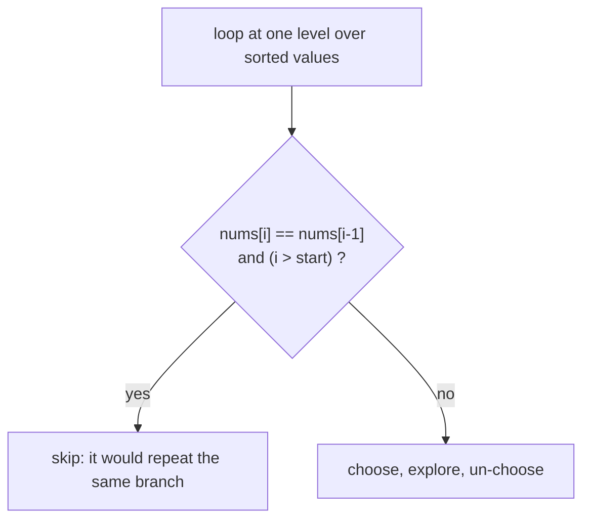

# Handling Duplicates: Sort and Skip Equal Siblings

> When the input has repeated values, the same answer can be built in several ways. **Sort first**, then **skip a value that equals the previous one at the same level**.

#### 1. What Is It?

If `nums = [1, 2, 2]`, picking the first `2` or the second `2` gives the same subset `[1, 2]`. Plain backtracking would produce it **twice**. The fix is two small rules:

1. **Sort** the array, so equal values are next to each other.
2. In the loop, **skip** `nums[i]` if it equals `nums[i − 1]` **and** you are choosing among the **same siblings**.

| Problem | Skip rule |
|---|---|
| **Subsets II** (90) | `if (i > start && nums[i] == nums[i − 1]) continue` |
| **Combination Sum II** (40) | same |
| **Permutations II** (47) | `if (i > 0 && nums[i] == nums[i − 1] && !used[i − 1]) continue` |

**Signals:** "may contain duplicates", "return unique subsets / combinations / permutations".

#### 2. How It Works

**Why `i > start` and not `i > 0`.** `i > start` means "this is not the first choice at this level". Only **siblings** (alternatives at the same level) are compared. A duplicate used **deeper** (a second `2` after choosing the first `2`) is still allowed.

```text
Subsets II, nums = [1, 2, 2] (sorted)
level 1 loop: i=0 → pick 1.   i=1 → pick 2.   i=2: nums[2] == nums[1] and i > start(0) → SKIP (same as sibling)
under pick 1, level 2 loop (start=1): i=1 → pick 2 → [1,2].   i=2: equal to i=1 and i > start(1) → SKIP
under [1,2], level 3 loop (start=2): i=2 → pick 2 → [1,2,2]   (i == start, so allowed: this is the "second 2" used deeper)
result: [], [1], [1,2], [1,2,2], [2], [2,2]
```

**Permutations II** can use the second `2` before the first only if the first is already placed. The rule `!used[i − 1]` means "the previous equal element is **not** in the current path", so choosing this one first would create a duplicate order, and it is skipped.



**Alternative:** generate everything and put results in a `HashSet`. It works, but wastes time and memory building duplicates. Skipping is cleaner.

#### 3. Brute Force vs Optimized

| Approach | Time | Space |
|---|---|---|
| Generate all, then remove duplicates with a `Set<List<Int>>` | extra `O(total · n)` | stores duplicates |
| **Sort + skip equal siblings** | no duplicates generated | `O(n)` |

```kotlin
// Brute force: generate all subsets and de-duplicate afterwards
fun subsetsWithDupBrute(nums: IntArray): List<List<Int>> {
    val sorted = nums.sortedArray()
    val seen = LinkedHashSet<List<Int>>()
    for (mask in 0 until (1 shl sorted.size)) {
        seen.add(sorted.indices.filter { ((mask shr it) and 1) == 1 }.map { sorted[it] })
    }
    return seen.toList()
}
```

#### 4. Kotlin Code

```kotlin
// Subsets II (LeetCode 90)
fun subsetsWithDup(nums: IntArray): List<List<Int>> {
    nums.sort()
    val result = mutableListOf<List<Int>>()
    val path = mutableListOf<Int>()
    fun backtrack(start: Int) {
        result.add(path.toList())
        for (i in start until nums.size) {
            if (i > start && nums[i] == nums[i - 1]) continue        // skip an equal sibling
            path.add(nums[i]); backtrack(i + 1); path.removeAt(path.size - 1)
        }
    }
    backtrack(0)
    return result
}

// Combination Sum II (LeetCode 40): each number used at most once
fun combinationSum2(candidates: IntArray, target: Int): List<List<Int>> {
    candidates.sort()
    val result = mutableListOf<List<Int>>()
    val path = mutableListOf<Int>()
    fun backtrack(start: Int, remaining: Int) {
        if (remaining == 0) { result.add(path.toList()); return }
        for (i in start until candidates.size) {
            if (i > start && candidates[i] == candidates[i - 1]) continue
            if (candidates[i] > remaining) break
            path.add(candidates[i]); backtrack(i + 1, remaining - candidates[i]); path.removeAt(path.size - 1)
        }
    }
    backtrack(0, target)
    return result
}

// Permutations II (LeetCode 47)
fun permuteUnique(nums: IntArray): List<List<Int>> {
    nums.sort()
    val result = mutableListOf<List<Int>>()
    val path = mutableListOf<Int>()
    val used = BooleanArray(nums.size)
    fun backtrack() {
        if (path.size == nums.size) { result.add(path.toList()); return }
        for (i in nums.indices) {
            if (used[i]) continue
            if (i > 0 && nums[i] == nums[i - 1] && !used[i - 1]) continue     // same value, previous not placed
            used[i] = true; path.add(nums[i])
            backtrack()
            path.removeAt(path.size - 1); used[i] = false
        }
    }
    backtrack()
    return result
}
```

Checks: `subsetsWithDup(intArrayOf(1, 2, 2))` → `[[], [1], [1, 2], [1, 2, 2], [2], [2, 2]]`. `subsetsWithDupBrute(intArrayOf(1, 2, 2))` → the same 6 subsets. `subsetsWithDup(intArrayOf(0))` → `[[], [0]]`. `combinationSum2(intArrayOf(10, 1, 2, 7, 6, 1, 5), 8)` → `[[1, 1, 6], [1, 2, 5], [1, 7], [2, 6]]`. `combinationSum2(intArrayOf(2, 5, 2, 1, 2), 5)` → `[[1, 2, 2], [5]]`. `permuteUnique(intArrayOf(1, 1, 2))` → `[[1, 1, 2], [1, 2, 1], [2, 1, 1]]`. `permuteUnique(intArrayOf(1, 2, 3)).size` → `6`.

#### 5. Complexity

| | Time | Space |
|---|---|---|
| Subsets II | `O(n · 2ⁿ)` worst case (all distinct) | `O(n)` |
| Combination Sum II | `O(2ⁿ)` worst case | `O(n)` |
| Permutations II | `O(n · n!)` worst case (all distinct) | `O(n)` |

With many duplicates the real work is much smaller.

#### 6. Common Mistakes

1. **Forgetting to sort.** The skip rule only works when equal values are adjacent.
2. **Using `i > 0` instead of `i > start`** (skips valid answers like `[1, 2, 2]`).
3. **Permutations II: using `used[i − 1]` instead of `!used[i − 1]`** (a different, also valid rule, but mixing them breaks the result).
4. **Skipping in the wrong place** (after the choose step instead of before).
5. **Not sorting a copy** when you must keep the input (`nums.sort()` changes the input array).
6. **Using a `Set` of lists** when the interviewer wants a cleaner, faster solution.

#### 7. Say This in the Interview

1. "With duplicates, the same set can be built in more than one way. I sort the input, and skip a value that equals the previous one **at the same level** (`i > start`), so each set is generated once."
2. "Using `i > start` (not `i > 0`) still lets me use two equal values in one answer, one level deeper."
3. "This avoids generating duplicates, so it's better than building everything and de-duplicating with a set."

#### 8. Quick Check

1. How many unique permutations of `[1, 1, 2]`?
2. Why sort first?
3. Why `i > start` and not `i > 0`?

<details>
<summary>Answers</summary>

1. `3`.
2. So equal values are neighbours and the "equal to previous" check finds them.
3. `i > 0` would also skip the second `2` at deeper levels, losing answers like `[1, 2, 2]`.

</details>

#### 9. Related LeetCode Questions

| # | Question | Idea |
|---|---|---|
| 90 | [Subsets II](https://leetcode.com/problems/subsets-ii/) (Medium) | sort + skip siblings |
| 40 | [Combination Sum II](https://leetcode.com/problems/combination-sum-ii/) (Medium) | sort + skip + break |
| 47 | [Permutations II](https://leetcode.com/problems/permutations-ii/) (Medium) | `!used[i − 1]` rule |
| 491 | [Non-decreasing Subsequences](https://leetcode.com/problems/non-decreasing-subsequences/) (Medium) | per-level set instead of sort |
| 996 | [Number of Squareful Arrays](https://leetcode.com/problems/number-of-squareful-arrays/) (Hard) | permutations with duplicates |
| 267 | [Palindrome Permutation II](https://leetcode.com/problems/palindrome-permutation-ii/) (Medium, premium) | counts to avoid duplicates |
