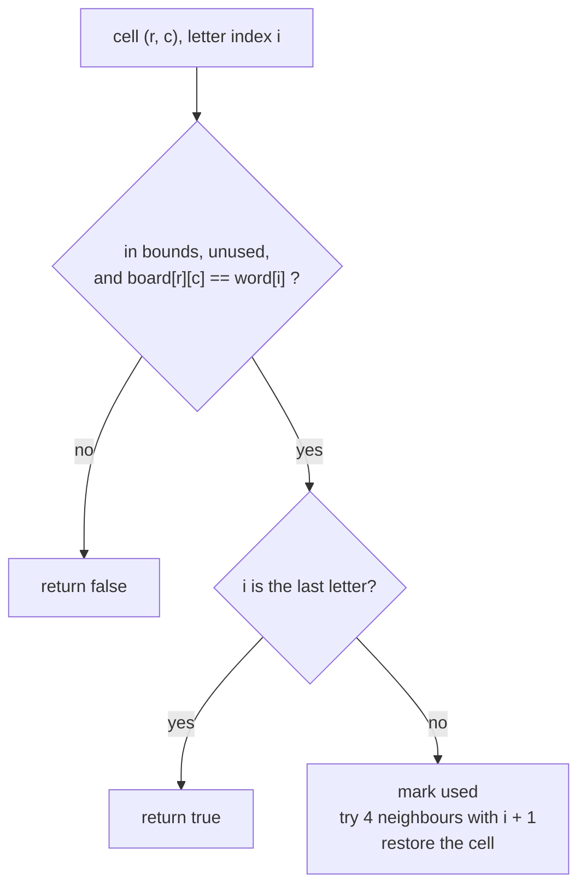

# Grid & String Backtracking: Word Search, Parentheses, Partitions

> Backtracking on a grid (mark a cell, undo it) and on a string (choose where to cut). The state is a position, not a list of numbers.

#### 1. What Is It?

| Problem | Decision | State |
|---|---|---|
| **Word Search** (79) | which neighbouring cell comes next | `(row, col, index in word)` |
| **Generate Parentheses** (22) | add `(` or `)` | `(open, close)` counts |
| **Palindrome Partitioning** (131) | where to end the next piece | start index in the string |
| **Restore IP Addresses** (93) | where to end the next number | start index and parts used |

**Signals:** a grid and a word, "all ways to split a string", "all valid strings of length n".

#### 2. How It Works

**Word Search.** From each cell try to match `word[0]`. For each next letter, move to one of the 4 neighbours that matches. **Mark the cell as used** (for example change it to `#`) so the path does not reuse it, and **restore it** when you come back.



**Palindrome Partitioning.** At position `start`, try every end `end` such that `s[start..end]` is a palindrome. Add that piece and recurse from `end + 1`. When `start == s.length`, save the pieces.

```text
"aab":  start 0:  "a" → start 1: "a" → start 2: "b" → save [a, a, b]
                                   "ab" not a palindrome
                  "aa" → start 2: "b" → save [aa, b]
```

**Generate Parentheses** is in note 2. The state is `(open, close)`, and the two rules keep every prefix valid.

**Restore IP Addresses.** A valid part is `0..255` with no leading zero (except `"0"` itself). Cut the string into exactly 4 parts. Prune when the remaining characters cannot fill the remaining parts (each part has 1 to 3 digits).

**Grid tip:** instead of a `visited` array, change the cell in place and put it back. It uses no extra memory.

#### 3. Brute Force vs Optimized

| Problem | Brute force | Backtracking |
|---|---|---|
| Word Search | generate every path of length `L` and compare | stop at the first mismatch: `O(m · n · 3^L)` |
| Palindrome Partitioning | all `2^(n−1)` ways to cut, test each piece | cut only at palindromes (with a DP table, each test is `O(1)`) |
| Restore IPs | all ways to place 3 dots, check | prune invalid parts early |

```kotlin
// Brute force palindrome partitioning: try every way to place cuts (bitmask), keep valid ones
fun partitionBrute(s: String): List<List<String>> {
    val result = mutableListOf<List<String>>()
    fun isPal(t: String) = t == t.reversed()
    for (mask in 0 until (1 shl (s.length - 1))) {
        val parts = mutableListOf<String>()
        var begin = 0
        for (i in 0 until s.length - 1) {
            if (((mask shr i) and 1) == 1) { parts.add(s.substring(begin, i + 1)); begin = i + 1 }
        }
        parts.add(s.substring(begin))
        if (parts.all { isPal(it) }) result.add(parts)
    }
    return result
}
```

#### 4. Kotlin Code

```kotlin
// Word Search (LeetCode 79)
fun exist(board: Array<CharArray>, word: String): Boolean {
    val rows = board.size
    val cols = board[0].size
    fun dfs(r: Int, c: Int, i: Int): Boolean {
        if (i == word.length) return true
        if (r !in 0 until rows || c !in 0 until cols || board[r][c] != word[i]) return false
        val saved = board[r][c]
        board[r][c] = '#'                                             // choose: mark as used
        val found = dfs(r + 1, c, i + 1) || dfs(r - 1, c, i + 1) ||
                    dfs(r, c + 1, i + 1) || dfs(r, c - 1, i + 1)      // explore
        board[r][c] = saved                                           // un-choose: restore
        return found
    }
    for (r in 0 until rows) for (c in 0 until cols) if (dfs(r, c, 0)) return true
    return false
}

// Palindrome Partitioning (LeetCode 131)
fun partition(s: String): List<List<String>> {
    val result = mutableListOf<List<String>>()
    val path = mutableListOf<String>()
    fun isPalindrome(l: Int, r: Int): Boolean {
        var i = l; var j = r
        while (i < j) { if (s[i++] != s[j--]) return false }
        return true
    }
    fun backtrack(start: Int) {
        if (start == s.length) { result.add(path.toList()); return }
        for (end in start until s.length) {
            if (!isPalindrome(start, end)) continue                   // prune: only cut at palindromes
            path.add(s.substring(start, end + 1))
            backtrack(end + 1)
            path.removeAt(path.size - 1)
        }
    }
    backtrack(0)
    return result
}

// Restore IP Addresses (LeetCode 93)
fun restoreIpAddresses(s: String): List<String> {
    val result = mutableListOf<String>()
    val parts = mutableListOf<String>()
    fun backtrack(start: Int) {
        if (parts.size == 4) { if (start == s.length) result.add(parts.joinToString(".")); return }
        val remainingParts = 4 - parts.size
        val remainingChars = s.length - start
        if (remainingChars < remainingParts || remainingChars > remainingParts * 3) return     // prune
        for (len in 1..3) {
            if (start + len > s.length) break
            val piece = s.substring(start, start + len)
            if (piece.length > 1 && piece[0] == '0') break                // no leading zeros
            if (piece.toInt() > 255) break
            parts.add(piece); backtrack(start + len); parts.removeAt(parts.size - 1)
        }
    }
    backtrack(0)
    return result
}
```

Board for the checks: `board = arrayOf(charArrayOf('A','B','C','E'), charArrayOf('S','F','C','S'), charArrayOf('A','D','E','E'))`.

Checks: `exist(board, "ABCCED")` → `true`. `exist(board, "SEE")` → `true`. `exist(board, "ABCB")` → `false`. `partition("aab")` → `[["a", "a", "b"], ["aa", "b"]]`. `partition("a")` → `[["a"]]`. `partitionBrute("aab")` → `[["a", "a", "b"], ["aa", "b"]]` (the order may differ). `restoreIpAddresses("25525511135")` → `["255.255.11.135", "255.255.111.35"]`. `restoreIpAddresses("0000")` → `["0.0.0.0"]`. `restoreIpAddresses("101023")` → `["1.0.10.23", "1.0.102.3", "10.1.0.23", "10.10.2.3", "101.0.2.3"]`. `generateParenthesis(3)` is in note 2.

#### 5. Complexity

| | Time | Space |
|---|---|---|
| Word Search | `O(m · n · 3^L)` | `O(L)` |
| Palindrome Partitioning | `O(n · 2ⁿ)` | `O(n)` |
| Restore IP | `O(1)`-ish (at most `3⁴` cuts) | `O(1)` |

#### 6. Common Mistakes

1. **Not restoring the cell** after the recursive calls (Word Search).
2. **Reading `board[r][c]` before the bounds check.**
3. **Reusing a cell** because the used mark was not set before recursing.
4. **Palindrome Partitioning:** checking palindromes by building reversed strings every time (slow). Use two pointers, or a DP table.
5. **Restore IP:** allowing leading zeros (`"01"`) or values above 255.
6. **Wrong base case:** collecting when `start == s.length` but with fewer or more than 4 parts.

#### 7. Say This in the Interview

1. "For Word Search I mark the cell as used before exploring the four neighbours and restore it afterwards. It stops as soon as a letter mismatches. Time is `O(m · n · 3^L)`."
2. "For Palindrome Partitioning I only cut where the piece is a palindrome, so I never build an invalid partition."
3. "In Restore IP Addresses I prune early when the remaining characters can't fill the remaining parts."

#### 8. Quick Check

1. Why change the cell to `#` and restore it?
2. How many ways to partition `"aa"` into palindromes?
3. Maximum value of one IP part?

<details>
<summary>Answers</summary>

1. The mark stops the path reusing the cell. Restoring lets other paths use it.
2. `2`: `["a", "a"]` and `["aa"]`.
3. `255`.

</details>

#### 9. Related LeetCode Questions

| # | Question | Idea |
|---|---|---|
| 79 | [Word Search](https://leetcode.com/problems/word-search/) (Medium) | mark and restore |
| 212 | [Word Search II](https://leetcode.com/problems/word-search-ii/) (Hard) | trie + backtracking |
| 22 | [Generate Parentheses](https://leetcode.com/problems/generate-parentheses/) (Medium) | open / close counts |
| 131 | [Palindrome Partitioning](https://leetcode.com/problems/palindrome-partitioning/) (Medium) | cut at palindromes |
| 93 | [Restore IP Addresses](https://leetcode.com/problems/restore-ip-addresses/) (Medium) | four parts, prune |
| 1219 | [Path with Maximum Gold](https://leetcode.com/problems/path-with-maximum-gold/) (Medium) | grid DFS with undo |
